# Cálculo Diferencial e Integral I: Dos Fundamentos de $\mathbb{R}$ à Fórmula de Taylor e Quadraturas Clássicas
## Tratado Didático Rigoroso Baseado em *Um Curso de Cálculo — Vol. 1* (H. L. Guidorizzi, 5ª Edição) e Complementado por *Cálculo I* (Tom M. Apostol, 2ª Edição)

---

> **Navegação Rápida entre os Papers deste Repositório (GitHub Pages):**
> - 📄 **[Paper 1 — Tratado Teórico Principal (Você está aqui)](./index.html)** | [Versão Markdown](./Paper_Calculo_1_Guidorizzi_Apostol.md)
> - 📝 **[Paper 2 — Caderno de Exercícios Resolvidos e Problemas Clássicos (Guidorizzi + Apostol)](./exercicios.html)** | [Versão Markdown](./Caderno_Exercicios_Calculo_1.md)
> - ⚖️ **[Paper 3 — Guia Comparativo de Arquitetura Teórica: Guidorizzi (5ª ed.) vs. Apostol (Cálculo I)](./comparativo-guidorizzi-apostol.html)** | [Versão Markdown](./Comparativo_Guidorizzi_vs_Apostol.md)

---

> **Resumo (*Abstract*) e Convenção de Referências**  
> Este documento constitui um tratado didático rigoroso de **Cálculo Diferencial e Integral de Uma Variável Real (Cálculo 1)**, construído com fidelidade estrita à estrutura conceitual, às definições, às hipóteses dos teoremas e às demonstrações de ***Um Curso de Cálculo — Volume 1*, 5ª edição (2001/2013), de Hamilton Luiz Guidorizzi (LTC)**, abrangendo integralmente seus **17 capítulos e 6 apêndices**. De forma complementar — e **sempre sinalizada explicitamente** —, utilizamos a obra clássica ***Cálculo I: Cálculo com funções de uma variável, com uma introdução à Álgebra Linear*, 2ª edição, de Tom M. Apostol (Editorial Reverté)**, para enriquecer o texto com formulações axiomáticas, interpretações por funções em escada (Darboux), a construção integral do logaritmo e o Teorema da Derivada de Funções Definidas por Integral (que Guidorizzi reserva para o Volume 2).  
> Para absoluta transparência epistemológica, toda mudança de referência ao longo do texto é identificada pelos selos:
> - 📘 **[Referência Principal — Guidorizzi, Vol. 1, 5ª ed., Cap. X, Seção X.Y]**: segue fielmente a nomenclatura, a ordem lógica e as hipóteses de Guidorizzi.
> - 📙 **[Mudança de Referência / Complemento — Apostol, Cálculo I, Cap. Y, Seção Y.Z]**: indica que o conceito, demonstração alternativa ou tópico complementar provém da abordagem de Tom M. Apostol (ou antecipa tópicos do Volume 2 de Guidorizzi presentes no Volume 1 de Apostol).

---

## Mapa Estrutural Completo: Guidorizzi (5ª Edição, Cap. 1–17 e Apêndices 1–6) e Complementos de Apostol

| Seção deste Tratado | Referência Principal: Guidorizzi (Vol. 1, 5ª ed.) | Complemento Sinalizado: Apostol (*Cálculo I*) | Figuras e Exercícios |
| :--- | :--- | :--- | :--- |
| **0. Números Reais e Funções** | **Cap. 1** (*Números Reais*), **Cap. 2** (*Funções*), **Apêndices 1, 3 e 6** | **Parte I.3** (*Axiomas de $\mathbb{R}$ e Supremo*) e **Parte I.4** (*Indução e Somatórios*) | [Exercícios Cap. 1–2](./exercicios.html#cap-1-2) |
| **1. Limite e Continuidade** | **Cap. 3** (*Limite e Continuidade*, Seções 3.1–3.9) | **Cap. 3** (*Funções Contínuas*, Seções 3.1–3.7) | [Fig. 1](./assets/figuras/fig01_continuidade_limite_eps_delta.svg), [Fig. 2](./assets/figuras/fig02_limite_fundamental_trigonometrico.svg) e [Exercícios Cap. 3](./exercicios.html#cap-3) |
| **2. Extensões do Limite e $e$** | **Cap. 4** (*Extensões do Conceito de Limite*, Seções 4.1–4.5) e **Apêndice 1 (A1.4)** | **Cap. 7** (Seções 7.14–7.15) e **Cap. 10** (*Sucessões Monótonas*, Seções 10.2–10.4) | [Fig. 4a](./assets/figuras/fig04_exponencial_logaritmo_numero_e.svg) e [Exercícios Cap. 4](./exercicios.html#cap-4) |
| **3. Teoremas Globais em $[a,b]$** | **Cap. 5** (*Anulamento, Valor Intermediário e Weierstrass*) e **Apêndice 2** | **Cap. 3** (*Bolzano, TVI, Extremos e Continuidade Uniforme*, Seções 3.8–3.17) | [Fig. 3](./assets/figuras/fig03_teoremas_globais_bolzano_weierstrass.svg) e [Exercícios Cap. 5](./exercicios.html#cap-5) |
| **4. Exponencial e Logaritmo** | **Cap. 6** (*Funções Exponencial e Logarítmica*, Seções 6.1–6.3) e **Apêndice 3** | **Cap. 6** (*Logaritmo como Integral $\int_1^x \frac{dt}{t}$ e Exponencial*, Seções 6.1–6.15) | [Fig. 4](./assets/figuras/fig04_exponencial_logaritmo_numero_e.svg) e [Exercícios Cap. 6](./exercicios.html#cap-6) |
| **5. Derivadas** | **Cap. 7** (*Derivadas*, Seções 7.1–7.17) | **Cap. 4** (*Cálculo Diferencial*, Seções 4.1–4.11) | [Fig. 5](./assets/figuras/fig05_derivada_secante_tangente_diferencial.svg) e [Exercícios Cap. 7](./exercicios.html#cap-7) |
| **6. Funções Inversas** | **Cap. 8** (*Funções Inversas*, Seções 8.1–8.2) | **Cap. 3** (Seções 3.12–3.14) e **Cap. 6** (Seções 6.18–6.21) | [Fig. 6](./assets/figuras/fig06_funcoes_inversas_trigonometricas.svg) e [Exercícios Cap. 8](./exercicios.html#cap-8) |
| **7. TVM, Variação e Cauchy** | **Cap. 9** (*Estudo da Variação*, 9.1–9.8) e **Cap. 15** (*Rolle, TVM e Cauchy*, 15.1–15.3) | **Cap. 4** (Seções 4.12–4.20) e **Cap. 7** (*L'Hospital*, Seções 7.12–7.16) | [Fig. 7](./assets/figuras/fig07_rolle_tvm_concavidade_inflexao.svg) e [Exercícios Cap. 9 e 15](./exercicios.html#cap-9-15) |
| **8. Primitivas e Integral de Riemann** | **Cap. 10** (*Primitivas*), **Cap. 11** (*Integral de Riemann*, 11.1–11.8) e **Apêndice 4** | **Cap. 1** (*Funções em Escada*), **Cap. 2**, **Cap. 3 (3.19)** e **Cap. 5** (*1º e 2º TFC*) | [Fig. 8](./assets/figuras/fig08_soma_riemann_vs_escada_apostol.svg) e [Exercícios Cap. 10–11](./exercicios.html#cap-10-11) |
| **9. Técnicas de Primitivação** | **Cap. 12** (*Técnicas de Primitivação*, Seções 12.1–12.11) | **Cap. 5** (Seções 5.7–5.10) e **Cap. 6** (*Frações Simples*, Seções 6.22–6.25) | [Exercícios Cap. 12](./exercicios.html#cap-12) |
| **10. Aplicações da Integral e Polares** | **Cap. 13** (*Volumes, Áreas, Comprimento, Polares e Centro de Massa*, 13.1–13.9) e **Apêndice 5** | **Cap. 2** (*Áreas, Polares, Volumes, Trabalho*, Seções 2.1–2.18) | [Fig. 9](./assets/figuras/fig09_solidos_revolucao_discos_cascas.svg), [Fig. 10](./assets/figuras/fig10_coordenadas_polares_cardioide.svg) e [Exercícios Cap. 13](./exercicios.html#cap-13) |
| **11. EDOs de 1ª Ordem** | **Cap. 14** (*EDOs de Variáveis Separáveis e Lineares*, Seções 14.1–14.6) | **Cap. 8** (*Introdução às Equações Diferenciais e Campos Direcionais*, Seções 8.1–8.7, 8.21–8.26) | [Fig. 11](./assets/figuras/fig11_edo_campo_direcoes_solucoes.svg) e [Exercícios Cap. 14](./exercicios.html#cap-14) |
| **12. Fórmula e Polinômios de Taylor** | **Cap. 16** (*Fórmula de Taylor*, Seções 16.1–16.3) | **Cap. 7** (*Aproximação Polinomial de Funções e Notação $o$*, Seções 7.1–7.11) | [Fig. 12a](./assets/figuras/fig12_polinomios_taylor_arquimedes.svg) e [Exercícios Cap. 16](./exercicios.html#cap-16) |
| **13. Arquimedes, Pascal e Fermat** | **Cap. 17** (*Arquimedes, Pascal, Fermat e o Cálculo de Áreas*, Seções 17.1–17.3) | **Parte I.1** (*Método de Exaustão de Arquimedes*) e **Parte I.4** (*Indução Matemática*) | [Fig. 12b](./assets/figuras/fig12_polinomios_taylor_arquimedes.svg) e [Exercícios Cap. 17](./exercicios.html#cap-17) |

---

## 0. Preliminares: O Corpo Ordenado Completo $\mathbb{R}$ e as Funções Elementares (Capítulos 1 e 2)

> 📘 **[Referência Principal — Guidorizzi, Vol. 1, 5ª ed., Cap. 1 (Seções 1.1–1.7), Cap. 2 (Seções 2.1–2.4) e Apêndices 1, 3 e 6]**

### 0.1 De $\mathbb{Q}$ a $\mathbb{R}$: Propriedade do Supremo, Intervalos Encaixantes e Arquimedes
No Capítulo 1, Guidorizzi parte da insuficiência geométrica do corpo ordenado dos números racionais $\mathbb{Q} = \left\{\frac{a}{b} \;\middle|\; a, b \in \mathbb{Z}, b \neq 0\right\}$: existem segmentos geométricos (como a hipotenusa de um triângulo retângulo de catetos $1$, pois não há racional $p/q$ irredutível com $(p/q)^2 = 2 \iff p^2 = 2q^2$) que não possuem medida racional.

A estrutura algébrica de $\mathbb{R}$ como **corpo ordenado** baseia-se nas propriedades da adição ($A_1$ a $A_4$), multiplicação ($M_1$ a $M_4$), distributividade ($D$) e ordem ($O_1$ a $O_4$, $OA$ e $OM$). Contudo, como tanto $\mathbb{Q}$ quanto $\mathbb{R}$ são corpos ordenados, o que distingue $\mathbb{R}$ de $\mathbb{Q}$ — eliminando todas as "lacunas" da reta — é a **Completude**, apresentada por Guidorizzi em três níveis de aprofundamento:

1. **No Texto Principal (Seção 1.5) — Propriedade dos Intervalos Encaixantes e Propriedade de Arquimedes:**  
   Para permitir um início ágil do curso sem exigir a teoria de supremo no primeiro dia de aula, Guidorizzi destaca na Seção 1.5 duas propriedades fundamentais (demonstradas no Apêndice 1):
   - **Propriedade dos Intervalos Encaixantes (Cantor):** Seja $[a_0, b_0], [a_1, b_1], [a_2, b_2], \dots, [a_n, b_n], \dots$ uma sequência de intervalos fechados e limitados satisfazendo **duas condições**:
     $$\text{(i) } [a_0, b_0] \supset [a_1, b_1] \supset [a_2, b_2] \supset \dots \supset [a_n, b_n] \supset \dots \quad (\text{cada intervalo contém o seguinte});$$
     $$\text{(ii) para todo } r > 0, \text{ existe um natural } n \in \mathbb{N} \text{ tal que } b_n - a_n < r \quad (\text{o comprimento tende a zero}).$$
     Nestas condições, **existe um único número real $\alpha$ que pertence a todos os intervalos da sequência**, isto é, existe um único $\alpha \in \mathbb{R}$ tal que $a_n \le \alpha \le b_n$ para todo $n \in \mathbb{N}$ ($\bigcap_{n=0}^{\infty} [a_n, b_n] = \{\alpha\}$).
   - **Propriedade de Arquimedes:** Se $x > 0$ e $y$ são dois reais quaisquer, então existe pelo menos um número natural $n \in \mathbb{N}$ tal que:
     $$nx > y$$
     *(Consequências imediatas do Exemplo da Seção 1.5: (a) para todo $x \in \mathbb{R}$, existe $n \in \mathbb{N}$ tal que $n > x$; (b) para todo $x > 0$, existe $n \in \mathbb{N}^*$ tal que $\frac{1}{n} < x$).*

2. **No Apêndice 1 (Seções A1.1–A1.3) — A Propriedade do Supremo como Fonte da Completude:**  
   Um conjunto $A \subset \mathbb{R}$ é **limitado superiormente** se existe $m \in \mathbb{R}$ (*cota superior*) tal que $x \le m$ para todo $x \in A$. A **menor das cotas superiores** de $A$ denomina-se **supremo de $A$** ($\sup A$); analogamente, a **maior das cotas inferiores** de um conjunto limitado inferiormente denomina-se **ínfimo de $A$** ($\inf A$).
   > **Propriedade do Supremo (Seção A1.2):** *Todo subconjunto de $\mathbb{R}$, não vazio e limitado superiormente, admite supremo (em $\mathbb{R}$).*

   > **⚠️ Alerta Conceitual Importante (Correção de Erro Clássico):**  
   > **Jamais diga que a Propriedade de Arquimedes "equivale" à Propriedade do Supremo!** O corpo $\mathbb{Q}$ dos números racionais **satisfaz** a Propriedade de Arquimedes (dados $x, y \in \mathbb{Q}$ com $x > 0$, existe $n \in \mathbb{N}$ com $nx > y$), mas $\mathbb{Q}$ **não satisfaz** a Propriedade do Supremo (por exemplo, $A = \{p \in \mathbb{Q}_+ \mid p^2 < 2\}$ é não vazio e limitado superiormente em $\mathbb{Q}$, mas não tem supremo em $\mathbb{Q}$).  
   > Na arquitetura lógica de Guidorizzi (**Apêndice 1**):
   > $$\boxed{\text{Propriedade do Supremo (A1.2)} \implies \begin{cases} \text{Propriedade de Arquimedes (Exemplo 2, A1.2)} \\ \text{Propriedade dos Intervalos Encaixantes (A1.3)} \end{cases}}$$
   > *(Reciprocamente, nos fundamentos da Análise Real, é a conjunção **Intervalos Encaixantes + Propriedade de Arquimedes** que equivale à Propriedade do Supremo).*

3. **No Apêndice 6 (Seções A6.1–A6.8) — Construção de $\mathbb{R}$ via Cortes de Dedekind:**  
   Para provar que a Propriedade do Supremo não é um ato de fé, Guidorizzi constrói $\mathbb{R}$ a partir de $\mathbb{Q}$ no Apêndice 6 definindo um **número real $\alpha$** como um subconjunto $\alpha \subset \mathbb{Q}$ (corte de Dedekind) que satisfaz: **(R1)** $\alpha \neq \emptyset$ e $\alpha \neq \mathbb{Q}$; **(R2)** se $p \in \alpha$ e $q \in \mathbb{Q}$ com $q < p$, então $q \in \alpha$; **(R3)** $\alpha$ não tem máximo. Nessa construção, a relação $\alpha \le \beta$ é a simples inclusão $\alpha \subset \beta$, e o supremo de uma família $A$ de reais limitados superiormente é simplesmente a **reunião conjuntista** $\gamma = \bigcup_{\alpha \in A} \alpha$ (Seção A6.7)!

> 📙 **[Mudança de Referência / Complemento — Apostol, Cálculo I, Parte I.3 (Seções I.3.1–I.3.12)]**  
> Em vez de construir $\mathbb{R}$ por cortes de Dedekind, **Tom M. Apostol** adota na Parte I.3 o **método axiomático de Hilbert**: postula 10 axiomas para $\mathbb{R}$ — 6 **Axiomas de Corpo** (Seção I.3.2), 3 **Axiomas de Ordem** (Seção I.3.4) e 1 **Axioma de Completitude / Extremo Superior** (Axioma 10, Seção I.3.9). Apostol destaca a caracterização operacional do supremo $s = \sup S$ (Teorema I.29, Seção I.3.11): para qualquer $h > 0$, existe pelo menos um $x \in S$ tal que $s - h < x \le s$.

---

### 0.2 Módulo, Distância na Reta e Intervalos (Seções 1.3 e 1.4 de Guidorizzi)
O **módulo (ou valor absoluto)** de $x \in \mathbb{R}$ é definido na Seção 1.3 por:
$$|x| = \begin{cases} x, & \text{se } x \ge 0 \\ -x, & \text{se } x < 0 \end{cases} \qquad \text{donde} \qquad |x| = \sqrt{x^2} \quad (\text{Seção 1.6})$$

- **Interpretação Geométrica como Distância:** Dados $p, x \in \mathbb{R}$, $|x - p|$ é a **distância de $x$ a $p$**. Assim, para $r > 0$:
  $$\boxed{|x - p| < r \iff p - r < x < p + r \iff x \in \,]p - r,\, p + r[}$$
  E a condição **$0 < |x - p| < r$** descreve todos os pontos $x$ que distam menos que $r$ de $p$, **exceto o próprio ponto $p$** ($x \in \,]p - r, p + r[ \setminus \{p\}$).
- **Desigualdade Triangular e sua Inversa (Exemplo 9 e Exercício 7 da Seção 1.3):** Quaisquer que sejam $x, y \in \mathbb{R}$:
  $$\boxed{|x + y| \le |x| + |y| \qquad \text{e} \qquad \big||x| - |y|\big| \le |x - y|}$$
  Além disso, $|x + y| = |x| + |y| \iff xy \ge 0$ (Exercício 6, Seção 1.3).
- **Notação de Intervalos no Guidorizzi (Seção 1.4):** Guidorizzi utiliza colchetes invertidos para extremidades abertas: $]a, b[ = \{x \in \mathbb{R} \mid a < x < b\}$, $[a, b] = \{x \in \mathbb{R} \mid a \le x \le b\}$, $]a, +\infty[ = \{x \in \mathbb{R} \mid x > a\}$, ressaltando que $+\infty$ e $-\infty$ **não são números reais**, mas apenas símbolos tipográficos para indicar intervalos ilimitados.

---

### 0.3 Funções Reais e a Construção Analítica de $\operatorname{sen} x$, $\cos x$ e $\pi$ (Capítulo 2 de Guidorizzi)

> 📘 **[Referência Principal — Guidorizzi, Vol. 1, 5ª ed., Cap. 2 (Seções 2.1–2.4) e Apêndice 3 (Seção A3.2)]**

Na Seção 2.1, Guidorizzi define uma **função $f$** como uma terna $(A, B, x \mapsto y)$, em que $A = D_f$ é o **domínio**, $B$ é o **contradomínio** e $x \mapsto y = f(x)$ é a regra que associa a cada $x \in A$ um único $y \in B$. O **gráfico** de $f$ é o subconjunto do plano cartesiano $G_f = \{(x, f(x)) \mid x \in D_f\}$, e a **imagem** é $\operatorname{Im}_f = \{f(x) \mid x \in D_f\}$.
- **Igualdade de Funções (Seção 2.4):** Duas funções $f: A \to \mathbb{R}$ e $g: A' \to \mathbb{R}$ são iguais ($f = g$) se, e somente se, têm o **mesmo domínio ($A = A'$) e $f(x) = g(x)$ para todo $x \in A$**.
- **Função Composta (Seção 2.4):** Dadas $f$ e $g$ com $\operatorname{Im}_f \subset D_g$, a composta **$g \circ f$** é definida em $D_{g\circ f} = D_f$ por **$(g \circ f)(x) = g(f(x))$**.

#### Como Guidorizzi Define Rigorosamente $\operatorname{sen} x$, $\cos x$ e o Número $\pi$ (Seção 2.2 e Apêndice 3)
Após motivar geometricamente o comprimento de arco no círculo trigonométrico unitário $x^2 + y^2 = 1$, Guidorizzi observa que o conceito rigoroso de comprimento de curva depende do Cálculo Integral (Capítulo 13). Para não deixar as funções trigonométricas apoiadas apenas na intuição geométrica, ele enuncia na **Seção 2.2** o teorema caracterizador:

> **Teorema de Caracterização de Seno e Cosseno (Seção 2.2):**  
> *Existe um único par de funções definidas em $\mathbb{R}$, indicadas por $\operatorname{sen}$ e $\cos$, satisfazendo as propriedades:*
> 1. $\operatorname{sen} 0 = 0$;
> 2. $\cos 0 = 1$;
> 3. $\forall a, b \in \mathbb{R}, \quad \operatorname{sen}(a - b) = \operatorname{sen} a \cos b - \operatorname{sen} b \cos a$;
> 4. $\forall a, b \in \mathbb{R}, \quad \cos(a - b) = \cos a \cos b + \operatorname{sen} a \operatorname{sen} b$;
> 5. Existe $r > 0$ tal que $0 < \operatorname{sen} x < x < \operatorname{tg} x$ para todo $x \in \,]0, r[$;
> 6. $\operatorname{sen} x > 0$ e $\cos x > 0$ para todo $x \in \,]0, a[$, onde $a$ é o menor real positivo tal que $\cos a = 0$;
> 7. **Existe $a > 0$ tal que $\cos a = 0$.** *(A partir desse menor $a > 0$ com $\cos a = 0$, Guidorizzi **define o número $\pi$ por $\pi = 2a$**, de modo que $\frac{\pi}{2}$ é o menor número positivo tal que $\cos\frac{\pi}{2} = 0$, e demonstra a Propriedade (7) no **Apêndice 3, Seção A3.2**, usando apenas as propriedades (1)–(5), o Teorema do Valor Intermediário e as derivadas de seno e cosseno!)*

---

## 1. Limite e Continuidade (Capítulo 3 de Guidorizzi)

> 📘 **[Referência Principal — Guidorizzi, Vol. 1, 5ª ed., Cap. 3 (Seções 3.1–3.9)]**

### 1.1 A Convenção de Domínio do Guidorizzi e a Ordem Pedagógica: Continuidade Primeiro, Limite Depois!
Ao final da Seção 3.1, Guidorizzi estabelece uma convenção essencial que governa todas as definições do livro:
> **Convenção Fundamental (Seção 3.1):** *"As funções de uma variável real que vão interessar ao curso são aquelas que têm por **domínio um intervalo ou uma reunião de intervalos**. Portanto, de agora em diante, sempre que nos referirmos a uma função de uma variável real e nada mencionarmos sobre seu domínio, ficará implícito que o mesmo ou é um intervalo ou uma reunião de intervalos."*

Por que essa convenção é tão importante? Porque graças a ela não existem "pontos isolados" no domínio, permitindo que Guidorizzi enuncie as definições de **função contínua (Seção 3.2)** e de **limite (Seção 3.3)** de maneira limpa e direta:

> **Definição 1.1 (Função Contínua em um Ponto — Seção 3.2):**  
> Sejam $f$ uma função e **$p$ um ponto de seu domínio ($p \in D_f$)**. Dizemos que **$f$ é contínua em $p$** se, para todo $\varepsilon > 0$ dado, existir um $\delta > 0$ ($\delta$ dependendo de $\varepsilon$ e de $p$) tal que, para todo $x \in D_f$:
> $$p - \delta < x < p + \delta \implies f(p) - \varepsilon < f(x) < f(p) + \varepsilon$$
> ou, equivalentemente, em notação de módulo:
> $$\boxed{\forall \varepsilon > 0, \;\exists \delta > 0 \text{ tal que, } \forall x \in D_f, \quad |x - p| < \delta \implies |f(x) - f(p)| < \varepsilon}$$
> Dizemos que $f$ é **contínua em $A \subset D_f$** se for contínua em todo $p \in A$, e simplesmente que **$f$ é uma função contínua** se for contínua em todo $p \in D_f$.

> **Definição 1.2 (Limite de uma Função — Seção 3.3):**  
> Sejam $f$ uma função e **$p$ um ponto do domínio de $f$ ou extremidade de um dos intervalos que compõem o domínio de $f$**. Dizemos que $f$ tem **limite $L$, em $p$**, e escrevemos
> $$\lim_{x \to p} f(x) = L$$
> se, para todo $\varepsilon > 0$ dado, existir um $\delta > 0$ tal que, para todo $x \in D_f$:
> $$\boxed{0 < |x - p| < \delta \implies |f(x) - L| < \varepsilon}$$

**Relação Exata entre Limite e Continuidade (Seção 3.3):**
- Na definição de $\lim_{x \to p} f(x) = L$, a restrição **$0 < |x - p|$ significa $x \neq p$**: o comportamento de $f$ exatamente em $x = p$ (ou mesmo o fato de $p$ pertencer ou não a $D_f$) **não interfere no limite**.
- Se $p \in D_f$, então:
  $$\boxed{f \text{ é contínua em } p \iff \lim_{x \to p} f(x) = f(p)}$$
- Se $\lim_{x \to p} f(x) = L$ existe, mas $f$ não é contínua em $p$ (seja porque $p \notin D_f$, seja porque $f(p) \neq L$), então **$L$ é exatamente o valor que $f$ deveria assumir em $p$ para tornar-se contínua nesse ponto**.

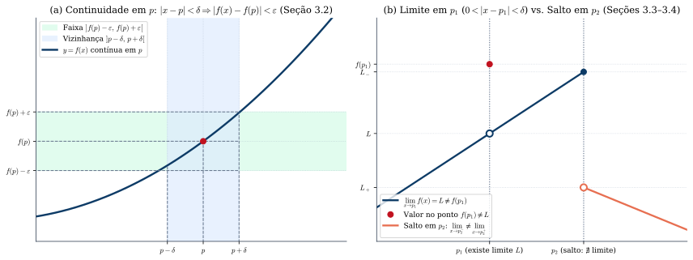
*Figura 1 — (a) Interpretação geométrica da Definição 3.2 de Guidorizzi: dada a faixa horizontal $]f(p)-\varepsilon, f(p)+\varepsilon[$, existe a vizinhança $]p-\delta, p+\delta[$ cuja imagem por $f$ cai inteiramente dentro da faixa. (b) Em $p_1$, os limites laterais coincidem com $L$, logo $\lim_{x\to p_1} f(x) = L$ mesmo sendo $f(p_1) \neq L$; em $p_2$, os limites laterais são distintos ($L_- \neq L_+$), caracterizando um salto (Seção 3.4).*

---

### 1.2 Unicidade do Limite, Limites Laterais e Conservação do Sinal (Seções 3.3 e 3.4)
1. **Unicidade do Limite (Teorema 1, Seção 3.3):** Se $\lim_{x \to p} f(x) = L_1$ e $\lim_{x \to p} f(x) = L_2$, então **$L_1 = L_2$**.
2. **Teorema da Conservação do Sinal (Teorema 2, Seção 3.3):** Se $\lim_{x \to p} f(x) = L$, então:
   - Se **$L > 0$**, existe $\delta > 0$ tal que, para todo $x \in D_f$, $0 < |x - p| < \delta \implies f(x) > 0$;
   - Se **$L < 0$**, existe $\delta > 0$ tal que, para todo $x \in D_f$, $0 < |x - p| < \delta \implies f(x) < 0$.
   *(Demonstração: Para $L > 0$, basta tomar $\varepsilon = \frac{L}{2} > 0$ na definição de limite, obtendo $0 < |x - p| < \delta \implies \frac{L}{2} = L - \varepsilon < f(x) < L + \varepsilon \implies f(x) > 0$!)*
3. **Limites Laterais (Seção 3.4):**
   - **Limite à direita ($x \to p^+$):** Suposto $]p, b[ \subset D_f$, $\lim_{x \to p^+} f(x) = L \iff \forall \varepsilon > 0, \exists \delta > 0 \text{ tal que } p < x < p + \delta \implies |f(x) - L| < \varepsilon$.
   - **Limite à esquerda ($x \to p^-$):** Suposto $]a, p[ \subset D_f$, $\lim_{x \to p^-} f(x) = L \iff \forall \varepsilon > 0, \exists \delta > 0 \text{ tal que } p - \delta < x < p \implies |f(x) - L| < \varepsilon$.
   - **Teorema (Seção 3.4):** Se existem $a, b$ tais que $]a, p[ \subset D_f$ e $]p, b[ \subset D_f$, então:
     $$\boxed{\lim_{x \to p} f(x) = L \iff \lim_{x \to p^+} f(x) = \lim_{x \to p^-} f(x) = L}$$

---

### 1.3 Limite de Função Composta: Os Dois Teoremas da Seção 3.5 (e o Erro Conceitual Clássico!)

> 📘 **[Referência Principal — Guidorizzi, Vol. 1, 5ª ed., Cap. 3, Seção 3.5 (Teoremas 1 e 2)]**

Sejam $f$ e $g$ duas funções tais que $\operatorname{Im}_f \subset D_g$, e suponhamos que $\lim_{x \to p} f(x) = a$. Quando podemos afirmar que o limite da composta $(g \circ f)(x) = g(f(x))$ existe? Guidorizzi separa cuidadosamente **dois casos** em dois teoremas distintos:

> **Teorema 1.1 (Limite da Composta quando a Função Externa $g$ é Contínua em $a$ — Teorema 1, Seção 3.5):**  
> Sejam $f$ e $g$ tais que $\operatorname{Im}_f \subset D_g$. Se **$\lim_{x \to p} f(x) = a$** e **$g$ é contínua em $a$**, então:
> $$\boxed{\lim_{x \to p} g(f(x)) = g(a) = g\left(\lim_{x \to p} f(x)\right)}$$
> **Corolário Imediato:** *A composta de duas funções contínuas é uma função contínua* (se $f$ é contínua em $p$ e $g$ é contínua em $f(p)$, então $h(x) = g(f(x))$ é contínua em $p$).

> **Teorema 1.2 (Limite da Composta quando $g$ NÃO é necessariamente contínua em $a$ — Teorema 2, Seção 3.5):**  
> Sejam $f$ e $g$ tais que $\operatorname{Im}_f \subset D_g$, **$\lim_{x \to p} f(x) = a$** e **$\lim_{u \to a} g(u) = L$**. Nestas condições, **se existir um $r > 0$ tal que $f(x) \neq a$ para todo $x$ com $0 < |x - p| < r$**, então $\lim_{x \to p} g(f(x))$ existirá e valerá:
> $$\boxed{\lim_{x \to p} g(f(x)) = L = \lim_{u \to a} g(u)}$$

> **⚠️ Por que a hipótese "$f(x) \neq a$ para $0 < |x - p| < r$" é indispensável no Teorema 2?**  
> Suponha que $f(x) = a$ (constante!) numa vizinhança de $p$, e que $g$ tenha uma descontinuidade em $a$: $\lim_{u \to a} g(u) = L$, mas $g(a) = M \neq L$. Então, para todo $x \neq p$, temos $g(f(x)) = g(a) = M$, logo $\lim_{x \to p} g(f(x)) = M \neq \lim_{u \to a} g(u)$! A condição $f(x) \neq a$ para $0 < |x - p| < r$ garante que $u = f(x)$ satisfaz $0 < |u - a| < \delta_1$, permitindo usar a definição de $\lim_{u \to a} g(u) = L$.

---

### 1.4 Teorema do Confronto, Propriedades Operatórias e o 1º Limite Fundamental (Seções 3.6 a 3.9)

1. **Teorema do Confronto (Seções 3.6 e 3.9):**  
   Se existem $r > 0$ tal que **$f(x) \le g(x) \le h(x)$ para $0 < |x - p| < r$** e $\lim_{x \to p} f(x) = L = \lim_{x \to p} h(x)$, então **$\lim_{x \to p} g(x) = L$**.
   - **Propriedade Fundamental ("Zero vezes Limitada dá Zero" — Exemplo 2 da Seção 3.6 e Exemplo 5 da Seção 3.9):**  
     Se $\lim_{x \to p} f(x) = 0$ e $g$ é **limitada** numa vizinhança perfurada de $p$ (existe $M > 0$ tal que $|g(x)| \le M$ para $0 < |x - p| < r$), então:
     $$\boxed{\lim_{x \to p} [f(x) \cdot g(x)] = 0}$$
2. **Propriedades Operatórias dos Limites (Seção 3.9):**  
   Se $\lim_{x \to p} f(x) = L$ e $\lim_{x \to p} g(x) = L_1$, então:
   - $\lim_{x \to p} [f(x) + g(x)] = L + L_1$ e $\lim_{x \to p} [k f(x)] = k L$;
   - $\lim_{x \to p} [f(x) \cdot g(x)] = L \cdot L_1$ *(que Guidorizzi demonstra com elegância na Seção 3.9 escrevendo $f(x)g(x) - LL_1 = f(x)[g(x) - L_1] + L_1[f(x) - L]$ e usando o fato de que toda função com limite finito em $p$ é localmente limitada perto de $p$!)*;
   - Se **$L_1 \neq 0$**, então $\lim_{x \to p} \frac{f(x)}{g(x)} = \frac{L}{L_1}$.
3. **Continuidade de $\operatorname{sen} x$ e $\cos x$ (Seção 3.7) e o 1º Limite Fundamental (Seção 3.8):**  
   Da Propriedade (5) da Seção 2.2 ($0 < \operatorname{sen} x < x < \operatorname{tg} x$ para $0 < x < r$), Guidorizzi deduz na Seção 3.7 que **$|\operatorname{sen} x - \operatorname{sen} p| \le |x - p|$** para $|x - p| < 2r$, o que prova pelo Teorema do Confronto que $\operatorname{sen} x$ e $\cos x$ são contínuas em todo $p \in \mathbb{R}$. Em seguida, dividindo $\operatorname{sen} x < x < \frac{\operatorname{sen} x}{\cos x}$ por $\operatorname{sen} x > 0$ ($0 < x < r$) e usando a paridade de $\cos x$ e de $\frac{\operatorname{sen} x}{x}$, obtém-se para $0 < |x| < r$:
   $$\boxed{\cos x < \frac{\operatorname{sen} x}{x} < 1 \quad \xrightarrow{\text{Confronto } (x \to 0)} \quad \lim_{x \to 0} \frac{\operatorname{sen} x}{x} = 1}$$

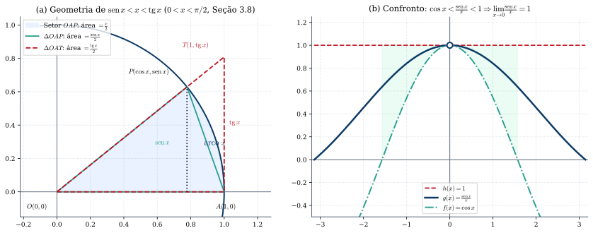
*Figura 2 — (a) Comparação geométrica no 1º quadrante: $\text{Área}(\Delta OAP) < \text{Área}(\text{Setor } OAP) < \text{Área}(\Delta OAT) \implies \operatorname{sen} x < x < \operatorname{tg} x$. (b) A função par $g(x) = \frac{\operatorname{sen} x}{x}$ permanece comprimida entre $f(x) = \cos x$ e $h(x) = 1$ em torno de $x = 0$, convergindo para $1$ (Seção 3.8 de Guidorizzi).*

---

### 📝 Exercícios Selecionados do Capítulo 3 (Com Resolução Passo a Passo)

<strong>Exercício 1.1 (Guidorizzi, Seção 3.3 / Seção 3.6) — Limite com Função Limitada Oscilante:</strong> Seja $f: \mathbb{R}^* \to \mathbb{R}$ dada por $f(x) = x^2 \cos\left(\frac{1}{x^3}\right) + 3x$. Calcule $\lim_{x \to 0} f(x)$ justificando rigorosamente por que não se pode aplicar a regra do limite do produto a $x^2 \cos(1/x^3)$.

**Resolução Passo a Passo:**
1. **Por que a regra do produto não se aplica diretamente?** A propriedade $\lim [u(x)v(x)] = (\lim u(x))(\lim v(x))$ exige que **ambos** os limites existam. Ora, $\lim_{x \to 0} \cos(1/x^3)$ **não existe**, pois quando $x \to 0$, $1/x^3 \to \pm\infty$ e o cosseno oscila infinitas vezes entre $-1$ e $1$.
2. **Aplicação do Corolário do Teorema do Confronto (Seção 3.6):** Para todo $x \neq 0$, a função $g(x) = \cos\left(\frac{1}{x^3}\right)$ é **limitada**, pois $\left|\cos\left(\frac{1}{x^3}\right)\right| \le 1$. Como $\lim_{x \to 0} x^2 = 0$, o produto de uma função que tende a zero por uma função limitada tende a zero:
   $$-x^2 \le x^2 \cos\left(\frac{1}{x^3}\right) \le x^2 \implies \lim_{x \to 0} x^2 \cos\left(\frac{1}{x^3}\right) = 0.$$
3. **Conclusão pela soma de limites:** Como $\lim_{x \to 0} 3x = 0$, segue da propriedade da soma que $\lim_{x \to 0} f(x) = 0 + 0 = \mathbf{0}$. $\blacksquare$

<strong>Exercício 1.2 (Guidorizzi, Seção 3.8) — Limite Trigonométrico com Mudança de Variável:</strong> Calcule $\displaystyle \lim_{x \to 1} \frac{\operatorname{sen}(\pi x)}{x - 1}$ e $\displaystyle \lim_{x \to 0} \frac{1 - \cos(3x)}{x^2}$.

**Resolução Passo a Passo:**
1. **Primeiro limite:** Fazemos a mudança de variável $u = x - 1 \iff x = u + 1$. Quando $x \to 1$, temos $u \to 0$. Usando $\operatorname{sen}(\pi u + \pi) = -\operatorname{sen}(\pi u)$:
   $$\lim_{x \to 1} \frac{\operatorname{sen}(\pi x)}{x - 1} = \lim_{u \to 0} \frac{\operatorname{sen}(\pi u + \pi)}{u} = \lim_{u \to 0} \frac{-\operatorname{sen}(\pi u)}{\pi u} \cdot \pi = -1 \cdot \pi = \mathbf{-\pi}.$$
2. **Segundo limite:** Multiplicando numerador e denominador por $1 + \cos(3x)$ e usando $1 - \cos^2(3x) = \operatorname{sen}^2(3x)$:
   $$\lim_{x \to 0} \frac{1 - \cos(3x)}{x^2} = \lim_{x \to 0} \frac{\operatorname{sen}^2(3x)}{x^2 [1 + \cos(3x)]} = \lim_{x \to 0} 9 \left(\frac{\operatorname{sen}(3x)}{3x}\right)^2 \cdot \frac{1}{1 + \cos(3x)} = 9 \cdot 1^2 \cdot \frac{1}{1 + 1} = \mathbf{\frac{9}{2}}. \quad \blacksquare$$

> 🔗 **Quer mais exercícios sobre Limites e Continuidade?** Acesse a **[Bateria Completa do Capítulo 3 no Paper de Exercícios](./exercicios.html#cap-3)**.

---

## 2. Extensões do Conceito de Limite, Sequências e o Número $e$ (Capítulo 4 de Guidorizzi)

> 📘 **[Referência Principal — Guidorizzi, Vol. 1, 5ª ed., Cap. 4 (Seções 4.1–4.5) e Apêndice 1 (Seção A1.4)]**

### 2.1 Limites no Infinito ($x \to \pm\infty$) e Limites Infinitos ($f(x) \to \pm\infty$) (Seções 4.1 e 4.2)
1. **Limite Finito no Infinito (Seção 4.1):** Supondo $]a, +\infty[ \subset D_f$, definimos:
   $$\boxed{\lim_{x \to +\infty} f(x) = L \iff \forall \varepsilon > 0, \;\exists \delta > 0 \text{ tal que } x > \delta \implies |f(x) - L| < \varepsilon}$$
   *(Notação de Guidorizzi: observe que Guidorizzi usa a própria letra $\delta > 0$ na condição $x > \delta$ para manter a simetria notacional com $\varepsilon$ e $\delta$!).* Geometricamente, $y = L$ é uma **assíntota horizontal** à direita.
2. **Limites Infinitos (Seção 4.2):**
   - Para $x \to +\infty$: $\lim_{x \to +\infty} f(x) = +\infty \iff \forall \varepsilon > 0, \;\exists \delta > 0 \text{ tal que } x > \delta \implies f(x) > \varepsilon$.
   - Para $x \to p^+$: $\lim_{x \to p^+} f(x) = +\infty \iff \forall \varepsilon > 0, \;\exists \delta > 0 \text{ tal que } p < x < p + \delta \implies f(x) > \varepsilon$. Geometricamente, $x = p$ é uma **assíntota vertical**.

### 2.2 Sequências Numéricas, Convergência Monótona e a Definição do Número $e$ (Seções 4.3 a 4.5)
Na Seção 4.3, uma **sequência** é uma função definida no conjunto dos naturais, indicada por $a_n$. Dizemos que $a_n$ converge para $a \in \mathbb{R}$ ($\lim_{n \to \infty} a_n = a$ ou $a_n \to a$) se:
$$\forall \varepsilon > 0, \;\exists n_0 \in \mathbb{N} \text{ tal que } n > n_0 \implies |a_n - a| < \varepsilon.$$

No **Apêndice 1 (Seção A1.4)** e na **Seção 4.3**, Guidorizzi estabelece o teorema estrutural que liga a Propriedade do Supremo às sequências e funções monótonas:
> **Teorema da Convergência de Sequência Monótona (Seção 4.3 / Seção A1.4):**  
> *Toda sequência monótona (crescente ou decrescente) e limitada é convergente.* Mais precisamente, se $(a_n)$ é crescente e limitada superiormente, então $\lim_{n \to \infty} a_n = \sup \{a_n \mid n \in \mathbb{N}\}$.

#### A Construção Rigorosa do Número $e$ na Seção 4.5 do Guidorizzi
Na Seção 4.5, Guidorizzi aplica o teorema acima à sequência $a_n = \left(1 + \frac{1}{n}\right)^n$ ($n \ge 1$):
1. Pelo desenvolvimento do Binômio de Newton:
   $$\left(1 + \frac{1}{n}\right)^n = 1 + 1 + \frac{1}{2!}\left(1 - \frac{1}{n}\right) + \frac{1}{3!}\left(1 - \frac{1}{n}\right)\left(1 - \frac{2}{n}\right) + \dots + \frac{1}{n!}\left(1 - \frac{1}{n}\right)\cdots\left(1 - \frac{n-1}{n}\right)$$
2. Comparando os termos de $a_n$ com os de $a_{n+1}$, cada parcela é positiva e aumenta quando $n$ passa para $n+1$ (e surge uma parcela positiva adicional), provando que **$a_n$ é estritamente crescente** ($a_1 < a_2 < a_3 < \dots$).
3. Além disso, como $1 - \frac{k}{n} < 1$ e $k! \ge 2^{k-1}$ para todo $k \ge 2$, temos:
   $$2 \le \left(1 + \frac{1}{n}\right)^n < 1 + 1 + \frac{1}{2} + \frac{1}{2^2} + \dots + \frac{1}{2^{n-1}} = 1 + \frac{1 - (1/2)^n}{1 - 1/2} = 3 - \frac{1}{2^{n-1}} < 3.$$
4. Como $a_n = \left(1 + \frac{1}{n}\right)^n$ é **crescente e limitada superiormente por $3$**, ela converge! Guidorizzi **define o número $e$** como este limite:
   $$\boxed{e = \lim_{n \to \infty} \left(1 + \frac{1}{n}\right)^n \approx 2{,}718281828\dots}$$

---

## 3. Teoremas do Anulamento, do Valor Intermediário e de Weierstrass (Capítulo 5 de Guidorizzi)

> 📘 **[Referência Principal — Guidorizzi, Vol. 1, 5ª ed., Cap. 5 e Apêndice 2 (Seções A2.1–A2.4)]**

No Capítulo 5, estudamos os três teoremas globais que traduzem a completude de $\mathbb{R}$ para o comportamento de uma função contínua num **intervalo fechado e limitado $[a, b]$**:

> **Teorema 3.1 (Teorema do Anulamento ou de Bolzano — Cap. 5 e Seção A2.1):**  
> *Se $f$ for contínua no intervalo fechado $[a, b]$ e se $f(a)$ e $f(b)$ tiverem sinais contrários ($f(a)\cdot f(b) < 0$), então existirá pelo menos um $c$ em $[a, b]$ (e, portanto, em $]a, b[$) tal que **$f(c) = 0$**.*
> - **Ideia da Demonstração por Bissecção (Apêndice 2, Seção A2.1):** Supondo $f(a) < 0$ e $f(b) > 0$, toma-se $[a_0, b_0] = [a, b]$ e o ponto médio $c_0 = \frac{a_0+b_0}{2}$. Se $f(c_0) = 0$, a prova termina; caso contrário, escolhe-se a metade $[a_1, b_1]$ nas extremidades da qual $f$ tem sinais opostos. Repetindo o processo, constrói-se uma sequência de intervalos encaixantes $[a_n, b_n]$ de comprimento $b_n - a_n = \frac{b-a}{2^n} \to 0$ com $f(a_n) < 0 < f(b_n)$. Pela **Propriedade dos Intervalos Encaixantes**, existe um único $c \in \bigcap_{n=0}^{\infty}[a_n, b_n]$. Pela continuidade de $f$ em $c$ e pelo Teorema da Conservação do Sinal, não podemos ter $f(c) > 0$ nem $f(c) < 0$; logo, **$f(c) = 0$**!

> **Teorema 3.2 (Teorema do Valor Intermediário — TVI, Cap. 5 e Seção A2.2):**  
> *Se $f$ for contínua em $[a, b]$ e se $\gamma$ for um real compreendido entre $f(a)$ e $f(b)$, então existirá pelo menos um $c \in [a, b]$ tal que **$f(c) = \gamma$**.*
> - **Demonstração (Seção A2.2):** Aplica-se o Teorema do Anulamento à função contínua $g(x) = f(x) - \gamma$ em $[a, b]$.

> **Teorema 3.3 (Teorema da Limitação e Teorema de Weierstrass — Cap. 5 e Seções A2.3–A2.4):**  
> 1. **Teorema da Limitação (Seção A2.3):** *Se $f$ for contínua no intervalo fechado $[a, b]$, então $f$ será limitada em $[a, b]$.*  
> 2. **Teorema de Weierstrass (Cap. 5 e Seção A2.4):** *Se $f$ for contínua em $[a, b]$, então existirão $x_1$ e $x_2$ em $[a, b]$ tais que, para todo $x \in [a, b]$:*
> $$\boxed{f(x_1) \le f(x) \le f(x_2)}$$
> *Isto é, toda função contínua num intervalo fechado $[a, b]$ assume em $[a, b]$ valor mínimo global $m = f(x_1)$ e valor máximo global $M = f(x_2)$.*
> - **Consequência (Exercício 8 do Cap. 5):** Se $f: [a, b] \to \mathbb{R}$ é contínua e não constante, pelo Teorema de Weierstrass e pelo TVI sua imagem é o intervalo fechado $\operatorname{Im}_f = [m, M] = [f(x_1), f(x_2)]$.

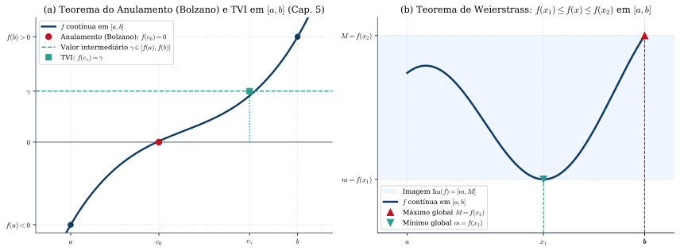
*Figura 3 — (a) Teorema do Anulamento (Bolzano) garantindo a raiz $c_0$ onde $f(c_0)=0$ e Teorema do Valor Intermediário (TVI) garantindo $c_\gamma$ com $f(c_\gamma)=\gamma$. (b) Teorema de Weierstrass em $[a, b]$: a imagem de $[a, b]$ por uma função contínua não constante é o intervalo fechado $[m, M] = [f(x_1), f(x_2)]$ (Capítulo 5 de Guidorizzi).*

> 📙 **[Mudança de Referência / Complemento — Apostol, Cálculo I, Cap. 3 (Seções 3.8–3.17)]**  
> No Capítulo 3 de *Cálculo I*, **Tom M. Apostol** demonstra os mesmos três teoremas globais (Teorema de Bolzano na Seção 3.8, TVI na Seção 3.9 e Teorema dos Valores Extremos na Seção 3.16), mas acrescenta na **Seção 3.17** um quarto teorema estrutural de funções contínuas em intervalos fechados $[a, b]$ — o **Teorema da Continuidade Uniforme (ou das Pequenas Oscilações)**, que no Guidorizzi aparece como o Lema e Teorema da **Seção A4.3 do Apêndice 4**:
> > **Teorema da Continuidade Uniforme em $[a, b]$ (Apostol, Seção 3.17 / Guidorizzi, Apêndice 4, Seção A4.3):**  
> > *Se $f$ é contínua no intervalo fechado $[a, b]$, então para todo $\varepsilon > 0$ existe um único $\delta > 0$ (que depende apenas de $\varepsilon$, e **não** dos pontos escolhidos!) tal que, quaisquer que sejam $s, t \in [a, b]$:*
> > $$|s - t| < \delta \implies |f(s) - f(t)| < \varepsilon.$$
> Este teorema é a chave mestra para provar que **toda função contínua em $[a, b]$ é integrável segundo Riemann**!

---

## 4. Funções Exponencial e Logarítmica: Duas Construções Complementares (Capítulo 6 de Guidorizzi vs. Capítulo 6 de Apostol)

### 4.1 A Construção de Guidorizzi: De $a^r$ ($r \in \mathbb{Q}$) a $a^x$ ($x \in \mathbb{R}$) e ao Logaritmo via TVI

> 📘 **[Referência Principal — Guidorizzi, Vol. 1, 5ª ed., Cap. 6 (Seções 6.1–6.3) e Apêndice 3 (Seção A3.1)]**

No Capítulo 6, Guidorizzi constrói as funções exponencial e logarítmica **antes** do estudo de derivadas e integrais, seguindo uma cadeia lógica impecável:
1. **Potência com Expoente Real (Seção 6.1 e Apêndice 3, Seção A3.1):**  
   Na Seção 1.7, definiu-se $a^r$ para $r = \frac{p}{q} \in \mathbb{Q}$ ($a > 0, a \neq 1$). Na Seção 6.1, Guidorizzi observa primeiro que se duas funções contínuas em $\mathbb{R}$ coincidem em todos os racionais $\mathbb{Q}$, então elas coincidem em todo $\mathbb{R}$. No **Apêndice 3 (Seção A3.1)**, ele demonstra (usando a Propriedade do Supremo via Lemas 1, 2 e 3: para $a > 1$ e $x \in \mathbb{R}$, define $a^x = \sup \{a^r \mid r \in \mathbb{Q}, r < x\}$):
   > **Teorema (Seção 6.1):** *Seja $a > 0$ e $a \neq 1$ um real qualquer. Existe uma única função $f$, definida e contínua em $\mathbb{R}$, tal que $f(r) = a^r$ para todo racional $r \in \mathbb{Q}$.*  
   Define-se então **$a^x = f(x)$** (função exponencial de base $a$), que herda por continuidade todas as propriedades operatórias: $a^{x+y} = a^x a^y$, $(a^x)^y = a^{xy}$, $(ab)^x = a^x b^x$, sendo **estritamente crescente** se $a > 1$ e **estritamente decrescente** se $0 < a < 1$.
2. **Definição de Logaritmo via Teorema do Valor Intermediário (Seção 6.2):**  
   *(Repare no rigor de Guidorizzi: como o conceito geral de função inversa só será introduzido no Capítulo 8, ele define o logaritmo na Seção 6.2 usando diretamente o TVI do Capítulo 5!)*
   > **Teorema (Existência e Unicidade do Logaritmo — Seção 6.2):**  
   > *Sejam $a > 0, a \neq 1$, e $\beta > 0$ dois reais quaisquer. Então existe um **único** $\gamma \in \mathbb{R}$ tal que **$a^\gamma = \beta$**.*  
   > *(Demonstração: Para $a > 1$, como $\lim_{x \to -\infty} a^x = 0$ e $\lim_{x \to +\infty} a^x = +\infty$, existem $u < v$ tais que $a^u < \beta < a^v$. Como $f(x) = a^x$ é contínua em $[u, v]$, pelo **TVI** existe $\gamma \in [u, v]$ tal que $a^\gamma = \beta$; a unicidade decorre de $a^x$ ser estritamente crescente).*  
   Esse único $\gamma$ denomina-se **logaritmo de $\beta$ na base $a$**, indicado por **$\gamma = \log_a \beta \iff a^\gamma = \beta \implies a^{\log_a \beta} = \beta$**. Na base $e$, escrevemos **$\ln x = \log_e x$**, valendo $e^{\ln x} = x$ ($\forall x > 0$), $\ln(e^x) = x$ ($\forall x \in \mathbb{R}$) e a mudança de base $\log_a x = \frac{\ln x}{\ln a} \implies a^x = e^{x \ln a}$.
3. **O 2º Limite Fundamental para Variável Contínua e seus Corolários (Seção 6.3):**  
   Para todo $x > 0$, tomando o único natural $n \ge 1$ tal que $n \le x < n + 1$, tem-se $\frac{1}{n+1} < \frac{1}{x} \le \frac{1}{n}$, donde:
   $$\left(1 + \frac{1}{n+1}\right)^n < \left(1 + \frac{1}{x}\right)^x < \left(1 + \frac{1}{n}\right)^{n+1}.$$
   Como ambos os extremos tendem a $e$ quando $x \to +\infty$ ($n \to \infty$), o Teorema do Confronto garante (e a substituição $x = -(t+1)$ estende para $x \to -\infty$):
   $$\boxed{\lim_{x \to +\infty} \left(1 + \frac{1}{x}\right)^x = \lim_{x \to -\infty} \left(1 + \frac{1}{x}\right)^x = e \qquad \Longleftrightarrow \qquad \lim_{h \to 0} (1 + h)^{\frac{1}{h}} = e}$$
   E fazendo $u = e^h - 1 \iff h = \ln(1 + u)$ (Exemplo 3, Seção 6.3), obtemos o limite que nos dará a derivada de $e^x$ no Capítulo 7:
   $$\boxed{\lim_{h \to 0} \frac{e^h - 1}{h} = \lim_{u \to 0} \frac{u}{\ln(1 + u)} = \lim_{u \to 0} \frac{1}{\ln\big((1+u)^{1/u}\big)} = \frac{1}{\ln e} = 1}$$

> 📙 **[Mudança de Referência / Complemento — Apostol, Cálculo I, Cap. 6 (Seções 6.1–6.15): A Construção Integral do Logaritmo e da Exponencial]**  
> Enquanto Guidorizzi constrói primeiro $a^x$ por continuidade a partir dos racionais e obtém $\ln x$ pelo TVI, **Tom M. Apostol** (que introduz o Cálculo Integral antes do Diferencial) apresenta no Capítulo 6 de *Cálculo I* a célebre **construção analítica via integral definida**, evitando completamente os lemas de aproximação racional do Apêndice 3:
> 1. **Definição de $\ln x$ (Apostol, Seção 6.3):** Para todo $x > 0$, define-se o logaritmo natural diretamente como a área (com sinal) sob a hipérbole $f(t) = \frac{1}{t}$ de $1$ até $x$:
>    $$\boxed{\ln x = \int_{1}^{x} \frac{1}{t}\,dt \quad (x > 0)}$$
> 2. **Propriedades imediatas:** Pelo Teorema Fundamental do Cálculo, a derivada $(\ln x)' = \frac{1}{x} > 0$ sai na hora (sem precisar do limite $(1+1/x)^x \to e$!), provando que $\ln x$ é derivável, contínua e estritamente crescente em $]0, +\infty[$. Além disso, a equação funcional $\ln(ab) = \ln a + \ln b$ decorre da aditividade da integral e da mudança de variável $t = a u$:
>    $$\ln(ab) = \int_1^a \frac{dt}{t} + \int_a^{ab} \frac{dt}{t} = \ln a + \int_1^b \frac{a\,du}{au} = \ln a + \ln b.$$
> 3. **Definição do número $e$ e da Exponencial (Apostol, Seções 6.4 e 6.10–6.13):** O número $e$ é definido como o único real positivo tal que $\ln e = \int_1^e \frac{1}{t}\,dt = 1$, a função exponencial $\exp(x) = e^x$ é definida como a **função inversa de $\ln x$**, e a potência geral de base $a > 0$ e expoente real $x \in \mathbb{R}$ é definida por **$a^x = e^{x \ln a}$**!

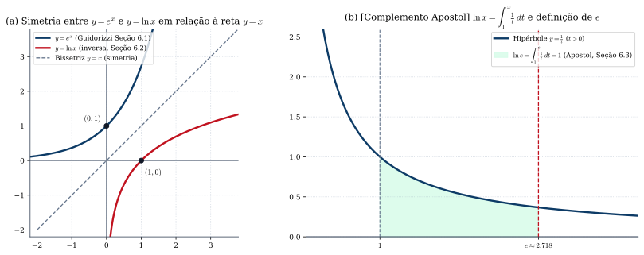
*Figura 4 — (a) Gráficos de $y = e^x$ e $y = \ln x$ simétricos em relação à bissetriz $y = x$ (Guidorizzi, Seções 6.1–6.2 e Cap. 8). (b) [Complemento Apostol, Seção 6.3] Interpretação geométrica de $\ln x = \int_1^x \frac{1}{t}\,dt$: o número $e \approx 2{,}71828$ é a abscissa que delimita sob a hipérbole $y = 1/t$ uma área exatamente igual a $1$.*

---

## 5. Derivadas (Capítulo 7 de Guidorizzi)

> 📘 **[Referência Principal — Guidorizzi, Vol. 1, 5ª ed., Cap. 7 (Seções 7.1–7.17)]**

### 5.1 Definição de Derivada, Reta Tangente e Reta Normal (Seções 7.1, 7.2 e 7.16)

> **Definição 5.1 (Derivada de uma Função — Seção 7.2):**  
> Sejam $f$ uma função e $p$ um ponto de seu domínio ($p \in D_f$). O limite
> $$\boxed{f'(p) = \lim_{x \to p} \frac{f(x) - f(p)}{x - p} = \lim_{h \to 0} \frac{f(p + h) - f(p)}{h}}$$
> quando existe e é finito, denomina-se **derivada de $f$ em $p$**. Caso $f$ admita derivada em $p$, dizemos que **$f$ é derivável (ou diferenciável) em $p$**.

- **Interpretação Geométrica (Seções 3.1, 7.2 e 7.16):** O quociente $\frac{f(p+h) - f(p)}{h}$ (razão incremental) é o coeficiente angular da **reta secante $s$** que passa por $M = (p, f(p))$ e $N = (p+h, f(p+h))$. Quando $h \to 0$, a secante tende à posição limite da **reta tangente $T$** ao gráfico de $f$ em $(p, f(p))$:
  - **Equação da Reta Tangente em $(p, f(p))$:** $\quad \boxed{y - f(p) = f'(p)(x - p)}$
  - **Equação da Reta Normal em $(p, f(p))$** (reta perpendicular à tangente em $(p, f(p))$; se $f'(p) \neq 0$):
    $$\boxed{y - f(p) = -\frac{1}{f'(p)}(x - p)} \qquad (\text{se } f'(p) = 0, \text{ a reta normal é a reta vertical } x = p).$$

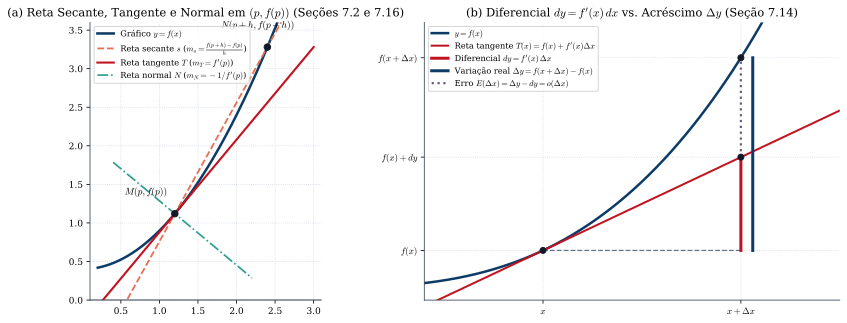
*Figura 5 — (a) A reta secante $s$ passando por $M(p, f(p))$ e $N(p+h, f(p+h))$ gira para a posição da reta tangente $T$ quando $h \to 0$, enquanto a reta normal $N$ é ortogonal a $T$ em $M$ (Seções 7.2 e 7.16). (b) A diferencial $dy = f'(x)\,\Delta x$ mede o acréscimo vertical sobre a reta tangente, aproximando a variação real $\Delta y = f(x+\Delta x) - f(x)$ com erro $E(\Delta x) = o(\Delta x)$ (Seção 7.14).*

---

### 5.2 Derivadas Elementares Deduzidas pela Definição (Seções 7.3 a 7.5)
No Capítulo 7, Guidorizzi deduz cada uma das derivadas fundamentais diretamente do limite da razão incremental:
1. **Potência Inteira e Raiz $n$-ésima (Seção 7.3):**  
   Usando a identidade algébrica $x^n - p^n = (x - p)(x^{n-1} + x^{n-2}p + \dots + p^{n-1})$ ($n \in \mathbb{N}^*$):
   $$(x^n)' = \lim_{x \to p} \frac{x^n - p^n}{x - p} = n p^{n-1} \implies \boxed{(x^n)' = n x^{n-1}}$$
   E fazendo a mudança $u = \sqrt[n]{x}$ e $v = \sqrt[n]{p}$ (logo $x - p = u^n - v^n$):
   $$\left(\sqrt[n]{x}\right)' = \lim_{x \to p} \frac{\sqrt[n]{x} - \sqrt[n]{p}}{x - p} = \lim_{u \to v} \frac{u - v}{u^n - v^n} = \frac{1}{n v^{n-1}} = \frac{1}{n x^{1 - \frac{1}{n}}} \implies \boxed{\left(x^{\frac{1}{n}}\right)' = \frac{1}{n} x^{\frac{1}{n} - 1}}$$
2. **Exponencial $e^x$ e Logaritmo $\ln x$ (Seção 7.4):**  
   Usando o limite da Seção 6.3 ($\lim_{h \to 0} \frac{e^h - 1}{h} = 1$):
   $$(e^x)' = \lim_{h \to 0} \frac{e^{x+h} - e^x}{h} = e^x \lim_{h \to 0} \frac{e^h - 1}{h} = e^x \implies \boxed{(e^x)' = e^x}$$
   E para $f(x) = \ln x$ ($x > 0$), fazendo $u = \frac{x - p}{p}$ ($x \to p \iff u \to 0$):
   $$(\ln p)' = \lim_{x \to p} \frac{\ln x - \ln p}{x - p} = \lim_{u \to 0} \frac{1}{p} \cdot \frac{\ln(1 + u)}{u} = \frac{1}{p} \cdot 1 = \frac{1}{p} \implies \boxed{(\ln x)' = \frac{1}{x}}$$
3. **Funções Trigonométricas (Seção 7.5):**  
   Usando as fórmulas de transformação em produto $\operatorname{sen}(x+h) - \operatorname{sen} x = 2\operatorname{sen}\left(\frac{h}{2}\right)\cos\left(x + \frac{h}{2}\right)$ e $\cos(x+h) - \cos x = -2\operatorname{sen}\left(\frac{h}{2}\right)\operatorname{sen}\left(x + \frac{h}{2}\right)$ e o 1º Limite Fundamental:
   $$\boxed{\operatorname{sen}' x = \cos x, \qquad \cos' x = -\operatorname{sen} x, \qquad \operatorname{tg}' x = \sec^2 x, \qquad \sec' x = \sec x \operatorname{tg} x, \qquad \operatorname{cotg}' x = -\operatorname{cossec}^2 x, \qquad \operatorname{cossec}' x = -\operatorname{cossec} x \operatorname{cotg} x}$$

---

### 5.3 Derivabilidade vs. Continuidade, Regras Operatórias, Regra da Cadeia e $f(x)^{g(x)}$ (Seções 7.6 a 7.12)

1. **Teorema (Derivabilidade Implica Continuidade — Seção 7.6):**  
   *Se $f$ for derivável em $p$, então $f$ será contínua em $p$.*  
   - **Demonstração (Seção 7.6):** Como $f(x) - f(p) = \frac{f(x) - f(p)}{x - p}(x - p)$ para $x \neq p$, passando ao limite para $x \to p$ vem $\lim_{x \to p}[f(x) - f(p)] = f'(p) \cdot 0 = 0 \implies \lim_{x \to p} f(x) = f(p)$.
   - **Contraexemplos da Recíproca (Seção 7.6):** $f(x) = |x|$ é contínua em $p = 0$, mas não é derivável em $0$, pois as derivadas laterais diferem ($f'_+(0) = 1 \neq -1 = f'_-(0)$ — *bico / ponto anguloso*); já $f(x) = \sqrt[3]{x}$ é contínua em $0$, mas $\lim_{x \to 0} \frac{\sqrt[3]{x}}{x} = \lim_{x \to 0} \frac{1}{\sqrt[3]{x^2}} = +\infty$ (*reta tangente vertical*).
2. **Regras de Derivação (Teoremas 1 e 2, Seção 7.7):** Se $f$ e $g$ são deriváveis em $p$:
   $$\boxed{(f + g)'(p) = f'(p) + g'(p), \qquad (kf)'(p) = kf'(p), \qquad (f \cdot g)'(p) = f'(p)g(p) + f(p)g'(p), \qquad \left(\frac{f}{g}\right)'(p) = \frac{f'(p)g(p) - f(p)g'(p)}{[g(p)]^2} \; (g(p)\neq 0)}$$
3. **Regra da Cadeia (Seção 7.10):**  
   Sejam $y = g(u)$ e $u = f(x)$ tais que $\operatorname{Im}_f \subset D_g$. Se $f$ for derivável em $p$ e $g$ for derivável em $q = f(p)$, então a composta $h(x) = g(f(x))$ é derivável em $p$ e:
   $$\boxed{h'(p) = g'(f(p)) \cdot f'(p) \qquad \Longleftrightarrow \qquad \frac{dy}{dx} = \frac{dy}{du} \cdot \frac{du}{dx}}$$
   > **Nota sobre o Rigor da Demonstração da Regra da Cadeia (Seção 7.10 de Guidorizzi e Seção 4.10 de Apostol):**  
   > Escrever ingenuamente $\frac{g(f(x)) - g(f(p))}{x - p} = \frac{g(f(x)) - g(f(p))}{f(x) - f(p)} \cdot \frac{f(x) - f(p)}{x - p}$ falha se $f(x) - f(p)$ se anular infinitas vezes perto de $p$! Por isso, na **Seção 7.10**, Guidorizzi define a função auxiliar contínua em $q = f(p)$:
   > $$\varphi(u) = \begin{cases} \dfrac{g(u) - g(q)}{u - q}, & \text{se } u \neq q \\[6pt] g'(q), & \text{se } u = q \end{cases} \implies g(u) - g(q) = \varphi(u)(u - q) \quad (\forall u \in D_g).$$
   > Substituindo $u = f(x)$ e dividindo por $x - p \neq 0$, obtém-se $\frac{g(f(x)) - g(f(p))}{x - p} = \varphi(f(x)) \cdot \frac{f(x) - f(p)}{x - p} \xrightarrow{x \to p} g'(f(p)) \cdot f'(p)$ sem jamais dividir por zero!
4. **Derivada de Potência Real $(x^\alpha)' = \alpha x^{\alpha - 1}$ e de $f(x)^{g(x)}$ (Seções 7.11 e 7.12):**  
   Escrevendo $x^\alpha = e^{\alpha \ln x}$ ($x > 0, \alpha \in \mathbb{R}$), pela Regra da Cadeia tem-se $(x^\alpha)' = e^{\alpha \ln x} \cdot \frac{\alpha}{x} = \alpha x^{\alpha - 1}$. De modo geral, para $f(x) > 0$, escrevemos **$y = f(x)^{g(x)} = e^{g(x) \ln f(x)}$**, obtendo:
   $$\boxed{\big[f(x)^{g(x)}\big]' = f(x)^{g(x)} \left[g'(x)\ln f(x) + g(x)\frac{f'(x)}{f(x)}\right]}$$

### 5.4 Derivação Implícita, Diferencial e Taxas de Variação (Seções 7.13 a 7.15)
- **Derivação Implícita (Seção 7.13):** Se $y = f(x)$ é dada implicitamente por uma equação $F(x, y) = 0$, derivamos ambos os membros em relação a $x$ aplicando a Regra da Cadeia aos termos com $y$ (por exemplo, $\frac{d}{dx}[y^n] = n y^{n-1} \frac{dy}{dx}$).
- **Diferencial $dy$ (Seção 7.14):** Para representar o símbolo de Leibniz $\frac{dy}{dx}$ como um verdadeiro quociente, Guidorizzi define o acréscimo da variável independente como $dx = \Delta x$ e a **diferencial de $y = f(x)$** por:
  $$\boxed{dy = f'(x)\,dx \implies \Delta y = f(x + \Delta x) - f(x) \approx dy = f'(x)\,\Delta x}$$
- **Velocidade e Aceleração (Seção 7.15):** Se $x = x(t)$ é a função de posição de uma partícula sobre o eixo $Ox$, a **velocidade escalar instantânea** é $v(t) = \frac{dx}{dt} = x'(t)$ e a **aceleração escalar instantânea** é $a(t) = \frac{dv}{dt} = \frac{d^2x}{dt^2} = x''(t)$.

---

### 📝 Exercícios Selecionados do Capítulo 7 (Com Resolução Passo a Passo)

<strong>Exercício 5.1 (Guidorizzi, Seção 7.6) — Derivabilidade e Continuidade de $x^n \operatorname{sen}(1/x)$:</strong> Considere a função $f: \mathbb{R} \to \mathbb{R}$ definida por $f(x) = x^2 \operatorname{sen}\left(\frac{1}{x}\right)$ se $x \neq 0$, e $f(0) = 0$. (a) Mostre que $f$ é derivável em $p = 0$ e calcule $f'(0)$. (b) Mostre que a função derivada $f'(x)$ <strong>não é contínua</strong> em $p = 0$!

**Resolução Passo a Passo:**
1. **(a) Cálculo de $f'(0)$ pela definição:** Como a lei de formação muda em $x = 0$, devemos usar obrigatoriamente a definição de derivada em $p = 0$:
   $$f'(0) = \lim_{x \to 0} \frac{f(x) - f(0)}{x - 0} = \lim_{x \to 0} \frac{x^2 \operatorname{sen}(1/x) - 0}{x} = \lim_{x \to 0} x \operatorname{sen}\left(\frac{1}{x}\right) = 0$$
   (pois $\lim_{x \to 0} x = 0$ e $|\operatorname{sen}(1/x)| \le 1$ é limitada). Logo, $f$ é derivável em $0$ e **$f'(0) = 0$**.
2. **(b) Cálculo de $f'(x)$ para $x \neq 0$ e descontinuidade de $f'$ em $0$:** Para $x \neq 0$, aplicamos a Regra do Produto e a Regra da Cadeia:
   $$f'(x) = 2x \operatorname{sen}\left(\frac{1}{x}\right) + x^2 \cos\left(\frac{1}{x}\right) \cdot \left(-\frac{1}{x^2}\right) = 2x \operatorname{sen}\left(\frac{1}{x}\right) - \cos\left(\frac{1}{x}\right).$$
   Quando $x \to 0$, a parcela $2x \operatorname{sen}(1/x) \to 0$, mas $\cos(1/x)$ oscila entre $-1$ e $1$ sem limite! Portanto, **não existe $\lim_{x \to 0} f'(x)$**, o que mostra que uma função pode ser derivável em toda a reta $\mathbb{R}$ sem que sua derivada $f'$ seja contínua em $0$! $\blacksquare$

<strong>Exercício 5.2 (Guidorizzi, Seções 7.12 e 7.16) — Derivada de $f(x)^{g(x)}$ e Reta Normal:</strong> Calcule a derivada de $f(x) = x^{\operatorname{sen} x}$ ($x > 0$) e determine as equações das retas tangente e normal ao gráfico no ponto de abscissa $p = \pi$.

**Resolução Passo a Passo:**
1. Escrevendo $f(x) = x^{\operatorname{sen} x} = e^{\operatorname{sen} x \cdot \ln x}$ ($x > 0$), derivamos pela Regra da Cadeia e do Produto:
   $$f'(x) = e^{\operatorname{sen} x \cdot \ln x} \left[\cos x \cdot \ln x + \operatorname{sen} x \cdot \frac{1}{x}\right] = x^{\operatorname{sen} x} \left(\cos x \ln x + \frac{\operatorname{sen} x}{x}\right).$$
2. Avaliando em $p = \pi$: temos $f(\pi) = \pi^{\operatorname{sen} \pi} = \pi^0 = 1$ e:
   $$f'(\pi) = \pi^0 \left(\cos \pi \cdot \ln \pi + \frac{\operatorname{sen} \pi}{\pi}\right) = 1 \cdot (-\ln \pi + 0) = -\ln \pi.$$
3. **Reta Tangente em $(\pi, 1)$:** $y - 1 = (-\ln \pi)(x - \pi) \iff \mathbf{y = -(\ln \pi)x + \pi \ln \pi + 1}$.  
   **Reta Normal em $(\pi, 1)$:** $y - 1 = \frac{1}{\ln \pi}(x - \pi) \iff \mathbf{y = \frac{x - \pi}{\ln \pi} + 1}$. $\blacksquare$

> 🔗 **Quer mais exercícios de Derivadas, Regra da Cadeia, Implícita e Taxas Relacionadas?** Acesse a **[Bateria Completa do Capítulo 7 no Paper de Exercícios](./exercicios.html#cap-7)**.

---

## 6. Funções Inversas e suas Derivadas (Capítulo 8 de Guidorizzi)

> 📘 **[Referência Principal — Guidorizzi, Vol. 1, 5ª ed., Cap. 8 (Seções 8.1 e 8.2)]**

### 6.1 Função Injetora, Função Inversa e o Teorema Rigoroso da Derivada da Inversa
Na Seção 8.1, uma função $f$ é **injetora** se, quaisquer que sejam $s, t \in D_f$, $s \neq t \implies f(s) \neq f(t)$ (em particular, toda função estritamente crescente ou estritamente decrescente é injetora). Se $f$ é injetora e $B = \operatorname{Im}_f$, a função $g: B \to D_f$ que a cada $y \in B$ associa o único $x \in D_f$ tal que $f(x) = y$ denomina-se **função inversa de $f$** ($g = f^{-1}$):
$$\boxed{g(y) = x \iff y = f(x) \qquad \Longleftrightarrow \qquad \forall x \in D_f,\; g(f(x)) = x \quad \text{e} \quad \forall y \in B,\; f(g(y)) = y}$$

> **⚠️ Correção de Erro Conceitual no Teorema da Derivada da Função Inversa (Seção 8.2 de Guidorizzi):**  
> Se já soubermos que $g = f^{-1}$ é derivável em $p$, a Regra da Cadeia aplicada a $f(g(x)) = x$ fornece imediatamente $f'(g(p)) \cdot g'(p) = 1 \implies g'(p) = \frac{1}{f'(g(p))}$.  
> **Mas como garantir que a inversa $g$ é de fato derivável em $p$?** Na Seção 8.2, Guidorizzi enuncia e demonstra o teorema de existência sem cair em raciocínio circular:
>
> **Teorema 6.1 (Derivada de Função Inversa — Seção 8.2):**  
> *Seja $f$ uma função inversível, com função inversa $g = f^{-1}$. Se **$f$ for derivável em $q = g(p)$, com $f'(q) \neq 0$**, e se **$g$ for contínua em $p$**, então **$g$ será derivável em $p$** e:*
> $$\boxed{g'(p) = \frac{1}{f'(g(p))} = \frac{1}{f'(q)}}$$
> - **Demonstração de Guidorizzi (Seção 8.2):** Fazendo a mudança de variável $u = g(x)$ (logo $x = f(u)$ e $p = f(q)$), como $g$ é bijetora temos $x \neq p \iff u \neq q$. Pela **continuidade de $g$ em $p$**, quando $x \to p$ temos $u = g(x) \to g(p) = q$. Pelo Teorema 2 do limite da composta (Seção 3.5):
>   $$g'(p) = \lim_{x \to p} \frac{g(x) - g(p)}{x - p} = \lim_{u \to q} \frac{u - q}{f(u) - f(q)} = \lim_{u \to q} \frac{1}{\dfrac{f(u) - f(q)}{u - q}} = \frac{1}{f'(q)} = \frac{1}{f'(g(p))}. \quad \blacksquare$$

> 📙 **[Mudança de Referência / Complemento — Apostol, Cálculo I, Cap. 3 (Seções 3.13–3.14): Continuidade Automática da Inversa]**  
> No Capítulo 8 de Guidorizzi, a continuidade da função inversa $g = f^{-1}$ de uma função contínua e estritamente monótona num intervalo é aceita intuitivamente pela simetria do gráfico em relação à reta $y = x$. Em **Apostol (*Cálculo I*, Teorema 3.8, Seção 3.13)**, demonstra-se analiticamente (usando o Teorema do Valor Intermediário) que *se $f$ é contínua e estritamente crescente (ou decrescente) num intervalo $I$, então sua imagem $f(I)$ é um intervalo e a inversa $g = f^{-1}$ é automaticamente contínua e estritamente crescente (ou decrescente) em $f(I)$*.

---

### 6.2 As Funções $\operatorname{arcsen} x$, $\arccos x$, $\operatorname{arctg} x$ e suas Derivadas (Exemplos 1 a 3 da Seção 8.2)
Restringindo os domínios das funções trigonométricas para torná-las estritamente monótonas e sobrejetoras em suas imagens, Guidorizzi aplica o Teorema 6.1 na Seção 8.2:
1. **Função Arco-Seno ($y = \operatorname{arcsen} x \iff x = \operatorname{sen} y$, com $x \in [-1, 1]$ e $y \in \left[-\frac{\pi}{2}, \frac{\pi}{2}\right]$):**  
   Para $x \in \,]-1, 1[$, temos $y = \operatorname{arcsen} x \in \,]-\frac{\pi}{2}, \frac{\pi}{2}[$, onde $\cos y > 0 \implies \cos y = +\sqrt{1 - \operatorname{sen}^2 y} = \sqrt{1 - x^2}$. Logo:
   $$\boxed{\operatorname{arcsen}' x = \frac{1}{\operatorname{sen}'(\operatorname{arcsen} x)} = \frac{1}{\cos(\operatorname{arcsen} x)} = \frac{1}{\sqrt{1 - x^2}} \quad (-1 < x < 1)}$$
   *(Observe que em $x = \pm 1$, $\cos(\pm\pi/2) = 0$, logo $\operatorname{arcsen} x$ não é derivável em $x = \pm 1$, apresentando tangentes verticais).*
2. **Função Arco-Cosseno ($y = \arccos x \iff x = \cos y$, com $x \in [-1, 1]$ e $y \in [0, \pi]$):**  
   Para $x \in \,]-1, 1[$, $y \in \,]0, \pi[ \implies \operatorname{sen} y = +\sqrt{1 - \cos^2 y} = \sqrt{1 - x^2}$, e como $\cos' y = -\operatorname{sen} y$:
   $$\boxed{\arccos' x = -\frac{1}{\operatorname{sen}(\arccos x)} = -\frac{1}{\sqrt{1 - x^2}} \quad (-1 < x < 1)}$$
3. **Função Arco-Tangente ($y = \operatorname{arctg} x \iff x = \operatorname{tg} y$, com $x \in \mathbb{R}$ e $y \in \,]-\frac{\pi}{2}, \frac{\pi}{2}[$):**  
   Como $\operatorname{tg}' y = \sec^2 y = 1 + \operatorname{tg}^2 y = 1 + x^2 \neq 0$ para todo $x \in \mathbb{R}$:
   $$\boxed{\operatorname{arctg}' x = \frac{1}{\sec^2(\operatorname{arctg} x)} = \frac{1}{1 + \operatorname{tg}^2(\operatorname{arctg} x)} = \frac{1}{1 + x^2} \quad (\forall x \in \mathbb{R})}$$

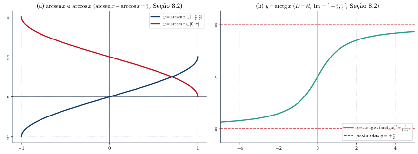
*Figura 6 — (a) As funções $\operatorname{arcsen} x$ (crescente de $-\pi/2$ a $\pi/2$) e $\arccos x$ (decrescente de $\pi$ a $0$) em $[-1, 1]$, cuja soma é constante e igual a $\frac{\pi}{2}$ ( pois $(\operatorname{arcsen} x + \arccos x)' = 0$). (b) A função $\operatorname{arctg} x$, definida e derivável em toda a reta $\mathbb{R}$, com assíntotas horizontais $y = -\frac{\pi}{2}$ ($x \to -\infty$) e $y = \frac{\pi}{2}$ ($x \to +\infty$) (Seção 8.2 de Guidorizzi).*

---

## 7. Teoremas de Rolle, Valor Médio e Cauchy, e Estudo da Variação das Funções (Capítulos 9 e 15 de Guidorizzi)

> 📘 **[Referência Principal — Guidorizzi, Vol. 1, 5ª ed., Cap. 9 (Seções 9.1–9.8) e Cap. 15 (Seções 15.1–15.3)]**

### 7.1 A Trilogia Diferencial: Teoremas de Rolle, do Valor Médio (TVM) e de Cauchy (Capítulo 15)
No Capítulo 9, Guidorizzi aplica o **Teorema do Valor Médio (TVM)** ao estudo global das funções, postergando as demonstrações formais dos teoremas de Rolle, TVM e Cauchy para o Capítulo 15:

1. **Condição Necessária para Extremos Locais Internos (Teorema 1, Seção 9.7):**  
   *Seja $f$ uma função derivável em $p$, em que **$p$ é um ponto interior a $D_f$** (isto é, existe intervalo aberto $]a, b[ \subset D_f$ com $p \in \,]a, b[$). Uma condição necessária para que $p$ seja ponto de máximo ou de mínimo local é que **$f'(p) = 0$**.*  
   - **Demonstração (Seção 9.7):** Se $p$ é ponto de máximo local, existe $r > 0$ tal que $]p-r, p+r[ \subset D_f$ e $f(x) \le f(p)$ em $]p-r, p+r[$. Para $p < x < p+r$, $\frac{f(x)-f(p)}{x-p} \le 0 \implies f'(p) = \lim_{x \to p^+} \frac{f(x)-f(p)}{x-p} \le 0$ (pela conservação do sinal). Para $p-r < x < p$, $\frac{f(x)-f(p)}{x-p} \ge 0 \implies f'(p) = \lim_{x \to p^-} \frac{f(x)-f(p)}{x-p} \ge 0$. Logo, $f'(p) = 0$.
2. **Teorema de Rolle (Seção 15.1):**  
   > *Se $f$ for **contínua em $[a, b]$**, **derivável em $]a, b[$** e **$f(a) = f(b)$**, então existirá pelo menos um $c$ em $]a, b[$ tal que:*
   > $$\boxed{f'(c) = 0}$$
   - **Demonstração (Seção 15.1):** Se $f$ é constante em $[a, b]$, $f'(x) = 0$ para todo $x \in \,]a, b[$. Se $f$ não é constante, pelo **Teorema de Weierstrass** existem $x_1, x_2 \in [a, b]$ tais que $f(x_1)$ é o valor mínimo e $f(x_2)$ é o valor máximo de $f$ em $[a, b]$, com $f(x_1) < f(x_2)$. Como $f(a) = f(b)$, pelo menos um dos pontos $x_1$ ou $x_2$ pertence ao aberto $]a, b[$ (é interior a $[a, b]$). Pelo Teorema 1 da Seção 9.7, nesse ponto interno $c$ tem-se **$f'(c) = 0$**. $\blacksquare$
3. **Teorema do Valor Médio — TVM (Seções 9.1 e 15.2):**  
   > *Se $f$ for **contínua em $[a, b]$** e **derivável em $]a, b[$**, então existirá pelo menos um $c$ em $]a, b[$ tal que:*
   > $$\boxed{\frac{f(b) - f(a)}{b - a} = f'(c) \qquad \Longleftrightarrow \qquad f(b) - f(a) = f'(c)(b - a)}$$
   - **Demonstração (Seção 15.2):** Seja $S(x) = f(a) + \frac{f(b) - f(a)}{b - a}(x - a)$ a função afim cujo gráfico é a **reta secante** que passa por $(a, f(a))$ e $(b, f(b))$. A função diferença $g(x) = f(x) - S(x)$ é contínua em $[a, b]$, derivável em $]a, b[$ e satisfaz $g(a) = 0 = g(b)$. Pelo Teorema de Rolle, existe $c \in \,]a, b[$ tal que $g'(c) = 0 \iff f'(c) - \frac{f(b) - f(a)}{b - a} = 0$. $\blacksquare$
4. **Teorema de Cauchy (Seção 15.3):**  
   > *Se $f$ e $g$ forem **contínuas em $[a, b]$** e **deriváveis em $]a, b[$**, então existirá pelo menos um $c$ em $]a, b[$ tal que:*
   > $$\boxed{\big[f(b) - f(a)\big] g'(c) = \big[g(b) - g(a)\big] f'(c)}$$
   > *ou, caso $g(b) \neq g(a)$ e $g'(c) \neq 0$ (em particular, se $g'(x) \neq 0$ em todo $]a, b[$):*
   > $$\boxed{\frac{f(b) - f(a)}{g(b) - g(a)} = \frac{f'(c)}{g'(c)}}$$
   - **Demonstração (Seção 15.3):** Aplica-se o Teorema de Rolle à função auxiliar $h(x) = [f(b) - f(a)]g(x) - [g(b) - g(a)]f(x)$ em $[a, b]$, que satisfaz $h(a) = f(b)g(a) - g(b)f(a) = h(b)$. $\blacksquare$

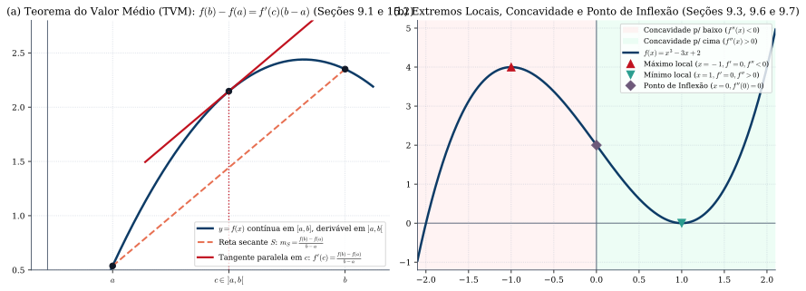
*Figura 7 — (a) Interpretação geométrica do TVM (Seções 9.1 e 15.2): em $c \in \,]a, b[$, a reta tangente ao gráfico de $f$ é paralela à reta secante $S$ que une $(a, f(a))$ e $(b, f(b))$. (b) Estudo completo de $f(x) = x^3 - 3x + 2$: máximo local em $x = -1$, mínimo local em $x = 1$, concavidade voltada para baixo em $]-\infty, 0[$ ($f''(x) < 0$), para cima em $]0, +\infty[$ ($f''(x) > 0$) e ponto de inflexão em $x = 0$ (Seções 9.2–9.7).*

---

### 7.2 Intervalos de Crescimento/Decrescimento, Concavidade e Pontos de Inflexão (Seções 9.2 e 9.3)

1. **Teorema de Crescimento e Decrescimento (Seção 9.2):**  
   Seja $f$ **contínua no intervalo $I$** (que pode ser fechado, semiaberto ou aberto!).
   - Se **$f'(x) > 0$ para todo $x$ interior a $I$**, então $f$ é **estritamente crescente em todo o intervalo $I$** (incluindo as extremidades fechadas de $I$, caso pertençam a $I$, pois o TVM aplica-se em $[s, t] \subset I$!).
   - Se **$f'(x) < 0$ para todo $x$ interior a $I$**, então $f$ é **estritamente decrescente em todo o intervalo $I$**.
   *(Atenção a este detalhe fino de Guidorizzi: se $f(x) = x^3 - 3x$, então $f'(x) = 3(x^2-1)$ é $>0$ em $]-\infty, -1[$ e $]1, +\infty[$, e $<0$ em $]-1, 1[$. Como $f$ é contínua nas extremidades $-1$ e $1$, Guidorizzi escreve com total precisão que $f$ é estritamente crescente em **$]-\infty, -1]$** e em **$[1, +\infty[$**, e estritamente decrescente no fechado **$[-1, 1]$**!)*
2. **Definição Geométrica Rigorosa de Concavidade e Ponto de Inflexão (Seção 9.3):**  
   Seja $f$ derivável no intervalo aberto $I$ e, para cada $p \in I$, seja **$T(x) = f(p) + f'(p)(x - p)$** a função afim cujo gráfico é a reta tangente em $(p, f(p))$.
   - **Definição 1 (Concavidade para Cima — Seção 9.3):** Dizemos que $f$ tem a **concavidade para cima** no intervalo aberto $I$ se **$f(x) > T(x)$ quaisquer que sejam $x$ e $p$ em $I$, com $x \neq p$** (isto é, o gráfico de $f$ em $I$ permanece estritamente acima de qualquer uma de suas retas tangentes, exceto no ponto de tangência!).
   - **Definição 2 (Concavidade para Baixo — Seção 9.3):** Dizemos que $f$ tem a **concavidade para baixo** no intervalo aberto $I$ se **$f(x) < T(x)$ quaisquer que sejam $x$ e $p$ em $I$, com $x \neq p$**.
   - **Definição 3 (Ponto de Inflexão — Seção 9.3):** Sejam $f$ uma função e $p \in D_f$, com **$f$ contínua em $p$**. Dizemos que **$p$ é ponto de inflexão de $f$** se existirem $a, b \in \mathbb{R}$, com $p \in \,]a, b[ \subset D_f$, tais que $f$ tenha **concavidades de nomes contrários em $]a, p[$ e em $]p, b[$**. *(Note que a Definição 3 exige apenas a continuidade de $f$ em $p$, permitindo que $p$ seja ponto de inflexão mesmo com tangente vertical, como $f(x) = \sqrt[3]{x}$ em $p = 0$!)*
   - **Teorema do Sinal da 2ª Derivada para a Concavidade (Seção 9.3):** Se $f$ admite derivada até a 2ª ordem no intervalo aberto $I$:
     $$\boxed{f''(x) > 0 \text{ em } I \implies \text{concavidade para cima em } I, \qquad f''(x) < 0 \text{ em } I \implies \text{concavidade para baixo em } I}$$
     *(Condição necessária para ponto de inflexão regular — Exemplo 3 da Seção 9.3: se $f$ é derivável até a 2ª ordem em $I$, com $f''$ contínua em $p \in I$, e $p$ é ponto de inflexão, então necessariamente **$f''(p) = 0$**; contudo, $f''(p) = 0$ não é suficiente se $f''$ não mudar de sinal em torno de $p$, como mostra $f(x) = x^4$ em $p = 0$).*

---

### 7.3 Regras de L'Hospital, Condições Suficientes de Extremos e Esboço de Gráficos (Seções 9.4 a 9.8)

1. **1ª e 2ª Regras de L'Hospital (Seção 9.4):**  
   Sejam $f$ e $g$ deriváveis em $]p, p+r[$ (ou $]p-r, p[$, ou $]a, +\infty[$), com $g'(x) \neq 0$. Se $\lim f(x) = \lim g(x) = 0$ (**forma $\frac{0}{0}$**) ou $\lim |f(x)| = \lim |g(x)| = +\infty$ (**forma $\frac{\infty}{\infty}$**), e se existir (finito ou $\pm\infty$) o limite $\lim \frac{f'(x)}{g'(x)}$, então:
   $$\boxed{\lim \frac{f(x)}{g(x)} = \lim \frac{f'(x)}{g'(x)}}$$
2. **Condições Suficientes para Máximos e Mínimos Locais (Seção 9.7):**
   - **Critério da Mudança de Sinal de $f'$ (1ª Derivada — Seção 9.7):** Seja $f$ contínua em $]a, b[$ e derivável em $]a, p[$ e em $]p, b[$ ($p \in \,]a, b[$):
     - Se $f'(x) > 0$ em $]a, p[$ e $f'(x) < 0$ em $]p, b[ \implies p$ é **ponto de máximo local**.
     - Se $f'(x) < 0$ em $]a, p[$ e $f'(x) > 0$ em $]p, b[ \implies p$ é **ponto de mínimo local**.
   - **Critério da 2ª Derivada (Teorema 2, Seção 9.7):** Sejam $f$ uma função que admite derivada de 2ª ordem **contínua** no intervalo aberto $I$ e $p \in I$ *(ou, mais geralmente, pelo Exercício 6 da Seção 9.7, bastando existir $f''(p)$)*:
     $$\boxed{f'(p) = 0 \text{ e } f''(p) > 0 \implies p \text{ é ponto de mínimo local}; \qquad f'(p) = 0 \text{ e } f''(p) < 0 \implies p \text{ é ponto de máximo local}.}$$

---

### 📝 Exercícios Selecionados dos Capítulos 9 e 15 (Com Resolução Passo a Passo)

<strong>Exercício 7.1 (Guidorizzi, Seções 9.2 e 15.1) — Existência e Unicidade de Raízes (Bolzano + Rolle):</strong> Prove que a equação $x^3 + 3x^2 + 6x - 4 = 0$ admite <strong>uma única</strong> raiz real, e que ela pertence ao intervalo $]0, 1[$.

**Resolução Passo a Passo:**
1. **Existência (Teorema do Anulamento — Cap. 5):** Seja $f(x) = x^3 + 3x^2 + 6x - 4$. Como $f$ é polinomial, é contínua em $\mathbb{R}$ e, em particular, em $[0, 1]$. Temos $f(0) = -4 < 0$ e $f(1) = 1 + 3 + 6 - 4 = 6 > 0$. Pelo Teorema do Anulamento, existe pelo menos um $c \in \,]0, 1[$ tal que $f(c) = 0$.
2. **Unicidade (via Teorema de Rolle ou Monotonicidade — Seções 9.2 e 15.1):** Calculando a derivada:
   $$f'(x) = 3x^2 + 6x + 6 = 3(x^2 + 2x + 2) = 3\big[(x + 1)^2 + 1\big] \ge 3 > 0 \quad (\forall x \in \mathbb{R}).$$
   Se existissem duas raízes reais distintas $c_1 < c_2$ ($f(c_1) = f(c_2) = 0$), pelo **Teorema de Rolle** aplicado em $[c_1, c_2]$ existiria $\bar{c} \in \,]c_1, c_2[$ tal que $f'(\bar{c}) = 0$, o que contradiz $f'(x) \ge 3 > 0$! Logo, a raiz real é **única**. $\blacksquare$

<strong>Exercício 7.2 (Guidorizzi, Seção 9.4) — Limite Indeterminado do Tipo $0^0$ e $\frac{0}{0}$ via L'Hospital:</strong> Calcule (a) $\displaystyle \lim_{x \to 0^+} x^{\operatorname{sen} x}$ e (b) $\displaystyle \lim_{x \to 0} \frac{e^x - e^{-x} - 2x}{x - \operatorname{sen} x}$.

**Resolução Passo a Passo:**
1. **(a) Forma indeterminada $0^0$:** Escrevemos $x^{\operatorname{sen} x} = e^{\operatorname{sen} x \cdot \ln x}$ ($x > 0$). Calculamos separadamente o limite do expoente $\lim_{x \to 0^+} \operatorname{sen} x \cdot \ln x$:
   $$\lim_{x \to 0^+} (\operatorname{sen} x \cdot \ln x) = \lim_{x \to 0^+} \left(\frac{\operatorname{sen} x}{x}\right) \cdot (x \ln x).$$
   Sabemos que $\lim_{x \to 0^+} \frac{\operatorname{sen} x}{x} = 1$, e por L'Hospital na forma $\frac{-\infty}{+\infty}$:
   $$\lim_{x \to 0^+} x \ln x = \lim_{x \to 0^+} \frac{\ln x}{1/x} \stackrel{\text{L'H}}{=} \lim_{x \to 0^+} \frac{1/x}{-1/x^2} = \lim_{x \to 0^+} (-x) = 0.$$
   Logo, o expoente tende a $1 \cdot 0 = 0$, e pela continuidade da exponencial: $\lim_{x \to 0^+} x^{\operatorname{sen} x} = e^0 = \mathbf{1}$.
2. **(b) Forma $\frac{0}{0}$ sucessiva:** Aplicando a 1ª Regra de L'Hospital três vezes consecutivas:
   $$\lim_{x \to 0} \frac{e^x - e^{-x} - 2x}{x - \operatorname{sen} x} \stackrel{\text{L'H }\left(\frac{0}{0}\right)}{=} \lim_{x \to 0} \frac{e^x + e^{-x} - 2}{1 - \cos x} \stackrel{\text{L'H }\left(\frac{0}{0}\right)}{=} \lim_{x \to 0} \frac{e^x - e^{-x}}{\operatorname{sen} x} \stackrel{\text{L'H }\left(\frac{0}{0}\right)}{=} \lim_{x \to 0} \frac{e^x + e^{-x}}{\cos x} = \frac{1 + 1}{1} = \mathbf{2}. \quad \blacksquare$$

> 🔗 **Quer mais exercícios de TVM, L'Hospital, Gráficos e Otimização?** Acesse a **[Bateria Completa dos Capítulos 9 e 15 no Paper de Exercícios](./exercicios.html#cap-9-15)**.

---

## 8. Primitivas e a Integral de Riemann (Capítulos 10 e 11 e Apêndice 4 de Guidorizzi vs. Capítulos 1 e 5 de Apostol)

> 📘 **[Referência Principal — Guidorizzi, Vol. 1, 5ª ed., Cap. 10 (Seções 10.1–10.2), Cap. 11 (Seções 11.1–11.8) e Apêndice 4 (Seções A4.1–A4.6)]**

### 8.1 Funções com Derivadas Iguais e Primitivas (Capítulo 10 de Guidorizzi)

> **Teorema 8.1 (Funções com Derivada Nula e Corolário das Primitivas — Seção 10.1):**  
> 1. *Seja $f$ contínua no intervalo $I$. Se **$f'(x) = 0$ em todo $x$ interior a $I$**, então existirá uma constante $k \in \mathbb{R}$ tal que $f(x) = k$ para todo $x \in I$.*  
> 2. **Corolário:** *Sejam $f$ e $g$ contínuas no intervalo $I$. Se **$f'(x) = g'(x)$ em todo $x$ interior a $I$**, então existirá uma constante $k \in \mathbb{R}$ tal que **$g(x) = f(x) + k$** para todo $x \in I$.*

> **⚠️ Atenção à Hipótese de que $I$ seja um INTERVALO:**  
> Se o domínio não for um único intervalo (por exemplo, $D = \mathbb{R}^* = \,]-\infty, 0[ \cup \,]0, +\infty[$), uma função com derivada nula em todo ponto do domínio não precisa ser constante globalmente, mas sim constante em cada intervalo separado! Por isso, na Seção 10.2, Guidorizzi define:
> - **Definição (Primitiva — Seção 10.2):** Seja $f$ uma função definida num **intervalo $I$**. Uma função $F$ definida em $I$ denomina-se **primitiva** de $f$ em $I$ se **$F'(x) = f(x)$** para todo $x \in I$. A família de todas as primitivas de $f$ em $I$ é indicada pela **integral indefinida** $\int f(x)\,dx = F(x) + k$ ($k$ constante).

---

### 8.2 Partição, Soma de Riemann e Definição Rigorosa da Integral de Riemann (Seções 11.1 a 11.4 de Guidorizzi)
1. **Partição $P$ de $[a, b]$ (Seção 11.1):** É um conjunto finito $P : a = x_0 < x_1 < x_2 < \dots < x_n = b$, que divide $[a, b]$ em $n$ subintervalos $[x_{i-1}, x_i]$ de amplitudes $\Delta x_i = x_i - x_{i-1}$. O número **$\max \Delta x_i$** (o maior dos $\Delta x_i$) denomina-se **amplitude da partição $P$**.
2. **Soma de Riemann (Seção 11.2):** Dada $f$ definida em $[a, b]$, uma partição $P$ e uma escolha arbitrária de pontos $c_i \in [x_{i-1}, x_i]$ ($i = 1, \dots, n$), a soma:
   $$\sum_{i=1}^{n} f(c_i)\,\Delta x_i = f(c_1)\Delta x_1 + f(c_2)\Delta x_2 + \dots + f(c_n)\Delta x_n$$
   denomina-se **soma de Riemann de $f$**, relativa à partição $P$ e aos números $c_i$.
3. **Definição de Integral de Riemann (Seção 11.3):**  
   Dizemos que $\sum_{i=1}^n f(c_i)\Delta x_i$ tende a $L \in \mathbb{R}$, quando $\max \Delta x_i \to 0$, e escrevemos $\lim_{\max \Delta x_i \to 0} \sum_{i=1}^n f(c_i)\Delta x_i = L$, se:
   > **Para todo $\varepsilon > 0$ dado, existir um $\delta > 0$ que só dependa de $\varepsilon$, mas NÃO da particular escolha dos $c_i$, tal que**
   > $$\left|\sum_{i=1}^{n} f(c_i)\,\Delta x_i - L\right| < \varepsilon$$
   > **para toda partição $P$ de $[a, b]$ com $\max \Delta x_i < \delta$, e qualquer que seja a escolha de $c_i \in [x_{i-1}, x_i]$.**  
   Tal número $L$ (quando existe, é único) denomina-se **integral de Riemann de $f$ em $[a, b]$** e indica-se por **$\int_a^b f(x)\,dx$**. Nesse caso, dizemos que **$f$ é integrável (segundo Riemann) em $[a, b]$**.

4. **Quais Funções São Integráveis Segundo Riemann? (Apêndice 4, Seções A4.1 a A4.6 de Guidorizzi):**
   - **Condição Necessária (Teorema da Seção A4.1):** *Se $f$ for integrável segundo Riemann em $[a, b]$, então $f$ será obrigatoriamente **limitada** em $[a, b]$.*
   - **Classes de Funções Integráveis demonstradas no Apêndice 4:**
     1. **Toda função contínua em $[a, b]$ é integrável em $[a, b]$** (Seção A4.3);
     2. **Toda função limitada em $[a, b]$ e descontínua em apenas um número finito de pontos é integrável em $[a, b]$** (Corolário da Seção A4.4);
     3. **Toda função monótona (crescente ou decrescente) em $[a, b]$ é integrável em $[a, b]$** (Seção A4.5);
     4. **Critério Geral de Integrabilidade de Lebesgue (Seção A4.6):** *Uma função limitada $f: [a, b] \to \mathbb{R}$ é integrável segundo Riemann em $[a, b]$ se, e somente se, o conjunto dos pontos de descontinuidade de $f$ em $[a, b]$ tiver **medida nula**.*

> 📙 **[Mudança de Referência / Complemento — Apostol, Cálculo I, Cap. 1 (Seções 1.8–1.22): A Construção da Integral via Funções em Escada e Integrais Superior/Inferior de Darboux]**  
> Enquanto Guidorizzi define a integral diretamente pelo limite $\varepsilon$-$\delta$ das somas de Riemann $\sum f(c_i)\Delta x_i$ na Seção 11.3 (e utiliza somas inferiores e superiores no Apêndice 4 para provar a integrabilidade de funções contínuas), **Tom M. Apostol** constrói a integral no Capítulo 1 de *Cálculo I* pelo **método de Darboux via funções em escada**:
> 1. Uma **função em escada** $s: [a, b] \to \mathbb{R}$ assume um valor constante $s_i$ em cada subintervalo aberto $]x_{i-1}, x_i[$ de uma partição $P$, e sua integral é simplesmente a soma finita $\int_a^b s(x)\,dx = \sum_{i=1}^n s_i (x_i - x_{i-1})$ (Seção 1.12).
> 2. Para uma função limitada qualquer $f: [a, b] \to \mathbb{R}$, Apostol aproxima $f$ por baixo por funções em escada $s \le f$ e por cima por funções em escada $t \ge f$, definindo (Seção 1.17):
>    $$\underline{I}(f) = \sup \left\{\int_a^b s(x)\,dx \;\middle|\; s \le f\right\} \quad (\text{integral inferior}) \qquad \text{e} \qquad \overline{I}(f) = \inf \left\{\int_a^b t(x)\,dx \;\middle|\; t \ge f\right\} \quad (\text{integral superior}).$$
> 3. Diz-se que **$f$ é integrável em $[a, b]$** quando **$\underline{I}(f) = \overline{I}(f)$**, definindo-se $\int_a^b f(x)\,dx$ como esse valor comum! Ambas as definições (Riemann em Guidorizzi e Darboux/Escada em Apostol) são **totalmente equivalentes** para funções limitadas em $[a, b]$.

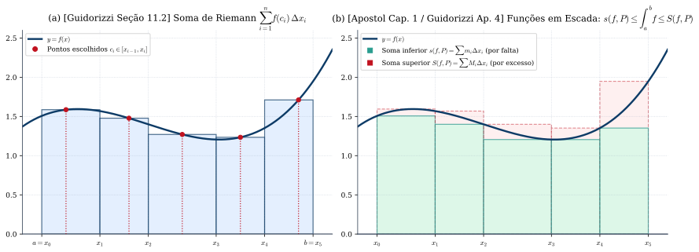
*Figura 8 — (a) Soma de Riemann na Seção 11.2 de Guidorizzi: em cada subintervalo $[x_{i-1}, x_i]$, a altura do retângulo é $f(c_i)$ para um ponto arbitrário $c_i \in [x_{i-1}, x_i]$. (b) Abordagem complementar por funções em escada / somas de Darboux (Apostol Cap. 1 e Guidorizzi Apêndice 4, Seção A4.2): a soma inferior $\sum m_i \Delta x_i$ aproxima a integral por falta e a soma superior $\sum M_i \Delta x_i$ aproxima por excesso.*

---

### 8.3 O 1º Teorema Fundamental do Cálculo (Guidorizzi Seção 11.5) e a Comparação com o 1º e 2º TFC de Apostol (Cap. 5)

> 📘 **[Referência Principal — Guidorizzi, Vol. 1, 5ª ed., Cap. 11, Seção 11.5]**

> **Teorema 8.2 (1º Teorema Fundamental do Cálculo — Seção 11.5 de Guidorizzi):**  
> *Se $f$ for **integrável em $[a, b]$** e se **$F$ for uma primitiva de $f$ em $[a, b]$** (isto é, $F'(x) = f(x)$ para todo $x \in [a, b]$), então:*
> $$\boxed{\int_{a}^{b} f(x)\,dx = \Big[F(x)\Big]_{a}^{b} = F(b) - F(a)}$$

- **Demonstração Completa e Rigorosa de Guidorizzi (Seção 11.5 — Por que a hipótese de $f$ ser integrável é usada!):**  
  1. Como $F$ é uma primitiva de $f$ em $[a, b]$, $F$ é derivável (logo contínua) em $[a, b]$, com $F'(x) = f(x)$.  
  2. Dada **qualquer partição** $P : a = x_0 < x_1 < \dots < x_n = b$ de $[a, b]$, aplicamos o **Teorema do Valor Médio (TVM)** a $F$ em cada subintervalo $[x_{i-1}, x_i]$: existe $\bar{c}_i \in \,]x_{i-1}, x_i[$ tal que $F(x_i) - F(x_{i-1}) = F'(\bar{c}_i)(x_i - x_{i-1}) = f(\bar{c}_i)\Delta x_i$. Somando de $i = 1$ até $n$ (soma telescópica):
     $$F(b) - F(a) = \sum_{i=1}^{n} \big[F(x_i) - F(x_{i-1})\big] = \sum_{i=1}^{n} f(\bar{c}_i)\,\Delta x_i \qquad \text{(para toda partição } P\text{)}.$$
  3. Agora entra a hipótese de **$f$ ser integrável em $[a, b]$**: pela Definição 11.3, para todo $\varepsilon > 0$ existe $\delta > 0$ tal que, para toda partição $P$ com $\max \Delta x_i < \delta$ e **qualquer que seja a escolha de $c_i \in [x_{i-1}, x_i]$**, vale $\left|\sum_{i=1}^n f(c_i)\Delta x_i - \int_a^b f(x)\,dx\right| < \varepsilon$. Escolhendo em particular $c_i = \bar{c}_i$, a soma de Riemann é exatamente $F(b) - F(a)$, logo:
     $$\left|F(b) - F(a) - \int_{a}^{b} f(x)\,dx\right| < \varepsilon \quad (\forall \varepsilon > 0) \implies \int_{a}^{b} f(x)\,dx = F(b) - F(a). \quad \blacksquare$$

> 📙 **[Mudança de Referência / Complemento Importante — Apostol, Cálculo I, Cap. 5 (Seções 5.1 e 5.3) e Guidorizzi, Vol. 2, Cap. 2: A Derivada da Função Integral e a Inversão de Nomenclatura entre 1º e 2º TFC]**  
> Conforme Guidorizzi avisa expressamente no Prefácio e na Seção 11.5 do Volume 1, o estudo da função definida por uma integral com limite superior variável $G(x) = \int_a^x f(t)\,dt$ (**2º Teorema Fundamental do Cálculo** na nomenclatura de Guidorizzi) é deixado para o **Capítulo 2 do Volume 2** de *Um Curso de Cálculo*.  
> Em **Tom M. Apostol (*Cálculo I*, Capítulo 5)**, ambos os teoremas são demonstrados no Volume 1, mas com a **numeração invertida** (que também é muito comum em livros norte-americanos):
>
> | Enunciado Matemático | Nome no **Guidorizzi** (*Um Curso de Cálculo*) | Nome no **Apostol** (*Cálculo I*, Cap. 5) |
> | :--- | :--- | :--- |
> | Se $f$ é integrável em $[a,b]$ e $F' = f$, então $\displaystyle \int_a^b f(x)\,dx = F(b) - F(a)$ | **1º Teorema Fundamental do Cálculo** (Vol. 1, Seção 11.5) | **2º Teorema Fundamental do Cálculo** (Vol. 1, Seção 5.3, Teorema 5.3) |
> | Se $f$ é contínua em $I$ e $A(x) = \displaystyle \int_a^x f(t)\,dt$, então **$A'(x) = f(x)$** | **2º Teorema Fundamental do Cálculo** (estudado no **Vol. 2, Cap. 2**) | **1º Teorema Fundamental do Cálculo** (Vol. 1, Seção 5.1, Teorema 5.1) |
>
> **Demonstração de $A'(x) = f(x)$ segundo Apostol (Seção 5.1, via Teorema do Valor Médio para Integrais — Seção 3.19):**  
> Pelo Teorema do Valor Médio para Integrais (Apostol, Seção 3.19), como $f$ é contínua entre $x$ e $x+h$, existe $c$ entre $x$ e $x+h$ tal que:
> $$A(x + h) - A(x) = \int_{x}^{x+h} f(t)\,dt = f(c) \cdot h \implies \frac{A(x + h) - A(x)}{h} = f(c).$$
> Fazendo $h \to 0$, temos $c \to x$ e, pela continuidade de $f$ em $x$, $\lim_{h \to 0} \frac{A(x+h)-A(x)}{h} = f(x)$, provando que **$A'(x) = f(x)$** (e, consequentemente, que **toda função contínua num intervalo $I$ admite primitiva em $I$**!). Combinando com a Regra da Cadeia para extremos variáveis $u(x)$ e $v(x)$ deriváveis:
> $$\boxed{\frac{d}{dx}\left[\int_{u(x)}^{v(x)} f(t)\,dt\right] = f(v(x))\cdot v'(x) - f(u(x))\cdot u'(x)}$$

---

### 8.4 Áreas Planas, Deslocamento vs. Espaço Percorrido, Mudança de Variável e Trabalho (Seções 11.6 a 11.8 de Guidorizzi)

1. **Cálculo de Áreas de Conjuntos Planos (Seção 11.6):**  
   Para a região $A = \{(x, y) \in \mathbb{R}^2 \mid a \le x \le b, \; g(x) \le y \le f(x)\}$ compreendida entre os gráficos de duas funções integráveis com $f(x) \ge g(x)$ em $[a, b]$:
   $$\boxed{\text{ área } A = \int_{a}^{b} \big[f(x) - g(x)\big]\,dx}$$
2. **Deslocamento vs. Espaço Percorrido na Cinemática (Seção 11.6):**  
   Se uma partícula se move sobre o eixo $Ox$ com posição $x = x(t)$ e velocidade $v(t) = x'(t)$ contínua em $[a, b]$:
   $$\boxed{\text{Deslocamento entre } a \text{ e } b = x(b) - x(a) = \int_{a}^{b} v(t)\,dt, \qquad \text{Espaço percorrido entre } a \text{ e } b = \int_{a}^{b} |v(t)|\,dt}$$
3. **Teorema de Mudança de Variável na Integral Definida (Seção 11.7):**  
   *Seja $f$ contínua num intervalo $I$ e sejam $a, b \in I$. Seja $g: [c, d] \to I$, com **$g'$ contínua em $[c, d]$**, tal que $g(c) = a$ e $g(d) = b$. Nestas condições:*
   $$\boxed{\int_{a}^{b} f(x)\,dx = \int_{g(c)}^{g(d)} f(x)\,dx = \int_{c}^{d} f(g(u))\,g'(u)\,du}$$
   *(Observe que na formulação da Seção 11.7 de Guidorizzi, não é necessário que $g$ seja injetora, bastando que $f$ seja contínua em $I$ e $g'$ seja contínua em $[c, d]$!)*
4. **Trabalho e o Teorema do Trabalho-Energia Cinética (Seção 11.8):**  
   Sob uma força resultante contínua $F(x)$ paralela ao eixo $Ox$, o trabalho de $x = a$ até $x = b$ é $\tau = \int_a^b F(x)\,dx$. Pela 2ª Lei de Newton, $F(x(t)) = m a(t) = m v'(t)$, logo (Exemplo 7, Seção 11.8):
   $$\boxed{\tau = \int_{t_0}^{t_1} F(x(t))\,x'(t)\,dt = \int_{t_0}^{t_1} m v'(t) v(t)\,dt = \left[\frac{1}{2}m v^2(t)\right]_{t_0}^{t_1} = \frac{1}{2}m v_1^2 - \frac{1}{2}m v_0^2 = \Delta E_c}$$

---

## 9. Técnicas de Primitivação (Capítulo 12 de Guidorizzi)

> 📘 **[Referência Principal — Guidorizzi, Vol. 1, 5ª ed., Cap. 12 (Seções 12.1–12.11)]**

No Capítulo 12, Guidorizzi organiza sistematicamente as técnicas de cálculo de primitivas $\int f(x)\,dx$ em 11 seções:

### 9.1 Primitivas Imediatas e Substituição Direta $\int f(g(x))g'(x)\,dx$ (Seções 12.1, 12.2 e 12.4)
Sendo $F'(u) = f(u)$, pela Regra da Cadeia $[F(g(x))]' = f(g(x))g'(x)$. Portanto, fazendo $u = g(x)$ e $du = g'(x)\,dx$:
$$\boxed{\int f(g(x))g'(x)\,dx = \int f(u)\,du = F(g(x)) + k}$$
- **Destaques da Seção 12.2:**
  - $\displaystyle \int [g(x)]^\alpha g'(x)\,dx = \frac{[g(x)]^{\alpha+1}}{\alpha + 1} + k \quad (\alpha \neq -1)$;
  - $\displaystyle \int \frac{g'(x)}{g(x)}\,dx = \ln|g(x)| + k \implies \int \operatorname{tg} x\,dx = -\ln|\cos x| + k \quad \text{e} \quad \int \sec x\,dx = \int \frac{\sec^2 x + \sec x \operatorname{tg} x}{\sec x + \operatorname{tg} x}\,dx = \ln|\sec x + \operatorname{tg} x| + k$.

### 9.2 Integração por Partes (Seção 12.3)
Se $f$ e $g$ são deriváveis num intervalo $I$, da derivada do produto $[f(x)g(x)]' = f'(x)g(x) + f(x)g'(x)$ resulta:
$$\boxed{\int f(x)g'(x)\,dx = f(x)g(x) - \int f'(x)g(x)\,dx \qquad \Longleftrightarrow \qquad \int u\,dv = u v - \int v\,du}$$

### 9.3 Substituições Trigonométricas para Radicais do 2º Grau (Seção 12.5)
Para calcular primitivas envolvendo $\sqrt{a^2 - x^2}$, $\sqrt{a^2 + x^2}$ e $\sqrt{x^2 - a^2}$ ($a > 0$), Guidorizzi apresenta na Seção 12.5 (após completar quadrados no trinômio $ax^2 + bx + c$, quando necessário):
1. **Radical $\sqrt{a^2 - x^2}$:** Substituição **$x = a\operatorname{sen} u$** ($u \in \left[-\frac{\pi}{2}, \frac{\pi}{2}\right]$, onde $\cos u \ge 0$), $dx = a\cos u\,du$ e $\sqrt{a^2 - x^2} = a\cos u$.
2. **Radical $\sqrt{a^2 + x^2}$:** Substituição **$x = a\operatorname{tg} u$** ($u \in \,]-\frac{\pi}{2}, \frac{\pi}{2}[$, onde $\sec u > 0$), $dx = a\sec^2 u\,du$ e $\sqrt{a^2 + x^2} = a\sec u$.
3. **Radical $\sqrt{x^2 - a^2}$:** Substituição **$x = a\sec u$**, $dx = a\sec u \operatorname{tg} u\,du$ e $\sqrt{x^2 - a^2} = a|\operatorname{tg} u|$.

### 9.4 Decomposição em Frações Parciais para Funções Racionais $\frac{P(x)}{Q(x)}$ (Seções 12.6 e 12.7)
Se $\text{grau}(P) \ge \text{grau}(Q)$, efetuamos primeiro a divisão euclidiana $P(x) = Q(x)C(x) + R(x)$ com $\text{grau}(R) < \text{grau}(Q)$, donde $\frac{P(x)}{Q(x)} = C(x) + \frac{R(x)}{Q(x)}$. Para integrar $\frac{R(x)}{Q(x)}$ com $\text{grau}(R) < \text{grau}(Q)$, Guidorizzi demonstra na Seção 12.6 e 12.7 os teoremas de decomposição:
1. **Raízes Reais Distintas (Seção 12.6):** $\dfrac{mx^2 + nx + p}{(x - \alpha)(x - \beta)(x - \gamma)} = \dfrac{A}{x - \alpha} + \dfrac{B}{x - \beta} + \dfrac{C}{x - \gamma}$.
2. **Raízes Reais Múltiplas (Seção 12.6):** $\dfrac{mx^2 + nx + p}{(x - \alpha)^2(x - \beta)} = \dfrac{A}{x - \alpha} + \dfrac{B}{(x - \alpha)^2} + \dfrac{C}{x - \beta}$.
3. **Fatores Quadráticos Irredutíveis com $\Delta = b^2 - 4ac < 0$ (Seção 12.7):**
   $$\frac{mx^2 + nx + p}{(x - \alpha)(ax^2 + bx + c)} = \frac{A}{x - \alpha} + \frac{Bx + D}{ax^2 + bx + c}$$
   *(Para integrar $\int \frac{Bx + D}{ax^2 + bx + c}\,dx$, completamos o quadrado em $ax^2 + bx + c = a\left[\left(x + \frac{b}{2a}\right)^2 + k^2\right]$, fazemos $u = x + \frac{b}{2a}$, e separamos na soma de um logaritmo $\int \frac{2u}{u^2+k^2}\,du = \ln(u^2+k^2)$ com um arco-tangente $\int \frac{1}{u^2+k^2}\,du = \frac{1}{k}\operatorname{arctg}\left(\frac{u}{k}\right)$!)*

### 9.5 Integrais Trigonométricas, Fórmulas de Recorrência e Substituição Universal $u = \operatorname{tg}\left(\frac{x}{2}\right)$ (Seções 12.8 a 12.11)
1. **Produtos de Senos e Cossenos com Arcos Diferentes (Seção 12.8):**  
   Usam-se as identidades de prostaférese reversa:
   $$\operatorname{sen} a \cos b = \frac{1}{2}[\operatorname{sen}(a+b) + \operatorname{sen}(a-b)], \quad \cos a \cos b = \frac{1}{2}[\cos(a+b) + \cos(a-b)], \quad \operatorname{sen} a \operatorname{sen} b = \frac{1}{2}[\cos(a-b) - \cos(a+b)].$$
2. **Potências de Seno/Cosseno e Fórmulas de Recorrência (Seção 12.9):**  
   Integrando por partes $\int \operatorname{sen}^n x\,dx = \int \operatorname{sen}^{n-1} x \operatorname{sen} x\,dx$ ($n \ge 2$), Guidorizzi deduz a **Fórmula de Recorrência**:
   $$\boxed{\int \operatorname{sen}^n x\,dx = -\frac{1}{n}\operatorname{sen}^{n-1} x \cos x + \frac{n - 1}{n}\int \operatorname{sen}^{n-2} x\,dx \qquad (n \ge 2)}$$
3. **Potências de Tangente/Secante e Fórmulas de Recorrência (Seção 12.10):**  
   Usando $\operatorname{tg}^2 x = \sec^2 x - 1$ e integração por partes para $\sec^n x$ ($n \ge 2$):
   $$\boxed{\int \operatorname{tg}^n x\,dx = \frac{\operatorname{tg}^{n-1} x}{n - 1} - \int \operatorname{tg}^{n-2} x\,dx \qquad \text{e} \qquad \int \sec^n x\,dx = \frac{\sec^{n-2} x \operatorname{tg} x}{n - 1} + \frac{n - 2}{n - 1}\int \sec^{n-2} x\,dx}$$
4. **A Mudança de Variável Trigonométrica Universal $u = \operatorname{tg}\left(\frac{x}{2}\right)$ (Seção 12.11 de Guidorizzi / Seção 6.24 de Apostol):**  
   Para integrar funções racionais de $\operatorname{sen} x$ e $\cos x$ (como $\int \frac{1}{2 + \cos x}\,dx$), a substituição **$u = \operatorname{tg}\left(\frac{x}{2}\right)$** ($-\pi < x < \pi$) transforma qualquer expressão trigonométrica numa função racional de $u$:
   $$\boxed{u = \operatorname{tg}\left(\frac{x}{2}\right) \implies \operatorname{sen} x = \frac{2u}{1 + u^2}, \qquad \cos x = \frac{1 - u^2}{1 + u^2}, \qquad dx = \frac{2}{1 + u^2}\,du}$$

---

### 📝 Exercícios Selecionados dos Capítulos 11 e 12 (Com Resolução Passo a Passo)

<strong>Exercício 9.1 (Guidorizzi, Seções 12.6–12.7) — Frações Parciais com Fator Irredutível do 2º Grau:</strong> Calcule a integral indefinida $\displaystyle \int \frac{2x^2 - x + 4}{x^3 + 4x}\,dx$.

**Resolução Passo a Passo:**
1. Fatoramos o denominador: $x^3 + 4x = x(x^2 + 4)$, onde $x^2 + 4$ é irredutível ($\Delta = -16 < 0$). Pela Seção 12.7, decompomos em frações parciais:
   $$\frac{2x^2 - x + 4}{x(x^2 + 4)} = \frac{A}{x} + \frac{Bx + D}{x^2 + 4} = \frac{A(x^2 + 4) + (Bx + D)x}{x(x^2 + 4)} = \frac{(A + B)x^2 + Dx + 4A}{x(x^2 + 4)}.$$
2. Igualando os coeficientes dos polinômios dos numeradores:
   - Termo independente: $4A = 4 \implies A = 1$;
   - Termo em $x$: $D = -1$;
   - Termo em $x^2$: $A + B = 2 \implies 1 + B = 2 \implies B = 1$.
3. Integrando termo a termo:
   $$\int \frac{2x^2 - x + 4}{x^3 + 4x}\,dx = \int \frac{1}{x}\,dx + \int \frac{x}{x^2 + 4}\,dx - \int \frac{1}{x^2 + 4}\,dx = \mathbf{\ln|x| + \frac{1}{2}\ln(x^2 + 4) - \frac{1}{2}\operatorname{arctg}\left(\frac{x}{2}\right) + k}. \quad \blacksquare$$

<strong>Exercício 9.2 (Guidorizzi, Seção 12.11) — Substituição Universal $u = \operatorname{tg}(x/2)$:</strong> Calcule $\displaystyle \int_{0}^{\pi/2} \frac{1}{2 + \cos x}\,dx$.

**Resolução Passo a Passo:**
1. Fazendo a mudança $u = \operatorname{tg}\left(\frac{x}{2}\right)$, temos $\cos x = \frac{1 - u^2}{1 + u^2}$ e $dx = \frac{2}{1 + u^2}\,du$.
2. Trocando os limites de integração: para $x = 0 \implies u = \operatorname{tg} 0 = 0$; para $x = \frac{\pi}{2} \implies u = \operatorname{tg}\left(\frac{\pi}{4}\right) = 1$.
3. Substituindo na integral:
   $$\int_{0}^{\pi/2} \frac{1}{2 + \cos x}\,dx = \int_{0}^{1} \frac{1}{2 + \frac{1 - u^2}{1 + u^2}} \cdot \frac{2}{1 + u^2}\,du = \int_{0}^{1} \frac{2}{2(1 + u^2) + (1 - u^2)}\,du = \int_{0}^{1} \frac{2}{3 + u^2}\,du.$$
4. Usando $\int \frac{1}{a^2 + u^2}\,du = \frac{1}{a}\operatorname{arctg}\left(\frac{u}{a}\right)$ com $a = \sqrt{3}$:
   $$\int_{0}^{1} \frac{2}{3 + u^2}\,du = \left[\frac{2}{\sqrt{3}}\operatorname{arctg}\left(\frac{u}{\sqrt{3}}\right)\right]_{0}^{1} = \frac{2}{\sqrt{3}}\left(\frac{\pi}{6} - 0\right) = \mathbf{\frac{\pi}{3\sqrt{3}} = \frac{\pi\sqrt{3}}{9}}. \quad \blacksquare$$

> 🔗 **Quer mais exercícios de Integração por Partes, Substituição Trigonométrica e Frações Parciais?** Acesse a **[Bateria Completa dos Capítulos 10 a 12 no Paper de Exercícios](./exercicios.html#cap-12)**.

---

## 10. Mais Aplicações da Integral e Coordenadas Polares (Capítulo 13 e Apêndice 5 de Guidorizzi)

> 📘 **[Referência Principal — Guidorizzi, Vol. 1, 5ª ed., Cap. 13 (Seções 13.1–13.9) e Apêndice 5]**

### 10.1 Volumes de Sólidos de Revolução e por Seções Transversais (Seções 13.1 a 13.3)
1. **Rotação em Torno do Eixo $x$ — Método dos Discos (Seção 13.1):**  
   Para o conjunto $A = \{(x, y) \in \mathbb{R}^2 \mid a \le x \le b, \; 0 \le y \le f(x)\}$ ($f$ contínua e $f(x) \ge 0$ em $[a, b]$):
   $$\boxed{V_x = \pi \int_{a}^{b} \big[f(x)\big]^2\,dx}$$
2. **Rotação em Torno do Eixo $y$ — Método das Cascas Cilíndricas (Seção 13.2):**  
   Para o mesmo conjunto $A$ com **$a \ge 0$**, aproximando o sólido pela reunião de cascas cilíndricas concêntricas de raio médio $\bar{x}_i = \frac{x_i + x_{i-1}}{2}$, espessura $\Delta x_i$ e altura $f(\bar{x}_i)$ (cujo volume exato da diferença de cilindros é $\pi x_i^2 f(\bar{x}_i) - \pi x_{i-1}^2 f(\bar{x}_i) = 2\pi \bar{x}_i f(\bar{x}_i)\Delta x_i$), Guidorizzi deduz:
   $$\boxed{V_y = 2\pi \int_{a}^{b} x f(x)\,dx \qquad (0 \le a \le b)}$$
3. **Volume de um Sólido Qualquer por Seções Transversais Planas (Seção 13.3):**  
   Se para cada $x \in [a, b]$ o plano perpendicular ao eixo $Ox$ intercepta um sólido $S$ segundo uma seção plana de área conhecida $A(x)$ (contínua em $[a, b]$), então:
   $$\boxed{V = \int_{a}^{b} A(x)\,dx}$$

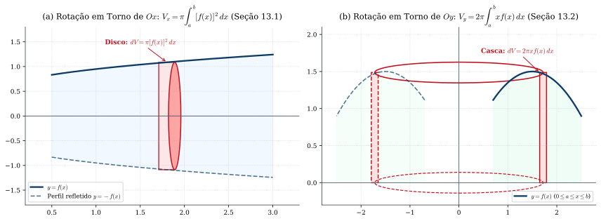
*Figura 9 — (a) Rotação em torno de $Ox$ (Seção 13.1): fatias perpendiculares ao eixo de rotação geram discos de volume $dV = \pi [f(x)]^2\,dx$. (b) Rotação em torno de $Oy$ (Seção 13.2): fatias paralelas ao eixo de rotação geram cascas cilíndricas de volume $dV = 2\pi x f(x)\,dx$.*

---

### 10.2 Área de Superfície de Revolução e Comprimento de Curvas (Seções 13.4 a 13.6 e Apêndice 5)
1. **Área de Superfície de Revolução (Seção 13.4 e Apêndice 5):**  
   Seja $f$ com derivada contínua e $f(x) \ge 0$ em $[a, b]$. No **Apêndice 5**, Guidorizzi aproxima a superfície gerada pela rotação do gráfico de $f$ em torno do eixo $x$ por troncos de cone de geratriz $\Delta s_i = \sqrt{(\Delta x_i)^2 + (\Delta y_i)^2} = \sqrt{1 + [f'(c_i)]^2}\,\Delta x_i$ (pelo TVM) e área lateral $\pi [f(x_{i-1}) + f(x_i)] \Delta s_i$, demonstrando:
   $$\boxed{A_S = 2\pi \int_{a}^{b} f(x)\sqrt{1 + \big[f'(x)\big]^2}\,dx}$$
2. **Comprimento de Gráfico $y = f(x)$ (Seção 13.5) e de Curva Parametrizada (Seção 13.6):**  
   Definindo o comprimento da curva como o supremo dos comprimentos das poligonais inscritas e aplicando o TVM em cada segmento poligonal:
   $$\boxed{s = \int_{a}^{b} \sqrt{1 + \big[f'(x)\big]^2}\,dx \qquad \text{e, na forma paramétrica } x = x(t), y = y(t): \qquad s = \int_{t_0}^{t_1} \sqrt{\big[x'(t)\big]^2 + \big[y'(t)\big]^2}\,dt}$$

---

### 10.3 Coordenadas Polares, Centro de Massa e os Teoremas de Pappus (Seções 13.7 a 13.9)
Em **coordenadas polares $(\theta, r)$**, com $x = r\cos\theta$ e $y = r\operatorname{sen}\theta$:
1. **Área em Coordenadas Polares (Seção 13.7):** Para a região delimitada por $\theta = \alpha$, $\theta = \beta$ ($\alpha < \beta$) e pela curva polar $r = f(\theta) \ge 0$ contínua:
   $$\boxed{A = \frac{1}{2}\int_{\alpha}^{\beta} \big[f(\theta)\big]^2\,d\theta}$$
2. **Comprimento de Curva em Coordenadas Polares (Seção 13.8):** Parametrizando por $x(\theta) = f(\theta)\cos\theta$ e $y(\theta) = f(\theta)\operatorname{sen}\theta$, tem-se $[x'(\theta)]^2 + [y'(\theta)]^2 = [f(\theta)]^2 + [f'(\theta)]^2$, donde:
   $$\boxed{s = \int_{\alpha}^{\beta} \sqrt{\big[f(\theta)\big]^2 + \big[f'(\theta)\big]^2}\,d\theta}$$
3. **Centro de Massa e Teoremas de Pappus (Seção 13.9):**  
   Para uma região plana homogênea $A = \{(x, y) \mid a \le x \le b, \; f(x) \le y \le g(x)\}$ ($f(x) \le g(x)$), o centro de massa $(x_c, y_c)$ é dado por:
   $$\boxed{x_c = \frac{\displaystyle \int_{a}^{b} x\big[g(x) - f(x)\big]\,dx}{\text{área } A}, \qquad y_c = \frac{\displaystyle \frac{1}{2}\int_{a}^{b} \left(\big[g(x)\big]^2 - \big[f(x)\big]^2\right)dx}{\text{área } A}}$$
   Consequentemente (**Teorema de Pappus**, Exercícios 3 e 9 da Seção 13.9): o volume do sólido obtido pela rotação de $A$ em torno de um eixo que não o atravessa é igual ao produto da área de $A$ pelo comprimento da circunferência descrita pelo seu centro de massa ($V_x = (2\pi y_c)\cdot \text{área } A$ e $V_y = (2\pi x_c)\cdot \text{área } A$)!

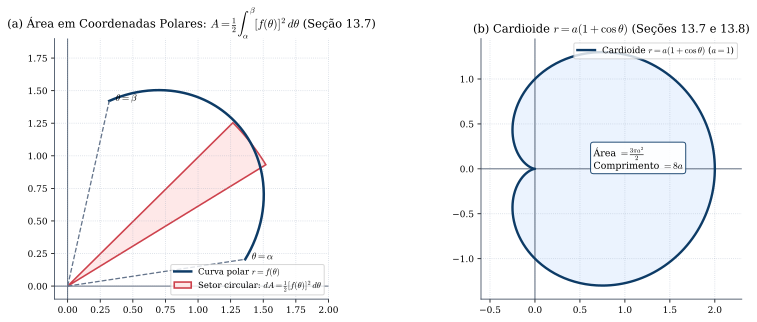
*Figura 10 — (a) Aproximação por setores circulares infinitesimais de abertura $d\theta$ e raio $r = f(\theta)$, fornecendo $dA = \frac{1}{2}[f(\theta)]^2\,d\theta$ (Seção 13.7). (b) A cardioide $r = a(1 + \cos\theta)$, de área total $\frac{3\pi a^2}{2}$ e comprimento total $8a$ (Exemplos das Seções 13.7 e 13.8).*

---

## 11. Equações Diferenciais de 1ª Ordem de Variáveis Separáveis e Lineares (Capítulo 14 de Guidorizzi)

> 📘 **[Referência Principal — Guidorizzi, Vol. 1, 5ª ed., Cap. 14 (Seções 14.1–14.6) e Demonstração do Teorema da Seção 14.4 no Apêndice]**

### 11.1 EDOs de 1ª Ordem de Variáveis Separáveis e o Teorema de Não-Anulamento de $h(x(t))$ (Seções 14.2 a 14.5)
Na Seção 14.2, uma equação diferencial de 1ª ordem de **variáveis separáveis** na incógnita $x = x(t)$ tem a forma:
$$\boxed{\frac{dx}{dt} = g(t) \cdot h(x)}$$
onde $g$ e $h$ são definidas em intervalos abertos $I_1$ e $I_2$, com $g$ contínua em $I_1$ e $h'$ contínua em $I_2$. Guidorizzi divide a análise das soluções em duas etapas rigorosas:

1. **Soluções Constantes (Seção 14.3):**  
   Se $x_0 \in I_2$ é uma raiz de $h(x) = 0$ (isto é, **$h(x_0) = 0$**), então a função constante **$x(t) = x_0$**, $t \in I_1$, satisfaz $\frac{dx}{dt} = 0 = g(t)h(x_0)$, sendo portanto uma **solução constante** da EDO.
2. **Soluções Não Constantes e o Teorema Fundamental da Seção 14.4:**  
   Para dividir a equação por $h(x)$, precisamos ter certeza de que uma solução não constante $x = x(t)$ jamais assume um valor onde $h(x(t)) = 0$. Guidorizzi enuncia na **Seção 14.4** (e demonstra rigorosamente no apêndice usando os Lemas 1 e 2 de unicidade local):
   > **Teorema 11.1 (Teorema da Seção 14.4 de Guidorizzi):**  
   > *Seja a equação $\frac{dx}{dt} = g(t)h(x)$, em que $g$ é contínua no intervalo aberto $I_1$ e **$h'$ é contínua no intervalo aberto $I_2$**. Nestas condições, se $x = x(t)$, $t \in I$, for uma **solução não constante** da equação, então, para todo $t \in I$:*
   > $$\boxed{h(x(t)) \neq 0}$$
   > *(Geometricamente: os gráficos das soluções não constantes **jamais tocam nem cruzam** as retas horizontais correspondentes às soluções constantes $x = x_0$!)*
3. **Método Prático para Determinar as Soluções Não Constantes (Seção 14.5):**  
   Graças ao Teorema 11.1, para $h(x) \neq 0$ podemos separar as variáveis e integrar:
   $$\boxed{\frac{1}{h(x)}\,\frac{dx}{dt} = g(t) \iff \int \frac{1}{h(x)}\,dx = \int g(t)\,dt + k}$$

> 📙 **[Mudança de Referência / Complemento — Apostol, Cálculo I, Cap. 8 (Seção 8.21): Curvas Integrais e Campos Direcionais]**  
> No Capítulo 8 de *Cálculo I* (Seção 8.21), **Tom M. Apostol** introduz a interpretação geométrica de uma EDO de 1ª ordem $y' = F(x, y)$ como um **campo direcional (ou campo de declives)**: a cada ponto $(x, y)$ do plano associa-se um pequeno segmento de reta de coeficiente angular $F(x, y)$. Resolver a EDO equivale a traçar as **curvas integrais** que são tangentes ao campo direcional em cada ponto!

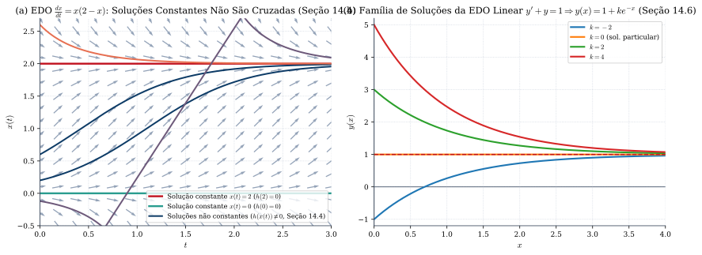
*Figura 11 — (a) Campo direcional (Apostol, Seção 8.21) e soluções da EDO separável $\frac{dx}{dt} = x(2-x)$: as soluções constantes $x(t)=0$ e $x(t)=2$ separam o plano em faixas invariantes, pois nenhuma solução não constante pode anular $h(x) = x(2-x)$ (Teorema da Seção 14.4 de Guidorizzi). (b) Família de curvas integrais da EDO linear $y' + y = 1$ (Seção 14.6).*

---

### 11.2 Equações Diferenciais Lineares de 1ª Ordem e o Fator Integrante (Seção 14.6 de Guidorizzi)
Uma EDO linear de 1ª ordem na incógnita $y = y(x)$ tem a forma:
$$\boxed{\frac{dy}{dx} + a(x)y = b(x)}$$
em que $a(x)$ e $b(x)$ são funções contínuas num intervalo aberto $I$.
- **Dedução pelo Fator Integrante (Seção 14.6):** Seja **$A(x) = \int a(x)\,dx$** uma primitiva qualquer de $a(x)$ em $I$ (logo $A'(x) = a(x)$). Multiplicando ambos os membros da EDO pelo fator estritamente positivo **$e^{A(x)}$**:
  $$e^{A(x)}\frac{dy}{dx} + a(x)e^{A(x)}y = e^{A(x)}b(x) \iff \frac{d}{dx}\Big[e^{A(x)}\cdot y\Big] = e^{A(x)}b(x).$$
  Integrando ambos os lados em relação a $x$ e isolando $y(x)$, obtemos a **Solução Geral da EDO Linear de 1ª Ordem**:
  $$\boxed{y(x) = e^{-A(x)}\left(\int e^{A(x)}b(x)\,dx + k\right), \qquad \text{onde } A(x) = \int a(x)\,dx}$$

---

## 12. Fórmula e Polinômios de Taylor (Capítulo 16 de Guidorizzi e Capítulo 7 de Apostol)

> 📘 **[Referência Principal — Guidorizzi, Vol. 1, 5ª ed., Cap. 16 (Seções 16.1–16.3)]**

### 12.1 Do Polinômio de Ordem 1 ao Polinômio de Taylor de Ordem $n$ e a Notação $o\big((x-x_0)^n\big)$
Seja $f$ derivável até a ordem $n$ no intervalo $I$ e seja $x_0 \in I$. O **polinômio de Taylor, de ordem $n$, de $f$ em volta de $x_0$** (chamado de **polinômio de Mac-Laurin** quando $x_0 = 0$) é definido na Seção 16.3 por:
$$\boxed{P(x) = f(x_0) + f'(x_0)(x - x_0) + \frac{f''(x_0)}{2!}(x - x_0)^2 + \frac{f'''(x_0)}{3!}(x - x_0)^3 + \dots + \frac{f^{(n)}(x_0)}{n!}(x - x_0)^n = \sum_{k=0}^{n} \frac{f^{(k)}(x_0)}{k!}(x - x_0)^k}$$

1. **Caracterização Local do Erro — Resto Infinitesimal de Peano (Seções 16.1 a 16.3):**  
   Definindo o erro (ou resto) $E(x) = f(x) - P(x)$, tem-se $E(x_0) = E'(x_0) = \dots = E^{(n)}(x_0) = 0$. Aplicando a Regra de L'Hospital $(n-1)$ vezes a $\frac{E(x)}{(x - x_0)^n}$ e usando a definição de $f^{(n)}(x_0)$ no último passo, prova-se que:
   $$\boxed{\lim_{x \to x_0} \frac{f(x) - P(x)}{(x - x_0)^n} = 0 \qquad \Longleftrightarrow \qquad f(x) = P(x) + o\big((x - x_0)^n\big)}$$
   onde **$o\big((x - x_0)^n\big)$** indica um infinitésimo de ordem superior a $(x - x_0)^n$ quando $x \to x_0$. Além disso, $P(x)$ é o **único** polinômio de grau $\le n$ que satisfaz essa propriedade!
2. **Teorema 12.1 (Fórmula de Taylor com Resto de Lagrange — Seção 16.3):**  
   > *Seja $f$ derivável até a ordem **$n + 1$** no intervalo $I$ e sejam $x, x_0 \in I$ ($x \neq x_0$). Então existe pelo menos um **$\bar{x}$ no intervalo aberto de extremos $x_0$ e $x$** tal que:*
   > $$\boxed{f(x) = f(x_0) + f'(x_0)(x - x_0) + \frac{f''(x_0)}{2!}(x - x_0)^2 + \dots + \frac{f^{(n)}(x_0)}{n!}(x - x_0)^n + \frac{f^{(n+1)}(\bar{x})}{(n + 1)!}(x - x_0)^{n+1}}$$
   - **Demonstração de Guidorizzi via Teorema de Cauchy (Seções 16.1–16.3):**  
     Para $E(x) = f(x) - P(x)$ e $h(x) = (x - x_0)^{n+1}$, temos $E(x_0) = E'(x_0) = \dots = E^{(n)}(x_0) = 0$, $h(x_0) = h'(x_0) = \dots = h^{(n)}(x_0) = 0$, $E^{(n+1)}(t) = f^{(n+1)}(t)$ e $h^{(n+1)}(t) = (n+1)!$. Aplicando o **Teorema de Cauchy (Seção 15.3)** $(n+1)$ vezes sucessivas, existem $x_1, x_2, \dots, \bar{x}$ estritamente entre $x_0$ e $x$ tais que:
     $$\frac{E(x)}{(x - x_0)^{n+1}} = \frac{E(x) - E(x_0)}{h(x) - h(x_0)} = \frac{E'(x_1)}{h'(x_1)} = \frac{E''(x_2)}{h''(x_2)} = \dots = \frac{E^{(n+1)}(\bar{x})}{h^{(n+1)}(\bar{x})} = \frac{f^{(n+1)}(\bar{x})}{(n + 1)!}. \quad \blacksquare$$

> 📙 **[Mudança de Referência / Complemento — Apostol, Cálculo I, Cap. 7 (Seções 7.5–7.9): Forma Integral exata do Resto de Taylor e Álgebra de $o(x^n)$]**  
> No Capítulo 7 de *Cálculo I* (Teorema 7.3, Seção 7.5), **Tom M. Apostol** demonstra a Fórmula de Taylor por um caminho complementar admirável: aplicando **integração por partes repetida $n$ vezes** a $\int_a^x f'(t)\,dt = f(x) - f(a)$ (sob a hipótese de $f^{(n+1)}$ ser contínua em $[a, x]$), ele obtém a **Forma Integral Exata do Resto de Taylor** (que também aparece no Exercício 8 da Seção 16.3 do Guidorizzi!):
> $$\boxed{E_n(x) = \frac{1}{n!}\int_{x_0}^{x} (x - t)^n f^{(n+1)}(t)\,dt}$$
> Na Seção 7.9 (Teorema 7.5), Apostol sistematiza a **álgebra dos símbolos $o(x^n)$ de Landau** para $x \to 0$, que permite calcular limites e polinômios de Taylor compostos sem derivar:
> - $o(x^n) \pm o(x^n) = o(x^n)$ e $c \cdot o(x^n) = o(x^n)$;
> - $x^m \cdot o(x^n) = o(x^{m+n})$ e $o(x^m) \cdot o(x^n) = o(x^{m+n})$;
> - $o(o(x^n)) = o(x^n)$.

---

## 13. Arquimedes, Pascal, Fermat e o Cálculo de Áreas (Capítulo 17 de Guidorizzi e Parte I.1 de Apostol)

> 📘 **[Referência Principal — Guidorizzi, Vol. 1, 5ª ed., Cap. 17 (Seções 17.1–17.3)]**  
> 📙 **[Complemento Sinalizado — Apostol, Cálculo I, Parte I.1 (Seções I.1.2–I.1.4) e Parte I.4 (Indução Matemática)]**

O **Capítulo 17** de Guidorizzi encerra o Volume 1 resgatando os três marcos históricos que pavimentaram a invenção do Cálculo Integral, dialogando diretamente com a Parte Introdutória de **Tom M. Apostol**:

### 13.1 Quadratura da Parábola: O Método de Exaustão de Arquimedes (Seção 17.1 de Guidorizzi)
Na Seção 17.1, Guidorizzi demonstra o célebre teorema de **Arquimedes de Siracusa (287–212 a.C.)**: *a área de qualquer segmento parabólico compreendido entre uma parábola e uma corda $AB$ é igual a **$\frac{4}{3}$ da área do triângulo $\Delta ABC$** inscrito, onde $C$ é o ponto da parábola cuja tangente é paralela à corda $AB$*.
- **A Propriedade Geométrica Fundamental dos Triângulos de Arquimedes:**  
  Dada a parábola $y = ax^2 + bx + c$, se os pontos $A, C, B$ da parábola têm abscissas em progressão aritmética ($x_1 - h$, $x_1$, $x_1 + h$), a área do triângulo $\Delta ACB$ depende **apenas** de $|a|$ e do passo $h$:
  $$\text{área}(\Delta ACB) = |a| h^3.$$
  Ao bissectar o passo $h \mapsto \frac{h}{2}$ para inscrever dois novos triângulos $\Delta_1$ e $\Delta_2$ nas aberturas laterais $AC$ e $CB$, a área de cada novo triângulo passa a ser $|a|\left(\frac{h}{2}\right)^3 = \frac{1}{8}|a|h^3 = \frac{1}{8}A_0$. Como são **dois** triângulos, a soma de suas áreas é $2 \cdot \frac{1}{8}A_0 = \frac{1}{4}A_0$!
- **A Série Geométrica de Razão $q = \frac{1}{4}$:**  
  Prosseguindo indefinidamente, na $k$-ésima etapa surgem $2^k$ triângulos cuja área somada é $\frac{1}{4^k}A_0$. A soma total das áreas dos polígonos inscritos converge para a soma da progressão geométrica infinita de razão $\frac{1}{4}$:
  $$\boxed{\text{Área do Segmento Parabólico} = A_0 \left(1 + \frac{1}{4} + \frac{1}{4^2} + \dots + \frac{1}{4^n} + \dots\right) = \frac{A_0}{1 - \frac{1}{4}} = \frac{4}{3}A_0}$$

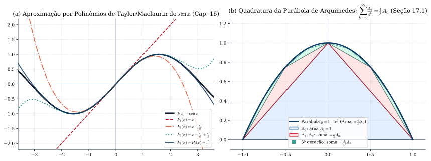
*Figura 12 — (a) Polinômios de Taylor/Maclaurin de ordens $1, 3, 5, 7$ aproximando $f(x) = \operatorname{sen} x$ em torno de $x_0 = 0$ (Cap. 16). (b) Quadratura da Parábola pelo método de exaustão de Arquimedes (Seção 17.1): o triângulo central tem área $A_0$, os dois triângulos de 2ª geração somam $\frac{1}{4}A_0$, os quatro de 3ª geração somam $\frac{1}{4^2}A_0$, totalizando $\frac{4}{3}A_0$.*

### 13.2 Pascal, o Princípio de Indução Finita (PIF) e a Área sob $y = x^k$ (Seção 17.2 de Guidorizzi e Parte I.1.3 de Apostol)
Para calcular a área sob $y = x^k$ ($0 \le x \le b$, $k \in \mathbb{N}^*$), dividimos $[0, b]$ em $n$ partes iguais de largura $\frac{b}{n}$ (como também faz **Apostol** na Seção I.1.3 para $k=2$). A soma das áreas dos retângulos circunscritos é:
$$S(n) = \sum_{i=1}^{n} \left(i\frac{b}{n}\right)^k \frac{b}{n} = \frac{b^{k+1}}{n^{k+1}} \sum_{i=1}^{n} i^k.$$
Usando a identidade telescópica de **Blaise Pascal (1623–1662)** para $(i + 1)^{k+1} - i^{k+1}$ somada de $i = 1$ até $n$:
$$(n + 1)^{k+1} - 1 = \sum_{i=1}^{n} \big[(i + 1)^{k+1} - i^{k+1}\big] = (k + 1)\sum_{i=1}^{n} i^k + \binom{k+1}{2}\sum_{i=1}^{n} i^{k-1} + \dots + n,$$
dividindo por $n^{k+1}$ e fazendo $n \to \infty$, prova-se por indução que $\lim_{n \to \infty} \frac{\sum_{i=1}^n i^k}{n^{k+1}} = \frac{1}{k + 1}$, obtendo:
$$\boxed{\text{Área sob } y = x^k \text{ em } [0, b] = \lim_{n \to \infty} S(n) = \frac{b^{k+1}}{k + 1}}$$
Na mesma Seção 17.2, Guidorizzi enuncia formalmente o **Princípio de Indução Finita (PIF)** e demonstra a fórmula do **Binômio de Newton**:
$$\boxed{(A + B)^k = \sum_{j=0}^{k} \binom{k}{j} A^{k-j} B^j, \qquad \text{usando a Relação de Stifel } \binom{k}{j-1} + \binom{k}{j} = \binom{k+1}{j}}$$

### 13.3 O Engenhoso Método de Fermat com Partição em Progressão Geométrica (Seção 17.3 de Guidorizzi)
Para evitar o difícil cálculo da soma de potências $\sum_{i=1}^n i^k$ de Pascal, **Pierre de Fermat (1601–1665)** teve a ideia brilhante de subdividir o intervalo $]0, b]$ em infinitos subintervalos cujos extremos formam uma **Progressão Geométrica** de razão $E \in \,]0, 1[$:
$$\dots, \; [b E^i, b E^{i-1}], \; \dots, \; [b E^3, b E^2], \; [b E^2, b E], \; [b E, b].$$
A área do $i$-ésimo retângulo circunscrito em $[b E^i, b E^{i-1}]$ é $(b E^{i-1} - b E^i)(b E^{i-1})^k = b^{k+1}(1 - E)(E^{k+1})^{i-1}$, que é uma **PG infinita de razão $q = E^{k+1} < 1$**! Somando a PG infinita e fatorando $1 - E^{k+1} = (1 - E)(1 + E + E^2 + \dots + E^k)$:
$$\sum_{i=1}^{\infty} \text{área}(R_i) = \frac{b^{k+1}(1 - E)}{1 - E^{k+1}} = \frac{b^{k+1}}{1 + E + E^2 + \dots + E^k} \xrightarrow{E \to 1^-} \boxed{\frac{b^{k+1}}{k + 1}}$$

---

## 14. Síntese dos 6 Apêndices de Guidorizzi (5ª Edição) e Referências Bibliográficas

| Apêndice (Guidorizzi Vol. 1, 5ª ed.) | Conteúdo Rigoroso Demonstrado |
| :--- | :--- |
| **Apêndice 1** (*Propriedade do Supremo*) | Definição de máximo, mínimo, supremo e ínfimo (A1.1); Axioma do Supremo e dedução de Arquimedes (A1.2); Demonstração dos Intervalos Encaixantes (A1.3); Limite de função monótona (A1.4). |
| **Apêndice 2** (*Teoremas do Cap. 5*) | Demonstração por bissecção e intervalos encaixantes do Teorema do Anulamento (A2.1), do TVI (A2.2), do Teorema da Limitação (A2.3) e do Teorema de Weierstrass (A2.4). |
| **Apêndice 3** (*Teorema de 6.1 e Prop. (7) de 2.2*) | Construção da exponencial real $a^x$ via supremo em $\mathbb{Q}$ (A3.1) e demonstração analítica de que existe $a > 0$ com $\cos a = 0$, fundamentando a definição de $\pi = 2a$ (A3.2). |
| **Apêndice 4** (*Funções Integráveis segundo Riemann*) | Todo integrável é limitado (A4.1); Somas superior e inferior (A4.2); Continuidade uniforme e integrabilidade das funções contínuas (A4.3), com nº finito de descontinuidades (A4.4), monótonas (A4.5) e Critério de Lebesgue (A4.6). |
| **Apêndice 5** (*Teorema da Seção 13.4*) | Demonstração da fórmula da área de superfície de revolução $A_S = 2\pi \int_a^b f(x)\sqrt{1 + [f'(x)]^2}\,dx$. |
| **Apêndice 6** (*Construção de $\mathbb{R}$*) | Construção completa do corpo ordenado completo $\mathbb{R}$ a partir de $\mathbb{Q}$ via Cortes de Dedekind e demonstração do Teorema do Supremo (A6.1–A6.8). |

### Referências Bibliográficas Utilizadas
1. 📘 **[Referência Principal]** **GUIDORIZZI, Hamilton Luiz.** *Um Curso de Cálculo — Volume 1*. **5ª edição** (Reimpressão 2013). Rio de Janeiro: LTC — Livros Técnicos e Científicos Editora, 2001/2013. 380 p. ISBN 978-85-216-2244-4.
2. 📙 **[Referência Complementar]** **APOSTOL, Tom M.** *Cálculo I: Cálculo com funções de uma variável, com uma introdução à Álgebra Linear*. Volume 1, 2ª edição. Tradução de António Ribeiro Gomes. Barcelona: Editorial Reverté, 1988/2021. 792 p. ISBN 978-84-291-5015-5.
