# Cálculo Diferencial e Integral I: Dos Números Reais à Fórmula de Taylor
## Um Estudo Baseado em *Um Curso de Cálculo — Volume 1* (Hamilton Luiz Guidorizzi, 5ª Edição), com Complementos de *Cálculo I* (Tom M. Apostol)

---

> **Resumo**  
> Este documento apresenta o curso completo de **Cálculo Diferencial e Integral de Uma Variável Real (Cálculo 1)**, estruturado fielmente a partir de *Um Curso de Cálculo — Volume 1* (5ª edição), de **Hamilton Luiz Guidorizzi** (Capítulos 1 a 17 e Apêndices 1 a 6). Sempre que um conceito, demonstração alternativa ou tópico complementar (como a construção integral do logaritmo ou a derivada de funções definidas por integral, que Guidorizzi aborda no Volume 2) é trazido da obra *Cálculo I* (2ª edição), de **Tom M. Apostol**, a mudança de referência é explicitamente indicada por **[Complemento — Apostol, *Cálculo I*, Seção X.Y]**. Todo o restante do texto segue estritamente as definições, hipóteses e notações de Guidorizzi.

---

## Sumário de Capítulos (Guidorizzi, Vol. 1, 5ª Edição)

| Seção | Capítulos (Guidorizzi, 5ª ed.) | Tópicos Centrais |
| :--- | :--- | :--- |
| **0. Preliminares** | Cap. 1 e Cap. 2 (Apêndices 1, 3, 6) | Reta real $\mathbb{R}$, supremo, intervalos encaixantes, módulo e funções |
| **1. Limite e Continuidade** | Cap. 3 (Seções 3.1–3.9) | Continuidade, limite $\varepsilon$-$\delta$, composta, confronto e $\lim \frac{\operatorname{sen} x}{x} = 1$ |
| **2. Extensões do Limite** | Cap. 4 (Seções 4.1–4.5) | Limites no infinito, limites infinitos, sequências monótonas e o número $e$ |
| **3. Teoremas Globais** | Cap. 5 (Apêndice 2) | Teoremas do Anulamento (Bolzano), do Valor Intermediário e de Weierstrass |
| **4. Exponencial e Logaritmo** | Cap. 6 (Seções 6.1–6.3, Ap. 3) | Potência real $a^x$, logaritmo $\log_a x$, $\ln x$ e limites fundamentais |
| **5. Derivadas** | Cap. 7 (Seções 7.1–7.17) | Reta tangente, regras de derivação, Regra da Cadeia, implícita e diferencial |
| **6. Funções Inversas** | Cap. 8 (Seções 8.1–8.2) | Teorema da derivada da inversa e derivadas de $\operatorname{arcsen} x, \arccos x, \operatorname{arctg} x$ |
| **7. TVM e Variação** | Cap. 9 e Cap. 15 | Rolle, Valor Médio (TVM), Cauchy, crescimento, concavidade, L'Hospital e extremos |
| **8. Primitivas e Integral** | Cap. 10, Cap. 11 e Apêndice 4 | Primitivas, Somas de Riemann, 1º e 2º TFC, áreas planas, mudança de variável e trabalho |
| **9. Técnicas de Primitivação** | Cap. 12 (Seções 12.1–12.11) | Substituição, integração por partes, substituição trigonométrica e frações parciais |
| **10. Aplicações e Polares** | Cap. 13 (Seções 13.1–13.9, Ap. 5) | Volumes (discos e cascas), área de superfície, comprimento de arco, polares e centro de massa |
| **11. Equações Diferenciais** | Cap. 14 (Seções 14.1–14.6) | EDOs de 1ª ordem de variáveis separáveis (soluções constantes e não constantes) e lineares |
| **12. Fórmula de Taylor** | Cap. 16 (Seções 16.1–16.3) | Polinômios de Taylor e Mac-Laurin, restos de Peano $o((x-x_0)^n)$ e de Lagrange |
| **13. Quadraturas Clássicas** | Cap. 17 (Seções 17.1–17.3) | Arquimedes (parábola), Pascal (indução finita e binômio de Newton) e Fermat |

---

## 0. Preliminares: Números Reais e Funções (Capítulos 1 e 2)

### 0.1 O Corpo Ordenado Completo $\mathbb{R}$, Supremo, Intervalos Encaixantes e Arquimedes (Seções 1.1 a 1.5 e Apêndices 1 e 6)
O conjunto dos números racionais $\mathbb{Q} = \{a/b \mid a, b \in \mathbb{Z}, b \neq 0\}$ satisfaz todas as propriedades algébricas de um corpo ordenado, mas possui lacunas geométricas (por exemplo, não existe racional $p/q$ tal que $(p/q)^2 = 2$, como mostra a Seção 1.1). O conjunto dos números reais $\mathbb{R}$ preenche a reta graças à **Completude**, apresentada por Guidorizzi em três níveis:

1. **No Apêndice 1 (Seções A1.1–A1.2) — Propriedade do Supremo:**  
   Um conjunto $A \subset \mathbb{R}$ é limitado superiormente se existe $m \in \mathbb{R}$ (*cota superior*) tal que $x \le m$ para todo $x \in A$. A **menor das cotas superiores** de $A$ denomina-se **supremo de $A$** ($\sup A$). A propriedade fundamental que distingue $\mathbb{R}$ de $\mathbb{Q}$ é:
   > **Propriedade do Supremo (Seção A1.2):** *Todo subconjunto de $\mathbb{R}$, não vazio e limitado superiormente, admite supremo em $\mathbb{R}$.*  
   *(No **Apêndice 6**, Guidorizzi constrói $\mathbb{R}$ a partir de $\mathbb{Q}$ definindo cada número real como um corte de Dedekind e demonstra a Propriedade do Supremo como teorema).*

2. **Na Seção 1.5 — Propriedade de Arquimedes e Propriedade dos Intervalos Encaixantes:**  
   A partir da Propriedade do Supremo, demonstram-se no Apêndice 1 (Seções A1.2 e A1.3) as duas propriedades utilizadas no texto principal:
   - **Propriedade de Arquimedes:** Se $x > 0$ e $y$ são dois reais quaisquer, existe pelo menos um número natural $n \in \mathbb{N}$ tal que:
     $$nx > y$$
     Em particular, para todo $\varepsilon > 0$, existe $n \in \mathbb{N}^*$ tal que $\frac{1}{n} < \varepsilon$. *(Atenção: a Propriedade de Arquimedes, isoladamente, não equivale à completude, pois $\mathbb{Q}$ também é arquimediano; ela é uma consequência da Propriedade do Supremo).*
   - **Propriedade dos Intervalos Encaixantes:** Seja $[a_0, b_0], [a_1, b_1], \dots, [a_n, b_n], \dots$ uma sequência de intervalos fechados satisfazendo **duas condições**:
     1. $[a_0, b_0] \supset [a_1, b_1] \supset [a_2, b_2] \supset \dots \supset [a_n, b_n] \supset \dots$ (cada intervalo contém o seguinte);
     2. Para todo $r > 0$, existe um natural $n \in \mathbb{N}$ tal que **$b_n - a_n < r$** (o comprimento do intervalo tende a zero quando $n$ cresce).  
     Nestas condições, **existe um único número real $\alpha$ que pertence a todos os intervalos da sequência**, isto é, $a_n \le \alpha \le b_n$ para todo natural $n$.

> **[Complemento — Apostol, *Cálculo I*, Parte I.3, Seções I.3.9–I.3.11]:**  
> Em vez de construir $\mathbb{R}$ via cortes de Dedekind, Apostol introduz $\mathbb{R}$ axiomaticamente através de 6 Axiomas de Corpo, 3 Axiomas de Ordem e o **Axioma da Completitude (Axioma 10)**, destacando a caracterização prática do supremo $s = \sup S$: um número $s$ é o supremo de $S$ se, e somente se, (i) $x \le s$ para todo $x \in S$ e (ii) para qualquer $h > 0$, existe pelo menos um $x \in S$ tal que $s - h < x \le s$.

---

### 0.2 Módulo, Distância e Intervalos (Seções 1.3 e 1.4)
O **módulo (ou valor absoluto)** de um real $x$ é definido por:
$$|x| = \begin{cases} x, & \text{se } x \ge 0 \\ -x, & \text{se } x < 0 \end{cases} \qquad \text{valendo} \qquad |x| = \sqrt{x^2}$$
Geometricamente, **$|x - p|$ é a distância de $x$ a $p$**. Assim, para $\delta > 0$:
$$|x - p| < \delta \iff p - \delta < x < p + \delta \iff x \in \,]p - \delta,\, p + \delta[$$
E a condição **$0 < |x - p| < \delta$** indica que $x$ pertence a $]p - \delta, p + \delta[$ com **$x \neq p$**.
- **Desigualdade Triangular (Seção 1.3):** Quaisquer que sejam $x, y \in \mathbb{R}$:
  $$|x + y| \le |x| + |y| \qquad \text{e} \qquad \big||x| - |y|\big| \le |x - y|$$

---

### 0.3 Funções e a Caracterização Analítica de $\operatorname{sen} x$, $\cos x$ e $\pi$ (Capítulo 2 e Apêndice 3)
Na Seção 2.1, uma função $f$ é uma terna $(A, B, x \mapsto y)$, onde $A = D_f$ é o domínio e $B$ é o contradomínio. Dadas $f$ e $g$ com $\operatorname{Im}_f \subset D_g$, a **função composta** $g \circ f$ é dada por $(g \circ f)(x) = g(f(x))$, para $x \in D_f$ (Seção 2.4).

Na **Seção 2.2**, como o conceito analítico de comprimento de arco depende do Cálculo Integral, Guidorizzi enuncia o teorema que caracteriza rigorosamente as funções $\operatorname{sen} x$ e $\cos x$ em $\mathbb{R}$ por meio de sete propriedades:
1. $\operatorname{sen} 0 = 0$ e $\cos 0 = 1$;
2. $\operatorname{sen}(a - b) = \operatorname{sen} a \cos b - \operatorname{sen} b \cos a$ e $\cos(a - b) = \cos a \cos b + \operatorname{sen} a \operatorname{sen} b$;
3. Existe $r > 0$ tal que $0 < \operatorname{sen} x < x < \operatorname{tg} x$ para $0 < x < r$;
4. **Propriedade (7) (demonstrada no Apêndice 3, Seção A3.2):** *Existe $a > 0$ tal que $\cos a = 0$*, sendo $\operatorname{sen} x > 0$ e $\cos x > 0$ em $]0, a[$, onde $a$ é o menor real positivo com $\cos a = 0$. Guidorizzi **define o número $\pi$ por $\pi = 2a$**, de modo que $\frac{\pi}{2}$ é o menor positivo tal que $\cos\left(\frac{\pi}{2}\right) = 0$.

#### Exercícios de Fixação (Capítulos 1 e 2)
1. *(Guidorizzi, Seção 1.3, Ex. 3 e 6)* Resolva a inequação $|2x - 1| < |x + 1|$ e prove que $|x + y| = |x| + |y| \iff xy \ge 0$. *(Gabarito: $x \in \,]0, 2[$; basta elevar ambos os membros não negativos ao quadrado).*
2. *(Guidorizzi, Seção 1.4, Ex. 3)* Dados $a < b$ e $p \in \,]a, b[$, determine $r > 0$ tal que $]p - r, p + r[ \subset \,]a, b[$. *(Gabarito: $0 < r \le \min\{p - a, b - p\}$).*

---

## 1. Limite e Continuidade (Capítulo 3)

### 1.1 Convenção de Domínio e Definições de Continuidade e de Limite (Seções 3.1 a 3.3)
Ao final da Seção 3.1, Guidorizzi fixa uma convenção que vigora em todo o livro: **toda função considerada tem por domínio um intervalo ou uma reunião de intervalos**. Além disso, ele introduz primeiro a **continuidade** (onde o valor esperado coincide com $f(p)$) e logo a seguir o **limite** (onde o ponto $p$ é excluído da análise):

> **Definição 1.1 (Função Contínua em $p$ — Seção 3.2):**  
> Sejam $f$ uma função e $p \in D_f$. Dizemos que **$f$ é contínua em $p$** se, para todo $\varepsilon > 0$ dado, existir um $\delta > 0$ ($\delta$ dependendo de $\varepsilon$) tal que, para todo $x \in D_f$:
> $$|x - p| < \delta \implies |f(x) - f(p)| < \varepsilon$$
> equivalentemente: $p - \delta < x < p + \delta \implies f(p) - \varepsilon < f(x) < f(p) + \varepsilon$.

> **Definição 1.2 (Limite de uma Função — Seção 3.3):**  
> Sejam $f$ uma função e $p$ um ponto do domínio de $f$ ou extremidade de um dos intervalos que compõem o domínio de $f$. Dizemos que $f$ tem **limite $L$, em $p$**, e escrevemos $\lim_{x \to p} f(x) = L$, se, para todo $\varepsilon > 0$ dado, existir um $\delta > 0$ tal que, para todo $x \in D_f$:
> $$0 < |x - p| < \delta \implies |f(x) - L| < \varepsilon$$

Se $p \in D_f$, resulta imediatamente que **$f$ é contínua em $p$ se, e somente se, $\lim_{x \to p} f(x) = f(p)$**.

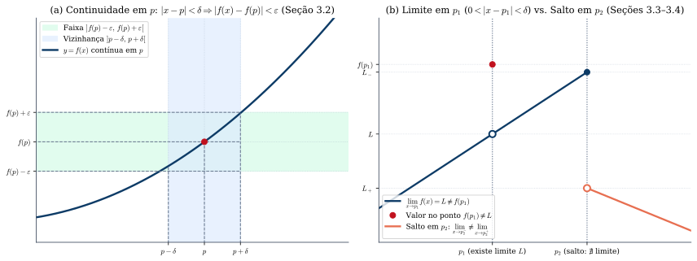
*Figura 1 — (a) Definição $\varepsilon$-$\delta$ de continuidade em $p$ (Seção 3.2). (b) Existência de limite em $p_1$ apesar de $f(p_1) \neq L$ versus descontinuidade de salto em $p_2$, onde os limites laterais diferem (Seções 3.3 e 3.4).*

---

### 1.2 Conservação do Sinal, Limites Laterais e Limite de Função Composta (Seções 3.3 a 3.5)
1. **Unicidade e Conservação do Sinal (Teoremas 1 e 2, Seção 3.3):** O limite, quando existe, é único. Se $\lim_{x \to p} f(x) = L > 0$ (resp. $L < 0$), existe $\delta > 0$ tal que, para todo $x \in D_f$ com $0 < |x - p| < \delta$, tem-se **$f(x) > 0$** (resp. $f(x) < 0$).
2. **Limites Laterais (Seção 3.4):** Se $]a, p[ \subset D_f$ e $]p, b[ \subset D_f$, então:
   $$\lim_{x \to p} f(x) = L \iff \lim_{x \to p^+} f(x) = \lim_{x \to p^-} f(x) = L$$
3. **Limite de Função Composta (Teoremas 1 e 2, Seção 3.5):**  
   Sejam $f$ e $g$ tais que $\operatorname{Im}_f \subset D_g$ e suponhamos **$\lim_{x \to p} f(x) = a$**:
   - **Teorema 1 (Quando $g$ é contínua em $a$):** Se $g$ é contínua em $a$, então $\lim_{x \to p} g(f(x)) = g(a) = g\left(\lim_{x \to p} f(x)\right)$. Em particular, a composta de funções contínuas é contínua.
   - **Teorema 2 (Quando $g$ não é necessariamente contínua em $a$):** Se $\lim_{u \to a} g(u) = L$ e **existir $r > 0$ tal que $f(x) \neq a$ para $0 < |x - p| < r$**, então $\lim_{x \to p} g(f(x)) = L$. *(A condição $f(x) \neq a$ numa vizinhança perfurada de $p$ é indispensável caso $g$ não seja contínua em $a$).*

---

### 1.3 Teorema do Confronto, Propriedades Operatórias e o 1º Limite Fundamental (Seções 3.6 a 3.9)
- **Teorema do Confronto (Seção 3.6):** Se existe $r > 0$ tal que $f(x) \le g(x) \le h(x)$ para $0 < |x - p| < r$ e $\lim_{x \to p} f(x) = \lim_{x \to p} h(x) = L$, então $\lim_{x \to p} g(x) = L$.
- **Produto de Função que Tende a Zero por Função Limitada (Exemplo 2, Seção 3.6):** Se $\lim_{x \to p} f(x) = 0$ e $g$ é **limitada** numa vizinhança perfurada de $p$ ($|g(x)| \le M$), então **$\lim_{x \to p} [f(x) \cdot g(x)] = 0$**.
- **O 1º Limite Fundamental (Seção 3.8):** Da desigualdade $0 < \operatorname{sen} x < x < \operatorname{tg} x$ para $0 < x < r$, dividindo por $\operatorname{sen} x$ e usando a paridade de $\cos x$ e de $\frac{\operatorname{sen} x}{x}$, obtém-se $\cos x < \frac{\operatorname{sen} x}{x} < 1$ para $0 < |x| < r$. Pelo Teorema do Confronto:
  $$\lim_{x \to 0} \frac{\operatorname{sen} x}{x} = 1 \qquad \text{e, consequentemente,} \qquad \lim_{x \to 0} \frac{1 - \cos x}{x^2} = \frac{1}{2}$$

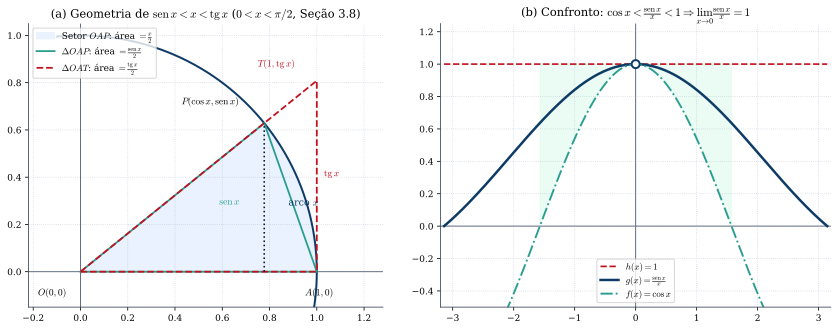
*Figura 2 — (a) Comparação de áreas no círculo unitário: $\operatorname{sen} x < x < \operatorname{tg} x$. (b) Compressão de $\frac{\operatorname{sen} x}{x}$ entre $\cos x$ e $1$ em torno de $x = 0$ (Seção 3.8).*

#### Exercícios de Fixação (Capítulo 3)
1. *(Guidorizzi, Seção 3.2, Ex. 21)* Sejam $f, g: \mathbb{R} \to \mathbb{R}$ contínuas em $\mathbb{R}$ tais que $f(r) = g(r)$ para todo $r \in \mathbb{Q}$. Prove que $f(x) = g(x)$ para todo $x \in \mathbb{R}$. *(Dica: aplique o Teorema da Conservação do Sinal a $h(x) = f(x) - g(x)$).*
2. *(Guidorizzi, Seção 3.6 e 3.8)* Calcule: (a) $\lim_{x \to 0} x^3 \operatorname{sen}\left(\frac{1}{x^4 + x^2}\right)$; (b) $\lim_{x \to 1} \frac{\sqrt[3]{x} - 1}{\sqrt{x} - 1}$; (c) $\lim_{x \to 0} \frac{\cos(2x) - \cos(3x)}{x^2}$. *(Gabarito: (a) $0$; (b) $\frac{2}{3}$ fazendo $x = u^6$; (c) $\frac{5}{2}$).*

---

## 2. Extensões do Conceito de Limite, Sequências e o Número $e$ (Capítulo 4)

### 2.1 Limites no Infinito e Limites Infinitos (Seções 4.1 e 4.2)
- **Limite no Infinito (Seção 4.1):** Supondo $]a, +\infty[ \subset D_f$, $\lim_{x \to +\infty} f(x) = L \iff \forall \varepsilon > 0, \exists \delta > 0 \text{ tal que } x > \delta \implies |f(x) - L| < \varepsilon$. Para funções polinomiais e racionais quando $x \to \pm\infty$, coloca-se em evidência a mais alta potência de $x$. *(Cuidado ao extrair fatores de raízes quadradas para $x \to -\infty$: como $\sqrt{x^2} = |x|$, para $x < 0$ tem-se $\sqrt{x^2} = -x$).*
- **Limite Infinito (Seção 4.2):** $\lim_{x \to p^+} f(x) = +\infty \iff \forall \varepsilon > 0, \exists \delta > 0 \text{ tal que } p < x < p + \delta \implies f(x) > \varepsilon$.

### 2.2 Sequências Monótonas e a Definição do Número $e$ (Seções 4.3 a 4.5 e Apêndice 1, A1.4)
Da Propriedade do Supremo decorre que **toda sequência monótona e limitada é convergente** (Seção 4.3). Na **Seção 4.5**, desenvolvendo $a_n = \left(1 + \frac{1}{n}\right)^n$ pelo Binômio de Newton:
$$\left(1 + \frac{1}{n}\right)^n = 1 + 1 + \frac{1}{2!}\left(1 - \frac{1}{n}\right) + \frac{1}{3!}\left(1 - \frac{1}{n}\right)\left(1 - \frac{2}{n}\right) + \dots + \frac{1}{n!}\left(1 - \frac{1}{n}\right)\cdots\left(1 - \frac{n-1}{n}\right)$$
Guidorizzi mostra que $a_n$ é estritamente crescente e limitada superiormente por $1 + 1 + \frac{1}{2} + \frac{1}{2^2} + \dots + \frac{1}{2^{n-1}} < 3$. Logo, a sequência converge, definindo o número **$e$**:
$$e = \lim_{n \to \infty} \left(1 + \frac{1}{n}\right)^n \approx 2{,}718281828\dots$$

#### Exercícios de Fixação (Capítulo 4)
1. *(Guidorizzi, Seção 4.1)* Calcule: (a) $\lim_{x \to -\infty} \frac{\sqrt{9x^2 + x + 1}}{2x - 5}$; (b) $\lim_{x \to +\infty} \left(\sqrt{x^2 + 3x} - x\right)$. *(Gabarito: (a) $-\frac{3}{2}$; (b) $\frac{3}{2}$).*
2. *(Guidorizzi, Seção 4.3)* Calcule $\lim_{n \to \infty} \sqrt[n]{3^n + 5^n}$ pelo Teorema do Confronto. *(Gabarito: $5$).*

---

## 3. Teoremas do Anulamento, do Valor Intermediário e de Weierstrass (Capítulo 5)

No Capítulo 5 (com demonstrações completas no **Apêndice 2**, Seções A2.1 a A2.4, via método da bissecção e Propriedade dos Intervalos Encaixantes), estudam-se as propriedades globais das funções contínuas num **intervalo fechado e limitado $[a, b]$**:

> **Teorema 3.1 (Teorema do Anulamento ou de Bolzano — Cap. 5 e Seção A2.1):**  
> *Se $f$ for contínua no intervalo fechado $[a, b]$ e se $f(a)$ e $f(b)$ tiverem sinais contrários, então existirá pelo menos um $c \in [a, b]$ (logo $c \in \,]a, b[$) tal que $f(c) = 0$.*

> **Teorema 3.2 (Teorema do Valor Intermediário — TVI, Cap. 5 e Seção A2.2):**  
> *Se $f$ for contínua em $[a, b]$ e se $\gamma$ for um real compreendido entre $f(a)$ e $f(b)$, então existirá pelo menos um $c \in [a, b]$ tal que $f(c) = \gamma$.*

> **Teorema 3.3 (Teorema de Weierstrass — Cap. 5 e Seções A2.3–A2.4):**  
> *Se $f$ for contínua em $[a, b]$, então existirão $x_1$ e $x_2$ em $[a, b]$ tais que, para todo $x \in [a, b]$:*
> $$f(x_1) \le f(x) \le f(x_2)$$
> *Isto é, toda função contínua num intervalo fechado $[a, b]$ é limitada e assume em $[a, b]$ valor mínimo global $f(x_1)$ e valor máximo global $f(x_2)$.*

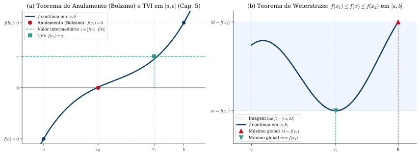
*Figura 3 — (a) Teorema do Anulamento (Bolzano) e Teorema do Valor Intermediário (TVI). (b) Teorema de Weierstrass: mínimo global $m = f(x_1)$ e máximo global $M = f(x_2)$ atingidos em $[a, b]$ (Capítulo 5).*

> **[Complemento — Apostol, *Cálculo I*, Seção 3.17 e Guidorizzi, Apêndice 4, Seção A4.3]:**  
> Além dos três teoremas acima, toda função contínua num intervalo fechado $[a, b]$ satisfaz o **Teorema da Continuidade Uniforme**: para todo $\varepsilon > 0$, existe um único $\delta > 0$ tal que, quaisquer que sejam $s, t \in [a, b]$, $|s - t| < \delta \implies |f(s) - f(t)| < \varepsilon$.

#### Exercícios de Fixação (Capítulo 5)
1. *(Guidorizzi, Cap. 5, Ex. 2)* Prove que a equação $x^3 - 4x + 2 = 0$ admite três raízes reais distintas e localize-as em intervalos de amplitude $1$. *(Gabarito: uma em $]-3, -2[$, uma em $]0, 1[$ e outra em $]1, 2[$).*
2. *(Guidorizzi, Cap. 5, Ex. 11)* Seja $f: [0, 1] \to \mathbb{R}$ contínua tal que $0 \le f(x) \le 1$ em $[0, 1]$. Prove que existe $c \in [0, 1]$ tal que $f(c) = c$. *(Dica: aplique o Teorema do Anulamento a $g(x) = f(x) - x$).*

---

## 4. Funções Exponencial e Logarítmica (Capítulo 6)

### 4.1 A Construção de Guidorizzi: Potência Real $a^x$, Logaritmo via TVI e o Limite $(1+1/x)^x \to e$ (Seções 6.1 a 6.3)
1. **Potência com Expoente Real (Seção 6.1 e Apêndice 3, Seção A3.1):**  
   Dado $a > 0, a \neq 1$, Guidorizzi enuncia o teorema (demonstrado no Apêndice 3 via supremo dos $a^r$ com $r \in \mathbb{Q}, r < x$) segundo o qual existe uma **única função contínua em $\mathbb{R}$** que coincide com $a^r$ para todo racional $r \in \mathbb{Q}$. Define-se então $a^x = f(x)$, que é estritamente crescente para $a > 1$ e estritamente decrescente para $0 < a < 1$.
2. **Definição de Logaritmo via Teorema do Valor Intermediário (Seção 6.2):**  
   Dados $a > 0, a \neq 1$ e $\beta > 0$, como $f(x) = a^x$ é contínua e assume valores menores e maiores que $\beta$, o **TVI** garante a existência (e a monotonicidade estrita garante a unicidade) de um real $\gamma$ tal que $a^\gamma = \beta$, denominado **logaritmo de $\beta$ na base $a$**:
   $$\gamma = \log_a \beta \iff a^\gamma = \beta \implies a^{\log_a \beta} = \beta$$
   Para a base $e$, escreve-se **$\ln x = \log_e x$**, valendo $e^{\ln x} = x$ ($x > 0$), $\ln(e^x) = x$ ($x \in \mathbb{R}$) e $a^x = e^{x \ln a}$.
3. **O Limite Fundamental Contínuo (Seção 6.3):**  
   Compreendendo $x > 0$ entre dois naturais consecutivos $n \le x < n + 1$, tem-se $\left(1 + \frac{1}{n+1}\right)^n < \left(1 + \frac{1}{x}\right)^x < \left(1 + \frac{1}{n}\right)^{n+1}$. Pelo Teorema do Confronto (e fazendo $u = e^h - 1 \iff h = \ln(1 + u)$ no Exemplo 3 da Seção 6.3):
   $$\lim_{x \to \pm\infty} \left(1 + \frac{1}{x}\right)^x = e, \qquad \lim_{h \to 0} \frac{\ln(1 + h)}{h} = 1, \qquad \lim_{h \to 0} \frac{e^h - 1}{h} = 1$$

> **[Complemento — Apostol, *Cálculo I*, Cap. 6, Seções 6.3–6.13]:**  
> Como Apostol desenvolve a Integral antes da Derivada, ele constrói no Capítulo 6 o logaritmo natural diretamente como a integral definida:
> $$\ln x = \int_{1}^{x} \frac{1}{t}\,dt \quad (x > 0)$$
> Nessa abordagem, $(\ln x)' = \frac{1}{x}$ decorre imediatamente do Teorema Fundamental do Cálculo, o número $e$ é definido como o único real positivo tal que $\ln e = \int_1^e \frac{1}{t}\,dt = 1$, e a função exponencial $e^x$ é definida como a função inversa de $\ln x$.

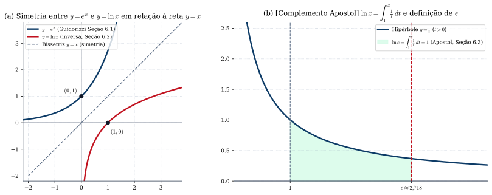
*Figura 4 — (a) Gráficos de $y = e^x$ e $y = \ln x$ simétricos em relação à reta $y = x$ (Seções 6.1–6.2). (b) [Complemento — Apostol, Seção 6.3] O logaritmo natural como área sob a hipérbole $y = 1/t$ de $1$ até $x$.*

#### Exercícios de Fixação (Capítulo 6)
1. *(Guidorizzi, Seção 6.3)* Calcule: (a) $\lim_{x \to +\infty} \left(\frac{2x + 3}{2x - 1}\right)^{x + 1}$; (b) $\lim_{x \to 0} \frac{a^x - b^x}{x}$ ($a, b > 0$); (c) $\lim_{x \to 0} \frac{\ln(\cos x)}{x^2}$. *(Gabarito: (a) $e^2$; (b) $\ln(a/b)$; (c) $-1/2$).*

---

## 5. Derivadas (Capítulo 7)

### 5.1 Definição de Derivada, Reta Tangente e Reta Normal (Seções 7.1, 7.2 e 7.16)
> **Definição 5.1 (Derivada — Seção 7.2):**  
> Sejam $f$ uma função e $p \in D_f$. O limite
> $$f'(p) = \lim_{x \to p} \frac{f(x) - f(p)}{x - p} = \lim_{h \to 0} \frac{f(p + h) - f(p)}{h}$$
> quando existe e é finito, denomina-se **derivada de $f$ em $p$**.

- **Reta Tangente e Reta Normal ao Gráfico em $(p, f(p))$ (Seção 7.16):**
  $$y - f(p) = f'(p)(x - p) \quad (\text{Reta Tangente}) \qquad \text{e} \qquad y - f(p) = -\frac{1}{f'(p)}(x - p) \quad (\text{Reta Normal, se } f'(p) \neq 0)$$

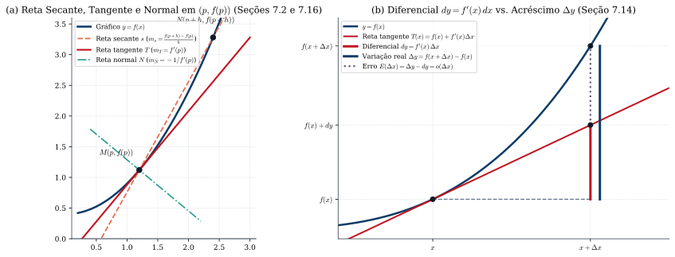
*Figura 5 — (a) A reta secante $s$ tende à reta tangente $T$ quando $h \to 0$, sendo a reta normal $N$ perpendicular a $T$ em $M(p, f(p))$ (Seções 7.2 e 7.16). (b) A diferencial $dy = f'(x)\,\Delta x$ comparada ao acréscimo real $\Delta y$ (Seção 7.14).*

---

### 5.2 Derivadas Elementares, Continuidade, Regras de Derivação e Regra da Cadeia (Seções 7.3 a 7.15)
1. **Derivadas Fundamentais (Seções 7.3 a 7.5):**  
   $$(x^n)' = n x^{n-1}, \quad \left(\sqrt[n]{x}\right)' = \frac{1}{n}x^{\frac{1}{n} - 1}, \quad (e^x)' = e^x, \quad (\ln x)' = \frac{1}{x}, \quad \operatorname{sen}' x = \cos x, \quad \cos' x = -\operatorname{sen} x$$
   $$\operatorname{tg}' x = \sec^2 x, \quad \sec' x = \sec x \operatorname{tg} x, \quad \operatorname{cotg}' x = -\operatorname{cossec}^2 x, \quad \operatorname{cossec}' x = -\operatorname{cossec} x \operatorname{cotg} x$$
2. **Derivabilidade e Continuidade (Seção 7.6):** *Se $f$ for derivável em $p$, então $f$ será contínua em $p$* (pois $f(x) - f(p) = \frac{f(x)-f(p)}{x-p}(x-p) \to f'(p)\cdot 0 = 0$). A recíproca é falsa: $f(x) = |x|$ é contínua em $0$, mas não é derivável em $0$ ($f'_+(0) = 1 \neq -1 = f'_-(0)$).
3. **Regras Operatórias (Seção 7.7):**
   $$(f + g)' = f' + g', \qquad (kf)' = kf', \qquad (f \cdot g)' = f'g + fg', \qquad \left(\frac{f}{g}\right)' = \frac{f'g - fg'}{g^2}$$
4. **Regra da Cadeia (Seção 7.10):** Se $u = f(x)$ é derivável em $p$ e $y = g(u)$ é derivável em $q = f(p)$, então $h(x) = g(f(x))$ é derivável em $p$ e:
   $$h'(p) = g'(f(p)) \cdot f'(p) \qquad \Longleftrightarrow \qquad \frac{dy}{dx} = \frac{dy}{du} \cdot \frac{du}{dx}$$
5. **Potência Real $(x^\alpha)' = \alpha x^{\alpha - 1}$ e Função $f(x)^{g(x)}$ (Seções 7.11 e 7.12):** Para $f(x) > 0$, escreve-se $f(x)^{g(x)} = e^{g(x)\ln f(x)}$, obtendo:
   $$\big[f(x)^{g(x)}\big]' = f(x)^{g(x)}\left[g'(x)\ln f(x) + g(x)\frac{f'(x)}{f(x)}\right]$$
6. **Diferencial (Seção 7.14):** Define-se a diferencial de $y = f(x)$ por $dy = f'(x)\,dx$, de modo que $\Delta y = f(x + \Delta x) - f(x) \approx f'(x)\,\Delta x$.

#### Exercícios de Fixação (Capítulo 7)
1. *(Guidorizzi, Seção 7.6)* Seja $f(x) = x^2 \operatorname{sen}(1/x)$ para $x \neq 0$ e $f(0) = 0$. Mostre que $f$ é derivável em $0$ com $f'(0) = 0$, mas $f'$ não é contínua em $0$.
2. *(Guidorizzi, Seções 7.12 e 7.13)* (a) Derive $y = x^{\operatorname{sen} x}$ ($x > 0$). (b) Ache a equação da reta tangente ao Fólio de Descartes $x^3 + y^3 - 3xy = 0$ no ponto $\left(\frac{3}{2}, \frac{3}{2}\right)$. *(Gabarito: (a) $x^{\operatorname{sen} x}\left(\cos x \ln x + \frac{\operatorname{sen} x}{x}\right)$; (b) $x + y - 3 = 0$).*

---

## 6. Funções Inversas e Derivadas Trigonométricas Inversas (Capítulo 8)

### 6.1 O Teorema da Derivada da Função Inversa (Seção 8.2)
Uma função $f$ é injetora se $s \neq t \implies f(s) \neq f(t)$, admitindo inversa $g = f^{-1}: \operatorname{Im}_f \to D_f$ dada por $g(y) = x \iff y = f(x)$ (Seção 8.1). Para provar rigorosamente que $g$ é derivável sem supor a existência prévia de $g'(p)$, Guidorizzi demonstra na Seção 8.2:

> **Teorema 6.1 (Derivada de Função Inversa — Seção 8.2):**  
> *Seja $f$ uma função inversível, com função inversa $g = f^{-1}$. Se **$f$ for derivável em $q = g(p)$, com $f'(q) \neq 0$**, e se **$g$ for contínua em $p$**, então **$g$ será derivável em $p$** e:*
> $$g'(p) = \frac{1}{f'(g(p))} = \frac{1}{f'(q)}$$
> *Demonstração:* Fazendo $u = g(x)$ (logo $x = f(u)$ e $p = f(q)$), pela continuidade de $g$ em $p$ tem-se $u \to q$ quando $x \to p$ (com $u \neq q$ para $x \neq p$). Logo, $\lim_{x \to p} \frac{g(x) - g(p)}{x - p} = \lim_{u \to q} \frac{u - q}{f(u) - f(q)} = \frac{1}{f'(q)}$.

### 6.2 Derivadas de $\operatorname{arcsen} x$, $\arccos x$ e $\operatorname{arctg} x$ (Exemplos 1 a 3, Seção 8.2)
Aplicando o Teorema 6.1 às inversas trigonométricas nos seus intervalos principais:
1. **Arco-seno ($y = \operatorname{arcsen} x \iff x = \operatorname{sen} y$, $x \in [-1, 1]$, $y \in [-\frac{\pi}{2}, \frac{\pi}{2}]$):** Como $\cos y = +\sqrt{1 - x^2} > 0$ para $x \in \,]-1, 1[$:
   $$\operatorname{arcsen}' x = \frac{1}{\cos(\operatorname{arcsen} x)} = \frac{1}{\sqrt{1 - x^2}} \quad (-1 < x < 1)$$
2. **Arco-cosseno ($y = \arccos x \iff x = \cos y$, $x \in [-1, 1]$, $y \in [0, \pi]$):**
   $$\arccos' x = -\frac{1}{\operatorname{sen}(\arccos x)} = -\frac{1}{\sqrt{1 - x^2}} \quad (-1 < x < 1)$$
3. **Arco-tangente ($y = \operatorname{arctg} x \iff x = \operatorname{tg} y$, $x \in \mathbb{R}$, $y \in \,]-\frac{\pi}{2}, \frac{\pi}{2}[$):**
   $$\operatorname{arctg}' x = \frac{1}{\sec^2(\operatorname{arctg} x)} = \frac{1}{1 + x^2} \quad (\forall x \in \mathbb{R})$$

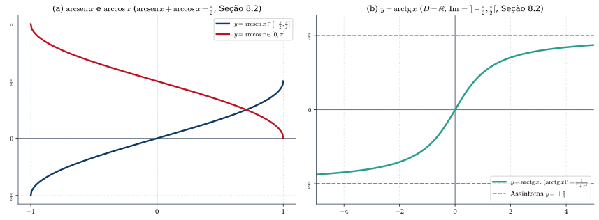
*Figura 6 — (a) Gráficos de $\operatorname{arcsen} x$ e $\arccos x$ em $[-1, 1]$. (b) Gráfico de $\operatorname{arctg} x$ em $\mathbb{R}$, com assíntotas horizontais $y = \pm\frac{\pi}{2}$ (Seção 8.2).*

#### Exercícios de Fixação (Capítulo 8)
1. *(Guidorizzi, Seção 8.2)* Seja $f(x) = x^5 + 2x^3 + x - 1$, com inversa $g = f^{-1}$. Calcule $g'(3)$ e $g''(3)$. *(Gabarito: como $f(1) = 3$, $g(3) = 1$, $g'(3) = \frac{1}{f'(1)} = \frac{1}{12}$ e $g''(3) = -\frac{f''(1)}{[f'(1)]^3} = -\frac{1}{54}$).*

---

## 7. Teoremas de Rolle, Valor Médio e Cauchy, e Estudo da Variação das Funções (Capítulos 9 e 15)

### 7.1 Condição de Fermat, Rolle, Valor Médio (TVM) e Cauchy (Seção 9.7 e Capítulo 15)
1. **Condição Necessária para Extremos Internos (Teorema 1, Seção 9.7):**  
   *Se $f$ é derivável em $p$, sendo $p$ um ponto interior a $D_f$, e se $p$ é ponto de máximo ou de mínimo local de $f$, então **$f'(p) = 0$**.*
2. **Teorema de Rolle (Seção 15.1):**  
   *Se $f$ for contínua em $[a, b]$, derivável em $]a, b[$ e $f(a) = f(b)$, então existirá pelo menos um $c \in \,]a, b[$ tal que **$f'(c) = 0$**.* *(Demonstração: se $f$ não é constante, pelo Teorema de Weierstrass ela atinge máximo ou mínimo global num ponto interior $c \in \,]a, b[$, onde $f'(c) = 0$).*
3. **Teorema do Valor Médio — TVM (Seções 9.1 e 15.2):**  
   *Se $f$ for contínua em $[a, b]$ e derivável em $]a, b[$, então existirá pelo menos um $c \in \,]a, b[$ tal que:*
   $$\frac{f(b) - f(a)}{b - a} = f'(c) \qquad \Longleftrightarrow \qquad f(b) - f(a) = f'(c)(b - a)$$
   *(Demonstração: aplica-se o Teorema de Rolle à diferença entre $f(x)$ e a reta secante $S(x) = f(a) + \frac{f(b)-f(a)}{b-a}(x-a)$).*
4. **Teorema de Cauchy (Seção 15.3):**  
   *Se $f$ e $g$ forem contínuas em $[a, b]$ e deriváveis em $]a, b[$, então existirá pelo menos um $c \in \,]a, b[$ tal que:*
   $$\big[f(b) - f(a)\big]g'(c) = \big[g(b) - g(a)\big]f'(c)$$
   *ou, caso $g(b) \neq g(a)$ e $g'(c) \neq 0$, $\dfrac{f(b) - f(a)}{g(b) - g(a)} = \dfrac{f'(c)}{g'(c)}$.*

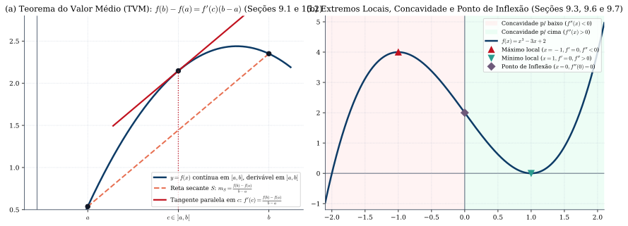
*Figura 7 — (a) Teorema do Valor Médio: tangente em $c$ paralela à corda secante $S$ (Seções 9.1 e 15.2). (b) Estudo de extremos locais, concavidade e ponto de inflexão (Seções 9.3, 9.6 e 9.7).*

---

### 7.2 Crescimento, Concavidade, Regras de L'Hospital e Extremos (Seções 9.2 a 9.8)
1. **Crescimento e Decrescimento (Seção 9.2):** Seja $f$ contínua no intervalo $I$.
   - Se **$f'(x) > 0$** para todo $x$ interior a $I \implies f$ é **estritamente crescente em $I$**;
   - Se **$f'(x) < 0$** para todo $x$ interior a $I \implies f$ é **estritamente decrescente em $I$**.
2. **Concavidade e Ponto de Inflexão (Seção 9.3):**  
   Sendo $T(x) = f(p) + f'(p)(x - p)$ a reta tangente em $p \in I$ ($I$ intervalo aberto), dizemos que $f$ tem **concavidade para cima** em $I$ se $f(x) > T(x)$ para quaisquer $x \neq p$ em $I$, e **concavidade para baixo** se $f(x) < T(x)$ para quaisquer $x \neq p$ em $I$. Um ponto $p \in D_f$ onde $f$ é contínua é **ponto de inflexão** se a concavidade muda de sentido em torno de $p$. Se $f$ admite derivada até a 2ª ordem em $I$:
   $$f''(x) > 0 \text{ em } I \implies \text{concavidade para cima em } I, \qquad f''(x) < 0 \text{ em } I \implies \text{concavidade para baixo em } I$$
3. **Regras de L'Hospital (Seção 9.4):** Nas formas indeterminadas $\frac{0}{0}$ ou $\frac{\infty}{\infty}$, se existir (finito ou infinito) o limite do quociente das derivadas $\lim \frac{f'(x)}{g'(x)}$, então $\lim \frac{f(x)}{g(x)} = \lim \frac{f'(x)}{g'(x)}$.
4. **Condições Suficientes para Extremos Locais (Seção 9.7):**
   - **1ª Derivada:** Se $f$ é contínua em $]a, b[$ e $f'$ troca de sinal de $+$ para $-$ em $p$, então $p$ é ponto de máximo local; se $f'$ troca de $-$ para $+$, $p$ é ponto de mínimo local.
   - **2ª Derivada (Teorema 2, Seção 9.7):** Se $f$ tem derivada de 2ª ordem contínua em $I$ e $p \in I$:
     $$f'(p) = 0 \text{ e } f''(p) > 0 \implies p \text{ é ponto de mínimo local}; \qquad f'(p) = 0 \text{ e } f''(p) < 0 \implies p \text{ é ponto de máximo local}.$$

#### Exercícios de Fixação (Capítulos 9 e 15)
1. *(Guidorizzi, Seções 9.2 e 15.1)* Prove que $x^3 + 3x^2 + 6x - 4 = 0$ admite uma única raiz real em $]0, 1[$. *(Dica: $f(0) = -4 < 0$, $f(1) = 6 > 0$ e $f'(x) = 3(x+1)^2 + 3 > 0$).*
2. *(Guidorizzi, Seção 9.4 e 9.8)* (a) Calcule $\lim_{x \to 0^+} x^{\operatorname{sen} x}$ e $\lim_{x \to 0} \frac{e^x - e^{-x} - 2x}{x - \operatorname{sen} x}$. (b) Determine a altura $h$ do cilindro circular reto de volume máximo inscrito numa esfera de raio $R$. *(Gabarito: (a) $1$ e $2$; (b) $h = \frac{2R}{\sqrt{3}}$).*

---

## 8. Primitivas e a Integral de Riemann (Capítulos 10 e 11 e Apêndice 4)

### 8.1 Funções com Derivadas Iguais e Primitivas (Capítulo 10)
> **Teorema 8.1 e Corolário (Seção 10.1):**  
> *Seja $f$ contínua no **intervalo $I$**. Se $f'(x) = 0$ em todo $x$ interior a $I$, então $f$ é constante em $I$. Consequentemente, se $f$ e $g$ são contínuas no intervalo $I$ e $f'(x) = g'(x)$ no interior de $I$, existe uma constante $k \in \mathbb{R}$ tal que $g(x) = f(x) + k$ em $I$.*

Uma função $F$ definida num intervalo $I$ é uma **primitiva** de $f$ em $I$ se $F'(x) = f(x)$ em $I$, indicando-se a família de primitivas por $\int f(x)\,dx = F(x) + k$ (Seção 10.2).

---

### 8.2 Partições, Somas de Riemann e Definição da Integral (Seções 11.1 a 11.4 e Apêndice 4)
Dada uma partição $P : a = x_0 < x_1 < \dots < x_n = b$ de $[a, b]$, de amplitudes $\Delta x_i = x_i - x_{i-1}$ e amplitude máxima $\max \Delta x_i$, e escolhidos pontos arbitrários $c_i \in [x_{i-1}, x_i]$, a soma $\sum_{i=1}^n f(c_i)\,\Delta x_i$ denomina-se **soma de Riemann** de $f$ (Seções 11.1–11.2).

> **Definição 8.1 (Integral de Riemann — Seção 11.3):**  
> Dizemos que $f$ é **integrável (segundo Riemann) em $[a, b]$**, com integral definida $\int_a^b f(x)\,dx = L$, se, para todo $\varepsilon > 0$ dado, existir um $\delta > 0$ (que só dependa de $\varepsilon$, e não da escolha dos $c_i$) tal que:
> $$\left|\sum_{i=1}^{n} f(c_i)\,\Delta x_i - L\right| < \varepsilon$$
> para toda partição $P$ de $[a, b]$ com $\max \Delta x_i < \delta$, qualquer que seja a escolha de $c_i \in [x_{i-1}, x_i]$.

No **Apêndice 4**, Guidorizzi demonstra que toda função integrável em $[a, b]$ é limitada (A4.1), e que são integráveis em $[a, b]$: **(i)** toda função contínua (A4.3); **(ii)** toda função limitada com número finito de descontinuidades (A4.4); e **(iii)** toda função monótona (A4.5).

> **[Complemento — Apostol, *Cálculo I*, Cap. 1, Seções 1.8–1.17]:**  
> Apostol constrói a integral equivalente pelo método de Darboux: define primeiro a integral para **funções em escada** $s$ ($\int_a^b s(x)\,dx = \sum s_i \Delta x_i$) e, para uma função limitada $f$, define a integral inferior $\underline{I}(f) = \sup\{\int_a^b s \mid s \le f\}$ e a integral superior $\overline{I}(f) = \inf\{\int_a^b t \mid t \ge f\}$, sendo $f$ integrável quando $\underline{I}(f) = \overline{I}(f)$.

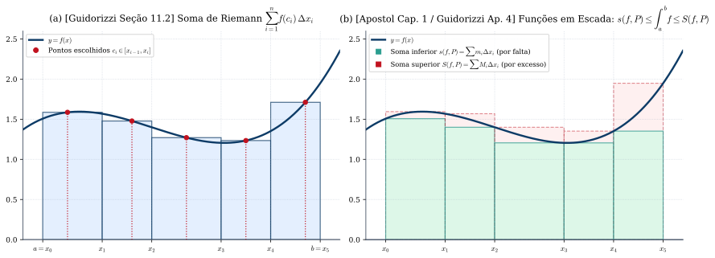
*Figura 8 — (a) Soma de Riemann $\sum f(c_i)\Delta x_i$ com pontos arbitrários $c_i \in [x_{i-1}, x_i]$ (Seção 11.2). (b) Aproximação por somas inferior e superior / funções em escada (Apostol, Cap. 1 e Guidorizzi, Apêndice 4).*

---

### 8.3 O 1º Teorema Fundamental do Cálculo (Seção 11.5) e a Derivada da Integral (Complemento de Apostol)

> **Teorema 8.2 (1º Teorema Fundamental do Cálculo — Seção 11.5 de Guidorizzi):**  
> *Se $f$ for **integrável em $[a, b]$** e se $F$ for uma **primitiva** de $f$ em $[a, b]$ ($F' = f$), então:*
> $$\int_{a}^{b} f(x)\,dx = \Big[F(x)\Big]_{a}^{b} = F(b) - F(a)$$
> *Demonstração:* Para qualquer partição $P$ de $[a, b]$, aplicando o TVM a $F$ em cada subintervalo $[x_{i-1}, x_i]$, existe $\bar{c}_i \in \,]x_{i-1}, x_i[$ tal que $F(x_i) - F(x_{i-1}) = f(\bar{c}_i)\Delta x_i$. Somando de $i = 1$ a $n$, tem-se $F(b) - F(a) = \sum_{i=1}^n f(\bar{c}_i)\Delta x_i$. Como, por hipótese, $f$ é integrável em $[a, b]$, o limite das somas de Riemann quando $\max \Delta x_i \to 0$ existe e independe da escolha de $c_i$; tomando $c_i = \bar{c}_i$, conclui-se que $\int_a^b f(x)\,dx = F(b) - F(a)$.

> **[Complemento — Apostol, *Cálculo I*, Cap. 5, Seção 5.1 (e Guidorizzi, Vol. 2, Cap. 2)]:**  
> Conforme Guidorizzi observa no Prefácio do Volume 1, o estudo da função definida por integral $A(x) = \int_a^x f(t)\,dt$ (**2º Teorema Fundamental do Cálculo** na nomenclatura de Guidorizzi) é realizado no Volume 2. Em **Apostol (*Cálculo I*, Seção 5.1)**, esse teorema é demonstrado no Volume 1 (onde recebe o nome de *1º Teorema Fundamental do Cálculo*, enquanto a fórmula $\int_a^b f(x)\,dx = P(b) - P(a)$ é chamada por Apostol de *2º TFC*):
> > *Se $f$ é contínua num intervalo $I$ e $a \in I$, então a função $A(x) = \int_a^x f(t)\,dt$ é derivável em $I$ e **$A'(x) = f(x)$**.*  
> Combinando com a Regra da Cadeia para limites de integração deriváveis $u(x)$ e $v(x)$:
> $$\frac{d}{dx}\left[\int_{u(x)}^{v(x)} f(t)\,dt\right] = f(v(x))\cdot v'(x) - f(u(x))\cdot u'(x)$$

### 8.4 Áreas, Mudança de Variável e Trabalho (Seções 11.6 a 11.8)
- **Área entre duas curvas $f(x) \ge g(x)$ em $[a, b]$ (Seção 11.6):** $\text{área } A = \int_a^b [f(x) - g(x)]\,dx$.
- **Mudança de Variável na Integral Definida (Seção 11.7):** Se $f$ é contínua em $I$ e $g: [c, d] \to I$ tem derivada $g'$ contínua em $[c, d]$, com $g(c) = a$ e $g(d) = b$:
  $$\int_{a}^{b} f(x)\,dx = \int_{c}^{d} f(g(u))\,g'(u)\,du$$
- **Trabalho e Energia Cinética (Seção 11.8):** O trabalho de uma força resultante $F(x)$ de $a$ até $b$ é $\tau = \int_a^b F(x)\,dx = \frac{1}{2}mv_1^2 - \frac{1}{2}mv_0^2$.

#### Exercícios de Fixação (Capítulos 10 e 11)
1. *(Guidorizzi, Seção 11.6)* Calcule a área limitada por $y = x^2 - 2x$ e $y = 4 - x^2$. *(Gabarito: $9$).*
2. *(Complemento — Apostol, Seção 5.1)* Sendo $F(x) = \int_{\operatorname{sen} x}^{x^2} e^{-t^2}\,dt$, calcule $F'(x)$. *(Gabarito: $2x e^{-x^4} - (\cos x)e^{-\operatorname{sen}^2 x}$).*

---

## 9. Técnicas de Primitivação (Capítulo 12)

1. **Substituição Simples (Seções 12.2 e 12.4):** $\int f(g(x))g'(x)\,dx = \int f(u)\,du = F(g(x)) + k$. Em particular, $\int \frac{g'(x)}{g(x)}\,dx = \ln|g(x)| + k$.
2. **Integração por Partes (Seção 12.3):**
   $$\int f(x)g'(x)\,dx = f(x)g(x) - \int f'(x)g(x)\,dx \qquad \Longleftrightarrow \qquad \int u\,dv = uv - \int v\,du$$
3. **Substituições Trigonométricas para Radicais (Seção 12.5):**
   - Para $\sqrt{a^2 - x^2}$: faz-se $x = a\operatorname{sen} u$, $dx = a\cos u\,du$, $\sqrt{a^2 - x^2} = a\cos u$;
   - Para $\sqrt{a^2 + x^2}$: faz-se $x = a\operatorname{tg} u$, $dx = a\sec^2 u\,du$, $\sqrt{a^2 + x^2} = a\sec u$;
   - Para $\sqrt{x^2 - a^2}$: faz-se $x = a\sec u$, $dx = a\sec u \operatorname{tg} u\,du$, $\sqrt{x^2 - a^2} = a|\operatorname{tg} u|$.
4. **Frações Parciais para Funções Racionais $\frac{P(x)}{Q(x)}$ (Seções 12.6 e 12.7):**  
   Se $\text{grau}(P) \ge \text{grau}(Q)$, divide-se primeiro $P(x)$ por $Q(x)$. Quando $\text{grau}(R) < \text{grau}(Q)$, decompõe-se a fração conforme os fatores de $Q(x)$:
   $$\frac{mx^2 + nx + p}{(x - \alpha)(ax^2 + bx + c)} = \frac{A}{x - \alpha} + \frac{Bx + D}{ax^2 + bx + c} \quad (\text{com } \Delta = b^2 - 4ac < 0)$$
5. **Integrais Trigonométricas e a Mudança $u = \operatorname{tg}\left(\frac{x}{2}\right)$ (Seções 12.8 a 12.11):**  
   Para potências pares de seno e cosseno, usam-se $\operatorname{sen}^2 x = \frac{1 - \cos(2x)}{2}$ e $\cos^2 x = \frac{1 + \cos(2x)}{2}$. Para funções racionais de $\operatorname{sen} x$ e $\cos x$, usa-se a substituição universal da Seção 12.11:
   $$u = \operatorname{tg}\left(\frac{x}{2}\right) \implies \operatorname{sen} x = \frac{2u}{1 + u^2}, \qquad \cos x = \frac{1 - u^2}{1 + u^2}, \qquad dx = \frac{2}{1 + u^2}\,du$$

#### Exercícios de Fixação (Capítulo 12)
1. *(Guidorizzi, Seções 12.3, 12.7 e 12.11)* Calcule: (a) $\int x^2 \operatorname{arctg} x\,dx$; (b) $\int \frac{2x^2 - x + 4}{x^3 + 4x}\,dx$; (c) $\int_0^{\pi/2} \frac{1}{2 + \cos x}\,dx$. *(Gabarito: (a) $\frac{x^3}{3}\operatorname{arctg} x - \frac{x^2}{6} + \frac{1}{6}\ln(x^2+1) + k$; (b) $\ln|x| + \frac{1}{2}\ln(x^2+4) - \frac{1}{2}\operatorname{arctg}(x/2) + k$; (c) $\frac{\pi\sqrt{3}}{9}$).*

---

## 10. Mais Aplicações da Integral e Coordenadas Polares (Capítulo 13 e Apêndice 5)

### 10.1 Volumes, Área de Superfície e Comprimento de Arco (Seções 13.1 a 13.6)
Para uma região $A = \{(x, y) \mid a \le x \le b, \; 0 \le y \le f(x)\}$ ($f(x) \ge 0$ contínua):
1. **Volume de Rotação em Torno do Eixo $x$ — Discos (Seção 13.1):** $\quad V_x = \pi \int_a^b [f(x)]^2\,dx$.
2. **Volume de Rotação em Torno do Eixo $y$ — Cascas Cilíndricas (Seção 13.2, $a \ge 0$):** $\quad V_y = 2\pi \int_a^b x f(x)\,dx$.
3. **Volume por Seções Transversais de Área $A(x)$ (Seção 13.3):** $\quad V = \int_a^b A(x)\,dx$.
4. **Área de Superfície de Revolução em Torno de $Ox$ (Seção 13.4 e Apêndice 5):** $\quad A_S = 2\pi \int_a^b f(x)\sqrt{1 + [f'(x)]^2}\,dx$.
5. **Comprimento de Arco (Seções 13.5 e 13.6):**
   $$s = \int_{a}^{b} \sqrt{1 + \big[f'(x)\big]^2}\,dx \qquad \text{e, na forma paramétrica } x = x(t), y = y(t): \qquad s = \int_{t_0}^{t_1} \sqrt{\big[x'(t)\big]^2 + \big[y'(t)\big]^2}\,dt$$

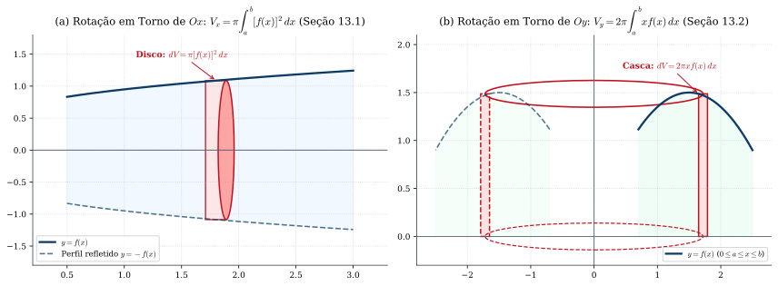
*Figura 9 — (a) Rotação em torno do eixo $x$ pelo método dos discos (Seção 13.1). (b) Rotação em torno do eixo $y$ pelo método das cascas cilíndricas (Seção 13.2).*

### 10.2 Coordenadas Polares e Centro de Massa (Seções 13.7 a 13.9)
Com $x = r\cos\theta$ e $y = r\operatorname{sen}\theta$, para uma curva polar $r = f(\theta)$ ($\theta \in [\alpha, \beta]$):
$$\text{Área Polar: } A = \frac{1}{2}\int_{\alpha}^{\beta} \big[f(\theta)\big]^2\,d\theta \qquad \text{e} \qquad \text{Comprimento Polar: } s = \int_{\alpha}^{\beta} \sqrt{\big[f(\theta)\big]^2 + \big[f'(\theta)\big]^2}\,d\theta$$
Para o centro de massa $(x_c, y_c)$ de $A = \{(x, y) \mid a \le x \le b, \; 0 \le y \le f(x)\}$ (Seção 13.9):
$$x_c = \frac{\int_a^b x f(x)\,dx}{\text{área } A}, \qquad y_c = \frac{\frac{1}{2}\int_a^b [f(x)]^2\,dx}{\text{área } A}$$

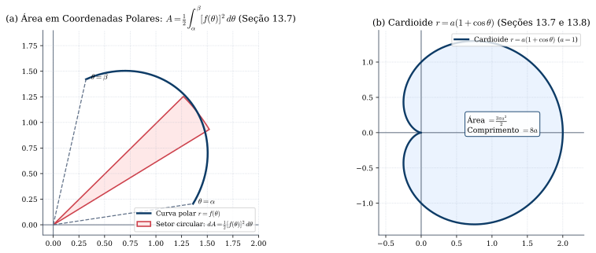
*Figura 10 — (a) Elemento de área em coordenadas polares $dA = \frac{1}{2}[f(\theta)]^2\,d\theta$ (Seção 13.7). (b) A cardioide $r = a(1 + \cos\theta)$ (Seções 13.7 e 13.8).*

#### Exercícios de Fixação (Capítulo 13)
1. *(Guidorizzi, Seções 13.7, 13.8 e 13.9)* (a) Calcule a área e o comprimento da cardioide $r = a(1 + \cos\theta)$ ($a > 0$). (b) Calcule o volume do toro gerado pela rotação do disco $x^2 + (y - b)^2 \le a^2$ ($0 < a < b$) em torno do eixo $x$. *(Gabarito: (a) $\frac{3\pi a^2}{2}$ e $8a$; (b) $2\pi^2 a^2 b$).*

---

## 11. Equações Diferenciais de 1ª Ordem (Capítulo 14)

### 11.1 EDOs de Variáveis Separáveis: Soluções Constantes e Não Constantes (Seções 14.2 a 14.5)
Para a equação $\frac{dx}{dt} = g(t)h(x)$, onde $g$ é contínua em $I_1$ e $h'$ é contínua em $I_2$:
1. **Soluções Constantes (Seção 14.3):** Cada raiz $x_0$ de **$h(x) = 0$** fornece uma solução constante $x(t) = x_0$.
2. **Teorema das Soluções Não Constantes (Seção 14.4):** *Se $g$ é contínua em $I_1$ e $h'$ é contínua em $I_2$, toda solução não constante $x = x(t)$ ($t \in I$) satisfaz **$h(x(t)) \neq 0$ para todo $t \in I$**.* Graças a esse teorema, determinam-se as soluções não constantes separando as variáveis (Seção 14.5):
   $$\int \frac{1}{h(x)}\,dx = \int g(t)\,dt + k$$

### 11.2 EDOs Lineares de 1ª Ordem via Fator Integrante (Seção 14.6)
Para a equação linear $\frac{dy}{dx} + a(x)y = b(x)$, com $a(x)$ e $b(x)$ contínuas num intervalo $I$, multiplica-se a equação pelo **fator integrante** $\mu(x) = e^{A(x)}$, onde $A(x) = \int a(x)\,dx$:
$$e^{A(x)}\frac{dy}{dx} + a(x)e^{A(x)}y = e^{A(x)}b(x) \iff \frac{d}{dx}\Big[e^{A(x)}y\Big] = e^{A(x)}b(x) \implies y(x) = e^{-A(x)}\left(\int e^{A(x)}b(x)\,dx + k\right)$$

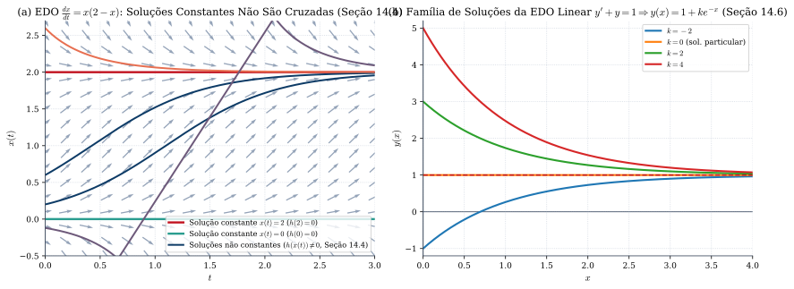
*Figura 11 — (a) Soluções constantes e não constantes de $\frac{dx}{dt} = x(2-x)$ (Seção 14.4) sobre o campo de direções [Complemento — Apostol, Seção 8.21]. (b) Família de soluções da EDO linear $y' + y = 1$ (Seção 14.6).*

#### Exercícios de Fixação (Capítulo 14)
1. *(Guidorizzi, Seções 14.5 e 14.6)* (a) Determine todas as soluções (constantes e não constantes) de $\frac{dx}{dt} = x^2 - 1$. (b) Resolva $\frac{dy}{dx} + (\operatorname{tg} x)y = \cos^2 x$ com $y(0) = 2$. *(Gabarito: (a) $x = -1$ e $x(t) = \frac{1 + ke^{2t}}{1 - ke^{2t}}$; (b) $y(x) = \operatorname{sen} x \cos x + 2\cos x$).*

---

## 12. Fórmula e Polinômios de Taylor (Capítulo 16)

### 12.1 Polinômio de Taylor de Ordem $n$ e Restos de Peano e de Lagrange (Seções 16.1 a 16.3)
Seja $f$ derivável até a ordem $n$ no intervalo $I$ e $x_0 \in I$. O **polinômio de Taylor de ordem $n$ de $f$ em volta de $x_0$** (ou de **Mac-Laurin** quando $x_0 = 0$) é:
$$P(x) = f(x_0) + f'(x_0)(x - x_0) + \frac{f''(x_0)}{2!}(x - x_0)^2 + \dots + \frac{f^{(n)}(x_0)}{n!}(x - x_0)^n = \sum_{k=0}^{n} \frac{f^{(k)}(x_0)}{k!}(x - x_0)^k$$

1. **Forma Infinitesimal do Erro — Resto de Peano:** $P(x)$ é o único polinômio de grau $\le n$ tal que o erro $E(x) = f(x) - P(x)$ satisfaz:
   $$\lim_{x \to x_0} \frac{f(x) - P(x)}{(x - x_0)^n} = 0 \qquad \Longleftrightarrow \qquad f(x) = P(x) + o\big((x - x_0)^n\big)$$
2. **Teorema 12.1 (Fórmula de Taylor com Resto de Lagrange — Seção 16.3):**  
   *Se $f$ é derivável até a ordem $n + 1$ no intervalo $I$ e $x, x_0 \in I$, então existe pelo menos um $\bar{x}$ no intervalo aberto de extremos $x_0$ e $x$ tal que $f(x) = P(x) + E(x)$, onde:*
   $$E(x) = \frac{f^{(n+1)}(\bar{x})}{(n + 1)!}(x - x_0)^{n+1}$$
   Em particular, se $|f^{(n+1)}(t)| \le M$ entre $x_0$ e $x$, então $|f(x) - P(x)| \le \frac{M}{(n+1)!}|x - x_0|^{n+1}$.

> **[Complemento — Apostol, *Cálculo I*, Seção 7.5 e Guidorizzi, Seção 16.3, Ex. 8]:**  
> Integrando por partes $n$ vezes, obtém-se também a **Forma Integral do Resto de Taylor** (quando $f^{(n+1)}$ é contínua):
> $$E(x) = \frac{1}{n!}\int_{x_0}^{x} (x - t)^n f^{(n+1)}(t)\,dt$$

### 12.2 Expansões Clássicas de Mac-Laurin ($x_0 = 0$, Seção 16.3)
- $e^x = 1 + x + \dfrac{x^2}{2!} + \dfrac{x^3}{3!} + \dots + \dfrac{x^n}{n!} + o(x^n)$
- $\operatorname{sen} x = x - \dfrac{x^3}{3!} + \dfrac{x^5}{5!} - \dots + (-1)^{n}\dfrac{x^{2n+1}}{(2n+1)!} + o(x^{2n+2})$
- $\cos x = 1 - \dfrac{x^2}{2!} + \dfrac{x^4}{4!} - \dots + (-1)^{n}\dfrac{x^{2n}}{(2n)!} + o(x^{2n+1})$
- $\ln(1 + x) = x - \dfrac{x^2}{2} + \dfrac{x^3}{3} - \dots + (-1)^{n-1}\dfrac{x^n}{n} + o(x^n) \quad (x > -1)$
- $(1 + x)^\alpha = 1 + \alpha x + \dfrac{\alpha(\alpha-1)}{2!}x^2 + \dots + \binom{\alpha}{n}x^n + o(x^n)$

#### Exercícios de Fixação (Capítulo 16)
1. *(Guidorizzi, Seção 16.2 e 16.3)* (a) Aproxime $\sqrt[3]{8{,}12}$ pelo polinômio de Taylor de ordem $2$ em torno de $x_0 = 8$ e estime o erro. (b) Calcule $\lim_{x \to 0} \frac{\cos x - e^{-x^2/2}}{x^4}$. *(Gabarito: (a) $2{,}00995$ por falta, com erro $< 5 \times 10^{-7}$; (b) $-\frac{1}{12}$).*

---

## 13. Arquimedes, Pascal, Fermat e o Cálculo de Áreas (Capítulo 17)

O Capítulo 17 da 5ª edição de Guidorizzi apresenta os três métodos históricos precursores da Integral (também discutidos na Parte I.1 de Apostol):
1. **Quadratura da Parábola pelo Método de Exaustão de Arquimedes (Seção 17.1):**  
   A área do segmento parabólico compreendido entre uma parábola e uma corda $AB$ é obtida inscrevendo-se um triângulo inicial de área $A_0$ e preenchendo os segmentos residuais com novas gerações de triângulos cujas áreas formam uma progressão geométrica de razão $\frac{1}{4}$:
   $$\text{Área} = A_0\left(1 + \frac{1}{4} + \frac{1}{4^2} + \dots + \frac{1}{4^n} + \dots\right) = \frac{A_0}{1 - \frac{1}{4}} = \frac{4}{3}A_0$$
2. **Pascal, o Princípio de Indução Finita (PIF) e o Binômio de Newton (Seção 17.2):**  
   Dividindo $[0, b]$ em $n$ partes iguais de comprimento $b/n$ e usando a identidade telescópica de Pascal para $\sum_{i=1}^n i^k$, obtém-se $\lim_{n \to \infty} \frac{b^{k+1}}{n^{k+1}}\sum_{i=1}^n i^k = \frac{b^{k+1}}{k+1}$. Na mesma seção, Guidorizzi enuncia o **Princípio de Indução Finita (PIF)** e demonstra o **Binômio de Newton** $(A + B)^k = \sum_{j=0}^k \binom{k}{j}A^{k-j}B^j$.
3. **Fermat e a Partição em Progressão Geométrica (Seção 17.3):**  
   Para calcular a área sob $y = x^k$ em $[0, b]$ sem depender da soma de potências $\sum i^k$, Fermat subdividiu $]0, b]$ pelos pontos de uma progressão geométrica $b, bE, bE^2, bE^3, \dots$ ($0 < E < 1$). A soma das áreas dos retângulos circunscritos é uma PG infinita de razão $E^{k+1}$, cuja soma vale:
   $$S(E) = \frac{b^{k+1}(1 - E)}{1 - E^{k+1}} = \frac{b^{k+1}}{1 + E + E^2 + \dots + E^k} \xrightarrow{E \to 1^-} \frac{b^{k+1}}{k + 1}$$

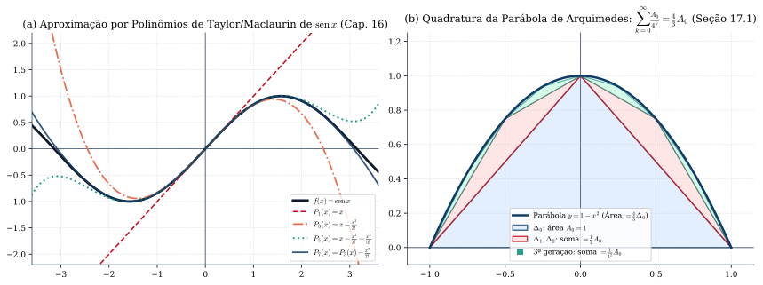
*Figura 12 — (a) Polinômios de Taylor/Mac-Laurin de ordens $1, 3, 5, 7$ aproximando $\operatorname{sen} x$ (Cap. 16). (b) Método de exaustão de Arquimedes para a quadratura da parábola (Seção 17.1).*

---

## Referências Bibliográficas
1. **GUIDORIZZI, Hamilton Luiz.** *Um Curso de Cálculo — Volume 1*. 5ª edição. Rio de Janeiro: LTC, 2001/2013. (Referência Principal).
2. **APOSTOL, Tom M.** *Cálculo I: Cálculo com funções de uma variável, com uma introdução à Álgebra Linear*. Volume 1, 2ª edição. Barcelona: Editorial Reverté, 1988/2021. (Referência Complementar).
