# Aprendizado Estatístico e Machine Learning: Da Regressão Linear ao Deep Learning Moderno
## Um Estudo Baseado em *An Introduction to Statistical Learning — with Applications in Python* (James, Witten, Hastie, Tibshirani & Taylor), com Complementos de *Machine Learning with PyTorch and Scikit-Learn* (Sebastian Raschka, Yuxi Liu & Vahid Mirjalili)

---

> **Resumo**  
> Este documento apresenta um tratado teórico e algorítmico completo de **Aprendizado Estatístico e Machine Learning**, estruturado fielmente a partir de *An Introduction to Statistical Learning — with Applications in Python (ISLP)* (1ª edição em Python / 2ª edição geral, 2023), de **Gareth James, Daniela Witten, Trevor Hastie, Robert Tibshirani e Jonathan Taylor** (Capítulos 1 a 13). Sempre que uma formulação algorítmica clássica, pipeline de pré-processamento ou arquitetura moderna de *Deep Learning* e *Reinforcement Learning* (como Perceptron, Adaline, LDA supervisionado como redução de dimensão, AdaBoost, XGBoost, DBSCAN, t-SNE, Grafos Computacionais em PyTorch, *Transformers*, GANs, *Graph Neural Networks* e Processos de Decisão de Markov) é trazida da obra *Machine Learning with PyTorch and Scikit-Learn* (2022), de **Sebastian Raschka, Yuxi (Hayden) Liu e Vahid Mirjalili**, a mudança de referência é explicitamente indicada por **[Complemento — Raschka et al., *ML with PyTorch and Scikit-Learn*, Cap. X, Seção X.Y]**. Todo o restante do texto segue estritamente as definições, hipóteses e notações matemáticas do ISLP.

---

## Sumário de Capítulos (ISLP, 2023 & Raschka et al., 2022)

| Seção | Capítulos (ISLP / Raschka) | Tópicos Centrais |
| :--- | :--- | :--- |
| **0. Fundamentos do Aprendizado** | Cap. 1 e Cap. 2 (Seções 2.1–2.3); Raschka Cap. 1 e 4 | Estimação de $f$, erro redutível e irredutível, *trade-off* viés-variância, classificador de Bayes, KNN e pré-processamento |
| **1. Regressão Linear** | Cap. 3 (Seções 3.1–3.6); Raschka Cap. 9 | Mínimos Quadrados (MQO/OLS), erros padrão, testes $t$ e $F$, $R^2$, variáveis *dummy*, interações, diagnósticos, VIF e RANSAC |
| **2. Classificação** | Cap. 4 (Seções 4.1–4.7); Raschka Cap. 2 e 3 | Regressão Logística, máxima verossimilhança, modelos generativos (LDA, QDA, Naive Bayes), ROC/AUC, Poisson, GLMs, Perceptron e Adaline |
| **3. Métodos de Reamostragem** | Cap. 5 (Seções 5.1–5.3); Raschka Cap. 6 | Validação simples, LOOCV (atalho da alavancagem $h_i$), Validação Cruzada $k$-Fold, *Nested CV* e Bootstrap ($1 - (1-1/n)^n \to 0{,}632$) |
| **4. Seleção e Regularização** | Cap. 6 (Seções 6.1–6.5); Raschka Cap. 4 e 5 | *Best Subset*, *Stepwise* ($C_p$, AIC, BIC, $R^2_{\text{adj}}$), Ridge ($\ell_2$), Lasso ($\ell_1$, limiarização suave e priores bayesianas), PCR, PLS e alta dimensão ($p \gg n$) |
| **5. Além da Linearidade** | Cap. 7 (Seções 7.1–7.8) | Regressão polinomial, funções degrau, funções de base, *Cubic Splines*, *Natural Splines*, *Smoothing Splines*, LOESS e GAMs (*Backfitting*) |
| **6. Árvores e Ensembles** | Cap. 8 (Seções 8.1–8.3); Raschka Cap. 7 | Árvores de regressão e classificação (CART), poda por custo-complexidade, Gini e entropia, Bagging (OOB), Random Forests, Boosting, BART, AdaBoost e XGBoost |
| **7. Support Vector Machines** | Cap. 9 (Seções 9.1–9.6); Raschka Cap. 3 | Hiperplano de margem máxima, *Support Vector Classifier* (folgas $\epsilon_i$), *Kernel Trick* (polinomial e RBF), multiclasse (OVO/OVA) e Hinge Loss |
| **8. Deep Learning: MLP, CNN e RNN** | Cap. 10 (Seções 10.1–10.9); Raschka Cap. 11–15 | Redes densas, ativações (ReLU, Sigmoid, Softmax), CNNs (convolução 2D e *pooling*), RNNs/LSTMs, *Backpropagation*, *Dropout*, *Double Descent* e PyTorch |
| **9. Arquiteturas Modernas de DL e RL** | Cap. 10 (ISLP) e Raschka Cap. 16–19 | *Transformers* (*Scaled Dot-Product Self-Attention*, Multi-Head, GPT, BERT), GANs e WGAN-GP, *Graph Neural Networks* (GNNs) e *Reinforcement Learning* (MDP e Q-Learning) |
| **10. Análise de Sobrevivência** | Cap. 11 (Seções 11.1–11.8) | Sobrevivência $T$ e censura à direita $Y = \min(T, C)$, estimador de Kaplan-Meier, teste Log-Rank, taxa de falha (*Hazard*) e Riscos Proporcionais de Cox |
| **11. Aprendizado Não Supervisionado** | Cap. 12 (Seções 12.1–12.5); Raschka Cap. 5 e 10 | Componentes Principais (PCA, cargas, escores, PVE), completamento de matrizes via SVD, *K-Means* ($K$-Means++, silhueta), hierárquico, DBSCAN e t-SNE |
| **12. Testes Múltiplos** | Cap. 13 (Seções 13.1–13.6) | Testes de hipóteses, Taxa de Erro Familiar (FWER), Bonferroni, método *step-down* de Holm, Taxa de Falsas Descobertas (FDR), Benjamini-Hochberg e permutação |
| **13. Ecossistema Python Aplicado** | Labs Cap. 2–13 (ISLP) e Cap. 1–19 (Raschka) | Arquitetura de modelagem com `ISLP` (`ModelSpec`), `statsmodels`, `scikit-learn` (`Pipeline`, `GridSearchCV`), `lifelines` e `PyTorch` |

---

## 0. Preliminares e Fundamentos do Aprendizado Estatístico (Capítulos 1 e 2)

### 0.1 O Modelo Estatístico $Y = f(X) + \varepsilon$, Erro Redutível e Erro Irredutível (Seções 1.1 e 2.1)
Suponha que observamos uma resposta quantitativa $Y$ e $p$ preditores distintos $X = (X_1, X_2, \dots, X_p)$ em uma amostra de $n$ observações. Na Seção 2.1, o ISLP postula a relação fundamental:
$$Y = f(X) + \varepsilon$$
onde **$f$ é uma função fixa, mas desconhecida**, de $X_1, \dots, X_p$ (que representa a informação sistemática que $X$ fornece sobre $Y$), e **$\varepsilon$ é um termo de erro aleatório**, independente de $X$ e com média zero ($\mathbb{E}(\varepsilon) = 0$) e variância $\operatorname{Var}(\varepsilon) = \sigma^2$.

Existem duas razões principais para estimar $f$ (Seção 2.1.1):
1. **Predição (*Prediction*):** Dado um conjunto de entradas $X$, predizemos $Y$ por $\hat{Y} = \hat{f}(X)$, onde $\hat{f}$ representa nossa estimativa para $f$ (tratada frequentemente como uma "caixa-preta" se o único objetivo for a acurácia preditiva). Fixados $\hat{f}$ e os preditores $X$, a média dos quadrados do erro de predição decompõe-se exatamente em duas parcelas:
   $$\mathbb{E}(Y - \hat{Y})^2 = \mathbb{E}\big[f(X) + \varepsilon - \hat{f}(X)\big]^2 = \underbrace{\big[f(X) - \hat{f}(X)\big]^2}_{\text{Erro Redutível}} + \underbrace{\operatorname{Var}(\varepsilon)}_{\text{Erro Irredutível } (\sigma^2)}$$
   O **erro redutível** decorre da imprecisão de $\hat{f}$ como aproximação de $f$ e pode ser diminuído escolhendo uma técnica de aprendizado estatístico mais adequada. O **erro irredutível** $\operatorname{Var}(\varepsilon) = \sigma^2$ é uma cota inferior estrita para o erro esperado de qualquer estimador $\hat{f}$, pois $\varepsilon$ contém variáveis não medidas e variação aleatória intrínseca.
2. **Inferência (*Inference*):** O objetivo é compreender a estrutura da associação entre $Y$ e $X_1, \dots, X_p$: quais preditores estão efetivamente associados à resposta, se a relação é positiva ou negativa, e se o modelo é adequadamente linear ou exige termos não lineares e interações.

Na Seção 2.1.2, distinguem-se duas classes de métodos para estimar $f$ a partir dos dados de treinamento $\{(x_1, y_1), \dots, (x_n, y_n)\}$:
- **Métodos Paramétricos:** Reduzem o problema de estimar uma função arbitrária $f$ em dimensão infinita ao problema de estimar um conjunto finito de parâmetros. Primeiro, assume-se uma forma funcional (por exemplo, linear: $f(X) = \beta_0 + \beta_1 X_1 + \dots + \beta_p X_p$); segundo, ajusta-se (*fits* ou *trains*) o modelo aos dados de treino estimando os $p + 1$ coeficientes $\beta_0, \beta_1, \dots, \beta_p$. Se a forma escolhida estiver distante da verdadeira $f$, o viés será elevado; se usarmos modelos paramétricos excessivamente flexíveis, ocorrerá **sobreajuste (*overfitting*)** ao ruído $\varepsilon$.
- **Métodos Não Paramétricos:** Não assumem forma funcional explícita para $f$ (ex.: *Thin-Plate Splines*, KNN, árvores não podadas). Eles buscam uma estimativa $\hat{f}$ que se aproxime dos dados tanto quanto possível sem ser excessivamente abrupta, exigindo, porém, um número de observações $n$ muito maior do que o necessário para métodos paramétricos.

> **Trade-Off entre Acurácia Preditiva e Interpretabilidade (Seção 2.1.3):**  
> Métodos mais restritivos (como **Lasso**, **Seleção de Subconjuntos** e **Mínimos Quadrados**) produzem uma faixa restrita de formas para $\hat{f}$ (lineares e esparsas), sendo ideais para **inferência** pela alta interpretabilidade. Métodos altamente flexíveis (como **Bagging**, **Boosting**, **SVMs com Kernels** e **Deep Learning**) podem estimar superfícies fortemente não lineares com excelente acurácia preditiva, mas perdem a interpretabilidade individual de cada preditor.

---

### 0.2 Qualidade do Ajuste, Decomposição Viés-Variância, Classificador de Bayes e KNN (Seção 2.2)

#### 1. Regressão: MSE de Treinamento vs. MSE de Teste e a Decomposição Viés-Variância (Seções 2.2.1–2.2.2)
No contexto de regressão, a medida padrão de ajuste nos dados de treinamento é o **Erro Quadrático Médio de Treinamento (*Training MSE*)**:
$$\operatorname{MSE}_{\text{treino}} = \frac{1}{n}\sum_{i=1}^{n} \big(y_i - \hat{f}(x_i)\big)^2$$
Todavia, o que realmente importa é a precisão das predições quando aplicamos o método a dados de teste não vistos $(x_0, y_0)$, medida pelo **MSE de Teste Esperado** $\mathbb{E}(y_0 - \hat{f}(x_0))^2$. À medida que a **flexibilidade** do método (medida, por exemplo, pelos **graus de liberdade**) aumenta, o $\operatorname{MSE}_{\text{treino}}$ decresce monotonicamente, enquanto o $\operatorname{MSE}_{\text{teste}}$ apresenta uma curva característica em **formato de U**.

> **Teorema 0.1 (Decomposição Viés-Variância — Equação 2.7, Seção 2.2.2):**  
> *Para qualquer ponto de teste fixo $x_0$, o erro quadrático médio de teste esperado, tomado sobre a distribuição de conjuntos de treinamento possíveis e sobre o erro aleatório na observação de teste $y_0 = f(x_0) + \varepsilon_0$, satisfaz:*
> $$\mathbb{E}\big(y_0 - \hat{f}(x_0)\big)^2 = \operatorname{Var}\big(\hat{f}(x_0)\big) + \Big[\operatorname{Viés}\big(\hat{f}(x_0)\big)\Big]^2 + \operatorname{Var}(\varepsilon)$$
> *onde:*
> - **$\operatorname{Var}(\hat{f}(x_0)) = \mathbb{E}\big[\hat{f}(x_0) - \mathbb{E}\hat{f}(x_0)\big]^2$ (Variância):** *mede o quanto a estimativa $\hat{f}(x_0)$ mudaria se a estimássemos usando um conjunto de treinamento diferente. Métodos muito flexíveis seguem de perto os dados de treino e possuem alta variância;*
> - **$\operatorname{Viés}(\hat{f}(x_0)) = \mathbb{E}\big[\hat{f}(x_0)\big] - f(x_0)$ (Viés):** *refere-se ao erro introduzido ao aproximar um problema real complexo por um modelo mais simples. Métodos pouco flexíveis possuem alto viés.*

*Demonstração:* Escrevendo $y_0 - \hat{f}(x_0) = \big(f(x_0) - \hat{f}(x_0)\big) + \varepsilon_0$ e usando que $\varepsilon_0$ é independente de $\hat{f}(x_0)$ com $\mathbb{E}[\varepsilon_0] = 0$ e $\mathbb{E}[\varepsilon_0^2] = \operatorname{Var}(\varepsilon)$:
$$\mathbb{E}\big(y_0 - \hat{f}(x_0)\big)^2 = \mathbb{E}\big[f(x_0) - \hat{f}(x_0)\big]^2 + 2\,\mathbb{E}\big[f(x_0) - \hat{f}(x_0)\big]\underbrace{\mathbb{E}[\varepsilon_0]}_{=0} + \mathbb{E}[\varepsilon_0^2].$$
Na primeira parcela, somando e subtraindo $\mu = \mathbb{E}[\hat{f}(x_0)]$:
$$\mathbb{E}\big[(f(x_0) - \mu) - (\hat{f}(x_0) - \mu)\big]^2 = (f(x_0) - \mu)^2 - 2(f(x_0) - \mu)\underbrace{\mathbb{E}[\hat{f}(x_0) - \mu]}_{=0} + \mathbb{E}\big[(\hat{f}(x_0) - \mu)^2\big] = \big[\operatorname{Viés}(\hat{f}(x_0))\big]^2 + \operatorname{Var}(\hat{f}(x_0)). \quad \blacksquare$$

#### 2. Classificação: Classificador de Bayes e K-Vizinhos Mais Próximos (KNN, Seção 2.2.3)
Quando $y_i$ é qualitativa (assumindo valores num conjunto discreto de classes $\mathcal{C} = \{1, 2, \dots, K\}$), quantifica-se a acurácia pela **Taxa de Erro de Treinamento**:
$$\text{Erro}_{\text{treino}} = \frac{1}{n}\sum_{i=1}^{n} I(y_i \neq \hat{y}_i), \qquad \text{onde } I(y_i \neq \hat{y}_i) = \begin{cases} 1, & \text{se } y_i \neq \hat{y}_i \\ 0, & \text{se } y_i = \hat{y}_i \end{cases}$$
sendo a **Taxa de Erro de Teste** sobre novas observações $(x_0, y_0)$ dada por $\operatorname{Ave}\big(I(y_0 \neq \hat{y}_0)\big)$.

> **Teorema 0.2 (O Classificador de Bayes e a Taxa de Erro de Bayes — Equações 2.10 e 2.11, Seção 2.2.3):**  
> *A taxa de erro de teste esperada $\mathbb{E}\big[I(y_0 \neq \hat{y}_0)\big]$ é minimizada, em média, pelo classificador que atribui cada observação $x_0$ à classe $j$ para a qual a probabilidade condicional é máxima:*
> $$\hat{y}_0 = \arg\max_{j \in \{1, \dots, K\}} \Pr(Y = j \mid X = x_0)$$
> *No caso binário ($K = 2$), o **Classificador de Bayes** prediz a classe $1$ se $\Pr(Y = 1 \mid X = x_0) > 0{,}5$, e a classe $2$ caso contrário; o lugar geométrico dos pontos onde $\Pr(Y = 1 \mid X = x_0) = 0{,}5$ denomina-se **Fronteira de Decisão de Bayes**. A menor taxa de erro de teste possível, análoga ao erro irredutível $\operatorname{Var}(\varepsilon)$, é a **Taxa de Erro de Bayes**:*
> $$\text{Erro}_{\text{Bayes}} = 1 - \mathbb{E}\left(\max_{j} \Pr(Y = j \mid X)\right)$$

Como na prática a distribuição condicional verdadeira de $Y$ dado $X$ é desconhecida, o classificador de **K-Vizinhos Mais Próximos (*K-Nearest Neighbors* — KNN)** dado um inteiro positivo $K$ e uma observação de teste $x_0$:
1. Identifica o conjunto $\mathcal{N}_0$ dos $K$ pontos dos dados de treinamento mais próximos de $x_0$ (usualmente segundo a distância euclidiana $\|x_i - x_0\|_2 = \sqrt{\sum_{j=1}^p (x_{ij} - x_{0j})^2}$);
2. Estima a probabilidade condicional da classe $j$ como a fração de pontos em $\mathcal{N}_0$ cujas respostas iguais a $j$:
   $$\widehat{\Pr}(Y = j \mid X = x_0) = \frac{1}{K}\sum_{i \in \mathcal{N}_0} I(y_i = j)$$
3. Classifica $x_0$ na classe com a maior probabilidade estimada (regra da maioria).

A flexibilidade do KNN é governada por **$1/K$** (ou $N/K$): para **$K = 1$**, a fronteira de decisão é excessivamente recortada (**baixo viés, mas altíssima variância**, com taxa de erro de treino exatamente igual a $0$); para **$K$ grande**, a fronteira torna-se quase linear (**baixa variância, mas alto viés**).

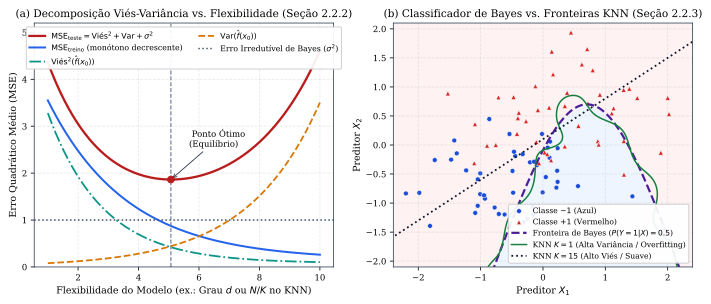
*Figura 1 — (a) Decomposição do MSE de teste em $\text{Viés}^2$, Variância e Erro Irredutível $\sigma^2$, comparada ao MSE de treinamento (Seção 2.2.2). (b) Fronteira de decisão ótima de Bayes comparada ao classificador KNN com $K=1$ (alta variância) e $K=15$ (alto viés) (Seção 2.2.3).*

> **[Complemento — Raschka et al., *ML with PyTorch and Scikit-Learn*, Cap. 1 e Cap. 4, Seções 4.1–4.4]:**  
> Além do aprendizado supervisionado e não supervisionado, Raschka et al. destacam no Capítulo 1 o terceiro grande pilar: o **Aprendizado por Reforço (*Reinforcement Learning*)**, no qual um agente interage com um ambiente buscando maximizar um sinal de recompensa acumulado (detalhado na Seção 9.4 deste paper).  
> No **Capítulo 4**, Raschka sistematiza o pré-processamento indispensável antes do ajuste de modelos sensíveis à escala (como KNN, SVM, Regressão Regularizada, PCA e Redes Neurais):
> 1. **Tratamento de Dados Ausentes (`NaN`):** remoção de linhas/colunas (`dropna`) ou imputação pela média, mediana ou moda (`SimpleImputer`), ou ainda por KNN/SVD;
> 2. **Codificação de Variáveis Categóricas:** mapeamento explícito de variáveis *ordinais* mantendo a ordem e **One-Hot Encoding** de variáveis *nominais*, descartando uma coluna de referência (`drop_first=True`) para evitar colinearidade perfeita com o intercepto;
> 3. **Escalonamento de Atributos (*Feature Scaling*):**
>    - **Normalização Min-Max ($\in [0, 1]$):** $\quad x_{\text{norm}}^{(i)} = \dfrac{x^{(i)} - x_{\min}}{x_{\max} - x_{\min}}$;
>    - **Padronização (*Standardization* / Z-score):** $\quad x_{\text{std}}^{(i)} = \dfrac{x^{(i)} - \mu_x}{\sigma_x}$ (média $0$ e desvio-padrão $1$, preservando informações sobre *outliers* e mantendo os pesos bem-condicionados para o Gradiente Descendente). **Regra Áurea contra *Data Leakage*:** os parâmetros $\mu_x$ e $\sigma_x$ devem ser estimados **exclusivamente no conjunto de treinamento** (`scaler.fit(X_train)`) e aplicados para transformar tanto o treino quanto o teste (`scaler.transform(X_test)`).

#### Exercícios de Fixação (Capítulos 1 e 2)
1. *(ISLP, Seção 2.4, Ex. 1)* Indique se um método estatístico altamente flexível tende a superar ou ser superado por um método inflexível quando: (a) $n$ é extremamente grande e $p$ é pequeno; (b) $p$ é extremamente grande e $n$ é pequeno; (c) a relação verdadeira é altamente não linear; (d) a variância do erro $\sigma^2 = \operatorname{Var}(\varepsilon)$ é extremamente alta. *(Gabarito: (a) Flexível é melhor; (b) Inflexível é melhor, pois o flexível sofrerá overfitting severo; (c) Flexível é melhor pelo menor viés; (d) Inflexível é melhor para não ajustar o forte ruído $\varepsilon$).*
2. *(ISLP, Seção 2.4, Ex. 7)* Dados 6 pontos em $\mathbb{R}^3$: $x_1=(0,3,0)$ [Red], $x_2=(2,0,0)$ [Red], $x_3=(0,1,3)$ [Red], $x_4=(0,1,2)$ [Green], $x_5=(-1,0,1)$ [Green] e $x_6=(1,1,1)$ [Red], classifique $x_0 = (0,0,0)$ por KNN com $K=1$ e $K=3$. *(Gabarito: Distâncias euclidianas a $x_0$: $d_1=3$, $d_2=2$, $d_3=\sqrt{10}$, $d_4=\sqrt{5}$, $d_5=\sqrt{2}$, $d_6=\sqrt{3}$. Para $K=1$, o mais próximo é $x_5$ ($\sqrt{2}$), logo **Green**; para $K=3$, os vizinhos são $\{x_5, x_6, x_2\}$ com 2 Red e 1 Green, logo **Red**).*

---

## 1. Regressão Linear (Capítulo 3)

### 1.1 Regressão Linear Simples: Estimadores de Mínimos Quadrados, Erros Padrão e $R^2$ (Seção 3.1)
Na Regressão Linear Simples, modelamos uma resposta quantitativa $Y$ com base num único preditor $X$ via $Y \approx \beta_0 + \beta_1 X$. Dadas as $n$ observações de treinamento $(x_1, y_1), \dots, (x_n, y_n)$, seja $\hat{y}_i = \hat{\beta}_0 + \hat{\beta}_1 x_i$ a predição para a $i$-ésima observação e seja $e_i = y_i - \hat{y}_i$ o **$i$-ésimo resíduo**. O critério de **Mínimos Quadrados Ordinários (MQO / OLS)** escolhe $\hat{\beta}_0$ e $\hat{\beta}_1$ de modo a minimizar a **Soma dos Quadrados dos Resíduos (*Residual Sum of Squares* — RSS)**:
$$\operatorname{RSS} = e_1^2 + e_2^2 + \dots + e_n^2 = \sum_{i=1}^{n} (y_i - \hat{\beta}_0 - \hat{\beta}_1 x_i)^2$$

> **Teorema 1.1 (Estimadores de Mínimos Quadrados — Equações 3.4, Seção 3.1.1):**  
> *Derivando $\operatorname{RSS}(\beta_0, \beta_1)$ parcialmente em relação a $\beta_0$ e $\beta_1$ e igualando a zero, obtêm-se os únicos minimizadores (desde que os $x_i$ não sejam todos idênticos):*
> $$\hat{\beta}_1 = \frac{\sum_{i=1}^{n} (x_i - \bar{x})(y_i - \bar{y})}{\sum_{i=1}^{n} (x_i - \bar{x})^2}, \qquad \hat{\beta}_0 = \bar{y} - \hat{\beta}_1 \bar{x}$$
> *onde $\bar{y} = \frac{1}{n}\sum_{i=1}^n y_i$ e $\bar{x} = \frac{1}{n}\sum_{i=1}^n x_i$ são as médias amostrais. Em particular, **a reta de mínimos quadrados sempre passa pelo centroide amostral $(\bar{x}, \bar{y})$** (pois $\hat{\beta}_0 + \hat{\beta}_1\bar{x} = \bar{y}$).*

#### 1. Precisão dos Coeficientes, Intervalos de Confiança e Teste $t$ (Seção 3.1.2)
Sob o modelo populacional $Y = \beta_0 + \beta_1 X + \varepsilon$, onde os erros $\varepsilon_i$ são descorrelacionados com variância comum $\sigma^2 = \operatorname{Var}(\varepsilon)$, os estimadores $\hat{\beta}_0$ e $\hat{\beta}_1$ são **não viesados** ($\mathbb{E}(\hat{\beta}_0) = \beta_0$ e $\mathbb{E}(\hat{\beta}_1) = \beta_1$) e seus **erros padrão (*Standard Errors* — SE)** ao quadrado valem (Equação 3.8):
$$\operatorname{SE}(\hat{\beta}_0)^2 = \sigma^2 \left[\frac{1}{n} + \frac{\bar{x}^2}{\sum_{i=1}^{n}(x_i - \bar{x})^2}\right], \qquad \operatorname{SE}(\hat{\beta}_1)^2 = \frac{\sigma^2}{\sum_{i=1}^{n}(x_i - \bar{x})^2}$$
Note que $\operatorname{SE}(\hat{\beta}_1)$ é menor quando os valores de $x_i$ são mais dispersos em torno de $\bar{x}$, e $\operatorname{SE}(\hat{\beta}_0)$ coincide com $\sigma/\sqrt{n}$ se $\bar{x} = 0$. Na prática, $\sigma$ é estimado pelo **Erro Padrão Residual (*Residual Standard Error* — RSE)**:
$$\operatorname{RSE} = \hat{\sigma} = \sqrt{\frac{\operatorname{RSS}}{n - 2}}$$
- **Intervalo de Confiança de $95\%$:** $\hat{\beta}_1 \pm t_{n-2;\, 0,975}\cdot \operatorname{SE}(\hat{\beta}_1) \approx \hat{\beta}_1 \pm 2\cdot \operatorname{SE}(\hat{\beta}_1)$.
- **Teste de Hipótese para $H_0: \beta_1 = 0$ vs. $H_a: \beta_1 \neq 0$:** Calcula-se a **estatística $t$**:
  $$t = \frac{\hat{\beta}_1 - 0}{\operatorname{SE}(\hat{\beta}_1)}$$
  que mede quantos desvios-padrão $\hat{\beta}_1$ está afastado de $0$, seguindo sob $H_0$ (e erros normais) uma distribuição $t$ de Student com $n - 2$ graus de liberdade.

#### 2. Acurácia do Modelo: RSE e a Estatística $R^2$ (Seção 3.1.3)
Enquanto o $\operatorname{RSE}$ mede a falta de ajuste absoluta na mesma unidade de $Y$, a estatística **$R^2$ (Coeficiente de Determinação)** mede a **proporção da variabilidade total de $Y$ que é explicada pela regressão sobre $X$** (Equação 3.17):
$$R^2 = \frac{\operatorname{TSS} - \operatorname{RSS}}{\operatorname{TSS}} = 1 - \frac{\operatorname{RSS}}{\operatorname{TSS}}, \qquad \text{onde } \operatorname{TSS} = \sum_{i=1}^{n}(y_i - \bar{y})^2 \quad (\text{Soma Total dos Quadrados})$$
Valendo sempre $0 \le R^2 \le 1$. Na **Regressão Linear Simples**, tem-se a identidade exata **$R^2 = r^2$**, onde $r = \operatorname{Cor}(X, Y) = \frac{\sum (x_i-\bar{x})(y_i-\bar{y})}{\sqrt{\sum (x_i-\bar{x})^2}\sqrt{\sum (y_i-\bar{y})^2}}$ é a correlação amostral de Pearson.

---

### 1.2 Regressão Linear Múltipla, Estatística $F$ e Intervalos de Confiança vs. Predição (Seção 3.2)
Para $p$ preditores, o modelo $Y = \beta_0 + \beta_1 X_1 + \beta_2 X_2 + \dots + \beta_p X_p + \varepsilon$ interpreta **$\beta_j$** como o efeito médio sobre $Y$ do aumento de uma unidade em $X_j$, **mantendo todos os demais preditores fixos** (*ceteris paribus*). Os coeficientes $\hat{\beta}_0, \dots, \hat{\beta}_p$ minimizam $\operatorname{RSS} = \sum_{i=1}^n (y_i - \hat{\beta}_0 - \sum_{j=1}^p \hat{\beta}_j x_{ij})^2$.

> **[Complemento — Forma Matricial e Equações Normais, Raschka Cap. 9 e Álgebra Linear do OLS]:**  
> Empilhando as observações no vetor $y \in \mathbb{R}^n$ e na matriz de desenho $X \in \mathbb{R}^{n \times (p+1)}$ (com primeira coluna de $1$s), tem-se $\operatorname{RSS}(\beta) = \|y - X\beta\|_2^2 = (y - X\beta)^T(y - X\beta)$. Igualando o gradiente $\nabla_\beta \operatorname{RSS}(\beta) = -2X^T(y - X\beta) = 0$, se $X$ tem posto coluna completo ($\operatorname{posto}(X) = p + 1 \le n$), o estimador de mínimos quadrados e sua matriz de covariância são dados por:
> $$\hat{\beta} = (X^T X)^{-1} X^T y, \qquad \operatorname{Cov}(\hat{\beta}) = \sigma^2 (X^T X)^{-1}, \qquad \hat{y} = X\hat{\beta} = H y$$
> onde $H = X(X^T X)^{-1}X^T$ é a **matriz de projeção ortogonal (matriz chapéu / *hat matrix*)**, e $\operatorname{RSE} = \sqrt{\dfrac{\operatorname{RSS}}{n - p - 1}}$.

Na Seção 3.2.2, o ISLP estrutura as cinco questões fundamentais da Regressão Múltipla:
1. **Ao menos um preditor é útil? (Teste Global $F$):** Para testar a hipótese nula conjunta **$H_0: \beta_1 = \beta_2 = \dots = \beta_p = 0$** contra $H_a:$ *pelo menos um $\beta_j \neq 0$*, utiliza-se a **estatística $F$** (Equação 3.23):
   $$F = \frac{(\operatorname{TSS} - \operatorname{RSS}) / p}{\operatorname{RSS} / (n - p - 1)} \sim F_{p,\, n-p-1} \quad (\text{sob } H_0)$$
   Quando $H_0$ é verdadeira, o numerador e o denominador têm esperança igual a $\sigma^2$, logo $F \approx 1$; quando $H_a$ é verdadeira, $\mathbb{E}[(\operatorname{TSS}-\operatorname{RSS})/p] > \sigma^2$, logo $F > 1$.  
   *(Por que não olhar apenas para os $p$-valores individuais das estatísticas $t$? Porque se $p$ for grande — por exemplo, $p = 100$ — e $H_0$ for verdadeira, esperamos que cerca de $5\%$ dos $p$-valores individuais sejam $< 0{,}05$ puramente por acaso! A estatística $F$ ajusta para o número de preditores $p$ e não sofre desse problema quando $p < n$).*  
   Para testar se um **subconjunto de $q$ coeficientes** é nulo ($H_0: \beta_{p-q+1} = \dots = \beta_p = 0$), sendo $\operatorname{RSS}_0$ a soma de resíduos do modelo reduzido sem essas $q$ variáveis, usa-se a estatística $F$ parcial (Equação 3.24):
   $$F = \frac{(\operatorname{RSS}_0 - \operatorname{RSS}) / q}{\operatorname{RSS} / (n - p - 1)} \sim F_{q,\, n-p-1}$$
   Quando $q = 1$, essa estatística $F$ parcial é exatamente igual ao **quadrado da estatística $t$** daquela variável ($F = t^2$).
2. **Decidindo sobre Variáveis Importantes:** O $R^2$ sempre aumenta ao adicionar qualquer variável ao modelo (mesmo ruído puro), pois o $\operatorname{RSS}$ de treino nunca cresce. Por isso, a seleção entre $2^p$ submodelos possíveis utiliza critérios que penalizam o tamanho do modelo ($C_p$, AIC, BIC, $R^2$ ajustado e Validação Cruzada — estudados no Capítulo 6) via *Forward*, *Backward* ou *Mixed Selection*.
3. **Incerteza na Predição: Intervalo de Confiança vs. Intervalo de Predição:** Dado $x_0 = (1, x_{01}, \dots, x_{0p})^T$, a predição pontual $\hat{y}_0 = x_0^T\hat{\beta}$ serve tanto para estimar a **resposta média** $f(x_0) = \mathbb{E}(Y \mid X = x_0)$ quanto para prever uma **resposta individual** $Y_0 = f(x_0) + \varepsilon_0$, mas com incertezas distintas:
   - **Intervalo de Confiança (para a média $f(x_0)$):** incorpora apenas o **erro redutível** da estimação de $\hat{\beta}$, com variância $\operatorname{Var}(\hat{f}(x_0)) = \sigma^2 x_0^T(X^T X)^{-1}x_0$;
   - **Intervalo de Predição (para uma nova observação $Y_0 = f(x_0) + \varepsilon_0$):** incorpora tanto o erro redutível quanto o **erro irredutível** $\operatorname{Var}(\varepsilon_0) = \sigma^2$, tendo variância $\sigma^2\big[1 + x_0^T(X^T X)^{-1}x_0\big]$. Logo, **o intervalo de predição é sempre substancialmente mais largo do que o intervalo de confiança**.

---

### 1.3 Preditores Qualitativos, Interações, Diagnósticos de Problemas e KNN para Regressão (Seções 3.3 e 3.5)
1. **Preditores Qualitativos (Fatores / Variáveis *Dummy*, Seção 3.3.1):** Um fator com $L$ níveis é representado por **$L - 1$ variáveis indicadoras (*dummy*)** binárias $\{0, 1\}$. O nível sem variável *dummy* associada atua como **linha de base (*baseline*)**, cujo efeito médio é absorvido pelo intercepto $\beta_0$.
2. **Termos de Interação e Princípio Hierárquico (Seção 3.3.2):** Para relaxar a hipótese aditiva, inclui-se o produto $X_1 X_2$:
   $$Y = \beta_0 + \beta_1 X_1 + \beta_2 X_2 + \beta_3 X_1 X_2 + \varepsilon = \beta_0 + (\beta_1 + \beta_3 X_2)X_1 + \beta_2 X_2 + \varepsilon$$
   Agora o efeito de $X_1$ sobre $Y$ ($\tilde{\beta}_1 = \beta_1 + \beta_3 X_2$) depende do nível de $X_2$ (**sinergia** em marketing).
   > **Princípio Hierárquico (Seção 3.3.2):** *Se incluirmos uma interação $X_1 X_2$ num modelo (ou uma potência $X^d$), devemos **sempre incluir os efeitos principais** $X_1$ e $X_2$ (ou as potências inferiores $X, \dots, X^{d-1}$), mesmo que os $p$-valores associados aos coeficientes dos efeitos principais não sejam estatisticamente significativos.*
3. **Seis Problemas Potenciais no Modelo de Regressão (Seção 3.3.3):**
   - **(i) Não Linearidade da Relação:** Diagnosticada plotando os resíduos $e_i = y_i - \hat{y}_i$ contra os valores ajustados $\hat{y}_i$. Um padrão em U (ou curva sistemática) indica não linearidade, corrigível com transformações ($\log X, \sqrt{X}, X^2$) ou splines (Cap. 7).
   - **(ii) Correlação dos Termos de Erro:** Comum em séries temporais, onde resíduos adjacentes têm sinais semelhantes (*tracking*). Faz com que os erros padrão $\operatorname{SE}(\hat{\beta}_j)$ subestimem a verdadeira incerteza, gerando intervalos de confiança estreitos demais e $p$-valores artificialmente baixos.
   - **(iii) Variância Não Constante dos Erros (Heterocedasticidade):** Identificada pelo **formato de funil** no gráfico de resíduos vs. $\hat{y}_i$. Pode ser corrigida transformando a resposta com uma função côncava como $\log Y$ ou $\sqrt{Y}$, ou usando Mínimos Quadrados Ponderados (*Weighted Least Squares* — WLS).
   - **(iv) *Outliers* (Valores Discrepantes em $y_i$):** Observações onde $|y_i - \hat{y}_i|$ é anormalmente grande, identificadas pelos **resíduos estudentizados (*studentized residuals*)** $e_i / \operatorname{SE}(e_i)$ cujo valor absoluto excede $3$.
   - **(v) Pontos de Alta Alavancagem (*High Leverage Points*, discrepantes em $x_i$):** Quantificados pela **estatística de alavancagem (*leverage statistic*)** $h_i = H_{ii}$ (Equação 3.37, para regressão simples):
     $$h_i = \frac{1}{n} + \frac{(x_i - \bar{x})^2}{\sum_{i'=1}^{n}(x_{i'} - \bar{x})^2}, \qquad \text{valendo sempre } \frac{1}{n} \le h_i \le 1 \quad \text{e} \quad \sum_{i=1}^{n} h_i = p + 1$$
     Como a média das alavancagens é $(p+1)/n$, uma observação com $h_i \gg (p+1)/n$ tem alta alavancagem e combinada a um alto resíduo estudentizado distorce severamente a reta ajustada.
   - **(vi) Colinearidade e Multicolinearidade:** Duas ou mais variáveis preditoras fortemente correlacionadas entre si inflam a variância $\operatorname{Var}(\hat{\beta}_j)$, reduzindo a estatística $t = \hat{\beta}_j / \operatorname{SE}(\hat{\beta}_j)$ e o poder do teste. Para detectar **multicolinearidade** envolvendo três ou mais variáveis, calcula-se o **Fator de Inflação da Variância (*Variance Inflation Factor* — VIF)** (Equação 3.28):
     $$\operatorname{VIF}(\hat{\beta}_j) = \frac{1}{1 - R^2_{X_j \mid X_{-j}}}$$
     onde $R^2_{X_j \mid X_{-j}}$ é o $R^2$ da regressão de $X_j$ sobre todos os outros $p-1$ preditores. Um $\operatorname{VIF} = 1$ indica ausência total de colinearidade; valores de **$\operatorname{VIF} > 5$ ou $10$** indicam colinearidade problemática (solucionada removendo uma das variáveis redundantes ou combinando-as num índice único).
4. **Regressão KNN e a Maldição da Dimensionalidade (Seção 3.5):** O estimador não paramétrico de regressão KNN estima $\hat{f}(x_0) = \frac{1}{K}\sum_{x_i \in \mathcal{N}_0} y_i$. Embora supere a regressão linear quando $p = 1$ ou $2$ e a verdadeira $f$ é fortemente não linear, em dimensões moderadas ou altas ($p \ge 4$) a regressão linear supera o KNN porque as $K$ observações mais próximas ficam muito distantes de $x_0$ em $\mathbb{R}^p$ (**Maldição da Dimensionalidade**).

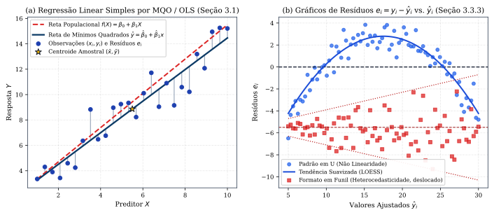
*Figura 2 — (a) Reta de Mínimos Quadrados Ordinários $\hat{y} = \hat{\beta}_0 + \hat{\beta}_1 x$ passando por $(\bar{x}, \bar{y})$, reta populacional e resíduos $e_i$ (Seção 3.1). (b) Gráfico de resíduos $e_i$ versus $\hat{y}_i$ exibindo não linearidade (curva em U) e heterocedasticidade (formato em funil) (Seção 3.3.3).*

> **[Complemento — Raschka et al., *ML with PyTorch and Scikit-Learn*, Cap. 9, Seção 9.3]:**  
> Como alternativa à remoção manual de *outliers*, Raschka apresenta o algoritmo **RANSAC (*RANdom SAmple Consensus*)**, que ajusta iterativamente o modelo linear apenas a um subconjunto de *inliers* selecionados aleatoriamente, testando os demais pontos contra um limiar de tolerância residual e reajustando o modelo no maior conjunto de consenso encontrado. Além disso, para dados de grande escala onde a inversão matricial $(X^T X)^{-1}$ de custo $\mathcal{O}(p^3)$ é proibitiva, resolve-se o OLS via Gradiente Descendente (`SGDRegressor`).

#### Exercícios de Fixação (Capítulo 3)
1. *(ISLP, Seção 3.7, Ex. 3)* Ajusta-se um modelo para o salário inicial (em milhares de dólares) com $X_1 = \text{GPA}$, $X_2 = \text{IQ}$, $X_3 = \text{Level}$ ($1$ para Faculdade, $0$ para Ensino Médio), $X_4 = X_1 X_2$ e $X_5 = X_1 X_3$, obtendo $\hat{\beta}_0 = 50, \hat{\beta}_1 = 20, \hat{\beta}_2 = 0{,}07, \hat{\beta}_3 = 35, \hat{\beta}_4 = 0{,}01, \hat{\beta}_5 = -10$. (a) Prediga o salário para Faculdade ($X_3=1$), $\text{IQ}=110$ e $\text{GPA}=4{,}0$. (b) Para quem o salário esperado é maior com $\text{GPA}$ alto? *(Gabarito: (a) $\hat{Y} = 50 + 20(4) + 0{,}07(110) + 35(1) + 0{,}01(440) - 10(4) = 137{,}1$ mil dólares; (b) Diferença Faculdade $-$ Ensino Médio $= 35 - 10\,\text{GPA}$, logo para $\text{GPA} > 3{,}5$ graduados do Ensino Médio ganham mais em média nesse modelo).*
2. *(ISLP, Seção 3.7, Ex. 4)* Se a relação verdadeira entre $X$ e $Y$ for perfeitamente linear ($Y = \beta_0 + \beta_1 X + \varepsilon$), compare o $\operatorname{RSS}$ de treino e o $\operatorname{RSS}$ de teste de uma regressão linear versus uma regressão cúbica. *(Gabarito: No **treino**, a regressão cúbica terá $\operatorname{RSS}$ menor ou igual, pois contém o modelo linear como caso particular e ajusta mais graus de liberdade ao ruído; no **teste**, a regressão linear terá $\operatorname{RSS}$ esperado menor, pois ambos têm viés zero, mas a cúbica tem variância maior).*

---

## 2. Classificação (Capítulo 4)

### 2.1 Por Que Não Regressão Linear? E o Modelo de Regressão Logística (Seções 4.1 a 4.3)
Se uma resposta qualitativa $Y$ possui $K \ge 3$ categorias sem ordem natural (ex.: *AVC*, *Overdose*, *Crise Epiléptica*), codificá-la por $Y \in \{1, 2, 3\}$ numa regressão linear impõe um ordenamento artificial e distâncias iguais entre as classes. Mesmo para uma **resposta binária** $Y \in \{0, 1\}$, a regressão linear $p(X) = \beta_0 + \beta_1 X$ pode produzir estimativas de probabilidade absurdas ($p(X) < 0$ ou $p(X) > 1$, Figura 3a).

Para garantir que $p(X) = \Pr(Y = 1 \mid X)$ pertença estritamente ao intervalo $(0, 1)$ para qualquer valor de $X = (X_1, \dots, X_p)$, a **Regressão Logística** utiliza a **função logística (ou sigmoide)** (Equações 4.2 e 4.7):
$$p(X) = \frac{e^{\beta_0 + \beta_1 X_1 + \dots + \beta_p X_p}}{1 + e^{\beta_0 + \beta_1 X_1 + \dots + \beta_p X_p}} = \frac{1}{1 + e^{-(\beta_0 + \beta_1 X_1 + \dots + \beta_p X_p)}}$$
Isolando a exponencial, obtém-se a **chance (*odds*)** e o **log-odds (ou *logit*)** (Equações 4.3 e 4.4):
$$\frac{p(X)}{1 - p(X)} = e^{\beta_0 + \beta_1 X_1 + \dots + \beta_p X_p} \iff \ln\left(\frac{p(X)}{1 - p(X)}\right) = \beta_0 + \beta_1 X_1 + \dots + \beta_p X_p$$
Assim, aumentar $X_j$ em uma unidade multiplica a chance (*odds*) por $e^{\beta_j}$ e aumenta o *log-odds* em $\beta_j$ unidades.
- **Estimação por Máxima Verossimilhança (*Maximum Likelihood* — Seção 4.3.2):** Buscam-se os coeficientes $\hat{\beta}_0, \dots, \hat{\beta}_p$ que maximizam a **função de verossimilhança**:
  $$\ell(\beta_0, \dots, \beta_p) = \prod_{i:\, y_i = 1} p(x_i) \prod_{i':\, y_{i'} = 0} \big(1 - p(x_{i'})\big) = \prod_{i=1}^{n} \big[p(x_i)\big]^{y_i}\big[1 - p(x_i)\big]^{1 - y_i}$$
  O que equivale a minimizar a **log-verossimilhança negativa (Entropia Cruzada Binária / *Log-Loss*)**:
  $$L(\beta) = -\ln \ell(\beta) = -\sum_{i=1}^{n} \Big[y_i \ln p(x_i) + (1 - y_i)\ln\big(1 - p(x_i)\big)\Big]$$
  Na inferência sobre $H_0: \beta_j = 0$, utiliza-se a **estatística $z$ (teste de Wald)** $z = \hat{\beta}_j / \operatorname{SE}(\hat{\beta}_j) \stackrel{a}{\sim} \mathcal{N}(0, 1)$.
- **Regressão Logística Multinomial (*Softmax* — Seção 4.3.5):** Para $K > 2$ classes, escolhendo a classe $K$ como *baseline*, $\ln\left(\frac{\Pr(Y=k|X=x)}{\Pr(Y=K|X=x)}\right) = \beta_{k0} + \sum_{j=1}^p \beta_{kj}x_j$ para $k = 1, \dots, K-1$. Na codificação simétrica **Softmax** (Equação 4.13, muito usada em *Deep Learning*):
  $$\Pr(Y = k \mid X = x) = \frac{e^{\beta_{k0} + \beta_{k1}x_1 + \dots + \beta_{kp}x_p}}{\sum_{\ell=1}^{K} e^{\beta_{\ell 0} + \beta_{\ell 1}x_1 + \dots + \beta_{\ell p}x_p}}, \qquad k = 1, \dots, K$$

> **[Complemento — Raschka et al., *ML with PyTorch and Scikit-Learn*, Cap. 2 e Cap. 3]:**  
> Raschka introduz a evolução histórica dos classificadores lineares a partir do neurônio artificial:
> 1. **Perceptron de Rosenblatt (1957, Cap. 2.1):** Calcula a entrada líquida $z = w^T x + b$ com ativação degrau $\phi(z) = 1$ se $z \ge 0$ e $0$ caso contrário, atualizando os pesos amostra a amostra por $\Delta w_j = \eta(y^{(i)} - \hat{y}^{(i)})x_j^{(i)}$. O Perceptron converge em número finito de passos **se, e somente se, as classes forem linearmente separáveis**.
> 2. **Adaline (*ADAptive LInear NEuron*, Widrow & Hoff, 1960, Cap. 2.2):** Utiliza ativação linear contínua $\phi(z) = z$ para atualizar os pesos via Gradiente Descendente sobre a soma dos quadrados dos erros $L(w) = \frac{1}{2}\sum_i (y^{(i)} - \phi(z^{(i)}))^2$, garantindo convergência convexa mesmo quando os dados não são linearmente separáveis. Substituindo a ativação linear pela sigmoide $\sigma(z)$ e a perda quadrática pela log-verossimilhança negativa, o Adaline transforma-se exatamente na **Regressão Logística** (Cap. 3.3).

---

### 2.2 Modelos Generativos para Classificação: LDA, QDA e Naive Bayes (Seção 4.4)
Em vez de modelar diretamente a distribuição condicional $\Pr(Y = k \mid X = x)$ (abordagem **discriminativa** da Regressão Logística), os **modelos generativos** modelam a distribuição dos preditores $X$ separadamente dentro de cada classe $k$, expressa pela densidade condicional $f_k(x) \equiv \Pr(X = x \mid Y = k)$, e a probabilidade *a priori* $\pi_k = \Pr(Y = k)$, invertendo o condicionamento pelo **Teorema de Bayes** (Equação 4.15):
$$\Pr(Y = k \mid X = x) = \frac{\pi_k f_k(x)}{\sum_{\ell=1}^{K} \pi_\ell f_\ell(x)}$$
Por que usar modelos generativos? (i) Quando há separação substancial entre as classes, as estimativas da regressão logística tornam-se instáveis (divergem para $\pm\infty$), enquanto os modelos generativos permanecem bem-comportados; (ii) Se a distribuição dos preditores for aproximadamente normal e $n$ for pequeno, o modelo generativo é mais preciso que a regressão logística; (iii) Estendem-se naturalmente para $K > 2$ classes.

1. **Análise Discriminante Linear (LDA) para $p = 1$ (Seção 4.4.1):** Assume-se que em cada classe $k$, $X \sim \mathcal{N}(\mu_k, \sigma^2)$ com **variância comum $\sigma^2 = \sigma_1^2 = \dots = \sigma_K^2$**:
   $$f_k(x) = \frac{1}{\sqrt{2\pi}\sigma}\exp\left(-\frac{1}{2\sigma^2}(x - \mu_k)^2\right)$$
   Tomando o logaritmo de $\pi_k f_k(x)$ e descartando as constantes que não dependem de $k$ (inclusive o termo quadrático $-\frac{x^2}{2\sigma^2}$, que se cancela graças à homocedasticidade $\sigma_k^2 = \sigma^2$!), maximizar $\Pr(Y = k \mid X = x)$ equivale a maximizar a **função discriminante linear $\delta_k(x)$** (Equação 4.18):
   $$\delta_k(x) = x \cdot \frac{\mu_k}{\sigma^2} - \frac{\mu_k^2}{2\sigma^2} + \ln(\pi_k)$$
   Para $K = 2$ e $\pi_1 = \pi_2 = 0{,}5$, a fronteira de decisão de Bayes $\delta_1(x) = \delta_2(x)$ reduz-se ao ponto médio **$x = \frac{\mu_1 + \mu_2}{2}$**. Na amostra, estimam-se $\hat{\pi}_k = n_k / n$, $\hat{\mu}_k = \frac{1}{n_k}\sum_{i: y_i = k} x_i$ e a variância agrupada (*pooled*) $\hat{\sigma}^2 = \frac{1}{n - K}\sum_{k=1}^K \sum_{i: y_i = k}(x_i - \hat{\mu}_k)^2$.
2. **Análise Discriminante Linear (LDA) para $p > 1$ (Seção 4.4.2):** Assume-se que $X = (X_1, \dots, X_p)^T$ na classe $k$ segue uma distribuição Normal Multivariada $\mathcal{N}(\mu_k, \mathbf{\Sigma})$ com vetor de médias $\mu_k \in \mathbb{R}^p$ específico da classe e **matriz de covariância comum $\mathbf{\Sigma} \in \mathbb{R}^{p \times p}$** para todas as $K$ classes:
   $$f_k(x) = \frac{1}{(2\pi)^{p/2}|\mathbf{\Sigma}|^{1/2}}\exp\left(-\frac{1}{2}(x - \mu_k)^T \mathbf{\Sigma}^{-1}(x - \mu_k)\right)$$
   Novamente, o termo quadrático $-\frac{1}{2}x^T\mathbf{\Sigma}^{-1}x$ não depende de $k$, resultando na **função discriminante linear em $x$** (Equação 4.24):
   $$\delta_k(x) = x^T \mathbf{\Sigma}^{-1}\mu_k - \frac{1}{2}\mu_k^T \mathbf{\Sigma}^{-1}\mu_k + \ln \pi_k$$
   As fronteiras de decisão $\delta_k(x) = \delta_\ell(x)$ são **hiperplanos afins** em $\mathbb{R}^p$, exigindo a estimação de $Kp$ médias e $\frac{p(p+1)}{2}$ parâmetros de covariância em $\mathbf{\Sigma}$.
3. **Análise Discriminante Quadrática (QDA — Seção 4.4.3):**Assume-se que na classe $k$, $X \sim \mathcal{N}(\mu_k, \mathbf{\Sigma}_k)$, onde **cada classe possui sua própria matriz de covariância $\mathbf{\Sigma}_k$**. Agora o termo quadrático em $x$ permanece na função discriminante (Equação 4.27):
   $$\delta_k(x) = -\frac{1}{2}(x - \mu_k)^T \mathbf{\Sigma}_k^{-1}(x - \mu_k) - \frac{1}{2}\ln|\mathbf{\Sigma}_k| + \ln \pi_k$$
   A fronteira de decisão do QDA é **quadrática**. Existe um claro **trade-off viés-variância entre LDA e QDA**: o QDA precisa estimar $K\frac{p(p+1)}{2}$ parâmetros de covariância (contra apenas $\frac{p(p+1)}{2}$ no LDA). Portanto, o LDA é menos flexível (menor variância, preferível quando $n$ é pequeno ou quando a matriz $\mathbf{\Sigma}$ realmente é compartilhada), enquanto o QDA é preferível quando $n$ é grande ou as covariâncias diferem marcadamente entre as classes.
4. **Classificador Naive Bayes (Seção 4.4.4):** Assume que, **dentro de cada classe $k$, os $p$ preditores são condicionalmente independentes** (Equação 4.29):
   $$f_k(x) = f_{k1}(x_1) \times f_{k2}(x_2) \times \dots \times f_{kp}(x_p) = \prod_{j=1}^{p} f_{kj}(x_j)$$
   Isso reduz a estimação de uma densidade conjunta $p$-dimensional (intratável para $p$ grande) à estimação de $p$ densidades marginais unidimensionais $f_{kj}$ (via normais univariadas $\mathcal{N}(\mu_{kj}, \sigma_{kj}^2)$, histogramas/KDE ou proporções multinomiais), reduzindo drasticamente a variância ao custo de algum viés.

#### Matriz de Confusão, Sensibilidade, Especificidade e Curva ROC (Seção 4.4.2)
Num problema binário (ex.: $Y = 1$ Positivo / Inadimplente vs. $Y = 0$ Negativo / Adimplente), alterar o limiar de probabilidade $\tau$ na regra $\widehat{\Pr}(Y = 1 \mid X = x) > \tau$ altera o compromisso entre os dois tipos de erro:
- **Sensibilidade (*Sensitivity* / *Recall* / Taxa de Verdadeiros Positivos — TPR):** $\quad \operatorname{TPR} = \dfrac{\operatorname{TP}}{\operatorname{TP} + \operatorname{FN}} = \Pr(\hat{Y} = 1 \mid Y = 1)$;
- **Especificidade (*Specificity* / Taxa de Verdadeiros Negativos — TNR):** $\quad \operatorname{TNR} = \dfrac{\operatorname{TN}}{\operatorname{TN} + \operatorname{FP}} = \Pr(\hat{Y} = 0 \mid Y = 0) = 1 - \operatorname{FPR}$;
- **Precisão (*Precision* / Valor Preditivo Positivo):** $\quad \operatorname{Precision} = \dfrac{\operatorname{TP}}{\operatorname{TP} + \operatorname{FP}} = \Pr(Y = 1 \mid \hat{Y} = 1)$.

A **Curva ROC (*Receiver Operating Characteristic*)** plota $\operatorname{TPR}$ versus $\operatorname{FPR} = 1 - \text{Especificidade}$ para todos os limiares $\tau \in [0, 1]$, e seu desempenho global é resumido pela **AUC (*Area Under the ROC Curve*)**, que vale $0{,}5$ para um classificador aleatório e $1{,}0$ para um classificador perfeito.

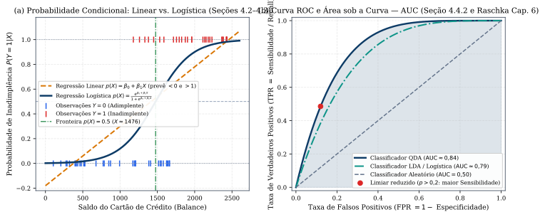
*Figura 3 — (a) Regressão Logística versus Regressão Linear para resposta binária no conjunto `Default` (Seções 4.2–4.3). (b) Curva ROC (Sensibilidade vs. Taxa de Falsos Positivos) e Área sob a Curva (AUC) para LDA e QDA (Seção 4.4.2).*

---

### 2.3 Comparação Analítica dos Classificadores, Regressão de Poisson e Modelos Lineares Generalizados (GLMs, Seções 4.5 e 4.6)
1. **Unificação Analítica dos Log-Odds (Seção 4.5.1, Equações 4.32–4.34):** Tomando a classe $K$ como referência, o logaritmo da razão de probabilidades posteriores $\ln\left(\frac{\Pr(Y=k|X=x)}{\Pr(Y=K|X=x)}\right)$ tem a estrutura:
   - **Regressão Logística e LDA:** $\quad a_k + \sum_{j=1}^p b_{kj} x_j$ (ambos são **lineares em $x$**, diferindo apenas na forma de estimar os coeficientes: condicional via MLE na logística vs. conjunta Gaussiana no LDA);
   - **Naive Bayes:** $\quad a_k + \sum_{j=1}^p g_{kj}(x_j)$ (soma de funções univariadas, ou seja, um **Modelo Aditivo Generalizado — GAM**);
   - **QDA:** $\quad a_k + \sum_{j=1}^p b_{kj} x_j + \sum_{j=1}^p \sum_{\ell=1}^p c_{kj\ell} x_j x_\ell$ (inclui todos os termos quadráticos e interações de 2ª ordem, subsumindo o LDA e o Naive Bayes Gaussiano).
2. **Regressão de Poisson para Dados de Contagem e GLMs (Seção 4.6):** Quando $Y \in \{0, 1, 2, \dots\}$ é uma **contagem** não negativa (como o número de aluguéis de bicicletas em `Bikeshare`), a variância cresce com a média e a regressão linear pode prever contagens negativas. Na **Regressão de Poisson**, assume-se $Y \sim \operatorname{Poisson}(\lambda)$ com $\Pr(Y = k) = \frac{e^{-\lambda}\lambda^k}{k!}$ ($\mathbb{E}(Y) = \operatorname{Var}(Y) = \lambda$) e modela-se o logaritmo da taxa esperada como função linear dos preditores (Equação 4.36):
   $$\ln\big(\lambda(X_1, \dots, X_p)\big) = \beta_0 + \beta_1 X_1 + \dots + \beta_p X_p \iff \lambda(X) = e^{\beta_0 + \beta_1 X_1 + \dots + \beta_p X_p}$$
   Um aumento de $1$ unidade em $X_j$ multiplica a contagem esperada $\mathbb{E}(Y|X)$ por **$e^{\beta_j}$**, estimando-se $\beta$ por máxima verossimilhança sobre $\ell(\beta) = \prod_{i=1}^n \frac{e^{-\lambda(x_i)}\lambda(x_i)^{y_i}}{y_i!}$.
3. **Modelos Lineares Generalizados (*Generalized Linear Models* — GLMs, Seção 4.6.3):** Unificam a Regressão Linear, a Regressão Logística e a Regressão de Poisson modelando $Y \mid X$ numa distribuição da **família exponencial** e transformando a média condicional $\mu(X) = \mathbb{E}(Y \mid X)$ por uma **função de ligação (*link function*) $\eta$** linear nos preditores:
   $$\eta\big(\mathbb{E}(Y \mid X_1, \dots, X_p)\big) = \beta_0 + \beta_1 X_1 + \dots + \beta_p X_p$$
   onde $\eta(\mu) = \mu$ (identidade) na Regressão Linear Gaussiana, $\eta(\mu) = \ln\left(\frac{\mu}{1-\mu}\right)$ (*logit*) na Regressão Logística Binomial, e $\eta(\mu) = \ln(\mu)$ (*log*) na Regressão de Poisson.

#### Exercícios de Fixação (Capítulo 4)
1. *(ISLP, Seção 4.8, Ex. 6)* Na regressão logística para receber nota A ($Y=1$) em função de $X_1 =$ horas de estudo e $X_2 = \text{GPA}$, obtiveram-se $\hat{\beta}_0 = -6, \hat{\beta}_1 = 0{,}05, \hat{\beta}_2 = 1$. (a) Estime a probabilidade de nota A para $X_1 = 40\text{ h}$ e $X_2 = 3{,}5$. (b) Quantas horas esse aluno precisa estudar para ter $50\%$ de chance de tirar A? *(Gabarito: (a) $z = -6 + 0{,}05(40) + 1(3{,}5) = -0{,}5 \implies \hat{p} = \frac{e^{-0,5}}{1+e^{-0,5}} \approx 0{,}3775$ ($37{,}75\%$); (b) $\hat{p} = 0{,}5 \iff z = 0 \iff -6 + 0{,}05 X_1 + 3{,}5 = 0 \implies X_1 = 50\text{ horas}$).*
2. *(ISLP, Seção 4.8, Ex. 7)* Para prever se uma ação pagará dividendos ($Y=\text{Yes}$ ou $\text{No}$) a partir do lucro percentual $X$, sabe-se que $\pi_{\text{Yes}} = 0{,}80$, $\pi_{\text{No}} = 0{,}20$, $X \mid \text{Yes} \sim \mathcal{N}(10, 36)$ e $X \mid \text{No} \sim \mathcal{N}(0, 36)$. Calcule $\Pr(\text{Yes} \mid X = 4)$. *(Gabarito: Pelo Teorema de Bayes, $\Pr(\text{Yes}\mid X=4) = \frac{0,8 e^{-(4-10)^2/72}}{0,8 e^{-36/72} + 0,2 e^{-16/72}} = \frac{0,8 e^{-0,5}}{0,8 e^{-0,5} + 0,2 e^{-2/9}} \approx 0{,}7519$ ($75{,}2\%$)).*

---

## 3. Métodos de Reamostragem: Validação Cruzada e Bootstrap (Capítulo 5)

### 3.1 Validação Cruzada: Conjunto de Validação, LOOCV e $k$-Fold CV (Seção 5.1)
Os métodos de reamostragem extraem repetidamente amostras do conjunto de treinamento para avaliar a acurácia de teste (**Model Assessment**) ou selecionar o nível ótimo de flexibilidade (**Model Selection**).

1. **Abordagem do Conjunto de Validação (*Validation Set Approach* — Seção 5.1.1):** Divide-se aleatoriamente o conjunto de $n$ observações num conjunto de treinamento e num conjunto de validação (*hold-out*). Possui **duas desvantagens**: (i) a estimativa da taxa de erro de teste tem **alta variância**, dependendo fortemente de quais observações caíram em cada metade; (ii) como apenas um subconjunto (ex.: $50\%$) das observações é usado para treinar o modelo, o método **tende a superestimar a taxa de erro de teste** (viés pessimista) do modelo ajustado sobre todas as $n$ observações.
2. **Validação Cruzada *Leave-One-Out* (LOOCV — Seção 5.1.2):** Em cada passo $i \in \{1, \dots, n\}$, reserva-se uma única observação $(x_i, y_i)$ para validação e ajusta-se o modelo nas $n - 1$ observações restantes, obtendo $\operatorname{MSE}_i = (y_i - \hat{y}_i^{(-i)})^2$. A estimativa LOOCV do erro de teste é:
   $$\operatorname{CV}_{(n)} = \frac{1}{n}\sum_{i=1}^{n} \operatorname{MSE}_i$$
   Como usa $n - 1$ observações em cada ajuste, o LOOCV tem **viés quase nulo** e não sofre de aleatoriedade na partição. Além disso, para **Regressão Linear ou Polinomial por Mínimos Quadrados**, vale a **fórmula mágica do atalho analítico (Equação 5.2)**, que calcula o LOOCV com o custo de **um único ajuste** no conjunto completo:
   $$\operatorname{CV}_{(n)} = \frac{1}{n}\sum_{i=1}^{n} \left(\frac{y_i - \hat{y}_i}{1 - h_i}\right)^2$$
   onde $\hat{y}_i$ é o $i$-ésimo valor ajustado no conjunto completo e $h_i \in [1/n, 1[$ é a alavancagem da Equação (3.37) (pontos de alta alavancagem inflam o respectivo resíduo ao serem deixados de fora!).
3. **Validação Cruzada $k$-Fold e seu Trade-Off Viés-Variância (Seções 5.1.3–5.1.5):** Divide-se aleatoriamente o conjunto de observações em $k$ grupos (*folds*) de tamanhos aproximadamente iguais. Para cada $i = 1, \dots, k$, trata-se o $i$-ésimo grupo como validação e ajusta-se o modelo nos outros $k - 1$ grupos:
   $$\operatorname{CV}_{(k)} = \frac{1}{k}\sum_{i=1}^{k} \operatorname{MSE}_i \quad (\text{em regressão}) \qquad \text{ou} \qquad \operatorname{CV}_{(k)} = \frac{1}{n}\sum_{j=1}^{n} \operatorname{Err}_j \quad (\text{em classificação})$$
   Além da enorme vantagem computacional (ajustar o modelo $k = 5$ ou $10$ vezes em vez de $n$ vezes), o **$k$-Fold CV frequentemente fornece estimativas mais precisas da taxa de erro de teste do que o LOOCV** devido ao **trade-off viés-variância**: embora o LOOCV tenha menor viés (treina com $n-1$ amostras contra $(k-1)n/k$ no $k$-Fold), no LOOCV fazemos a média das saídas de $n$ modelos ajustados sobre conjuntos de treinamento quase idênticos (diferindo em apenas 1 ponto!), logo as quantidades $\operatorname{MSE}_1, \dots, \operatorname{MSE}_n$ são **altamente correlacionadas positivamente**, e a média de variáveis altamente correlacionadas possui **maior variância** do que a média dos $k$ *folds* menos sobrepostos ($k = 5$ ou $k = 10$ são os valores empiricamente ótimos).

---

### 3.2 O Bootstrap (Seção 5.2)
O **Bootstrap** permite quantificar a incerteza (como o erro padrão ou intervalo de confiança) associada a qualquer estimador estatístico $\hat{\alpha}$, mesmo quando não existe fórmula analítica fechada ou quando as hipóteses paramétricas não se verificam.
- **Mecanismo (Seção 5.2):** A partir do conjunto de dados original $Z$ com $n$ observações, sorteiam-se **$B$ amostras bootstrap $Z^{*1}, Z^{*2}, \dots, Z^{*B}$**, cada uma de tamanho $n$, **com reposição** (*sampling with replacement*). Em cada amostra $Z^{*b}$, calcula-se a estimativa $\hat{\alpha}^{*b}$, e estima-se o erro padrão de $\hat{\alpha}$ pelo desvio-padrão amostral das $B$ réplicas bootstrap (Equação 5.8):
  $$\operatorname{SE}_B(\hat{\alpha}) = \sqrt{\frac{1}{B - 1}\sum_{r=1}^{B} \left(\hat{\alpha}^{*r} - \frac{1}{B}\sum_{r'=1}^{B} \hat{\alpha}^{*r'}\right)^2}$$
- **Probabilidade de Inclusão no Bootstrap (Ex. 2 da Seção 5.4):** Em cada um dos $n$ sorteios independentes com reposição, a probabilidade de a $j$-ésima observação original **não** ser escolhida é $1 - \frac{1}{n}$. Logo, a probabilidade de a observação $j$ **não pertencer** à amostra bootstrap $Z^{*b}$ de tamanho $n$ é $\left(1 - \frac{1}{n}\right)^n \xrightarrow{n \to \infty} e^{-1} \approx 0{,}3679$, e a probabilidade de $j$ **pertencer** à amostra bootstrap é:
  $$\Pr(j \in Z^{*b}) = 1 - \left(1 - \frac{1}{n}\right)^n \xrightarrow{n \to \infty} 1 - \frac{1}{e} \approx 0{,}6321 \quad (63{,}2\%)$$
  Consequentemente, em média cerca de **$1/e \approx 36{,}8\%$ das observações ficam de fora** de cada amostra bootstrap (as chamadas observações **Out-of-Bag — OOB**).

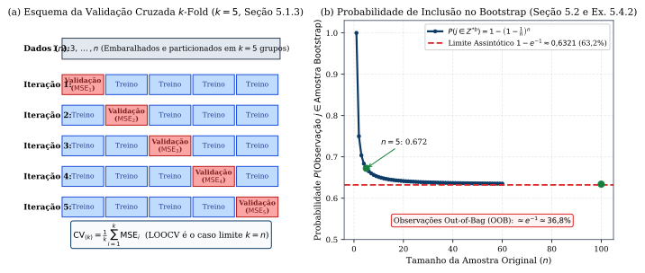
*Figura 4 — (a) Esquema das $k=5$ partições na Validação Cruzada $k$-Fold (Seção 5.1.3). (b) Convergência da probabilidade de inclusão no Bootstrap $1 - (1 - 1/n)^n \to 1 - e^{-1} \approx 0{,}632$ (Seção 5.2 e Ex. 5.4.2).*

> **[Complemento — Raschka et al., *ML with PyTorch and Scikit-Learn*, Cap. 6, Seções 6.1–6.4]:**  
> Raschka acrescenta três práticas fundamentais para avaliação e ajuste de hiperparâmetros em produção:
> 1. **Stratified $k$-Fold Cross-Validation (`StratifiedKFold`):** Em problemas de classificação (especialmente com classes desbalanceadas), garante que as proporções das classes sejam preservadas dentro de cada *fold*.
> 2. **Curvas de Aprendizado (*Learning Curves*) vs. Curvas de Validação (*Validation Curves*):** Plotar a acurácia de treino e validação em função do tamanho da amostra $n$ (*learning curve*) diagnostica se o modelo sofre de **alto viés (*underfitting*)** (ambas as curvas convergem para uma acurácia baixa; coletar mais dados não resolve, é preciso aumentar a complexidade do modelo) ou **alta variância (*overfitting*)** (há um grande *gap* entre a acurácia de treino e a de validação; coletar mais dados ou aumentar a regularização reduz o *gap*).
> 3. **Validação Cruzada Aninhada (*Nested Cross-Validation*, ex.: $5 \times 2$ CV):** Usa um laço externo de $k_1$ *folds* exclusivamente para estimar o erro de generalização não viesado, e um laço interno de $k_2$ *folds* (`GridSearchCV`, `RandomizedSearchCV` ou `HalvingRandomSearchCV`) dentro de cada *fold* de treino externo para sintonizar os hiperparâmetros sem vazar informação dos *folds* de teste.

#### Exercícios de Fixação (Capítulo 5)
1. *(ISLP, Seção 5.4, Ex. 1 — Alocação de Portfólio de Variância Mínima)* Sejam $X$ e $Y$ os retornos de dois ativos financeiros com $\sigma_X^2 = \operatorname{Var}(X)$, $\sigma_Y^2 = \operatorname{Var}(Y)$ e $\sigma_{XY} = \operatorname{Cov}(X, Y)$. Prove que a fração $\alpha \in \mathbb{R}$ que minimiza o risco $\operatorname{Var}(\alpha X + (1 - \alpha)Y)$ é dada pela Equação (5.6): $\alpha = \frac{\sigma_Y^2 - \sigma_{XY}}{\sigma_X^2 + \sigma_Y^2 - 2\sigma_{XY}}$. *(Dica: Expanda $f(\alpha) = \alpha^2\sigma_X^2 + (1-\alpha)^2\sigma_Y^2 + 2\alpha(1-\alpha)\sigma_{XY}$ e resolva $f'(\alpha) = 0$).*
2. *(ISLP, Seção 5.4, Ex. 2)* Calcule a probabilidade de a $j$-ésima observação estar presente numa amostra bootstrap quando $n = 5$, $n = 100$ e $n = 10\,000$. *(Gabarito: $1 - (1 - 1/5)^5 \approx 0{,}6723$; $1 - (1 - 1/100)^{100} \approx 0{,}63397$; $1 - (1 - 1/10000)^{10000} \approx 0{,}63214$).*

---

## 4. Seleção de Modelos Lineares e Regularização (Capítulo 6)

Quando $n$ não é muito maior que $p$, o estimador de mínimos quadrados sofre de alta variância; se **$p > n$**, a matriz $X^T X$ é singular, existem infinitas soluções de mínimos quadrados com $\operatorname{RSS} = 0$ no treino e o sobreajuste no teste é extremo. Além disso, o OLS raramente zera coeficientes irrelevantes. O Capítulo 6 estuda três classes de métodos para aumentar a acurácia preditiva (reduzindo a variância) e a interpretabilidade (seleção de variáveis):

### 4.1 Seleção de Subconjuntos e Critérios de Informação ($C_p$, AIC, BIC e $R^2$ Ajustado, Seção 6.1)
1. **Algoritmos de Busca (Algoritmos 6.1 a 6.3):**
   - **Seleção do Melhor Subconjunto (*Best Subset Selection*):** Para cada $k = 0, 1, \dots, p$, ajusta todos os $\binom{p}{k}$ modelos com exatamente $k$ preditores e escolhe o de menor $\operatorname{RSS}$ (ou maior $R^2$), chamado $\mathcal{M}_k$; por fim, escolhe o melhor entre $\mathcal{M}_0, \dots, \mathcal{M}_p$ via erro de validação cruzada ou critério penalizado ($C_p$, AIC, BIC, $R^2_{\text{adj}}$). Como avalia **$2^p$ modelos**, torna-se computacionalmente inviável para $p > 40$.
   - **Seleção *Forward Stepwise* (Progressiva):** Parte do modelo nulo $\mathcal{M}_0$ e, em cada passo $k = 0, \dots, p-1$, acrescenta a $\mathcal{M}_k$ o único preditor dentre os $p - k$ restantes que proporciona a maior redução no $\operatorname{RSS}$, avaliando apenas **$1 + \sum_{k=0}^{p-1}(p - k) = 1 + \frac{p(p+1)}{2}$ modelos** (aplicável mesmo quando $p > n$, até $k = n - 1$).
   - **Seleção *Backward Stepwise* (Regressiva):** Parte do modelo completo $\mathcal{M}_p$ com todos os $p$ preditores e remove iterativamente o preditor menos útil (também avaliando $1 + \frac{p(p+1)}{2}$ modelos, mas **exige estritamente $n > p$** para ajustar $\mathcal{M}_p$).
2. **Estimando Indiretamente o Erro de Teste: $C_p$, AIC, BIC e $R^2$ Ajustado (Seção 6.1.3):** Para um modelo ajustado por mínimos quadrados contendo **$d$ preditores**, corrige-se o viés de otimismo do $\operatorname{RSS}$ de treino somando uma penalidade crescente em $d$ (Equações 6.2 a 6.5):
   $$C_p = \frac{1}{n}\big(\operatorname{RSS} + 2d\hat{\sigma}^2\big), \qquad \operatorname{AIC} = \frac{1}{n}\big(\operatorname{RSS} + 2d\hat{\sigma}^2\big), \qquad \operatorname{BIC} = \frac{1}{n}\big(\operatorname{RSS} + \ln(n)d\hat{\sigma}^2\big)$$
   $$R^2_{\text{ajustado}} = 1 - \frac{\operatorname{RSS} / (n - d - 1)}{\operatorname{TSS} / (n - 1)}$$
   - Para modelos lineares com erros Gaussianos, **$C_p$ de Mallows e o AIC de Akaike são proporcionais**;
   - Como $\ln(n) > 2$ para qualquer $n > 7$, o **BIC de Schwarz impõe uma penalidade mais pesada** a modelos com muitas variáveis do que o $C_p$/AIC, resultando na escolha de **modelos menores e mais parcimoniosos**;
   - Diferentemente do $R^2$ comum, o **$R^2$ ajustado** só aumenta se a inclusão de uma nova variável reduzir $\operatorname{RSS}/(n - d - 1)$.

---

### 4.2 Métodos de Encolhimento (*Shrinkage*): Regressão Ridge ($\ell_2$) e o Lasso ($\ell_1$) (Seção 6.2)
1. **Regressão Ridge (Penalização $\ell_2$ — Seção 6.2.1):** Estima $\hat{\beta}^R_\lambda$ minimizando a soma de resíduos acrescida de uma penalidade de encolhimento quadrática sobre os coeficientes (exceto o intercepto $\beta_0$, Equação 6.5):
   $$\hat{\beta}^R_\lambda = \arg\min_{\beta} \left\{ \sum_{i=1}^{n}\left(y_i - \beta_0 - \sum_{j=1}^{p}\beta_j x_{ij}\right)^2 + \lambda \sum_{j=1}^{p}\beta_j^2 \right\} = \arg\min_{\beta} \big\{\operatorname{RSS} + \lambda \|\beta\|_2^2\big\}$$
   onde $\lambda \ge 0$ é o **parâmetro de sintonização (*tuning parameter*)**. Na forma matricial centrada, $\hat{\beta}^R_\lambda = (X^T X + \lambda I_p)^{-1}X^T y$ (a soma de $\lambda I_p$ torna a matriz invertível mesmo se $p > n$!).  
   **Invariância de Escala:** Enquanto no OLS multiplicar $X_j$ por uma constante $c$ simplesmente divide $\hat{\beta}_j$ por $c$ (deixando $X_j\hat{\beta}_j$ invariante), na Regressão Ridge (e no Lasso) os coeficientes $\hat{\beta}^R_{j,\lambda}$ dependem crucialmente da escala dos preditores! Por isso, **é obrigatório padronizar os preditores** ($\tilde{x}_{ij} = x_{ij} / s_j$) antes de aplicar Ridge ou Lasso.
2. **O Lasso (Penalização $\ell_1$ e Seleção Automática de Variáveis — Seção 6.2.2):** Substitui a norma $\ell_2^2$ pela norma $\ell_1$ ($\|\beta\|_1 = \sum_{j=1}^p |\beta_j|$, Equação 6.7):
   $$\hat{\beta}^L_\lambda = \arg\min_{\beta} \left\{ \sum_{i=1}^{n}\left(y_i - \beta_0 - \sum_{j=1}^{p}\beta_j x_{ij}\right)^2 + \lambda \sum_{j=1}^{p}|\beta_j| \right\}$$
   Enquanto a Regressão Ridge encolhe todos os coeficientes na direção de zero mas **não zera exatamente nenhum deles** (para $\lambda < \infty$), a penalidade $\ell_1$ do **Lasso força alguns coeficientes a serem exatamente iguais a zero** quando $\lambda$ é suficientemente grande, produzindo **modelos esparsos**!

> **Teorema 4.1 (Formulação por Restrição Equivalente e Solução Analítica via Limiarização Suave — Equações 6.8 a 6.15, Seção 6.2.2):**  
> 1. *Para todo $\lambda \ge 0$, existe um orçamento $s \ge 0$ tal que o Lasso e a Regressão Ridge equivalem aos problemas de otimização restrita:*
>    $$\min_{\beta} \operatorname{RSS}(\beta) \quad \text{sujeito a} \quad \sum_{j=1}^{p}|\beta_j| \le s \;\; (\text{Lasso: politopo/losango}) \qquad \text{ou} \qquad \sum_{j=1}^{p}\beta_j^2 \le s \;\; (\text{Ridge: esfera/círculo})$$
>    *Geometricamente (Figura 5b), como o losango $|\beta_1| + |\beta_2| \le s$ possui **quinas (vértices) sobre os eixos coordenados**, as elipses de nível do $\operatorname{RSS}$ frequentemente tocam a região viável num vértice onde $\beta_j = 0$, ao passo que o círculo $\beta_1^2 + \beta_2^2 \le s$ não possui quinas.*
> 2. *No caso especial ortonormal simplificado ($n = p$, $X = I_p$ e $\beta_0 = 0$), minimizando $\sum_{j=1}^p (y_j - \beta_j)^2 + \lambda \sum_{j=1}^p \beta_j^2$ ou $+\lambda \sum_{j=1}^p |\beta_j|$, temos:*
>    $$\hat{\beta}^R_j = \frac{y_j}{1 + \lambda} \quad (\text{Encolhimento Proporcional — Ridge}), \qquad \hat{\beta}^L_j = \begin{cases} y_j - \lambda/2, & \text{se } y_j > \lambda/2 \\ y_j + \lambda/2, & \text{se } y_j < -\lambda/2 \\ 0, & \text{se } |y_j| \le \lambda/2 \end{cases} \quad (\text{Limiarização Suave / Soft-Thresholding — Lasso})$$

3. **Interpretação Bayesiana para Ridge e Lasso (Seção 6.2.2 e Ex. 6.6.7):** Assumindo o modelo linear normal $Y \mid X, \beta \sim \mathcal{N}(X\beta, \sigma^2 I)$ e uma distribuição *a priori* para os coeficientes $p(\beta) = \prod_{j=1}^p g(\beta_j)$:
   - Se a *priori* $g(\beta_j)$ for **Gaussiana** com média $0$ e variância $c$ ($g(\beta_j) \propto e^{-\beta_j^2/(2c)}$), então a moda (e média) *a posteriori* (estimador MAP) é exatamente a **Regressão Ridge** com $\lambda = \sigma^2 / c$;
   - Se a *priori* $g(\beta_j)$ for **Dupla-Exponencial (Laplace)** com média $0$ e parâmetro de escala $b$ ($g(\beta_j) = \frac{1}{2b}e^{-|\beta_j|/b}$, que possui um pico agudo em $\beta_j = 0$), então a moda *a posteriori* (MAP) é exatamente o **Lasso** com $\lambda = 2\sigma^2 / b$.

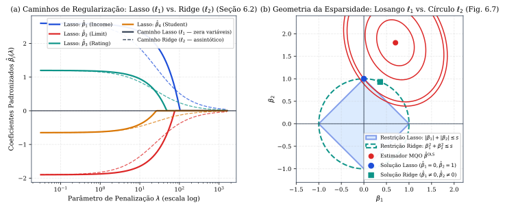
*Figura 5 — (a) Caminhos de encolhimento dos coeficientes padronizados $\hat{\beta}_j(\lambda)$ no Lasso ($\ell_1$, gerando esparsidade) e na Regressão Ridge ($\ell_2$) (Seção 6.2). (b) Geometria das regiões de restrição $|\beta_1| + |\beta_2| \le s$ (losango do Lasso atingindo $\beta_1 = 0$) versus $\beta_1^2 + \beta_2^2 \le s$ (círculo do Ridge) com curvas de nível do RSS (Seção 6.2.2, Fig. 6.7).*

---

### 4.3 Redução de Dimensão (PCR e PLS) e Considerações em Alta Dimensão (Seções 6.3 e 6.4)
1. **Regressão por Componentes Principais (PCR) vs. Mínimos Quadrados Parciais (PLS) (Seção 6.3):** Constroem-se $M < p$ combinações lineares $Z_m = \sum_{j=1}^p \phi_{jm} X_j$ ($m = 1, \dots, M$) e ajusta-se o modelo linear $y_i \approx \theta_0 + \sum_{m=1}^M \theta_m z_{im}$ por mínimos quadrados:
   - Na **PCR (*Principal Components Regression*, Seção 6.3.1)**, as direções $\phi_1, \dots, \phi_M$ são as $M$ primeiras componentes principais de $X$, escolhidas de forma **não supervisionada** (maximizando a variância de $X$ sem olhar para $Y$). Como $\sum_{m=1}^M \theta_m z_{im} = \sum_{j=1}^p \left(\sum_{m=1}^M \theta_m \phi_{jm}\right)x_{ij}$, a PCR **não é um método de seleção de variáveis**, pois cada $Z_m$ envolve todos os $p$ preditores originais (assemelhando-se mais à Regressão Ridge, que é uma versão contínua da PCR).
   - No **PLS (*Partial Least Squares*, Seção 6.3.2)**, as direções $Z_1, \dots, Z_M$ são escolhidas de forma **supervisionada**: para construir $Z_1 = \sum_{j=1}^p \phi_{j1}X_j$, define-se cada peso $\phi_{j1}$ igual ao coeficiente da regressão linear simples de $Y$ sobre $X_j$ (proporcional a $\operatorname{Cor}(X_j, Y)$ se padronizado); para construir $Z_2$, regride-se primeiro cada variável sobre $Z_1$ tomando os resíduos ortogonais e repete-se o processo.
2. **O Que Dá Errado em Alta Dimensão ($p \ge n$, Seção 6.4):** Quando o número de atributos $p$ é comparável ou superior a $n$: (i) o modelo de mínimos quadrados interpola perfeitamente os dados ($\operatorname{RSS} = 0$ e $R^2 = 1$ para $p \ge n - 1$), mesmo que os preditores sejam ruído puro sem nenhuma relação com $Y$; (ii) estatísticas clássicas como $C_p$, AIC, BIC e $R^2$ ajustado falham porque não é possível estimar $\hat{\sigma}^2 = \operatorname{RSS}/(n-p-1)$ quando $\operatorname{RSS} = 0$; (iii) a multicolinearidade é inevitável: qualquer variável em alta dimensão pode ser escrita como combinação linear das demais, de modo que o Lasso seleciona uma representante quase arbitrária dentre um grupo de variáveis correlacionadas.

#### Exercícios de Fixação (Capítulo 6)
1. *(ISLP, Seção 6.6, Ex. 2 e 3)* À medida que o orçamento $s$ em $\sum |\beta_j| \le s$ aumenta a partir de $0$ (ou $\lambda$ diminui até $0$), o que ocorre com: (a) $\operatorname{RSS}$ de treino; (b) $\operatorname{RSS}$ de teste; (c) Variância; (d) $\text{Viés}^2$; (e) Erro irredutível? *(Gabarito: Quando $s$ cresce de $0$ a $\infty$, o modelo fica mais flexível: (a) $\operatorname{RSS}_{\text{treino}}$ decresce monotonicamente; (b) $\operatorname{RSS}_{\text{teste}}$ segue formato em U — cai inicialmente e depois sobe; (c) Variância cresce monotonicamente; (d) $\text{Viés}^2$ decresce monotonicamente; (e) Erro irredutível permanece constante).*
2. *(ISLP, Seção 6.6, Ex. 5 — Preditores Idênticos no Ridge vs. Lasso)* Suponha $n=2, p=2$ com preditores idênticos ($x_{11}=x_{12}$ e $x_{21}=x_{22}$) e dados centrados ($\hat{\beta}_0 = 0$). Mostre que a Regressão Ridge atribui pesos iguais ($\hat{\beta}_1^R = \hat{\beta}_2^R$), enquanto o Lasso admite todo um segmento contínuo de soluções $(\hat{\beta}_1^L, \hat{\beta}_2^L)$ com soma constante! *(Dica: Como $x_{i1}\beta_1 + x_{i2}\beta_2 = x_{i1}(\beta_1 + \beta_2)$, o $\operatorname{RSS}$ depende apenas da soma $S = \beta_1 + \beta_2$. Minimizar $\beta_1^2 + \beta_2^2$ com $\beta_1 + \beta_2 = S$ fixo exige $\beta_1 = \beta_2 = S/2$, enquanto $|\beta_1| + |\beta_2| = |S|$ é constante para quaisquer $\beta_1, \beta_2$ de mesmo sinal com $\beta_1 + \beta_2 = S$).*

---

## 5. Movendo-se Além da Linearidade: Polinômios, Splines, LOESS e GAMs (Capítulo 7)

### 5.1 Regressão Polinomial, Funções Degrau e Funções de Base (Seções 7.1 a 7.3)
Todas as técnicas das Seções 7.1 a 7.4 são instâncias da abordagem de **Funções de Base (*Basis Functions* — Seção 7.3)**: aplica-se uma família de transformações conhecidas $b_1(X), b_2(X), \dots, b_K(X)$ ao preditor $X$ e ajusta-se o modelo linear nos atributos transformados:
$$y_i = \beta_0 + \beta_1 b_1(x_i) + \beta_2 b_2(x_i) + \dots + \beta_K b_K(x_i) + \varepsilon_i$$
Como o modelo continua **linear nos parâmetros $\beta_0, \dots, \beta_K$**, toda a teoria de mínimos quadrados (erros padrão, intervalos de confiança e estatísticas $F$/ANOVA) permanece aplicável!
- **Regressão Polinomial ($b_j(x_i) = x_i^j$, Seção 7.1):** $y_i = \beta_0 + \beta_1 x_i + \beta_2 x_i^2 + \dots + \beta_d x_i^d + \varepsilon_i$. Usam-se graus moderados ($d = 3$ ou $4$), pois polinômios globais de grau alto sofrem de **oscilações severas de Runge nas extremidades** do domínio de $X$.
- **Funções Degrau (*Step Functions*, Seção 7.2):** Particionando o domínio de $X$ pelos pontos de corte $c_1 < c_2 < \dots < c_K$, definem-se as funções indicadoras $C_0(X) = I(X < c_1)$, $C_k(X) = I(c_k \le X < c_{k+1})$ e $C_K(X) = I(X \ge c_K)$ (com $\sum_{k=0}^K C_k(X) = 1$), ajustando a função constante por partes $y_i = \beta_0 + \beta_1 C_1(x_i) + \dots + \beta_K C_K(x_i) + \varepsilon_i$.

---

### 5.2 Regression Splines, Natural Splines e Smoothing Splines (Seções 7.4 e 7.5)
1. **Splines de Regressão e a Base de Potências Truncadas (Seção 7.4):** Em vez de ajustar um único polinômio de grau alto em todo o domínio de $X$, escolhem-se **$K$ nós (*knots*) $\xi_1 < \xi_2 < \dots < \xi_K$** que dividem o domínio em $K + 1$ subintervalos. Uma **Spline de Grau $d$** (em particular, uma **Cubic Spline** quando $d = 3$) é um polinômio de grau $d$ por partes que é **contínuo e possui derivadas contínuas até a ordem $d - 1$** ($f, f', f''$ contínuas para $d=3$) em cada nó $\xi_k$.
   > **Teorema 5.1 (Representação na Base de Potências Truncadas e Graus de Liberdade — Equação 7.3 e Ex. 7.9.1):**  
   > *Toda spline cúbica com $K$ nós $\xi_1 < \dots < \xi_K$ pode ser representada de maneira única como o modelo linear:*
   > $$y_i = \beta_0 + \beta_1 x_i + \beta_2 x_i^2 + \beta_3 x_i^3 + \sum_{k=1}^{K} \beta_{3+k}\, h(x_i, \xi_k) + \varepsilon_i$$
   > *onde a **função de base de potência truncada** é definida por:*
   > $$h(x, \xi) = (x - \xi)_+^3 = \begin{cases} (x - \xi)^3, & \text{se } x > \xi \\ 0, & \text{se } x \le \xi \end{cases}$$
   > *Como $h(x, \xi)$, $h'(x, \xi) = 3(x-\xi)_+^2$ e $h''(x, \xi) = 6(x-\xi)_+$ se anulam em $x = \xi$, somar $\beta_{3+k}(x - \xi_k)_+^3$ altera a derivada terceira em $6\beta_{3+k}$ ao cruzar $\xi_k$, preservando automaticamente a continuidade de $f, f'$ e $f''$ em $\xi_k$! O número total de **graus de liberdade** (incluindo o intercepto) de uma spline cúbica com $K$ nós é:*
   > $$\operatorname{df}_{\text{cubic spline}} = (K + 1)\times 4 - 3K = K + 4 \quad (\text{em geral, } K + d + 1 \text{ para grau } d)$$
2. **Natural Cubic Splines (Seção 7.4.2):** Como polinômios cúbicos ainda apresentam alta variância além dos nós extremos, uma **Spline Cúbica Natural (*Natural Spline*)** impõe a restrição adicional de que a função seja **linear nas duas regiões de fronteira** ($X < \xi_1$ e $X > \xi_K$, isto é, $f'' = f''' = 0$ fora de $[\xi_1, \xi_K]$). Isso economiza $4$ graus de liberdade ($2$ em cada extremidade), resultando em **$\operatorname{df}_{\text{natural spline}} = K$** graus de liberdade e estimativas muito mais estáveis nas bordas (Figura 6a).
3. **Smoothing Splines (Splines de Suavização e Graus de Liberdade Efetivos — Seção 7.5):** Buscam a função suave $g$ que minimiza o critério penalizado por rugosidade (Equação 7.11):
   $$\hat{g}_\lambda = \arg\min_{g} \left\{ \sum_{i=1}^{n}\big(y_i - g(x_i)\big)^2 + \lambda \int g''(t)^2\,dt \right\}$$
   onde $\lambda \ge 0$ controla o equilíbrio entre fidelidade aos dados e suavidade ($\int g''(t)^2\,dt$ mede a variação total da inclinação $g'(t)$).
   - **Propriedade Notável (Seção 7.5.1):** A função $\hat{g}_\lambda$ que minimiza a Equação (7.11) sobre todas as funções duas vezes diferenciáveis é, de fato, uma **Spline Cúbica Natural encolhida (*shrunken natural cubic spline*) com nós em todos os valores únicos observados $x_1, \dots, x_n$**!
   - Quando $\lambda = 0$, $\hat{g}_0$ interpola todos os pontos de treinamento ($n$ graus de liberdade); quando $\lambda \to \infty$, $g''(t) \equiv 0$ força $\hat{g}_\infty$ a ser a **reta de mínimos quadrados ordinários** ($2$ graus de liberdade).
   - Como o vetor de valores ajustados satisfaz $\hat{g}_\lambda = S_\lambda y$ para uma matriz de suavização linear $S_\lambda$, definem-se os **graus de liberdade efetivos (*effective degrees of freedom*)** pelo traço da matriz (Equação 7.13):
     $$\operatorname{df}_\lambda = \sum_{i=1}^{n} \{S_\lambda\}_{ii} = \operatorname{tr}(S_\lambda) \in [2, n]$$
     e o erro de validação cruzada *Leave-One-Out* é calculado instantaneamente pela generalização do atalho da Equação (5.2): $\operatorname{RSS}_{\text{cv}}(\lambda) = \sum_{i=1}^n \left[\frac{y_i - \hat{g}_\lambda(x_i)}{1 - \{S_\lambda\}_{ii}}\right]^2$.

---

### 5.3 Regressão Local (LOESS) e Modelos Aditivos Generalizados (GAMs, Seções 7.6 e 7.7)
1. **Regressão Local (*Local Regression* / LOESS — Algoritmo 7.1, Seção 7.6):** Para estimar $\hat{f}(x_0)$ num ponto alvo $x_0$: (i) seleciona-se a fração $s = k/n$ (**span**) dos pontos de treinamento mais próximos de $x_0$; (ii) atribui-se um peso $K_{i0} = K(x_i, x_0)$ a cada ponto (máximo em $x_0$ e zero fora da vizinhança de tamanho $s$); (iii) ajusta-se uma **regressão linear ponderada** minimizando $\sum_{i=1}^n K_{i0}(y_i - \beta_0 - \beta_1 x_i)^2$ e define-se $\hat{f}(x_0) = \hat{\beta}_0 + \hat{\beta}_1 x_0$. O parâmetro *span* $s$ desempenha o mesmo papel de $K/n$ no KNN: $s$ pequeno gera curvas onduladas (alta variância), e $s$ grande gera curvas suaves (alto viés).
2. **Modelos Aditivos Generalizados (GAMs — Seção 7.7):** Estendem a regressão linear múltipla substituindo cada termo linear $\beta_j x_{ij}$ por uma função suave não linear $f_j(x_{ij})$, mantendo a estrutura **aditiva** (Equações 7.15 e 7.18):
   $$y_i = \beta_0 + \sum_{j=1}^{p} f_j(x_{ij}) + \varepsilon_i \quad (\text{Regressão}) \qquad \text{e} \qquad \ln\left(\frac{p(X)}{1 - p(X)}\right) = \beta_0 + \sum_{j=1}^{p} f_j(X_j) \quad (\text{Classificação Logística})$$
   - **Como Ajustar um GAM:** Se cada $f_j$ for representada por funções de base (como *natural splines* ou *B-splines*), todo o GAM reduz-se a uma única grande regressão linear múltipla ajustável por mínimos quadrados! Se as $f_j$ forem *smoothing splines* ou regressões locais (LOESS), utiliza-se o algoritmo iterativo de **Backfitting** (Seção 7.7.1 e Ex. 7.9.11): mantendo todas as funções exceto $f_j$ fixas, ajusta-se $f_j$ aplicando o suavizador univariado aos **resíduos parciais** $r_i^{(j)} = y_i - \beta_0 - \sum_{k \neq j} \hat{f}_k(x_{ik})$, ciclando por $j = 1, \dots, p$ até a convergência (centrando cada $\hat{f}_j$ para ter média amostral zero).
   - **Vantagens e Limitações dos GAMs:** (i) Capturam automaticamente relações não lineares em cada preditor sem exigir busca manual de transformações; (ii) Pela aditividade, mantêm a interpretabilidade: podemos plotar cada efeito parcial $\hat{f}_j(X_j)$ mantendo as demais variáveis fixas; (iii) A suavidade de cada $f_j$ é resumida pelos graus de liberdade $\operatorname{df}_j$; (iv) **Principal limitação:** o modelo é restrito a ser aditivo, podendo perder interações importantes, a menos que adicionemos explicitamente produtos $X_j \times X_k$ ou superfícies bivariadas $f_{jk}(X_j, X_k)$.

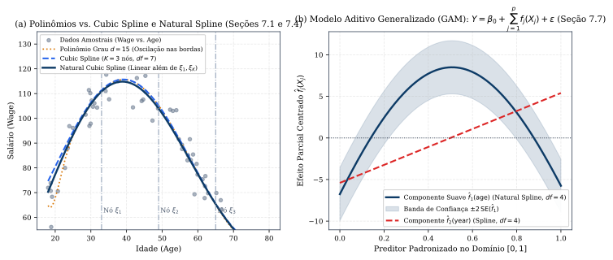
*Figura 6 — (a) Polinômio de grau $15$ comparado a uma Cubic Spline e a uma Natural Cubic Spline com $K=3$ nós (Seções 7.1 e 7.4). (b) Componentes aditivas suaves centradas $\hat{f}_j(X_j)$ em um Modelo Aditivo Generalizado (GAM) (Seção 7.7).*

#### Exercícios de Fixação (Capítulo 7)
1. *(ISLP, Seção 7.9, Ex. 2)* Considere o estimador $\hat{g} = \arg\min_g \left\{\sum_{i=1}^n (y_i - g(x_i))^2 + \lambda \int [g^{(m)}(x)]^2\,dx\right\}$, onde $g^{(m)}$ é a $m$-ésima derivada de $g$. Que curva $\hat{g}$ é obtida quando: (a) $\lambda = \infty, m = 0$; (b) $\lambda = \infty, m = 1$; (c) $\lambda = \infty, m = 2$; (d) $\lambda = \infty, m = 3$; (e) $\lambda = 0, m = 3$? *(Gabarito: Quando $\lambda = \infty$, a integral de $[g^{(m)}(x)]^2$ deve ser nula, isto é, $g^{(m)}(x) \equiv 0$, logo $g$ é o polinômio de grau $m-1$ que minimiza o $\operatorname{RSS}$: (a) $g(x) \equiv 0$; (b) reta horizontal constante $\hat{g}(x) = \bar{y}$; (c) reta de mínimos quadrados $\hat{\beta}_0 + \hat{\beta}_1 x$; (d) parábola quadrática de mínimos quadrados $\hat{\beta}_0 + \hat{\beta}_1 x + \hat{\beta}_2 x^2$; (e) quando $\lambda = 0$, a penalidade desaparece e $\hat{g}$ interpola exatamente todos os pontos $(x_i, y_i)$ com $\operatorname{RSS} = 0$).*

---

## 6. Métodos Baseados em Árvores e Aprendizado por Ensembles (Capítulo 8)

### 6.1 Árvores de Decisão: Regressão, Classificação, Impureza de Nó e Poda (Seção 8.1)
1. **Árvores de Regressão e Divisão Binária Recursiva (*Recursive Binary Splitting* — Seção 8.1.1):** Divide-se o espaço de preditores em $J$ caixas retangulares disjuntas (regiões ou folhas) $R_1, R_2, \dots, R_J$, predizendo para qualquer observação que caia em $R_j$ a **média das respostas** de treino naquela região: $\hat{y}_{R_j} = \frac{1}{|R_j|}\sum_{i \in R_j} y_i$. Como encontrar a partição global que minimiza $\sum_{j=1}^J \sum_{i \in R_j} (y_i - \hat{y}_{R_j})^2$ é computacionalmente intratável, utiliza-se uma abordagem **top-down e gulosa (*greedy*)**: em cada passo, escolhem-se o preditor $X_j$ e o ponto de corte $s$ que dividem o nó atual nos semiespaços $R_1(j, s) = \{X \mid X_j < s\}$ e $R_2(j, s) = \{X \mid X_j \ge s\}$ produzindo a maior redução imediata no $\operatorname{RSS}$ (Equação 8.3):
   $$\min_{j,\, s} \left[ \sum_{i:\, x_i \in R_1(j, s)} (y_i - \hat{y}_{R_1})^2 + \sum_{i:\, x_i \in R_2(j, s)} (y_i - \hat{y}_{R_2})^2 \right]$$
2. **Poda por Custo-Complexidade (*Cost Complexity Pruning* / *Weakest Link Pruning* — Algoritmo 8.1):** Uma árvore grande $T_0$ tende a sobreajustar os dados, mas parar de dividir cedo demais pode perder um bom corte subsequente. Por isso, cresce-se uma árvore grande $T_0$ e poda-se de volta buscando, para cada $\alpha \ge 0$, a subárvore $T \subset T_0$ que minimiza (Equação 8.4):
   $$C_\alpha(T) = \sum_{m=1}^{|T|} \sum_{i:\, x_i \in R_m} (y_i - \hat{y}_{R_m})^2 + \alpha |T| = \operatorname{RSS}(T) + \alpha |T|$$
   onde $|T|$ é o número de nós terminais (folhas) da subárvore $T$ e $\alpha \ge 0$ (escolhido por validação cruzada) penaliza a complexidade da árvore de forma análoga ao $\lambda$ do Lasso.
3. **Árvores de Classificação e Medidas de Impureza de Nó (Seção 8.1.2):** Numa árvore de classificação, prediz-se na região $R_m$ a **classe mais frequente (moda)** dentre as observações de treinamento em $R_m$. Sendo $\hat{p}_{mk}$ a proporção de observações de treino na região $R_m$ pertencentes à $k$-ésima classe ($k = 1, \dots, K$), avaliam-se três medidas de impureza (Equações 8.5 a 8.7):
   - **Taxa de Erro de Classificação:** $\quad E = 1 - \max_{k}(\hat{p}_{mk})$;
   - **Índice de Gini:** $\quad G = \sum_{k=1}^{K} \hat{p}_{mk}(1 - \hat{p}_{mk}) = 1 - \sum_{k=1}^{K} \hat{p}_{mk}^2$;
   - **Entropia (Desvio / *Cross-Entropy*):** $\quad D = -\sum_{k=1}^{K} \hat{p}_{mk}\ln \hat{p}_{mk}$.

   Tanto o **Índice de Gini** quanto a **Entropia** assumem valores próximos de zero se todas as $\hat{p}_{mk}$ estiverem próximas de $0$ ou $1$ (**pureza do nó**), e são **muito mais sensíveis à pureza dos nós do que a taxa de erro $E$** (que é linear por partes, Figura 7a). Por isso, usa-se o Índice de Gini ou a Entropia durante o crescimento da árvore para avaliar a qualidade dos cortes, enquanto a taxa de erro $E$ pode ser usada na poda se o objetivo final for a acurácia de classificação.

---

### 6.2 Bagging, Random Forests, Boosting e BART (Seção 8.2)
Árvores de decisão únicas possuem alta variância (dividir os dados de treino ao meio pode gerar duas árvores completamente diferentes) e menor acurácia preditiva que modelos lineares/aditivos quando a fronteira não é alinhada aos eixos. Os métodos de **Ensemble** combinam centenas ou milhares de árvores:

1. **Bagging (*Bootstrap Aggregation* — Seção 8.2.1):** Como a variância da média $\bar{Z} = \frac{1}{B}\sum_{i=1}^B Z_i$ de $B$ variáveis independentes de variância $\sigma^2$ cai para $\sigma^2 / B$, o **Bagging** gera $B$ conjuntos de treinamento bootstrap, ajusta uma árvore profunda **não podada** $\hat{f}^{*b}(x)$ (de baixo viés e alta variância) em cada amostra e tira a **média das predições** em regressão (Equação 8.8):
   $$\hat{f}_{\text{bag}}(x) = \frac{1}{B}\sum_{b=1}^{B} \hat{f}^{*b}(x)$$
   ou aplica o **voto majoritário (*majority vote*)** nas classes preditas em classificação. *(Atenção: aumentar o número de árvores $B$ no Bagging e no Random Forest **não causa overfitting**; o erro de teste estabiliza num patamar assintótico).*
   - **Estimação de Erro Out-of-Bag (OOB):** Como cada árvore $b$ usa cerca de $2/3$ ($63{,}2\%$) das observações, podemos prever a $i$-ésima observação usando apenas a média (ou voto majoritário) das cerca de $B/3$ árvores nas quais a observação $i$ ficou **Out-of-Bag**. O **erro OOB** é uma estimativa válida do erro de teste obtida de graça, equivalendo assintoticamente ao erro LOOCV para $B$ grande!
   - **Importância das Variáveis (*Variable Importance*):** Ao combinar $B$ árvores, perde-se a visualização de uma árvore única, mas quantifica-se a importância de cada preditor $X_j$ somando a redução total no $\operatorname{RSS}$ (em regressão) ou no Índice de Gini / Entropia (em classificação) proporcionada por todos os cortes sobre $X_j$, promediada nas $B$ árvores.
2. **Random Forests (Descorrelação das Árvores — Seção 8.2.2):** Se existir um preditor muito forte nos dados, quase todas as árvores do Bagging usarão esse mesmo preditor no corte de topo, tornando as $B$ árvores **altamente correlacionadas** (e a média de quantidades correlacionadas com correlação $\rho$ tem variância $\rho\sigma^2 + \frac{1-\rho}{B}\sigma^2$, limitando a redução de variância!).  
   O **Random Forest** resolve isso modificando cada divisão de nó: **antes de cada corte (*split*), sorteia-se aleatoriamente uma amostra de apenas $m$ preditores candidatos dentre os $p$ totais**, permitindo que o corte use apenas um desses $m$ preditores (tipicamente **$m \approx \sqrt{p}$** em classificação ou $m \approx p/3$ em regressão; note que $m = p$ recupera exatamente o Bagging!). Isso dá chance aos demais preditores e **descorrelaciona as árvores**, reduzindo substancialmente a variância da média (Figura 7b).
3. **Boosting (Aprendizado Sequencial Lento sobre os Resíduos — Algoritmo 8.2, Seção 8.2.3):** Diferentemente do Bagging (onde as árvores são independentes em amostras bootstrap), no **Boosting** as árvores são construídas **sequencialmente**, cada uma ajustada aos **resíduos atuais** do modelo:
   - **Passo 1:** Defina $\hat{f}(x) = 0$ e $r_i = y_i$ para todo $i$ no conjunto de treinamento.
   - **Passo 2:** Para $b = 1, 2, \dots, B$, repita:
     (a) Ajuste uma árvore pequena $\hat{f}^b$ com $d$ cortes ($d + 1$ nós terminais) aos dados de treino $(X, r)$;  
     (b) Atualize $\hat{f}$ somando uma versão encolhida da nova árvore: $\hat{f}(x) \leftarrow \hat{f}(x) + \lambda \hat{f}^b(x)$;  
     (c) Atualize os resíduos: $r_i \leftarrow r_i - \lambda \hat{f}^b(x_i)$.
   - **Passo 3:** A árvore impulsionada final é $\hat{f}(x) = \sum_{b=1}^{B} \lambda \hat{f}^b(x)$.  
   O Boosting possui **três hiperparâmetros de sintonização**: (i) o número de árvores $B$ (ao contrário do Bagging/Random Forest, no Boosting **um $B$ excessivamente grande pode causar overfitting**, embora lentamente, devendo ser escolhido por validação cruzada); (ii) o parâmetro de encolhimento $\lambda > 0$ (tipicamente $0{,}01$ ou $0{,}001$, que controla a taxa de aprendizado); e (iii) o número $d$ de cortes em cada árvore (**profundidade de interação**: quando **$d = 1$**, cada árvore é um **toco / *stump*** envolvendo uma única variável, e o modelo final reduz-se a um **Modelo Aditivo** $f(X) = \sum_{j=1}^p f_j(X_j)$, conforme mostra o Ex. 8.4.2!).
4. **Bayesian Additive Regression Trees (BART — Algoritmo 8.3, Seção 8.2.4):** Combina as ideias de Random Forests e Boosting numa formulação probabilística bayesiana: na $k$-ésima árvore da iteração $b$ de Markov Chain Monte Carlo (MCMC), atualiza-se $\hat{f}^b_k$ perturbando aleatoriamente a estrutura da árvore da iteração anterior $\hat{f}^{b-1}_k$ (adicionando/podando ramos ou alterando predições foliares) sobre o resíduo parcial $r_i = y_i - \sum_{k' < k}\hat{f}^b_{k'}(x_i) - \sum_{k' > k}\hat{f}^{b-1}_{k'}(x_i)$. Após descartar as primeiras $L$ iterações de aquecimento (*burn-in*), as amostras posteriores fornecem tanto a predição pontual quanto intervalos de credibilidade para $\hat{f}(x)$.

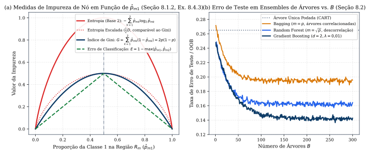
*Figura 7 — (a) Comparação entre Entropia, Índice de Gini e Taxa de Erro de Classificação em função de $\hat{p}_{m1}$ para $K=2$ classes (Seção 8.1.2 e Ex. 8.4.3). (b) Evolução da taxa de erro de teste em função do número de árvores $B$ para Bagging, Random Forest ($m = \sqrt{p}$) e Gradient Boosting (Seção 8.2).*

> **[Complemento — Raschka et al., *ML with PyTorch and Scikit-Learn*, Cap. 7, Seções 7.1–7.5]:**  
> Raschka aprofunda três técnicas de ensemble amplamente utilizadas na prática:
> 1. **Classificador de Voto Majoritário / Ponderado (`VotingClassifier`, Seção 7.1):** Se combinarmos $n$ classificadores binários independentes, cada um com taxa de erro $\varepsilon < 0{,}5$, a probabilidade de a decisão por voto majoritário estar errada é dada pela cauda da distribuição binomial $\varepsilon_{\text{ensemble}} = \sum_{k=\lceil n/2 \rceil}^{n} \binom{n}{k}\varepsilon^k(1-\varepsilon)^{n-k}$ (por exemplo, para $n = 11$ classificadores com $\varepsilon = 0{,}25$, o erro do ensemble cai para apenas $\mathbf{0{,}034}$!). No *soft voting*, ponderam-se as probabilidades preditas $\hat{y} = \arg\max_i \sum_{j=1}^m w_j p_{ij}$.
> 2. **AdaBoost (*Adaptive Boosting*, Freund & Schapire, 1997 — Seção 7.3):** Em vez de ajustar árvores aos resíduos, o AdaBoost mantém um vetor de **pesos amostrais $w^{(i)}$** sobre os exemplos de treinamento (inicializados em $1/n$). Em cada rodada $j$: (a) treina um classificador fraco $C_j$ (tipicamente um *decision stump* $d=1$) minimizando a taxa de erro ponderada $\varepsilon_j = \sum_{i} w^{(i)} I(\hat{y}_j^{(i)} \neq y^{(i)})$; (b) calcula o peso do classificador $\alpha_j = \frac{1}{2}\ln\left(\frac{1 - \varepsilon_j}{\varepsilon_j}\right)$; (c) **aumenta exponencialmente os pesos das amostras classificadas incorretamente** e reduz os das corretas: $w^{(i)} \leftarrow w^{(i)}\exp(-\alpha_j y^{(i)}\hat{y}_j^{(i)})$ (com $y^{(i)}, \hat{y}_j^{(i)} \in \{-1, +1\}$), normalizando $\sum_i w^{(i)} = 1$.
> 3. **Gradient Boosting Geral e XGBoost (Seção 7.4):** Generaliza o Boosting para qualquer função de perda diferenciável $L(y_i, F(x_i))$ ajustando a $m$-ésima árvore aos **pseudo-resíduos (gradientes negativos da perda)** $r_{im} = -\left[\frac{\partial L(y_i, F(x_i))}{\partial F(x_i)}\right]_{F = F_{m-1}}$. O **XGBoost** (Chen & Guestrin, 2016) expande a função de perda em **série de Taylor de 2ª ordem** usando tanto o gradiente $g_i$ quanto a hessiana $h_i$, inclui regularização explícita $\Omega(T) = \gamma |T| + \frac{1}{2}\lambda \sum_{j=1}^{|T|} w_j^2$ sobre as folhas e utiliza histogramas aproximados (quantis) e paralelismo para escalar a grandes volumes de dados.

#### Exercícios de Fixação (Capítulo 8)
1. *(ISLP, Seção 8.4, Ex. 2)* Prove que o algoritmo de Boosting (Algoritmo 8.2) utilizando árvores de profundidade $d = 1$ (*stumps*) produz sempre um **modelo aditivo** da forma $f(X) = \sum_{j=1}^p f_j(X_j)$. *(Dica: Uma árvore com um único corte na variável $X_{j_b}$ depende exclusivamente de $X_{j_b}$, isto é, $\hat{f}^b(X) = g_b(X_{j_b})$. Agrupando na soma $\sum_{b=1}^B \lambda \hat{f}^b(X)$ todas as árvores que cortaram a variável $X_j$, obtém-se $f_j(X_j) = \sum_{b:\, j_b = j} \lambda g_b(X_j)$).*
2. *(ISLP, Seção 8.4, Ex. 5 — Voto Majoritário vs. Probabilidade Média)* Dez árvores de classificação ajustadas em amostras bootstrap produziram, para um ponto $X$, as estimativas de $\Pr(\text{Classe} = \text{Red} \mid X)$: $0{,}1;\; 0{,}15;\; 0{,}2;\; 0{,}2;\; 0{,}55;\; 0{,}6;\; 0{,}6;\; 0{,}65;\; 0{,}7\text{ e } 0{,}75$. Qual é a classificação final por (a) voto majoritário e (b) probabilidade média? *(Gabarito: (a) Há $6$ estimativas $> 0{,}5$ e $4$ estimativas $< 0{,}5$, logo pelo voto majoritário a classe predita é **Red**; (b) A média das $10$ probabilidades é $\bar{p} = \frac{4{,}50}{10} = 0{,}45 < 0{,}5$, logo pela probabilidade média a classe predita é **Green**!).*

---

## 7. Máquinas de Vetores de Suporte — Support Vector Machines (Capítulo 9)

### 7.1 Hiperplano Separador, Classificador de Margem Máxima e Classificador de Vetores de Suporte (Seções 9.1 e 9.2)
Em $\mathbb{R}^p$, um **hiperplano** é um subespaço afim de dimensão $p - 1$ definido pela equação $\beta_0 + \beta_1 X_1 + \beta_2 X_2 + \dots + \beta_p X_p = 0$. Dadas $n$ observações de treinamento $x_1, \dots, x_n \in \mathbb{R}^p$ com rótulos de classe **$y_1, \dots, y_n \in \{-1, +1\}$**, um hiperplano separa perfeitamente as classes se $y_i(\beta_0 + \beta_1 x_{i1} + \dots + \beta_p x_{ip}) > 0$ para todo $i = 1, \dots, n$.

1. **Classificador de Margem Máxima (*Maximal Margin Classifier* — Seção 9.1.3):** Quando as classes são linearmente separáveis, existem infinitos hiperplanos separadores. Escolhe-se o hiperplano cuja distância perpendicular mínima às observações de treinamento — chamada **margem $M$** — seja a maior possível (Equações 9.9–9.11):
   $$\max_{\beta_0, \beta_1, \dots, \beta_p,\, M} M \quad \text{sujeito a} \quad \sum_{j=1}^{p} \beta_j^2 = 1 \quad \text{e} \quad y_i(\beta_0 + \beta_1 x_{i1} + \dots + \beta_p x_{ip}) \ge M \;\; (\forall i = 1, \dots, n)$$
   Como $\|\beta\|_2 = 1$, a quantidade $y_i(\beta_0 + \beta^T x_i)$ é exatamente a distância perpendicular da $i$-ésima observação ao hiperplano. As observações equidistantes que ficam exatamente sobre as linhas tracejadas da margem ($y_i(\beta_0 + \beta^T x_i) = M$) são os **Vetores de Suporte (*Support Vectors*)**: o hiperplano ótimo depende **exclusivamente** desses poucos pontos; mover qualquer outra observação (desde que não cruze a margem) não altera em nada o hiperplano!
2. **Classificador de Vetores de Suporte (*Support Vector Classifier* / Margem Suave — Seção 9.2):** Como na maioria dos dados reais não existe hiperplano separador (ou o hiperplano de margem rígida é hipersensível a um único *outlier*), permite-se que algumas observações violem a margem ou até o hiperplano introduzindo **variáveis de folga (*slack variables*) $\epsilon_1, \dots, \epsilon_n \ge 0$** (Equações 9.12–9.15):
   $$\max_{\beta_0, \dots, \beta_p,\, \epsilon_1, \dots, \epsilon_n,\, M} M \quad \text{sujeito a} \quad \sum_{j=1}^{p}\beta_j^2 = 1, \quad y_i(\beta_0 + \beta_1 x_{i1} + \dots + \beta_p x_{ip}) \ge M(1 - \epsilon_i)$$
   $$\epsilon_i \ge 0, \qquad \sum_{i=1}^{n} \epsilon_i \le C$$
   - Se **$\epsilon_i = 0$**, a $i$-ésima observação está do lado correto da margem;
   - Se **$\epsilon_i > 0$**, a $i$-ésima observação violou a margem (**lado errado da margem**);
   - Se **$\epsilon_i > 1$**, a $i$-ésima observação está do **lado errado do hiperplano** (classificada incorretamente!).
   - O parâmetro de orçamento **$C \ge 0$** controla o **trade-off viés-variância**: como no máximo $\lfloor C \rfloor$ observações podem ter $\epsilon_i > 1$, um **$C$ grande** (no ISLP) tolera muitas violações, resultando numa **margem larga** com muitos vetores de suporte (**alto viés, baixa variância**); um **$C$ pequeno** no ISLP ($C = 0$ recupera o classificador de margem máxima) exige margens estreitas raramente violadas (**baixo viés, alta variância**). *(Nota de implementação importante — Seção 9.6.1 do ISLP e Cap. 3 de Raschka: na biblioteca `scikit-learn`, o parâmetro `C` de `SVC(C=...)` multiplica a soma das folgas na função objetivo $\frac{1}{2}\|w\|^2 + C_{\text{sklearn}}\sum \xi_i$, agindo de forma **inversa** ao orçamento $C$ da Equação 9.15 do ISLP: em `scikit-learn`, `C` pequeno = margem larga/mais regularização, e `C` grande = margem estreita/menos regularização!).*
   - Aqui, os **Vetores de Suporte** são todas as observações que ficam **sobre a margem ($\epsilon_i = 0$ com igualdade) ou que violam a margem ($\epsilon_i > 0$)**. Observações estritamente do lado correto da margem não afetam o classificador!

---

### 7.2 Support Vector Machines (Kernels Não Lineares), Multiclasse e Hinge Loss (Seções 9.3 a 9.5)
1. **A Máquina de Vetores de Suporte e o Truque do Kernel (*Kernel Trick* — Seção 9.3):** A solução do problema de otimização do *Support Vector Classifier* depende das observações apenas através de seus **produtos internos** $\langle x_i, x_{i'}\rangle = \sum_{j=1}^p x_{ij}x_{i'j}$, de modo que a função de decisão linear escreve-se $f(x) = \beta_0 + \sum_{i \in \mathcal{S}} \alpha_i \langle x, x_i\rangle$, onde $\mathcal{S}$ é o conjunto de índices dos vetores de suporte (onde $\alpha_i \neq 0$).  
   Substituindo cada produto interno por uma **função de Kernel simétrica positiva definida $K(x_i, x_{i'})$** que quantifica a similaridade entre duas observações, obtém-se a **Support Vector Machine (SVM)** (Equação 9.23):
   $$f(x) = \beta_0 + \sum_{i \in \mathcal{S}} \alpha_i K(x, x_i)$$
   Principais escolhas de Kernel (Equações 9.21, 9.22 e 9.24):
   - **Kernel Linear:** $\quad K(x_i, x_{i'}) = \sum_{j=1}^{p} x_{ij} x_{i'j}$ (recupera o *Support Vector Classifier*);
   - **Kernel Polinomial de Grau $d$:** $\quad K(x_i, x_{i'}) = \left(1 + \sum_{j=1}^{p} x_{ij} x_{i'j}\right)^d$;
   - **Kernel Radial (RBF — *Radial Basis Function*):** $\quad K(x_i, x_{i'}) = \exp\left(-\gamma \sum_{j=1}^{p} (x_{ij} - x_{i'j})^2\right) = \exp\left(-\gamma \|x_i - x_{i'}\|_2^2\right)$ ($\gamma > 0$).  
     O Kernel Radial tem comportamento altamente **local**: se $x^*$ estiver longe de $x_i$ na distância euclidiana, $\|x^* - x_i\|_2^2$ é grande e $K(x^*, x_i) \approx 0$, de modo que apenas vetores de suporte próximos de $x^*$ influenciam sua classificação! Além disso, o espaço de características implícito do Kernel Radial tem **dimensão infinita**, mas graças ao *Kernel Trick* nunca precisamos projetar os dados explicitamente nesse espaço, bastando avaliar $K(x_i, x_{i'})$ para os $\binom{n}{2}$ pares de observações.
2. **SVMs com Mais de Duas Classes ($K > 2$ — Seção 9.4):**
   - **Um-Contra-Um (*One-Versus-One* — OVO / *All-Pairs*):** Ajusta $\binom{K}{2}$ SVMs binárias (uma para cada par de classes $\{k, k'\}$) e classifica $x^*$ na classe que vencer o maior número de duelos pareados.
   - **Um-Contra-Todos (*One-Versus-All* — OVA / *One-Versus-Rest*):** Ajusta $K$ SVMs binárias (cada uma comparando a classe $k$ codificada como $+1$ contra todas as outras $K-1$ classes reunidas como $-1$), atribuindo $x^*$ à classe $k$ para a qual $\hat{f}_k(x^*) = \hat{\beta}_{0k} + \dots$ seja máximo.
3. **Relação com a Regressão Logística e a Função *Hinge Loss* (Seção 9.5):** O problema do *Support Vector Classifier* (Equações 9.12–9.15) pode ser reescrito exatamente na forma de **Perda + Penalidade** (Equação 9.25):
   $$\min_{\beta_0, \beta_1, \dots, \beta_p} \left\{ \sum_{i=1}^{n} \max\Big(0,\; 1 - y_i(\beta_0 + \beta_1 x_{i1} + \dots + \beta_p x_{ip})\Big) + \lambda \sum_{j=1}^{p} \beta_j^2 \right\}$$
   A função $L(y_i, f(x_i)) = \max\big(0, 1 - y_i f(x_i)\big)$ denomina-se **Hinge Loss (Perda Dobradiça)**. Comparada à perda da Regressão Logística $\ln(1 + e^{-y_i f(x_i)})$ (Figura 8b):
   - Ambas decrescem de forma muito semelhante quando a margem funcional $y_i f(x_i)$ cresce, explicando por que **SVM Linear e Regressão Logística com penalização Ridge ($\ell_2$) produzem resultados muito próximos**;
   - Contudo, a **Hinge Loss vale exatamente zero** para toda observação com $y_i f(x_i) \ge 1$ (do lado correto da margem), conferindo esparsidade nos vetores de suporte, enquanto a perda logística é sempre estritamente positiva (embora tenda a zero), de modo que todas as observações têm algum peso no ajuste logístico;
   - Quando as classes são muito bem separadas, o **LDA e a SVM** superam a Regressão Logística; em regimes com forte sobreposição entre as classes, a **Regressão Logística** é frequentemente preferida por estimar diretamente probabilidades calibradas.

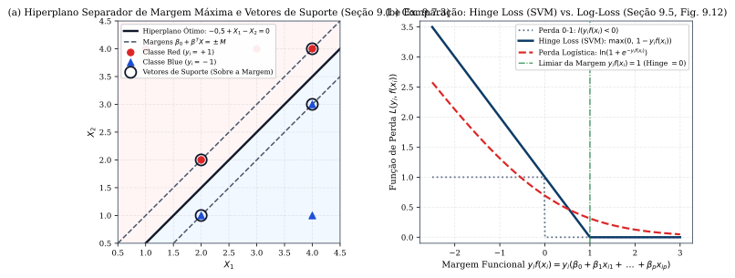
*Figura 8 — (a) Hiperplano ótimo separador de margem máxima, margens $\pm M$ e vetores de suporte para o conjunto de dados do Exercício 9.7.3 (Seção 9.1). (b) Comparação entre a função Hinge Loss da SVM, a perda da Regressão Logística e a perda $0$-$1$ em função de $y_i f(x_i)$ (Seção 9.5, Fig. 9.12).*

#### Exercícios de Fixação (Capítulo 9)
1. *(ISLP, Seção 9.7, Ex. 2 — Fronteira Não Linear Quadrática)* A curva $(1 + X_1)^2 + (2 - X_2)^2 = 4$ divide o plano em duas regiões (classifica em Blue se $> 4$ e em Red se $\le 4$). (a) Que curva é essa e como são classificadas $(0,0)$, $(-1,1)$, $(2,2)$ e $(3,8)$? (b) Por que essa fronteira é linear num espaço expandido? *(Gabarito: (a) É a circunferência de centro $(-1, 2)$ e raio $r = 2$; avaliando $(1+X_1)^2 + (2-X_2)^2$: para $(0,0) \mapsto 5 > 4$ [Blue], para $(-1,1) \mapsto 1 \le 4$ [Red], para $(2,2) \mapsto 9 > 4$ [Blue], para $(3,8) \mapsto 52 > 4$ [Blue]; (b) Expandindo, $-1 + 2X_1 + X_1^2 - 4X_2 + X_2^2 = 0$, que é um hiperplano linear nas $4$ variáveis $(X_1, X_1^2, X_2, X_2^2)$).*
2. *(ISLP, Seção 9.7, Ex. 3)* Para as $7$ observações em $\mathbb{R}^2$: Red $= \{(3,4), (2,2), (4,4), (1,4)\}$ e Blue $= \{(2,1), (4,3), (4,1)\}$ (Figura 8a), determine a equação do hiperplano de margem máxima, a largura da margem $M$ e os vetores de suporte. *(Gabarito: Os vetores de suporte são $(2,2), (4,4)$ [Red] e $(2,1), (4,3)$ [Blue]; o hiperplano equidistante passa pelos pontos médios $(2,\, 1{,}5)$ e $(4,\, 3{,}5)$, tendo equação $-0{,}5 + X_1 - X_2 = 0$; normalizando por $\sqrt{1^2+(-1)^2}=\sqrt{2}$, a margem perpendicular vale $M = \frac{0,5}{\sqrt{2}} = \frac{\sqrt{2}}{4} \approx 0{,}3536$).*

---

## 8. Deep Learning: Redes Neurais, CNNs, RNNs, Backpropagation e Double Descent (Capítulo 10)

### 8.1 Redes Neurais de Camada Única e Múltiplas Camadas (MLPs, Seções 10.1 e 10.2)
1. **Rede Neural *Feed-Forward* de Camada Oculta Única (Seção 10.1):** Dado um vetor de entrada $X = (X_1, \dots, X_p)$, constroem-se primeiro $K$ **ativações ocultas (*activations*)** $A_k = h_k(X)$ na camada oculta aplicando uma **função de ativação não linear $g(z)$** a combinações lineares das entradas (Equações 10.1 a 10.3):
   $$A_k = h_k(X) = g\left(w_{k0} + \sum_{j=1}^{p} w_{kj} X_j\right), \quad k = 1, \dots, K \qquad \implies \qquad f(X) = \beta_0 + \sum_{k=1}^{K} \beta_k A_k$$
   - **Funções de Ativação Clássicas e Modernas (Equações 10.4 e 10.5, Figura 9a):**
     $$g_{\text{sigmoid}}(z) = \sigma(z) = \frac{1}{1 + e^{-z}}, \qquad g_{\text{ReLU}}(z) = (z)_+ = \max(0, z) = \begin{cases} 0, & \text{se } z < 0 \\ z, & \text{se } z \ge 0 \end{cases}$$
   - **Por que a não linearidade de $g(z)$ é indispensável?** Se $g(z)$ fosse linear, a composição $f(X) = \beta_0 + \sum_{k=1}^K \beta_k(w_{k0} + \sum_j w_{kj}X_j)$ colapsaria num simples modelo de regressão linear em $X_1, \dots, X_p$! Além disso, combinações de ativações não lineares capturam **interações automaticamente** (como mostra a Equação 10.8 do ISLP: $\frac{1}{4}(X_1 + X_2)^2 - \frac{1}{4}(X_1 - X_2)^2 = X_1 X_2$).
2. **Redes Neurais Multicamadas (MLPs) e Classificação Multiclasse (Seção 10.2):** Empilhando $L$ camadas ocultas de dimensões $K_1, K_2, \dots, K_L$:
   $$A_\ell^{(1)} = g\left(w_{\ell 0}^{(1)} + \sum_{j=1}^{p} w_{\ell j}^{(1)} X_j\right) \;\; (\ell = 1, \dots, K_1), \qquad A_m^{(2)} = g\left(w_{m 0}^{(2)} + \sum_{\ell=1}^{K_1} w_{m\ell}^{(2)} A_\ell^{(1)}\right) \;\; (m = 1, \dots, K_2)$$
   Para classificar em $M$ classes (ex.: $M = 10$ dígitos em MNIST, onde cada imagem $28 \times 28$ possui $p = 784$ pixels), a camada de saída computa $Z_m = \beta_{m0} + \sum_{\ell=1}^{K_2}\beta_{m\ell} A_\ell^{(2)}$ ($m = 0, \dots, 9$), converte-os em probabilidades via **ativação Softmax** $f_m(X) = \Pr(Y = m \mid X) = \frac{e^{Z_m}}{\sum_{\ell=0}^9 e^{Z_\ell}}$ (Equação 10.13) e treina a rede minimizando a **Entropia Cruzada (*Cross-Entropy* / Log-Verossimilhança Multinomial Negativa, Equação 10.14)**:
   $$-\sum_{i=1}^{n}\sum_{m=0}^{9} y_{im} \ln f_m(x_i)$$
   onde $y_{im}$ é a codificação *one-hot* da classe verdadeira. *(Contagem de parâmetros: uma camada densa que conecta $D_{\text{in}}$ entradas a $D_{\text{out}}$ unidades ocultas possui exatamente **$(D_{\text{in}} + 1)\times D_{\text{out}}$ parâmetros**, contando os $D_{\text{out}}$ vieses/interceptos!)*

---

### 8.2 Redes Neurais Convolucionais (CNNs) e Redes Neurais Recorrentes (RNNs, Seções 10.3 a 10.5)
1. **Redes Neurais Convolucionais (CNNs) para Imagens (Seção 10.3):** Representa-se uma imagem colorida como um tensor tridimensional $H \times W \times C$ (onde $C = 3$ canais RGB). Uma CNN alterna duas operações especializadas que exploram a estrutura espacial local com compartilhamento de pesos (*weight sharing*):
   - **Camadas de Convolução (*Convolution Layers*, Seção 10.3.1):** Desliza-se um pequeno filtro (kernel) aprendível $K$ (ex.: $3 \times 3 \times C$) sobre a imagem, calculando o produto interno em cada subpatch para formar um **mapa de características (*feature map*)** ativado por ReLU. Cada filtro na 1ª camada atua como detector de bordas/orientações locais, combinando-se nas camadas seguintes em texturas, partes de objetos e formas completas.
   - **Camadas de Agrupamento (*Pooling Layers*, Seção 10.3.2):** Um **Max-Pooling $2 \times 2$** substitui cada bloco não sobreposto de $2 \times 2$ pixels pelo seu valor máximo, reduzindo cada dimensão espacial pela metade (fator $4$ na área) e conferindo **invariância de locação (translação)**. À medida que a resolução espacial diminui ao longo da rede, o número de filtros/canais aumenta, até o *flattening* final para uma camada densa com saída Softmax.
   - **Aumento de Dados (*Data Augmentation*, Seção 10.3.4):** Aplica transformações estocásticas (rotações leves, espelhamento horizontal, zoom, deslocamento) a cada imagem durante o treinamento, funcionando como poderosa regularização contra *overfitting*.
2. **Classificação de Documentos (*Bag-of-Words* vs. *Embeddings*) e Redes Neurais Recorrentes (RNNs, Seções 10.4 e 10.5):**
   - Na abordagem **Bag-of-Words** (Seção 10.4), representa-se um documento por um vetor esparso em $\mathbb{R}^{D}$ (ex.: $D = 10\,000$ palavras do dicionário), binário ou de frequências (*one-hot* / *n-grams*), mas isso ignora completamente a ordem sequencial das palavras.
   - Numa **Rede Neural Recorrente (RNN — Seção 10.5)**, a entrada é uma sequência ordenada $X = \{X_1, X_2, \dots, X_L\}$ (palavras de uma frase convertidas em vetores densos de dimensão $m$ por uma camada de **Word Embedding** aprendida, ou defasagens $v_{t-\ell}$ de uma série temporal). A rede mantém um vetor de **ativação oculta recorrente $A_\ell$** atualizado passo a passo com **os mesmos pesos compartilhados $(\mathbf{W}, \mathbf{U}, \mathbf{B})$** ao longo de todo o tempo $\ell = 1, \dots, L$ (Equações 10.17 e 10.18):
     $$A_{\ell k} = g\left(w_{k0} + \sum_{j=1}^{p} w_{kj} X_{\ell j} + \sum_{s=1}^{K} u_{ks} A_{\ell-1,\, s}\right), \qquad O_\ell = \beta_0 + \sum_{k=1}^{K} \beta_k A_{\ell k}$$
   - Arquiteturas modernas de RNN utilizam células **LSTM (*Long Short-Term Memory*)** (que mantêm duas trilhas de estados ocultos — memória longa e memória curta — controladas por portões sigmoides para evitar o desaparecimento/explosão do gradiente em sequências longas), além de **Autorregressão Linear/Não Linear (AR)** achatando as $L$ defasagens $(v_{t-1}, \dots, v_{t-L})$ como preditores diretos.

---

### 8.3 Ajuste de Redes Neurais: Backpropagation, SGD, Dropout e Double Descent (Seções 10.7 e 10.8)
1. **Não Convexidade, Gradiente Descendente e *Backpropagation* (Seção 10.7.1):** Diferentemente do OLS, do Ridge ou do Lasso, o problema de minimizar $R(\theta) = \frac{1}{2}\sum_{i=1}^n \big(y_i - f_\theta(x_i)\big)^2$ numa rede neural é **não convexo** em $\theta$, possuindo múltiplos mínimos locais e pontos de sela. O algoritmo de Gradiente Descendente atualiza iterativamente $\theta^{m+1} \leftarrow \theta^m - \rho \nabla R(\theta^m)$, onde $\rho > 0$ é a **taxa de aprendizado (*learning rate*)**.  
   Para uma rede de camada oculta única com $z_{ik} = w_{k0} + \sum_{j=1}^p w_{kj}x_{ij}$ e $f_\theta(x_i) = \beta_0 + \sum_{k=1}^K \beta_k g(z_{ik})$, a aplicação da **Regra da Cadeia** distribui o resíduo de volta pela rede (**Backpropagation**, Equações 10.25 e 10.26):
   $$\frac{\partial R_i(\theta)}{\partial \beta_k} = -\big(y_i - f_\theta(x_i)\big)\,g(z_{ik}), \qquad \frac{\partial R_i(\theta)}{\partial w_{kj}} = -\big(y_i - f_\theta(x_i)\big)\,\beta_k\,g'(z_{ik})\,x_{ij}$$
   No **Gradiente Descendente Estocástico (SGD — Seção 10.7.2)**, em vez de somar o gradiente sobre todas as $n$ observações, sorteia-se um pequeno lote (**minibatch**) a cada passo; uma varredura completa por todo o conjunto de treinamento constitui uma **época (*epoch*)**.
2. **Regularização em Redes Neurais: *Weight Decay*, *Early Stopping* e *Dropout* (Seções 10.7.2–10.7.3):**
   - **Penalização Ridge ($\ell_2$ / *Weight Decay*) ou Lasso ($\ell_1$):** soma $\lambda \sum_j \theta_j^2$ à função objetivo;
   - **Parada Precoce (*Early Stopping*):** interrompe as épocas de SGD assim que o erro no conjunto de validação começa a subir;
   - **Aprendizado por *Dropout* (Srivastava et al., 2014 — Seção 10.7.3):** Inspirado no Random Forest, a cada atualização de *minibatch* durante o treinamento, remove-se aleatoriamente uma fração $\phi \in (0, 1)$ das unidades de uma camada (zerando suas ativações) e **escalonam-se os pesos das $(1 - \phi)$ unidades sobreviventes por um fator $\frac{1}{1 - \phi}$** para compensar as unidades ausentes (*inverted dropout*), impedindo que os neurônios se co-adaptem excessivamente.
3. **Interpolação e o Fenômeno de Dupla Descida (*Double Descent* — Seção 10.8):** Na visão clássica do *trade-off* viés-variância, atingir erro de treinamento igual a zero ($d = n$, o **limiar de interpolação**) deveria levar a sobreajuste catastrófico para qualquer $d > n$. Na Seção 10.8 (Figura 9b), o ISLP demonstra por que redes neurais altamente sobreparametrizadas ($d \gg n$) generalizam bem:
   - Até $d = n$, a curva segue o formato em U clássico, atingindo um pico agudo de variância exatamente no **limiar de interpolação $d = n$**, onde existe uma única função interpoladora que oscila violentamente para passar por todos os $n$ pontos ruidosos;
   - Quando **$d > n$** (regime sobreparametrizado), existem infinitas soluções que interpolam os dados ($\operatorname{RSS} = 0$ no treino), e algoritmos como o **SGD convergem naturalmente para a solução interpoladora de norma mínima** ($\min \|\beta\|_2$ ou menor rugosidade $\int f''(x)^2\,dx$), que é muito mais suave do que a solução única em $d = n$, fazendo o erro de teste **descer uma segunda vez** (*Double Descent*)!

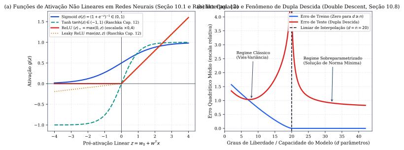
*Figura 9 — (a) Funções de ativação não lineares (Sigmoid, Tanh, ReLU e Leaky ReLU) utilizadas em redes neurais (Seção 10.1 e Raschka Cap. 12). (b) O fenômeno de Interpolação e Dupla Descida (*Double Descent*) do erro de teste além do limiar $d = n$ (Seção 10.8, Fig. 10.20).*

#### Exercícios de Fixação (Capítulo 10)
1. *(ISLP, Seção 10.10, Ex. 1 e 4 — Contagem de Parâmetros)* (a) Quantos parâmetros possui uma MLP com $p = 4$ entradas, $2$ unidades na 1ª camada oculta, $3$ unidades na 2ª camada oculta e $1$ saída escalar? (b) Uma CNN recebe imagens $32 \times 32$ em tons de cinza ($1$ canal) e aplica uma camada convolucional com $3$ filtros $5 \times 5$ (sem *padding*). Quantos parâmetros treináveis possui essa camada convolucional, e quantos pesos haveria se fosse uma camada densa ordinária com o mesmo número de ativações? *(Gabarito: (a) $(4+1)\times 2 + (2+1)\times 3 + (3+1)\times 1 = 10 + 9 + 4 = \mathbf{23\text{ parâmetros}}$; (b) Cada filtro $5\times 5$ tem $25$ pesos $+ 1$ viés $= 26$ parâmetros, logo $3 \times 26 = \mathbf{78\text{ parâmetros}}$; como cada mapa de saída tem $(32-5+1)\times(32-5+1) = 28\times 28 = 784$ unidades e há $3$ mapas ($3 \times 784 = 2\,352$ unidades ocultas recebendo $32\times 32 = 1\,024$ pixels), uma camada densa sem compartilhamento de pesos teria $(1\,024 + 1)\times 2\,352 = \mathbf{2\,410\,800\text{ parâmetros}}$!).*
2. *(ISLP, Seção 10.10, Ex. 2 — Invariância da Softmax)* Prove que na função Softmax $f_m(z) = \frac{e^{z_m}}{\sum_{\ell=1}^M e^{z_\ell}}$, somar uma constante arbitrária $c \in \mathbb{R}$ a cada logit $z_\ell$ não altera as probabilidades $f_m(z)$. *(Gabarito: $\frac{e^{z_m + c}}{\sum_\ell e^{z_\ell + c}} = \frac{e^c e^{z_m}}{e^c \sum_\ell e^{z_\ell}} = \frac{e^{z_m}}{\sum_\ell e^{z_\ell}}$).*

---

## 9. Arquiteturas Avançadas: Transformers, GANs, GNNs e Reinforcement Learning
### *[Complemento — Raschka et al., Machine Learning with PyTorch and Scikit-Learn, Capítulos 13 a 19]*

Os Capítulos 13 a 19 de **Raschka, Liu & Mirjalili (2022)** expandem o Capítulo 10 do ISLP apresentando a mecânica interna de grafos computacionais em PyTorch e as quatro arquiteturas que definem o estado da arte contemporâneo em Inteligência Artificial:

### 9.1 Grafos Computacionais Dinâmicos em PyTorch e CNNs Profundas (Raschka, Cap. 13 e 14)
1. **Diferenciação Automática (*Autograd*) e Grafos Dinâmicos (Cap. 13):** O PyTorch constrói um **grafo acíclico direcionado (DAG) dinâmico (*define-by-run*)** a cada passagem direta (*forward pass*) para tensores com `requires_grad=True`, armazenando as operações intermediárias e computando todos os gradientes reversos automaticamente via `loss.backward()`.
2. **Aritmética de Convoluções Discretas 2D e *BatchNorm* (Cap. 14):** Para uma entrada de tamanho $n_{\text{in}}$ com preenchimento de borda (*padding*) $p$, filtro de tamanho $f$ e passo (*stride*) $s$, a dimensão espacial de saída é exatamente:
   $$n_{\text{out}} = \left\lfloor \frac{n_{\text{in}} + 2p - f}{s} \right\rfloor + 1$$

---

### 9.2 Transformers e o Mecanismo de Self-Attention (Raschka, Cap. 16)
As RNNs/LSTMs processam sequências token por token ($t = 1, \dots, T$), o que impede a paralelização do treinamento em GPUs e dificulta a propagação de dependências de longo alcance. A arquitetura **Transformer** (*"Attention Is All You Need"*, Vaswani et al., 2017 — Raschka Cap. 16.2–16.3) substitui completamente a recorrência pelo mecanismo de **Auto-Atenção (*Self-Attention*)**:
1. **Scaled Dot-Product Self-Attention (Seção 16.2):** Dada uma sequência de vetores de entrada $x^{(1)}, \dots, x^{(T)} \in \mathbb{R}^d$ (empilhados na matriz $X \in \mathbb{R}^{T \times d}$), projetam-se três matrizes aprendíveis — **Consultas (*Queries*) $Q = X W_q$**, **Chaves (*Keys*) $K = X W_k$** (ambas em $\mathbb{R}^{T \times d_k}$) e **Valores (*Values*) $V = X W_v \in \mathbb{R}^{T \times d_v}$** — e calcula-se a matriz de vetores de contexto em paralelo:
   $$\operatorname{Attention}(Q, K, V) = \operatorname{softmax}\left(\frac{Q K^T}{\sqrt{d_k}}\right) V, \qquad \text{onde } \alpha_{ij} = \frac{\exp\left(\frac{q^{(i)T} k^{(j)}}{\sqrt{d_k}}\right)}{\sum_{\ell=1}^{T} \exp\left(\frac{q^{(i)T} k^{(\ell)}}{\sqrt{d_k}}\right)}$$
   - **Por que dividir por $\sqrt{d_k}$?** Se os componentes de $q$ e $k$ tiverem média $0$ e variância $1$, o produto interno $q^T k = \sum_{m=1}^{d_k} q_m k_m$ tem média $0$ e **variância $d_k$** (desvio-padrão $\sqrt{d_k}$). Para $d_k$ grande, os produtos internos assumiriam magnitudes elevadas, empurrando a função *softmax* para regiões de saturação onde os gradientes são quase nulos ($\nabla \approx 0$). Dividir por $\sqrt{d_k}$ restaura a variância unitária!
2. **Multi-Head Attention, Codificação Posicional e Modelos de Linguagem (GPT, BERT e BART — Seções 16.3–16.4):**
   - **Multi-Head Attention:** Executa $h$ cabeças de atenção em paralelo ($\operatorname{head}_m = \operatorname{Attention}(X W_q^{(m)}, X W_k^{(m)}, X W_v^{(m)})$) e concatena-as: $\operatorname{MHA}(Q,K,V) = \operatorname{Concat}(\operatorname{head}_1, \dots, \operatorname{head}_h)W_O$, seguidas de conexões residuais ($x + \operatorname{Sublayer}(x)$) e **Layer Normalization** (**Codificações Posicionais** senoidais ou aprendidas são somadas às entradas $X$, já que a atenção por si só é invariante a permutações).
   - **GPT (*Generative Pre-trained Transformer*):** Pilha de *Decoders* com **atenção mascarada (*causal masked self-attention*)** que zera os pesos $\alpha_{ij}$ para $j > i$, treinada de forma autorregressiva unidirecional para prever o próximo token $\max \sum_t \ln P(x_t \mid x_{<t})$.
   - **BERT (*Bidirectional Encoder Representations from Transformers*):** Pilha de *Encoders* bidirecionais pré-treinada via **Masked Language Modeling (MLM)** (mascarando $15\%$ dos tokens e prevendo-os usando o contexto à esquerda e à direita) e **Next Sentence Prediction (NSP)**. O **BART** combina um *Encoder* bidirecional (estilo BERT) com um *Decoder* autorregressivo (estilo GPT).

---

### 9.3 Redes Adversariais Generativas (GANs e WGAN-GP — Raschka, Cap. 17)
Para sintetizar novas amostras realistas $x \sim p_{\text{data}}(x)$ a partir de um vetor de ruído latente $z \sim p_z(z)$, uma **GAN** (Goodfellow et al., 2014) coloca duas redes neurais num **jogo minimax de soma zero de dois jogadores** (Seção 17.1):
- O **Gerador $G(z)$** mapeia o ruído $z$ numa amostra sintética $\tilde{x} = G(z)$ buscando enganar o discriminador;
- O **Discriminador $D(x) \in (0, 1)$** estima a probabilidade de $x$ provir da distribuição real $p_{\text{data}}$ em vez da distribuição gerada $p_g$:
  $$\min_{G} \max_{D} V(D, G) = \mathbb{E}_{x \sim p_{\text{data}}(x)}\big[\ln D(x)\big] + \mathbb{E}_{z \sim p_z(z)}\big[\ln\big(1 - D(G(z))\big)\big]$$
- **Teorema do Discriminador Ótimo e Equilíbrio de Nash:** Para um gerador $G$ fixo, derivando o integrando $p_{\text{data}}(x)\ln D(x) + p_g(x)\ln(1 - D(x))$ em relação a $D(x)$, o discriminador ótimo é **$D^*_G(x) = \dfrac{p_{\text{data}}(x)}{p_{\text{data}}(x) + p_g(x)}$**. Substituindo $D^*_G$ em $V(D^*_G, G)$, minimizar em $G$ equivale a minimizar a **Divergência de Jensen-Shannon** $\operatorname{JSD}(p_{\text{data}} \parallel p_g)$, cujo mínimo global é atingido se, e somente se, **$p_g = p_{\text{data}}$** (onde $D^*(x) = \frac{1}{2}$ em toda parte!).
- **Não Saturação, DCGAN e Wasserstein GAN com Penalidade de Gradiente (WGAN-GP — Seção 17.3):** No início do treino, quando $D$ rejeita facilmente $G(z)$ ($D(G(z)) \approx 0$), o gradiente de $\ln(1 - D(G(z)))$ desaparece; por isso, na prática treina-se $G$ maximizando $\mathbb{E}[\ln D(G(z))]$. Para eliminar a instabilidade e o **colapso de modos (*mode collapse*)**, a **WGAN-GP** substitui a divergência de Jensen-Shannon pela **Distância de Wasserstein (Earth Mover's Distance)** usando um crítico $D$ $1$-Lipschitz com penalidade de gradiente $\lambda \mathbb{E}_{\hat{x}}\big[(\|\nabla_{\hat{x}} D(\hat{x})\|_2 - 1)^2\big]$.

---

### 9.4 Graph Neural Networks (GNNs, Cap. 18) e Reinforcement Learning (MDP e Q-Learning, Cap. 19)
1. **Graph Neural Networks (GNNs) e Convoluções em Grafos (Raschka, Cap. 18):** Dado um grafo $\mathcal{G} = (\mathcal{V}, \mathcal{E})$ com $N$ nós, matriz de adjacência $\mathbf{A} \in \{0, 1\}^{N \times N}$, matriz de atributos de nós $\mathbf{X} \in \mathbb{R}^{N \times F}$ e matriz de adjacência com auto-laços $\tilde{\mathbf{A}} = \mathbf{A} + \mathbf{I}_N$ (com matriz diagonal de graus $\tilde{\mathbf{D}}_{ii} = \sum_j \tilde{\mathbf{A}}_{ij}$), uma camada de **Graph Convolutional Network (GCN, Kipf & Welling, 2017)** agrega e normaliza simetricamente as representações da vizinhança de cada nó (**Message Passing**):
   $$\mathbf{H}^{(\ell)} = \sigma\left(\tilde{\mathbf{D}}^{-1/2} \tilde{\mathbf{A}} \tilde{\mathbf{D}}^{-1/2} \mathbf{H}^{(\ell-1)} \mathbf{W}^{(\ell)}\right) \qquad \Longleftrightarrow \qquad h_v^{(\ell)} = \sigma\left(\sum_{u \in \mathcal{N}(v) \cup \{v\}} \frac{1}{\sqrt{\tilde{d}_u \tilde{d}_v}} \mathbf{W}^{(\ell)} h_u^{(\ell-1)}\right)$$
   Para classificação de grafos inteiros (ex.: moléculas com tamanhos variáveis), aplica-se uma camada de **Global Pooling** (soma ou média sobre todos os nós $v \in \mathcal{V}$) invariante à permutação dos vértices.
2. **Reinforcement Learning: Processos de Decisão de Markov (MDPs), Equação de Bellman e TD / Q-Learning (Raschka, Cap. 19):** Num **MDP** $(\mathcal{S}, \mathcal{A}, P(s', r \mid s, a), \gamma)$, a cada passo $t$ o agente no estado $S_t \in \mathcal{S}$ escolhe uma ação $A_t \in \mathcal{A}$ segundo uma política $\pi(a \mid s)$, recebe uma recompensa $R_{t+1}$ e transita para $S_{t+1}$, buscando maximizar o **retorno descontado** $G_t = \sum_{k=0}^\infty \gamma^k R_{t+k+1}$ ($\gamma \in [0, 1]$).
   - **Equações de Bellman para $v_\pi(s) = \mathbb{E}_\pi[G_t \mid S_t = s]$ e Equações de Otimalidade de Bellman para $v_*(s)$ e $q_*(s, a)$:**
     $$v_*(s) = \max_{a \in \mathcal{A}} \sum_{s', r} p(s', r \mid s, a)\big[r + \gamma v_*(s')\big], \qquad q_*(s, a) = \sum_{s', r} p(s', r \mid s, a)\left[r + \gamma \max_{a' \in \mathcal{A}} q_*(s', a')\right]$$
   -Quando a dinâmica $p(s', r \mid s, a)$ é desconhecida (*model-free*), os métodos de **Diferença Temporal (*Temporal Difference* — TD)** aprendem passo a passo via *bootstrapping* (com política exploratória $\varepsilon$-gulosa):
     - **SARSA (*On-Policy TD Control*):** $\quad Q(S_t, A_t) \leftarrow Q(S_t, A_t) + \alpha\Big[R_{t+1} + \gamma Q(S_{t+1}, A_{t+1}) - Q(S_t, A_t)\Big]$;
     - **Q-Learning (*Off-Policy TD Control*, Watkins, 1989):** $\quad Q(S_t, A_t) \leftarrow Q(S_t, A_t) + \alpha\Big[R_{t+1} + \gamma \max_{a} Q(S_{t+1}, a) - Q(S_t, A_t)\Big]$, que aproxima diretamente $q_*(s, a)$ independentemente da política comportamental seguida!

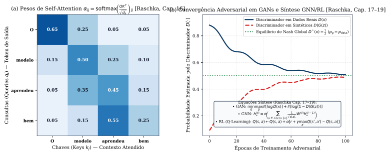
*Figura 10 — (a) Mapa de pesos de Scaled Dot-Product Self-Attention $\operatorname{softmax}(QK^T/\sqrt{d_k})$ num modelo Transformer [Complemento — Raschka et al., Cap. 16]. (b) Convergência ao equilíbrio de Nash $D^*(x) = 1/2$ no treinamento adversarial de uma GAN e equações síntese de GNN e Q-Learning [Complemento — Raschka et al., Cap. 17–19].*

#### Exercícios de Fixação (Complemento — Raschka, Capítulos 14 a 19)
1. *(Raschka, Cap. 14 e 16)* (a) Uma imagem $64 \times 64$ passa por uma convolução com filtro $4 \times 4$, *padding* $p = 1$ e *stride* $s = 2$. Qual a dimensão do mapa de saída? (b) Em *Scaled Dot-Product Attention* com $d_k = 64$, se os elementos de $q$ e $k$ são i.i.d. com média $0$ e variância $1$, qual é o desvio-padrão de $q^T k$ antes e depois do escalonamento por $\sqrt{d_k}$? *(Gabarito: (a) $\lfloor \frac{64 + 2(1) - 4}{2}\rfloor + 1 = 31 + 1 = 32 \times 32$; (b) Antes: $\sqrt{64} = 8$; depois de dividir por $\sqrt{64}=8$: desvio-padrão igual a $1$).*
2. *(Raschka, Cap. 17 e 19)* (a) Numa GAN, se em um ponto $x$ temos $p_{\text{data}}(x) = 0{,}3$ e $p_g(x) = 0{,}1$, qual o valor do discriminador ótimo $D^*_G(x)$? (b) Num episódio de Q-Learning com $\alpha = 0{,}5$, $\gamma = 0{,}9$, $Q(s, a) = 2{,}0$, recompensa observada $r = 4{,}0$ e $\max_{a'} Q(s', a') = 6{,}0$, calcule o novo valor de $Q(s, a)$. *(Gabarito: (a) $D^*_G(x) = \frac{0,3}{0,3 + 0,1} = 0{,}75$; (b) Erro TD $= 4{,}0 + 0{,}9(6{,}0) - 2{,}0 = 7{,}4 \implies Q_{\text{novo}}(s, a) = 2{,}0 + 0{,}5(7{,}4) = \mathbf{5{,}7}$).*

---

## 10. Análise de Sobrevivência e Dados Censurados (Capítulo 11)

### 10.1 Tempo de Sobrevivência, Censura Independente, Curva de Kaplan-Meier e Teste Log-Rank (Seções 11.1 a 11.4)
Para cada indivíduo $i = 1, \dots, n$, existe um verdadeiro **tempo de sobrevivência (ou tempo até o evento/falha) $T_i$** e um verdadeiro **tempo de censura $C_i$** (por término do estudo ou perda de acompanhamento). Observamos apenas o par $(Y_i, \delta_i)$ (Equação 11.1):
$$Y_i = \min(T_i, C_i), \qquad \delta_i = I(T_i \le C_i) = \begin{cases} 1, & \text{se } T_i \le C_i \;\; (\text{evento observado: } Y_i = T_i) \\ 0, & \text{se } T_i > C_i \;\; (\text{censurado à direita: } Y_i = C_i, \text{ sabendo-se que } T_i > Y_i) \end{cases}$$
- **Hipótese de Censura Independente (Seção 11.2):** Toda a análise assume que, condicional aos preditores $X$, o tempo de evento $T$ é estatisticamente independente do tempo de censura $C$ ($T \perp C \mid X$). Se pacientes mais graves abandonam o estudo mais cedo, a censura é informativa (não independente) e enviesa as estimativas!
- **Estimador de Kaplan-Meier da Curva de Sobrevivência $S(t) = \Pr(T > t)$ (Seção 11.3):** Sejam $d_1 < d_2 < \dots < d_K$ os $K$ instantes únicos de falha (morte/evento) observados dentre os pacientes não censurados ($\delta_i = 1$). Seja **$q_k$** o número de pacientes que falharam no instante $d_k$, e seja **$r_k$** o número de pacientes no **conjunto de risco (*risk set*)** imediatamente antes de $d_k$ (aqueles com $Y_i \ge d_k$, ainda vivos e em acompanhamento no estudo). Pela lei da probabilidade total, $\Pr(T > d_k) = \Pr(T > d_k \mid T > d_{k-1})\Pr(T > d_{k-1})$, e estimando $\widehat{\Pr}(T > d_j \mid T > d_{j-1}) = \frac{r_j - q_j}{r_j}$, obtém-se o **Estimador de Kaplan-Meier** em degraus (Equação 11.3):
  $$\hat{S}(d_k) = \prod_{j=1}^{k} \left(\frac{r_j - q_j}{r_j}\right), \qquad \text{sendo } \hat{S}(t) = 1 \text{ para } t < d_1 \text{ e } \hat{S}(t) = \hat{S}(d_k) \text{ para } d_k \le t < d_{k+1}$$
- **O Teste Log-Rank para Comparar Duas Curvas de Sobrevivência (Seção 11.4):** Para testar $H_0: S_1(t) = S_2(t)$ entre dois grupos, no instante de falha $d_k$ sejam $r_{1k}, r_{2k}$ os tamanhos dos conjuntos de risco ($r_k = r_{1k} + r_{2k}$) e $q_{1k}, q_{2k}$ os óbitos em cada grupo ($q_k = q_{1k} + q_{2k}$). Sob $H_0$, $q_{1k}$ segue uma distribuição **Hipergeométrica** com média e variância dadas pelas Equações (11.5) e (11.6):
  $$\mu_k = \mathbb{E}(q_{1k}) = \frac{r_{1k}}{r_k} q_k, \qquad \operatorname{Var}(q_{1k}) = \frac{q_k (r_{1k} / r_k)(1 - r_{1k} / r_k)(r_k - q_k)}{r_k - 1}$$
  Somando ao longo de todos os $K$ instantes de falha, a **estatística do teste Log-Rank** (Equação 11.8):
  $$W = \frac{\sum_{k=1}^{K} (q_{1k} - \mu_k)}{\sqrt{\sum_{k=1}^{K} \operatorname{Var}(q_{1k})}} \stackrel{a}{\sim} \mathcal{N}(0, 1) \quad (\text{sob } H_0, \text{ com } W^2 \stackrel{a}{\sim} \chi^2_1)$$

---

### 10.2 Função de Risco (*Hazard Function*) e o Modelo de Riscos Proporcionais de Cox (Seções 11.5 a 11.7)
1. **Função de Risco (*Hazard Function* / Taxa de Falha Instantânea — Seção 11.5.1):** É a taxa instantânea de ocorrência do evento logo após o instante $t$, dado que o indivíduo sobreviveu até $t$ (Equação 11.9):
   $$h(t) = \lim_{\Delta t \to 0} \frac{\Pr(t < T \le t + \Delta t \mid T > t)}{\Delta t} = \frac{f(t)}{S(t)} = -\frac{d}{dt}\ln S(t) \iff S(t) = \exp\left(-\int_{0}^{t} h(u)\,du\right)$$
   onde $f(t) = \lim_{\Delta t \to 0}\frac{\Pr(t < T \le t+\Delta t)}{\Delta t} = -\frac{dS(t)}{dt}$ é a densidade de probabilidade de $T$. A função de verossimilhança para dados censurados é $\ell = \prod_{i=1}^n f(y_i)^{\delta_i} S(y_i)^{1 - \delta_i} = \prod_{i=1}^n h(y_i)^{\delta_i} S(y_i)$ (Equação 11.13).
2. **Modelo de Riscos Proporcionais de Cox (*Cox's Proportional Hazards Model* — Seção 11.5.2):** Modela o risco condicional aos preditores $x_i = (x_{i1}, \dots, x_{ip})^T$ de forma **semiparamétrica** (Equação 11.14):
   $$h(t \mid x_i) = h_0(t)\exp\left(\sum_{j=1}^{p} x_{ij}\beta_j\right)$$
   onde **$h_0(t) \ge 0$ é a função de risco basal (*baseline hazard*)**, deixada completamente **não especificada** (para $x_i = 0$).
   - **Interpretação da Razão de Riscos (*Hazard Ratio* — HR):** A razão $\frac{h(t \mid x_i)}{h(t \mid x_{i'})} = \exp\left(\sum_{j=1}^p (x_{ij} - x_{i'j})\beta_j\right)$ não depende do tempo $t$ (**riscos proporcionais**, Figura 11b). Aumentar $x_{ij}$ em uma unidade multiplica o risco instantâneo em qualquer instante $t$ pelo **Hazard Ratio $\operatorname{HR}_j = e^{\beta_j}$**.
   - **Verossimilhança Parcial de Cox (*Partial Likelihood* — Equação 11.16):** Como $h_0(t)$ é arbitrária, Cox mostrou que, sabendo que a $i$-ésima observação ($\delta_i = 1$) falhou no instante $y_i$ (e supondo tempos de falha sem empates), a probabilidade de que tenha sido justamente o indivíduo $i$ a falhar dentre todos os indivíduos $i'$ no conjunto de risco $\mathcal{R}_i = \{i' : y_{i'} \ge y_i\}$ cancela $h_0(y_i)$ no numerador e no denominador! Multiplicando sobre todos os eventos não censurados, obtém-se a **Verossimilhança Parcial**:
     $$PL(\beta) = \prod_{i:\, \delta_i = 1} \frac{h_0(y_i)\exp\left(\sum_{j=1}^p x_{ij}\beta_j\right)}{\sum_{i' \in \mathcal{R}_i} h_0(y_i)\exp\left(\sum_{j=1}^p x_{i'j}\beta_j\right)} = \prod_{i:\, \delta_i = 1} \frac{\exp\left(\sum_{j=1}^p x_{ij}\beta_j\right)}{\sum_{i' :\, y_{i'} \ge y_i} \exp\left(\sum_{j=1}^p x_{i'j}\beta_j\right)}$$
     que permite estimar $\hat{\beta}$ sem nunca precisar estimar $h_0(t)$! *(Para um único preditor binário $x_i \in \{0, 1\}$, o teste escore do modelo de Cox é idêntico ao teste Log-Rank).*
3. **Regularização no Modelo de Cox e Índice C de Harrell (Seções 11.6 e 11.7.1):** Minimiza-se $-\ln PL(\beta) + \lambda P(\beta)$ (Lasso ou Ridge). Para avaliar a capacidade preditiva no conjunto de teste, calcula-se o **Índice de Concordância de Harrell (*C-index*, Equação 11.18)**, que mede a proporção de pares de observações $(i, i')$ com $y_{i'} > y_i$ e $\delta_i = 1$ nos quais o modelo atribuiu maior escore de risco $\eta_i = x_i^T\hat{\beta}$ ao indivíduo que falhou mais cedo:
   $$C = \frac{\sum_{i, i' :\, y_{i'} > y_i} I(\hat{\eta}_i > \hat{\eta}_{i'})\,\delta_i}{\sum_{i, i' :\, y_{i'} > y_i} \delta_i} \in [0, 1]$$

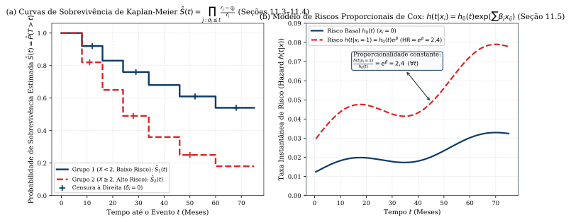
*Figura 11 — (a) Curvas de sobrevivência estimadas por Kaplan-Meier $\hat{S}(t)$ para dois grupos com marcações de censura à direita ($\delta_i = 0$) (Seções 11.3–11.4). (b) Proporcionalidade constante entre as curvas de risco instantâneo $h(t \mid x_i) = h_0(t)e^{\beta x_i}$ no Modelo de Cox (Seção 11.5).*

#### Exercícios de Fixação (Capítulo 11)
1. *(ISLP, Seção 11.9, Ex. 8 e 9 — Sobrevivência Exponencial Censurada)* Se os tempos de sobrevivência $T_i$ seguem uma distribuição $\operatorname{Exp}(\lambda)$ com $f(t) = \lambda e^{-\lambda t}$ ($t \ge 0$), mostre que $S(t) = e^{-\lambda t}$, a função *hazard* é constante $h(t) = \lambda$, e o estimador de máxima verossimilhança sobre dados censurados $(y_i, \delta_i)$ é $\hat{\lambda} = \frac{\sum_{i=1}^n \delta_i}{\sum_{i=1}^n y_i}$. *(Dica: Escreva $\ell(\lambda) = \prod_{i=1}^n h(y_i)^{\delta_i}S(y_i) = \prod_{i=1}^n \lambda^{\delta_i} e^{-\lambda y_i} = \lambda^{\sum \delta_i} e^{-\lambda \sum y_i}$, tome o logaritmo e derive em relação a $\lambda$).*

---

## 11. Aprendizado Não Supervisionado: PCA, Matrix Completion e Clustering (Capítulo 12)

### 11.1 Análise de Componentes Principais (PCA) e Completamento de Matrizes (Seções 12.2 e 12.3)
Dada uma matriz de dados $X \in \mathbb{R}^{n \times p}$ cujas colunas foram previamente **centradas para ter média zero** ($\frac{1}{n}\sum_{i=1}^n x_{ij} = 0$), a **Análise de Componentes Principais (PCA)** busca uma representação de baixa dimensão que preserve o máximo possível da variância dos dados:
1. **A Primeira e as Demais Componentes Principais (Seção 12.2.1):** A 1ª componente principal $Z_1 = \phi_{11}X_1 + \dots + \phi_{p1}X_p$ é a combinação linear normalizada ($\sum_{j=1}^p \phi_{j1}^2 = 1$) de maior variância amostral (Equação 12.3):
   $$\max_{\phi_{11}, \dots, \phi_{p1}} \left\{ \frac{1}{n}\sum_{i=1}^{n} \left(\sum_{j=1}^{p} \phi_{j1} x_{ij}\right)^2 \right\} \quad \text{sujeito a} \quad \sum_{j=1}^{p} \phi_{j1}^2 = 1$$
   O vetor unitário $\phi_1 = (\phi_{11}, \dots, \phi_{p1})^T$ é o **vetor de cargas (*loading vector*)** da 1ª componente principal, e as projeções $z_{i1} = \sum_{j=1}^p \phi_{j1}x_{ij}$ ($i = 1, \dots, n$) são os **escores (*scores*)**. A $m$-ésima componente principal $Z_m$ maximiza a variância amostral dentre todas as combinações lineares normalizadas que são **descorrelacionadas** com $Z_1, \dots, Z_{m-1}$ — o que equivale a exigir que a direção $\phi_m$ seja **ortogonal** a $\phi_1, \dots, \phi_{m-1}$ ($\phi_m^T \phi_\ell = 0$ para $\ell < m$). Algebricamente, $\phi_1, \phi_2, \dots, \phi_{\min(n-1, p)}$ são os **autovetores ortonormais ordenados da matriz $X^T X$** (ou vetores singulares direitos da decomposição SVD de $X$).
2. **Segunda Interpretação Geométrica: Subespaço Mais Próximo e Aproximação Matricial (Seção 12.2.2):** Os primeiros $M$ vetores de cargas e escores resolvem o problema de aproximação matricial de posto $M$ por mínimos quadrados (Equação 12.6):
   $$\min_{\mathbf{A} \in \mathbb{R}^{n \times M},\, \mathbf{B} \in \mathbb{R}^{p \times M}} \left\{ \sum_{j=1}^{p}\sum_{i=1}^{n} \left(x_{ij} - \sum_{m=1}^{M} a_{im} b_{jm}\right)^2 \right\}, \qquad \text{com solução } \hat{a}_{im} = z_{im} \text{ e } \hat{b}_{jm} = \phi_{jm}$$
3. **Proporção de Variância Explicada (PVE) e Importância do Escalonamento (Seções 12.2.3–12.2.4):** Pela decomposição de Pitágoras $\sum_{j=1}^p \sum_{i=1}^n x_{ij}^2 = \sum_{m=1}^M \sum_{i=1}^n z_{im}^2 + \sum_{j=1}^p \sum_{i=1}^n \left(x_{ij} - \sum_{m=1}^M z_{im}\phi_{jm}\right)^2$, a **Proporção de Variância Explicada (PVE)** pela $m$-ésima componente principal é dada pela Equação (12.10):
   $$\operatorname{PVE}_m = \frac{\sum_{i=1}^{n} z_{im}^2}{\sum_{j=1}^{p}\sum_{i=1}^{n} x_{ij}^2} = \frac{\sum_{i=1}^{n}\left(\sum_{j=1}^{p}\phi_{jm}x_{ij}\right)^2}{\sum_{j=1}^{p}\sum_{i=1}^{n} x_{ij}^2} \in [0, 1], \qquad \text{com } \sum_{m=1}^{\min(n-1, p)} \operatorname{PVE}_m = 1$$
   *(Atenção: como a PCA maximiza variância, se as variáveis forem medidas em unidades diferentes ou tiverem variâncias muito díspares, a 1ª componente principal concentrará quase todo o peso na variável de maior variância bruta! Por isso, **deve-se escalonar cada variável para ter desvio-padrão unitário** antes de rodar a PCA).*
4. **Valores Ausentes e Completamento de Matrizes via PCA Iterativa (Algoritmo 12.1, Seção 12.3):** Sendo $\mathcal{O}$ o conjunto dos índices $(i, j)$ observados em $X$, imputam-se inicialmente os valores ausentes $(i, j) \notin \mathcal{O}$ pela média da respectiva coluna $\bar{x}_j$ e repete-se até a convergência: (a) calcula-se a aproximação de posto $M$ via PCA/SVD $\hat{x}_{ij} = \sum_{m=1}^M \hat{a}_{im}\hat{b}_{jm}$; (b) atualizam-se os elementos ausentes por $\tilde{x}_{ij} \leftarrow \hat{x}_{ij}$ para $(i, j) \notin \mathcal{O}$, mantendo fixos os elementos observados $\tilde{x}_{ij} = x_{ij}$ para $(i, j) \in \mathcal{O}$.

---

### 11.2 Métodos de Agrupamento (*Clustering*): K-Means e Agrupamento Hierárquico (Seção 12.4)
1. **Agrupamento *K-Means* (Algoritmo 12.2, Seção 12.4.1):** Particiona as $n$ observações em $K$ clusters disjuntos $C_1, \dots, C_K$ ($\bigcup_{k=1}^K C_k = \{1, \dots, n\}$, $C_k \cap C_{k'} = \emptyset$) de modo a minimizar a variação total intra-cluster (Equações 12.15 e 12.17):
   $$\min_{C_1, \dots, C_K} \left\{ \sum_{k=1}^{K} \frac{1}{|C_k|} \sum_{i, i' \in C_k} \sum_{j=1}^{p} (x_{ij} - x_{i'j})^2 \right\} \Longleftrightarrow \min_{C_1, \dots, C_K} \left\{ \sum_{k=1}^{K} \sum_{i \in C_k} \sum_{j=1}^{p} (x_{ij} - \bar{x}_{kj})^2 \right\}$$
   A equivalência acima decorre da **Identidade Algébrica (Equação 12.18 e Ex. 12.6.1)**:
   $$\frac{1}{|C_k|}\sum_{i, i' \in C_k}\sum_{j=1}^{p}(x_{ij} - x_{i'j})^2 = 2\sum_{i \in C_k}\sum_{j=1}^{p}(x_{ij} - \bar{x}_{kj})^2, \qquad \text{onde } \bar{x}_{kj} = \frac{1}{|C_k|}\sum_{i \in C_k} x_{ij} \text{ é o centroide do cluster } k$$
   O **Algoritmo 12.2 (*K-Means*)** alterna dois passos após uma atribuição aleatória inicial de clusters: **(a)** calcula o centroide $\bar{x}_k = (\bar{x}_{k1}, \dots, \bar{x}_{kp})^T$ de cada cluster (o que minimiza a soma dos quadrados dentro de $C_k$); **(b)** reatribui cada observação $x_i$ ao cluster cujo centroide está mais próximo na distância euclidiana. Como ambos os passos reduzem (ou mantêm) a função objetivo da Equação (12.17), o algoritmo converge garantidamente para um **ótimo local** (devendo ser executado com múltiplas inicializações aleatórias, ex.: `n_init=20`).
2. **Agrupamento Hierárquico Aglomerativo (*Bottom-Up*) e Tipos de Ligação (*Linkage* — Seção 12.4.2):** Constrói uma representação em árvore (**dendrograma**) sem exigir a fixação prévia de $K$: parte das $n$ folhas individuais e, a cada passo, funde os dois grupos mais similares na altura igual à sua dissimilaridade inter-grupos, definida por um dos quatro tipos de **Ligação (*Linkage*, Tabela 12.1)**:
   - **Completa (*Complete Linkage*):** maior dissimilaridade entre pares $i \in A, i' \in B$ ($\max d(x_i, x_{i'})$ — gera clusters compactos e balanceados);
   - **Simples (*Single Linkage*):** menor dissimilaridade entre pares ($\min d(x_i, x_{i'})$ — propenso a formar cadeias alongadas / *trailing clusters*);
   - **Média (*Average Linkage*):** média de todas as $|A|\cdot|B|$ dissimilaridades pareadas (preferida junto com a Completa);
   - **Centroide (*Centroid Linkage*):** distância entre os centroides dos dois grupos (pode sofrer o fenômeno indesejável de **inversão**, onde a fusão ocorre numa altura inferior à de uma fusão anterior!).
   - **Escolha da Medida de Dissimilaridade:** Além da **Distância Euclidiana** (que agrupa observações com valores absolutos próximos), utiliza-se em expressão gênica e perfis de compras a **Distância Baseada em Correlação** $1 - \operatorname{Cor}(x_i, x_{i'})$ (que agrupa observações cujos perfis têm o mesmo formato relativo, independentemente da magnitude média; se cada observação $x_i$ for padronizada para ter média $0$ e variância $1$, vale $\|x_i - x_{i'}\|_2^2 = 2p\big(1 - \operatorname{Cor}(x_i, x_{i'})\big)$, conforme o Ex. 12.6.7!).

> **[Complemento — Raschka et al., *ML with PyTorch and Scikit-Learn*, Cap. 5 e Cap. 10]:**  
> 1. **K-Means++, Método do Cotovelo e Coeficiente de Silhueta (Cap. 10.1):** O algoritmo **K-Means++** inicializa os centroides escolhendo novos centros com probabilidade proporcional à distância quadrática $D(x)^2$ ao centroide mais próximo já escolhido. Para avaliar a qualidade do agrupamento e escolher $K$, calcula-se para cada ponto $x^{(i)}$ a coesão intra-cluster $a^{(i)}$ e a separação para o cluster vizinho mais próximo $b^{(i)}$, definindo o **Coeficiente de Silhueta**:
>    $$s^{(i)} = \frac{b^{(i)} - a^{(i)}}{\max\big\{b^{(i)},\, a^{(i)}\big\}} \in [-1, 1]$$
> 2. **DBSCAN (*Density-Based Spatial Clustering of Applications with Noise* — Cap. 10.3):** Agrupa regiões densas de formato arbitrário (não esférico) sem fixar $K$, classificando pontos como **pontos centrais (*core points*)** (que têm pelo menos $\operatorname{MinPts}$ vizinhos dentro de um raio $\varepsilon$), **pontos de fronteira (*border points*)** ou **pontos de ruído (*noise/outliers*)**.
> 3. **LDA como Redução de Dimensão Supervisionada e t-SNE (Cap. 5.2 e 5.3):** Enquanto a PCA maximiza a variância não supervisionada, o **LDA de Fisher** projeta os dados nas até $K - 1$ direções dos autovetores de $\mathbf{S}_W^{-1}\mathbf{S}_B$ (onde $\mathbf{S}_W$ é a matriz de dispersão *within-class* e $\mathbf{S}_B$ é a matriz de dispersão *between-class*). Para visualização 2D não linear de variedades complexas, o **t-SNE** (van der Maaten & Hinton, 2008) minimiza a divergência de Kullback-Leibler entre probabilidades de similaridade Gaussianas no espaço original e uma distribuição $t$ de Student de caudas pesadas (1 grau de liberdade / Cauchy) no espaço 2D.

#### Exercícios de Fixação (Capítulo 12)
1. *(ISLP, Seção 12.6, Ex. 1)* Prove a identidade algébrica da Equação (12.18): $\frac{1}{|C_k|}\sum_{i, i' \in C_k}\sum_{j=1}^p (x_{ij} - x_{i'j})^2 = 2\sum_{i \in C_k}\sum_{j=1}^p (x_{ij} - \bar{x}_{kj})^2$. *(Dica: Escreva $x_{ij} - x_{i'j} = (x_{ij} - \bar{x}_{kj}) - (x_{i'j} - \bar{x}_{kj})$, eleve ao quadrado e use que $\sum_{i \in C_k}(x_{ij} - \bar{x}_{kj}) = 0$).*
2. *(ISLP, Seção 12.6, Ex. 4)* Em um conjunto de dados, os clusters $\{1, 2, 3\}$ e $\{4, 5\}$ fundem-se tanto no dendrograma de ligação simples quanto no de ligação completa. Qual fusão ocorre mais alto na árvore? E para a fusão de dois clusters unitários $\{5\}$ e $\{6\}$? *(Gabarito: Para $\{1,2,3\}$ e $\{4,5\}$, a fusão na **ligação completa ocorre em altura maior ou igual** à da ligação simples, pois $\max d(x_i, x_{i'}) \ge \min d(x_i, x_{i'})$; para $\{5\}$ e $\{6\}$, há apenas um par de pontos, logo $\max = \min = d(x_5, x_6)$ e ambos **fundem exatamente na mesma altura**).*

---

## 12. Testes Múltiplos de Hipóteses: FWER, FDR e Benjamini-Hochberg (Capítulo 13)

### 12.1 O Desafio dos Testes Múltiplos e o Controle da Taxa de Erro Familiar (FWER, Seções 13.1 a 13.3)
Ao testar uma única hipótese nula $H_0$ no nível $\alpha$ (rejeitando $H_0$ se $p < \alpha$), a probabilidade de cometer um **Erro Tipo I (Falso Positivo)** — rejeitar $H_0$ quando $H_0$ é verdadeira — é limitada por $\alpha$. Contudo, se testarmos simultaneamente **$m$ hipóteses nulas $H_{01}, \dots, H_{0m}$**, todas verdadeiras e independentes no nível individual $\alpha$, esperamos cometer **$m\alpha$ falsos positivos**!

| Decisão $\setminus$ Estado da Natureza | $H_0$ é Verdadeira | $H_0$ é Falsa | Total |
| :--- | :---: | :---: | :---: |
| **Rejeitar $H_0$ (Descoberta)** | **$V$** (Falsos Positivos / Erro Tipo I) | $S$ (Verdadeiros Positivos) | **$R = V + S$** |
| **Não Rejeitar $H_0$** | $U$ (Verdadeiros Negativos) | **$W$** (Falsos Negativos / Erro Tipo II) | $m - R$ |
| **Total** | $m_0$ | $m - m_0$ | $m$ |

1. **A Taxa de Erro Familiar (*Family-Wise Error Rate* — FWER, Seção 13.3.1):** É a probabilidade de cometer **pelo menos um Erro Tipo I (falso positivo)** dentre os $m$ testes (Equação 13.4):
   $$\operatorname{FWER} = \Pr(V \ge 1)$$
   Se os $m$ testes forem independentes e todas as $H_{0j}$ forem verdadeiras, controlada cada uma no nível individual $\alpha$ (Equação 13.5):
   $$\operatorname{FWER}(\alpha) = 1 - \Pr(V = 0) = 1 - (1 - \alpha)^m$$
   Para $\alpha = 0{,}05$ e $m = 100$, tem-se $\operatorname{FWER}(0{,}05) = 1 - (0{,}95)^{100} \approx \mathbf{0{,}9941}$ ($99{,}4\%$ de chance de ao menos um falso positivo!).
2. **O Método de Bonferroni (Seção 13.3.2):** Pela desigualdade de Boole $\Pr(\bigcup_{j=1}^m A_j) \le \sum_{j=1}^m \Pr(A_j)$, para controlar a $\operatorname{FWER}$ no nível $\alpha$ **sem nenhuma hipótese de independência** entre os testes, a **Correção de Bonferroni** rejeita $H_{0j}$ somente se:
   $$p_j \le \frac{\alpha}{m}$$
   pois então $\operatorname{FWER} \le \sum_{j \in \mathcal{H}_0} \Pr(p_j \le \alpha/m) \le m_0 \frac{\alpha}{m} \le m \frac{\alpha}{m} = \alpha$.
3. **O Método *Step-Down* de Holm (Algoritmo 13.1, Seção 13.3.2):** O método de Holm também controla rigorosamente $\operatorname{FWER} \le \alpha$ sem qualquer suposição de independência, mas é **uniformemente mais poderoso que Bonferroni** (sempre rejeita todas as hipóteses que Bonferroni rejeita, e frequentemente mais!).
   - **Algoritmo 13.1 (Procedimento de Holm):**
     1. Ordene os $m$ $p$-valores em ordem crescente: $p_{(1)} \le p_{(2)} \le \dots \le p_{(m)}$;
     2. Defina $L = \min\left\{ j \in \{1, \dots, m\} : p_{(j)} > \frac{\alpha}{m + 1 - j} \right\}$;
     3. Rejeite todas as hipóteses nulas $H_{0j}$ para as quais $p_j < p_{(L)}$ (isto é, rejeite as $L - 1$ hipóteses associadas a $p_{(1)}, \dots, p_{(L-1)}$; se o conjunto em 2 for vazio, rejeite todas as $m$).

---

### 12.2 A Taxa de Falsas Descobertas (FDR), Procedimento de Benjamini-Hochberg e Reamostragem (Seções 13.4 e 13.5)
Quando $m$ é muito grande (ex.: $m = 20\,000$ genes), exigir $\Pr(V \ge 1) \le 0{,}05$ via Bonferroni ou Holm é excessivamente conservador e destrói o **poder estatístico** ($1 - \text{Erro Tipo II}$). Em vez de proibir que ocorra sequer um único falso positivo, é muito mais produtivo controlar a **fração esperada de falsos positivos dentre as hipóteses rejeitadas**:

1. **Proporção de Falsas Descobertas (FDP) e Taxa de Falsas Descobertas (*False Discovery Rate* — FDR, Seção 13.4.1):** Define-se $\operatorname{FDP} = V / R$ se $R > 0$ (e $0$ se $R = 0$), e a **FDR** como sua esperança matemática (Equação 13.8):
   $$\operatorname{FDR} = \mathbb{E}(\operatorname{FDP}) = \mathbb{E}\left(\frac{V}{R}\right)$$
   Controlar a FDR num nível $q = 0{,}20$ garante que, em média, no máximo $20\%$ das hipóteses rejeitadas (descobertas) sejam falsos positivos.
2. **O Procedimento de Benjamini-Hochberg (Algoritmo 13.2, Seção 13.4.2):** Para controlar $\operatorname{FDR} \le q$ sobre $m$ $p$-valores independentes (ou positivamente dependentes):
   - **Algoritmo 13.2 (Benjamini-Hochberg):**
     1. Especifique o nível desejado $q \in (0, 1)$ para a FDR;
     2. Ordene os $m$ $p$-valores: $p_{(1)} \le p_{(2)} \le \dots \le p_{(m)}$;
     3. Determine o **maior índice** $L$ tal que $p_{(L)} \le \dfrac{q \cdot L}{m}$:
        $$L = \max\left\{ j \in \{1, \dots, m\} : p_{(j)} \le \frac{q \cdot j}{m} \right\}$$
     4. Rejeite todas as hipóteses nulas $H_{0j}$ para as quais $p_j \le p_{(L)}$ (isto é, todas as $L$ primeiras hipóteses ordenadas $p_{(1)}, \dots, p_{(L)}$, mesmo que alguma intermediária tivesse $p_{(k)} > qk/m$ para $k < L$!).  
   Geometricamente (Figura 12b), enquanto o limiar de Bonferroni é a reta horizontal constante $\alpha / m$, o limiar de Benjamini-Hochberg é a **reta crescente de inclinação $q / m$** que passa pela origem!
3. **Abordagem de Reamostragem (Permutação) para $p$-Valores e FDR (Algoritmos 13.3 e 13.4, Seção 13.5):** Quando $n_X$ e $n_Y$ são pequenos ou os dados não são normais, não podemos confiar na distribuição teórica $t$ para a estatística de dois grupos $T$. Sob $H_0: \mathbb{E}(X) = \mathbb{E}(Y)$ (com distribuições iguais), podemos **permutar aleatoriamente** as $n_X + n_Y$ observações combinadas $B$ vezes (ex.: $B = 10\,000$), calculando $T^{*b}$ em cada permutação e estimando o $p$-valor empírico por:
   $$\text{$p$-valor} = \frac{\sum_{b=1}^{B} I\big(|T^{*b}| \ge |T|\big)}{B}$$
   Para $m$ variáveis simultâneas, para um limiar de rejeição $c > 0$, o número de hipóteses rejeitadas nos dados reais é $R = \sum_{j=1}^m I(|T_j| \ge c)$, e o número esperado de falsos positivos sob $H_0$ é estimado pela média nas $B$ permutações $\widehat{\mathbb{E}(V)} = \frac{1}{B}\sum_{b=1}^B \sum_{j=1}^m I(|T_j^{*b}| \ge c)$, fornecendo o estimador direto $\widehat{\operatorname{FDR}}(c) = \widehat{\mathbb{E}(V)} / R$.

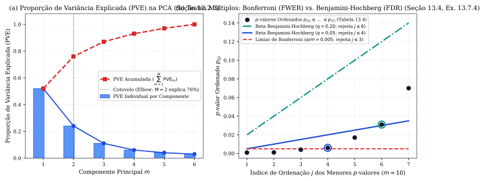
*Figura 12 — (a) Scree plot da Proporção de Variância Explicada (PVE) individual e acumulada na PCA (Seção 12.2.3). (b) Comparação entre o limiar horizontal de Bonferroni ($\alpha/m = 0{,}005$) e as retas crescentes $q \cdot j / m$ de Benjamini-Hochberg ($q = 0{,}05$ e $q = 0{,}20$) para os $p$-valores da Tabela 13.4 (Seção 13.4 e Ex. 13.7.4).*

#### Exercícios de Fixação (Capítulo 13)
1. *(ISLP, Seção 13.7, Ex. 4 — Tabela 13.4)* Considere os $m = 10$ $p$-valores da Tabela 13.4: $H_{01}=0{,}0011,\; H_{02}=0{,}031,\; H_{03}=0{,}017,\; H_{04}=0{,}32,\; H_{05}=0{,}11,\; H_{06}=0{,}90,\; H_{07}=0{,}07,\; H_{08}=0{,}006,\; H_{09}=0{,}004,\; H_{10}=0{,}0009$. Quais hipóteses são rejeitadas controlando: (a) FWER em $\alpha = 0{,}05$ (Bonferroni e Holm); (b) FDR em $q = 0{,}05$; (c) FDR em $q = 0{,}20$? *(Gabarito: Ordenando: $p_{(1)}=0{,}0009\;(H_{10}),\; p_{(2)}=0{,}0011\;(H_{01}),\; p_{(3)}=0{,}004\;(H_{09}),\; p_{(4)}=0{,}006\;(H_{08}),\; p_{(5)}=0{,}017\;(H_{03}),\; p_{(6)}=0{,}031\;(H_{02}),\; p_{(7)}=0{,}07\;(H_{07})$. (a) Bonferroni ($\le 0{,}005$) e Holm ($p_{(4)} = 0{,}006 \le 0{,}05/7 \approx 0{,}00714$, mas $p_{(5)} = 0{,}017 > 0{,}05/6$): Bonferroni rejeita **$H_{10}, H_{01}, H_{09}$** ($3$ hipóteses) e Holm rejeita **$H_{10}, H_{01}, H_{09}, H_{08}$** ($4$ hipóteses); (b) Benjamini-Hochberg ($q=0{,}05$, $p_{(j)} \le 0{,}005 j$): como $p_{(4)} = 0{,}006 \le 0{,}020$, rejeita **$H_{10}, H_{01}, H_{09}, H_{08}$** ($4$ hipóteses); (c) Benjamini-Hochberg ($q=0{,}20$, $p_{(j)} \le 0{,}02 j$): como $p_{(6)} = 0{,}031 \le 0{,}12$, rejeita **$H_{10}, H_{01}, H_{09}, H_{08}, H_{03}, H_{02}$** ($6$ hipóteses, esperando-se cerca de $6 \times 0{,}20 = 1{,}2$ falso positivo)).*

---

## 13. Síntese do Ecossistema Python em Machine Learning (ISLP & Raschka)

A tabela abaixo resume as ferramentas e classes canônicas utilizadas nos laboratórios do **ISLP** e de **Raschka et al.**:

| Tarefa / Modelo | Biblioteca / Classe Python (`ISLP`, `statsmodels`, `scikit-learn`, `PyTorch`) | Detalhes de Implementação Críticos |
| :--- | :--- | :--- |
| **Matrizes de Desenho, Polinômios e Splines** | `ISLP.models`: `ModelSpec`, `poly(col, degree)`, `bs(col, df)`, `ns(col, df)` | `ModelSpec` aplica *one-hot encoding* automático com descarte do 1º nível (*baseline*); `poly` gera polinômios ortogonais por padrão (`raw=False`) |
| **Inferência Linear e GLMs** | `statsmodels.api`: `sm.OLS(y, X)`, `sm.GLM(y, X, family=sm.families.Binomial())` ou `Poisson()`, `anova_lm` | Fornece tabelas de coeficientes, erros padrão $\operatorname{SE}(\hat{\beta}_j)$, estatísticas $t/z$, $p$-valores e intervalos de confiança |
| **Pré-processamento e Validação sem Vazamento** | `sklearn.pipeline.make_pipeline`, `StandardScaler`, `KFold`, `StratifiedKFold`, `GridSearchCV` | Encapsular `StandardScaler()` dentro de `Pipeline` garante que média e variância sejam calculadas apenas nos *folds* de treino |
| **Regularização Ridge, Lasso, PCR e PLS** | `sklearn.linear_model.ElasticNet` / `LassoCV` / `RidgeCV`, `PCA`, `PLSRegression` | Em `ElasticNet`, `l1_ratio=0` equivale a Ridge e `l1_ratio=1` equivale ao Lasso |
| **Árvores, Ensembles e SVM** | `DecisionTreeRegressor(ccp_alpha=...)`, `RandomForestRegressor(max_features=...)`, `GradientBoostingClassifier`, `SVC(kernel='rbf', C=..., gamma=...)` | Em `RandomForest`, `max_features=p` é Bagging; em `SVC`, `C` pequeno = margem larga (inverso da notação do ISLP!) |
| **Análise de Sobrevivência** | `lifelines`: `KaplanMeierFitter()`, `CoxPHFitter()`, `logrank_test` (`ISLP.survival.sim_time`) | Estima $\hat{S}(t)$, intervalos de confiança de Greenwood e verossimilhança parcial de Cox |
| **Deep Learning e Grafos** | `torch.nn.Module`, `nn.Linear`, `nn.Conv2d`, `nn.LSTM`, `nn.MultiheadAttention`, `pytorch_lightning.Trainer` | Fluxo padrão de treino a cada lote: `optimizer.zero_grad()`, `loss.backward()`, `optimizer.step()` |

---

## Referências Bibliográficas
1. **JAMES, Gareth; WITTEN, Daniela; HASTIE, Trevor; TIBSHIRANI, Robert; TAYLOR, Jonathan.** *An Introduction to Statistical Learning — with Applications in Python (ISLP)*. Springer Texts in Statistics. Cham: Springer, 2023. (Referência Principal).
2. **RASCHKA, Sebastian; LIU, Yuxi (Hayden); MIRJALILI, Vahid.** *Machine Learning with PyTorch and Scikit-Learn: Develop machine learning and deep learning models with Python*. Birmingham: Packt Publishing, 2022. (Referência Complementar).
