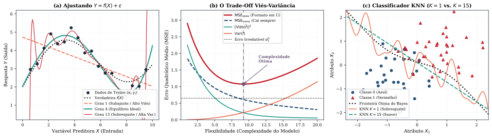
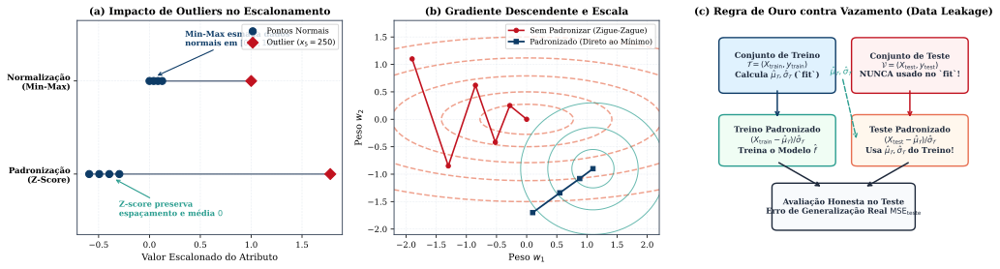
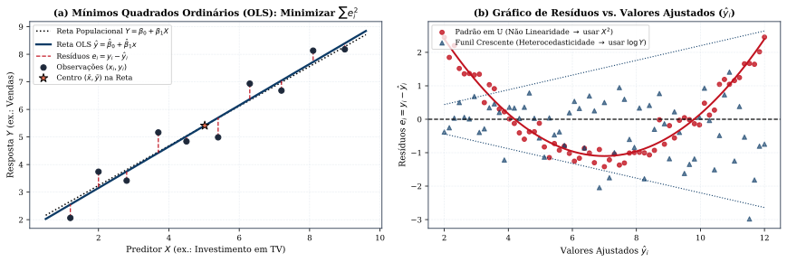
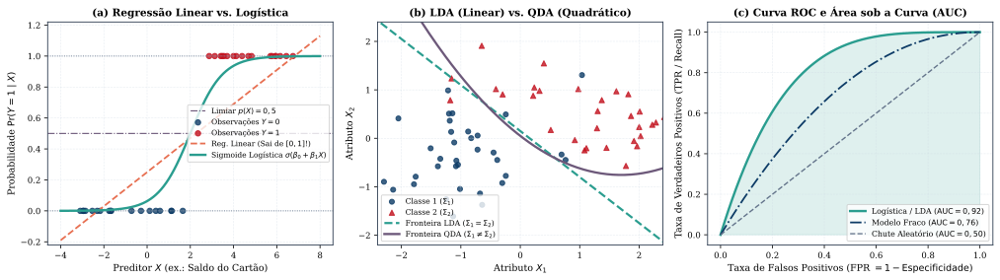
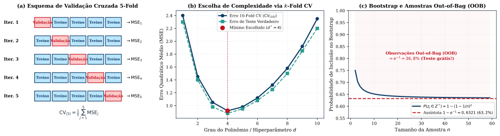
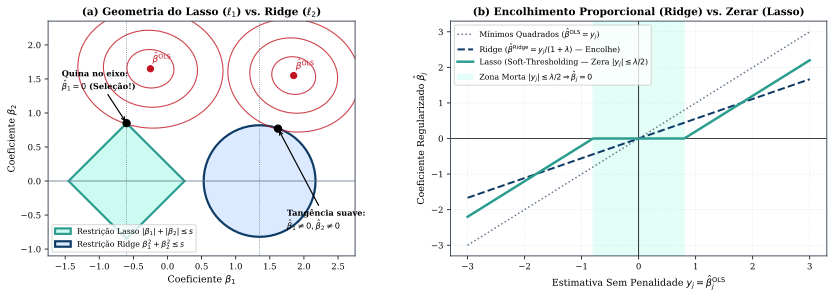
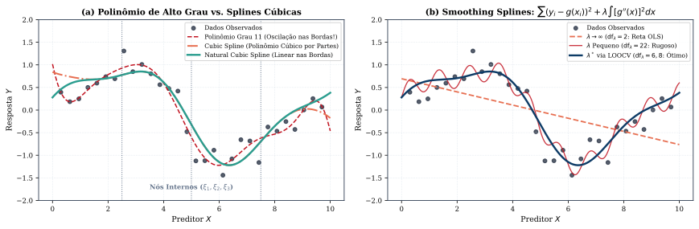
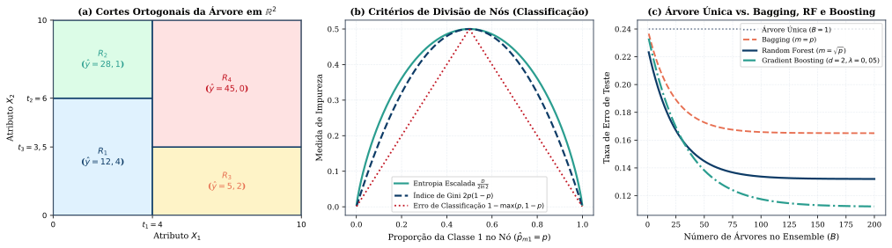
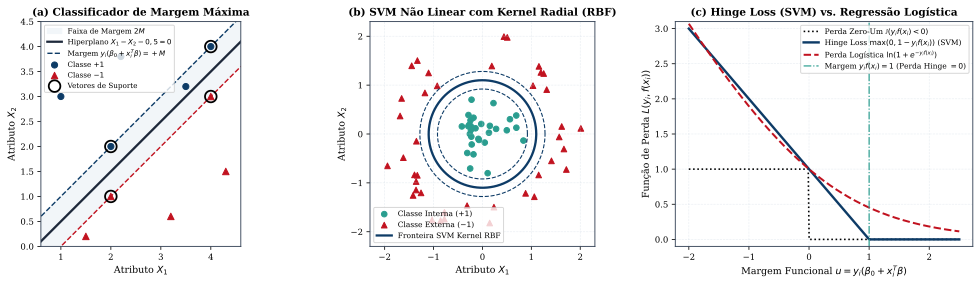
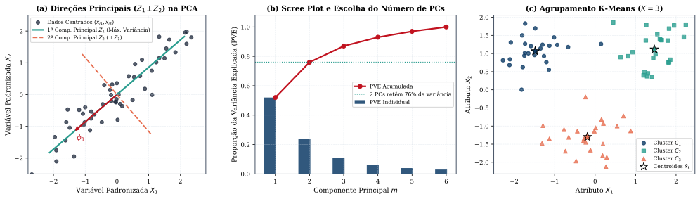

# Machine Learning Clássico: Dos Fundamentos à Prática Algorítmica
## Um Estudo Didático e Rigoroso Baseado em *An Introduction to Statistical Learning — with Applications in Python* (James, Witten, Hastie, Tibshirani & Taylor), com Complementos de *Machine Learning with PyTorch and Scikit-Learn* (Raschka, Liu & Mirjalili, Capítulos 1 a 10)

---

> **Resumo e Como Estudar por Este Material**  
> Este documento foi desenhado para ensinar **Machine Learning Clássico do absoluto zero até o domínio matemático e algorítmico completo**, sem exigir conhecimento prévio da área e sem misturar tópicos de *Deep Learning* (redes neurais profundas/CNNs). A espinha dorsal segue fielmente os **Capítulos 1 a 9 e 12 de *An Introduction to Statistical Learning — with Applications in Python (ISLP, 2023)***, enriquecida com os fundamentos de engenharia de atributos, otimização e algoritmos clássicos dos **Capítulos 1 a 10 de *Machine Learning with PyTorch and Scikit-Learn* (Raschka et al., 2022)** (sempre identificados por **[Complemento — Raschka et al., Cap. X]**).  
> Em cada seção, seguimos sempre a mesma tríade pedagógica: **(1) Intuição do Zero** (qual problema real queremos resolver), **(2) Dicionário de Símbolos e Fórmulas Rigorosas** (o que significa cada letra da equação) e **(3) Exemplo Numérico Feito à Mão** (como a conta funciona na prática com números reais).

---

## Mapa do Curso (10 Capítulos de Machine Learning Clássico)

| Seção | Capítulos de Referência | O que Você Vai Aprender (Do Zero ao Rigor) |
| :--- | :--- | :--- |
| **0. O Que é Machine Learning?** | ISLP Cap. 1 e Cap. 2; Raschka Cap. 1 | A ideia central $Y = f(X) + \varepsilon$, dicionário completo de símbolos ($n, p, X, Y, \hat{Y}$), Regressão vs. Classificação, Não Supervisionado, Subajuste (*Underfitting*) vs. Sobreajuste (*Overfitting*), Decomposição Viés-Variância, Classificador de Bayes e algoritmo **KNN** passo a passo |
| **1. Preparando os Dados** | Raschka Cap. 4 e Cap. 6; ISLP Cap. 2 | Como limpar dados reais: valores faltantes (`NaN`), variáveis categóricas (*One-Hot Encoding*), escalonamento (**Min-Max** vs. **Padronização Z-Score**) e a regra de ouro contra **Vazamento de Dados (*Data Leakage*)** entre treino e teste |
| **2. Regressão Linear** | ISLP Cap. 3 (Seções 3.1–3.6); Raschka Cap. 9 | Como prever números contínuos: reta de **Mínimos Quadrados Ordinários (OLS)** feita à mão, erro-padrão, teste $t$, estatística $F$, métrica $R^2$, variáveis *dummy*, interações (sinergia) e diagnóstico dos 6 problemas clássicos (resíduos, alavancagem $h_i$, VIF e RANSAC) |
| **3. Classificação** | ISLP Cap. 4 (Seções 4.1–4.7); Raschka Cap. 2 e 3 | Como prever categorias: por que a regressão linear falha, **Regressão Logística** (função sigmoide, *odds*, *logit* e máxima verossimilhança), **LDA**, **QDA**, **Naive Bayes**, Matriz de Confusão, Sensibilidade, Especificidade, **Curva ROC / AUC**, Perceptron e Adaline |
| **4. Validação Cruzada e Bootstrap** | ISLP Cap. 5 (Seções 5.1–5.3); Raschka Cap. 6 | Como medir se o modelo realmente aprendeu: divisão Treino/Validação, **LOOCV** (e a fórmula mágica da alavancagem $h_i$), **Validação Cruzada $k$-Fold** ($k=5$ ou $10$) e **Bootstrap** (amostragem com reposição e a origem dos $63{,}2\%$) |
| **5. Seleção de Variáveis e Regularização (Ridge & Lasso)** | ISLP Cap. 6 (Seções 6.1–6.5); Raschka Cap. 4 | Como evitar sobreajuste quando há muitas variáveis: *Best Subset*, *Forward/Backward Stepwise*, critérios $C_p$, AIC, BIC e $R^2_{\text{adj}}$, **Regressão Ridge ($\ell_2$)**, **Lasso ($\ell_1$)** (por que o losango zera coeficientes e faz seleção automática de variáveis), PCR e PLS |
| **6. Modelos Não Lineares, Splines e GAMs** | ISLP Cap. 7 (Seções 7.1–7.8) | Como capturar curvas suaves sem explodir a variância: Regressão Polinomial, Funções Escada, **Splines Cúbicas**, **Splines Naturais**, **Smoothing Splines**, Regressão Local (**LOESS**) e **Modelos Aditivos Generalizados (GAMs)** |
| **7. Árvores de Decisão, Random Forest e Boosting** | ISLP Cap. 8 (Seções 8.1–8.3); Raschka Cap. 7 | Modelos baseados em regras de decisão: **Árvores de Regressão e Classificação (CART)**, poda por custo-complexidade, Índice de **Gini** e **Entropia**, **Bagging** (erro *Out-of-Bag*), **Random Forests** ($m \approx \sqrt{p}$), **Gradient Boosting**, **AdaBoost** e **XGBoost** |
| **8. Máquinas de Vetores de Suporte (SVM)** | ISLP Cap. 9 (Seções 9.1–9.6); Raschka Cap. 3 | Separando classes com a maior margem de segurança possível: **Hiperplano de Margem Máxima**, Vetores de Suporte, Margem Suave (folgas $\epsilon_i$ e parâmetro $C$), o **Truque do Kernel (*Kernel Trick*)** Polinomial e Radial (RBF) e a perda **Hinge Loss** |
| **9. Aprendizado Não Supervisionado (PCA e Clustering)** | ISLP Cap. 12 (Seções 12.1–12.5); Raschka Cap. 5 e 10 | Aprendendo padrões sem rótulos $Y$: **Análise de Componentes Principais (PCA)** (cargas, escores e proporção de variância explicada PVE), **Agrupamento *K-Means*** ($K$-Means++ e silhueta), **Agrupamento Hierárquico** (dendrogramas) e **DBSCAN** |

---

## 0. O Que é Machine Learning? Fundamentos, Notação, Viés-Variância e KNN (ISLP Cap. 1 e 2; Raschka Cap. 1)

### 0.1 A Intuição Fundamental e o Dicionário de Símbolos (Seções 1.1 e 2.1)

Imagine que você trabalha em uma imobiliária e quer estimar o **preço de venda de um apartamento** a partir da sua **área em $\text{m}^2$**, do **número de quartos** e da **distância até o metrô**; ou imagine um médico que deseja prever se um paciente **tem ou não diabetes** a partir da **glicemia**, do **IMC** e da **idade**.

Em **Machine Learning (Aprendizado de Máquina)** ou **Aprendizado Estatístico (*Statistical Learning*)**, nós não programamos regras fixas manualmente (como `se área > 100 então preço = 500 mil`). Em vez disso, fornecemos ao computador uma tabela com **exemplos históricos reais** (os **dados de treinamento**) para que um algoritmo descubra automaticamente a relação matemática entre as características de entrada e o resultado de saída.

Para ler qualquer livro ou artigo de Machine Learning sem nunca travar na notação, guarde este **Dicionário Fundamental de Símbolos** (usado em todo o ISLP):

1. **$n$ (número de observações / exemplos / linhas da tabela):** É a quantidade total de exemplos que temos no nosso banco de dados. Por exemplo, se coletamos dados de $200$ imóveis, então $n = 200$. Usamos o índice $i$ ($i = 1, 2, \dots, n$) para nos referirmos ao $i$-ésimo exemplo (a $i$-ésima linha da tabela).
2. **$p$ (número de variáveis preditoras / atributos / *features* / colunas de entrada):** É a quantidade de características que medimos em cada exemplo para fazer a previsão. Se medimos *Área* ($X_1$), *Quartos* ($X_2$) e *Distância ao metrô* ($X_3$), então temos $p = 3$ preditores. Usamos o índice $j$ ($j = 1, 2, \dots, p$) para indicar a $j$-ésima variável.
3. **$x_{ij}$ (um valor específico na tabela de entrada):** Representa o valor da **$j$-ésima variável** medido na **$i$-ésima observação** (linha $i$, coluna $j$).
4. **$x_i$ (o vetor de características da $i$-ésima observação):** É a lista com todas as $p$ medidas do indivíduo $i$:
   $$x_i = \begin{pmatrix} x_{i1} \\ x_{i2} \\ \vdots \\ x_{ip} \end{pmatrix} \in \mathbb{R}^p$$
5. **$X$ (a matriz de dados / matriz de desenho $n \times p$):** É a tabela inteira de entradas com $n$ linhas (exemplos) e $p$ colunas (atributos):
   $$X = \begin{pmatrix} x_{11} & x_{12} & \dots & x_{1p} \\ x_{21} & x_{22} & \dots & x_{2p} \\ \vdots & \vdots & \ddots & \vdots \\ x_{n1} & x_{n2} & \dots & x_{np} \end{pmatrix}$$
6. **$Y$ ou $y_i$ (a variável resposta / alvo / *target* / *label*):** É o resultado que queremos prever para a observação $i$.
7. **O chapéu $\;\hat{}\;$ (*hat*), como em $\hat{f}$ e $\hat{Y}$:** Na Estatística e no Machine Learning, **toda letra com um chapéu ($\hat{f}, \hat{y}_i, \hat{\beta}$) significa uma estimativa ou predição calculada pelo nosso modelo** a partir dos dados! Assim:
   - $y_i$ é o valor **real** observado na realidade;
   - $\hat{y}_i = \hat{f}(x_i)$ é o valor **previsto** pelo computador;
   - $e_i = y_i - \hat{y}_i$ é o **erro (ou resíduo)** que o modelo cometeu no exemplo $i$.

---

### 0.2 Os Três Tipos de Problemas em Machine Learning

Antes de escolher um algoritmo, a primeira pergunta é sempre: **qual é a natureza da resposta $Y$?**

1. **Aprendizado Supervisionado — Regressão ($Y$ é um número contínuo/quantitativo):**  
   Temos entradas $X$ e respostas $Y$ numéricas (ex.: preço de uma casa em reais, temperatura amanhã em °C, vendas em milhares de unidades). O objetivo é ajustar uma curva ou superfície $\hat{f}(X)$ que produza números próximos de $Y$.
2. **Aprendizado Supervisionado — Classificação ($Y$ é uma categoria/rótulo qualitativo):**  
   Temos entradas $X$ e respostas $Y$ pertencentes a um conjunto finito de classes $\mathcal{C} = \{1, 2, \dots, K\}$ (ex.: e-mail é *Spam* ou *Não-Spam*; tumor é *Benigno* ou *Maligno*; dígito escrito à mão é $\{0, 1, \dots, 9\}$).
3. **Aprendizado Não Supervisionado (Não existe coluna resposta $Y$, apenas $X$):**  
   Recebemos apenas as medidas $X = \{x_1, x_2, \dots, x_n\}$ sem nenhum rótulo prévio. O objetivo é descobrir estrutura oculta nos dados: agrupar clientes com hábitos de compra parecidos (**Clustering / Agrupamento**, como o *K-Means*) ou resumir dezenas de variáveis correlacionadas em 2 ou 3 eixos principais para visualização (**Redução de Dimensionalidade**, como a **PCA**).

---

### 0.3 O Modelo Matemático Central: $Y = f(X) + \varepsilon$, Erro Redutível e Erro Irredutível (Seção 2.1.1)

Na Seção 2.1 do ISLP, quando $Y$ é quantitativa, postulamos que a natureza gera os dados segundo a equação mestra:
$$Y = f(X) + \varepsilon$$
Vamos entender o que cada peça significa:
- **$f(X)$ é a função verdadeira (desconhecida):** Representa a parte **sistemática e previsível** que as variáveis $X = (X_1, \dots, X_p)$ fornecem sobre $Y$.
- **$\varepsilon$ (épsilon) é o termo de erro aleatório (ruído):** Representa tudo aquilo que afeta $Y$ mas **não está medido em $X$** (por exemplo, o humor do comprador do imóvel no dia da visita, variações de medição ou sorte pura). Assumimos que $\varepsilon$ tem **média zero** ($\mathbb{E}[\varepsilon] = 0$, ou seja, ora joga para cima, ora para baixo sem vício sistemático) e **variância $\operatorname{Var}(\varepsilon) = \sigma_\varepsilon^2$**, sendo independente de $X$.

Quando treinamos um algoritmo de Machine Learning nos dados, obtemos uma função estimada $\hat{f}(X)$ e fazemos predições $\hat{Y} = \hat{f}(X)$. Por que nossas previsões $\hat{Y}$ nunca acertam $100\%$ de $Y$? A álgebra responde com uma das identidades mais bonitas da área:

> **Teorema 0.1 (Decomposição em Erro Redutível e Erro Irredutível — ISLP, Seção 2.1.1):**  
> *Para um preditor $X$ fixado e uma função estimada $\hat{f}$, a média do quadrado do erro de predição $\mathbb{E}\big[(Y - \hat{Y})^2\big]$ separa-se exatamente em duas partes:*
> $$\mathbb{E}\!\left[(Y - \hat{Y})^2\right] = \underbrace{\big[f(X) - \hat{f}(X)\big]^2}_{\text{Erro Redutível}} + \underbrace{\operatorname{Var}(\varepsilon)}_{\text{Erro Irredutível } (\sigma_\varepsilon^2)}$$

- **Por que essa fórmula vale?** Basta substituir $Y = f(X) + \varepsilon$ e $\hat{Y} = \hat{f}(X)$:
  $$\mathbb{E}\!\left[(f(X) + \varepsilon - \hat{f}(X))^2\right] = \mathbb{E}\!\left[\big((f(X) - \hat{f}(X)) + \varepsilon\big)^2\right] = \big[f(X) - \hat{f}(X)\big]^2 + 2\big(f(X) - \hat{f}(X)\big)\underbrace{\mathbb{E}[\varepsilon]}_{=0} + \underbrace{\mathbb{E}[\varepsilon^2]}_{=\operatorname{Var}(\varepsilon)}.$$
- **O que isso ensina na prática?**
  1. O **Erro Redutível** $[f(X) - \hat{f}(X)]^2$ depende da qualidade do nosso modelo: quanto mais próximo $\hat{f}(X)$ estiver da verdadeira $f(X)$, menor ele será.
  2. O **Erro Irredutível** $\operatorname{Var}(\varepsilon) = \sigma_\varepsilon^2$ é uma **barreira física intransponível**: mesmo que você descobrisse a função perfeita $\hat{f}(X) = f(X)$, suas previsões ainda errariam em média $\sigma_\varepsilon^2$ por causa do ruído $\varepsilon$!

#### Predição versus Inferência e Métodos Paramétricos versus Não Paramétricos (Seções 2.1.1–2.1.3)
- **Predição (*Prediction*):** Nosso foco principal é acertar o valor futuro $\hat{Y}$ com o menor erro possível (ex.: prever se uma transação de cartão é fraude em milissegundos), mesmo que $\hat{f}$ seja uma "caixa-preta" complexa.
- **Inferência (*Inference*):** Nosso foco é **entender o fenômeno** e responder perguntas como: *"Quais variáveis $X_j$ realmente causam impacto em $Y$? Qual é o tamanho exato do aumento nas vendas para cada R\$ 1.000 investidos em anúncios de TV?"* Modelos lineares simples são excelentes para inferência, pois cada variável tem um peso direto e interpretável.
- **Métodos Paramétricos (ex.: Regressão Linear, Logística):** Fazemos uma suposição prévia sobre o formato de $f$ (por exemplo, assumimos que $f(X) = \beta_0 + \beta_1 X_1 + \dots + \beta_p X_p$ é uma reta/plano). O problema infinito de achar uma função qualquer reduz-se a calcular apenas $p + 1$ números ($\beta_0, \beta_1, \dots, \beta_p$). **Vantagem:** rápido, fácil de interpretar e exige poucos dados. **Risco:** se a relação verdadeira for muito curva, o modelo linear nunca conseguirá acompanhá-la (**alto viés / subajuste**).
- **Métodos Não Paramétricos (ex.: KNN, Splines, Árvores de Decisão):** Não impõem uma fórmula fixa prévia; a forma de $\hat{f}$ se molda livremente aos dados. **Vantagem:** captura formatos complexos. **Risco:** exige muitos dados e, se deixado solto demais, decora até o ruído aleatório (**alta variância / sobreajuste**).

---

### 0.4 Avaliação de Modelos: Erro de Treino vs. Erro de Teste e o Trade-Off Viés-Variância (Seção 2.2)

Em problemas de **Regressão**, medimos a qualidade de um modelo pelo **Erro Quadrático Médio (*Mean Squared Error* — MSE)**, que é a média dos quadrados das diferenças entre o valor real $y_i$ e o valor previsto $\hat{f}(x_i)$:
$$\operatorname{MSE}_{\text{treino}} = \frac{1}{n}\sum_{i=1}^{n} \big(y_i - \hat{f}(x_i)\big)^2$$
- **Por que elevamos ao quadrado?** Porque erros para mais ($+3$) e para menos ($-3$) não podem se cancelar na soma, e porque erros grandes (como errar por $10$, que vira $100$) são fortemente penalizados.

> **A Armadilha Fundamental do Machine Learning:**  
> **Nunca julgue um modelo pelo seu erro de treinamento ($\operatorname{MSE}_{\text{treino}}$)!**  
> Um aluno que decora as respostas da lista de exercícios tira $10$ na lista de casa (treino), mas pode tirar $2$ na prova com questões inéditas (teste). Da mesma forma, se usarmos uma curva extremamente flexível (como um polinômio de grau $13$ passando por todos os pontos na Figura 1a), o $\operatorname{MSE}_{\text{treino}}$ cai para **zero**, mas nas regiões entre os pontos a curva oscila violentamente para perseguir o ruído $\varepsilon_i$. Esse fenômeno chama-se **Sobreajuste (*Overfitting*)**.

O que realmente importa é o **MSE de Teste** em novas observações $(x_0, y_0)$ que **não foram usadas para treinar o modelo**:
$$\operatorname{MSE}_{\text{teste}} = \operatorname{Média}\!\left[\big(y_0 - \hat{f}(x_0)\big)^2\right]$$

> **Teorema 0.2 (A Decomposição Viés-Variância do Erro de Teste — Equação 2.7 do ISLP):**  
> *Para qualquer ponto de teste $x_0$, o MSE de teste esperado (caso pudéssemos repetir o treinamento em diversos bancos de dados sorteados da mesma população) é sempre a soma de três quantidades positivas:*
> $$\mathbb{E}\!\left[\big(y_0 - \hat{f}(x_0)\big)^2\right] = \underbrace{\operatorname{Var}\!\big(\hat{f}(x_0)\big)}_{\text{Variância}} + \underbrace{\left[\operatorname{Viés}\!\big(\hat{f}(x_0)\big)\right]^2}_{\text{Viés ao Quadrado}} + \underbrace{\operatorname{Var}(\varepsilon)}_{\text{Erro Irredutível}}$$
> *onde:*
> - **Viés ($\operatorname{Viés}(\hat{f}(x_0)) = \mathbb{E}[\hat{f}(x_0)] - f(x_0)$):** *É o erro de aproximação causado por usar um modelo simples demais para um problema complexo (ex.: ajustar uma reta a uma curva senoidal). **Alto viés = Subajuste (Underfitting)**.*
> - **Variância ($\operatorname{Var}(\hat{f}(x_0)) = \mathbb{E}\big[(\hat{f}(x_0) - \mathbb{E}[\hat{f}(x_0)])^2\big]$):** *Mede o quanto a curva $\hat{f}$ muda drasticamente se trocarmos alguns pontos da amostra de treino. Modelos excessivamente flexíveis mudam totalmente de formato a cada nova amostra. **Alta variância = Sobreajuste (Overfitting)**.*

Como mostra a **Figura 1b**, quando aumentamos a flexibilidade do modelo, o **Viés$^2$ cai** e a **Variância sobe**. O ponto ótimo de Machine Learning está sempre no fundo do **"U"** da curva de MSE de teste, onde Viés e Variância se equilibram!

---

### 0.5 Classificação: O Classificador Ideal de Bayes e o Algoritmo KNN Passo a Passo (Seção 2.2.3)

Quando a resposta $y_i$ é uma **categoria** (ex.: $Y \in \{\text{Azul}, \text{Vermelho}\}$), não faz sentido subtrair $y_i - \hat{y}_i$. Em vez disso, medimos a **Taxa de Erro (*Error Rate*)**, que é simplesmente a fração (porcentagem) de exemplos em que o modelo previu a classe errada:
$$\text{Taxa de Erro}_{\text{treino}} = \frac{1}{n}\sum_{i=1}^{n} \mathbb{I}(y_i \neq \hat{y}_i), \qquad \text{onde } \mathbb{I}(y_i \neq \hat{y}_i) = \begin{cases} 1, & \text{se } y_i \neq \hat{y}_i \text{ (errou)} \\ 0, & \text{se } y_i = \hat{y}_i \text{ (acertou)} \end{cases}$$
O símbolo $\mathbb{I}(\text{condição})$ chama-se **função indicadora**: vale $1$ quando a condição dentro dos parênteses é verdadeira e $0$ quando é falsa.

#### 1. O Classificador de Bayes (O Padrão-Ouro Teórico)
Qual seria o melhor classificador possível se conhecêssemos exatamente as probabilidades da natureza? Seria o **Classificador de Bayes** (Equação 2.10 do ISLP): dado um novo ponto $x_0$, ele calcula a probabilidade condicional de cada classe $j \in \{1, \dots, K\}$ dado $X = x_0$, denotada por $\Pr(Y = j \mid X = x_0)$, e escolhe a classe mais provável:
$$\hat{y}_0 = \arg\max_{j \in \{1, \dots, K\}} \Pr(Y = j \mid X = x_0)$$
*(Nota: o símbolo $\arg\max_j$ significa "o valor do índice $j$ que torna a expressão máxima").* No caso de $2$ classes ($0$ e $1$), basta prever a classe $1$ se $\Pr(Y = 1 \mid X = x_0) > 0{,}50$ ($50\%$), e a linha onde $\Pr(Y = 1 \mid X = x_0) = 0{,}50$ é a **Fronteira de Decisão de Bayes** (linha pontilhada preta na Figura 1c). A menor taxa de erro possível na natureza é a **Taxa de Erro de Bayes**: $1 - \mathbb{E}\!\left[\max_j \Pr(Y = j \mid X)\right]$.

#### 2. O Algoritmo KNN (*K-Nearest Neighbors* / $K$-Vizinhos Mais Próximos)
Na vida real, nós não sabemos a fórmula verdadeira de $\Pr(Y = j \mid X = x_0)$. Como estimá-la do jeito mais intuitivo possível? Olhando para os **$K$ exemplos de treinamento mais parecidos (mais próximos)** com o novo ponto $x_0$!

Dado um número inteiro $K \ge 1$ escolhido por você e um novo ponto $x_0 = (x_{01}, \dots, x_{0p})^T$:
1. **Passo 1 (Calcular Distâncias):** Calcule a distância euclidiana (Teorema de Pitágoras em $p$ dimensões) de $x_0$ até cada ponto $x_i$ do banco de treinamento:
   $$d(x_i, x_0) = \|x_i - x_0\|_2 = \sqrt{(x_{i1} - x_{01})^2 + (x_{i2} - x_{02})^2 + \dots + (x_{ip} - x_{0p})^2}$$
2. **Passo 2 (Identificar os $K$ Vizinhos):** Ordene as distâncias da menor para a maior e selecione o conjunto $\mathcal{N}_0$ formado pelos **$K$ pontos de treino com as menores distâncias** até $x_0$.
3. **Passo 3 (Votação / Média):**
   - **Se for Classificação:** Estime a probabilidade da classe $j$ pela fração dos $K$ vizinhos que pertencem à classe $j$:
     $$\widehat{\Pr}(Y = j \mid X = x_0) = \frac{1}{K}\sum_{i \in \mathcal{N}_0} \mathbb{I}(y_i = j)$$
     e classifique $x_0$ na classe majoritária entre os $K$ vizinhos!
   - **Se for Regressão (Seção 3.5 do ISLP):** Preveja a média aritmética dos valores $y_i$ dos $K$ vizinhos: $\hat{f}(x_0) = \frac{1}{K}\sum_{i \in \mathcal{N}_0} y_i$.

> **Como escolher $K$ no KNN? (O Papel de $1/K$ na Flexibilidade):**  
> - **$K = 1$ (Máxima Flexibilidade $\implies$ Baixo Viés, Altíssima Variância):** O algoritmo olha apenas para o único vizinho mais próximo. No treino, a taxa de erro é sempre $0\%$ (pois o vizinho mais próximo de cada ponto de treino é ele mesmo!), mas a fronteira de decisão fica cheia de "ilhas" recortadas ao redor de ruídos (curva laranja na Figura 1c — *overfitting*).  
> - **$K$ Grande, ex.: $K = 15$ ou $50$ (Baixa Flexibilidade $\implies$ Baixa Variância, Alto Viés):** Fazemos a média sobre muitos pontos, alisando a fronteira de decisão (curva verde tracejada na Figura 1c). Se $K$ for exageradamente grande, a fronteira fica rígida demais (*underfitting*).

---

### 0.6 Exemplo Numérico Resolvido Passo a Passo (KNN Feito à Mão)

Vamos resolver juntos um exemplo concreto (baseado no Exercício 2.4.7 do ISLP): temos uma tabela de treino com $n = 4$ pacientes, $p = 2$ exames ($X_1$ e $X_2$) e o diagnóstico $Y \in \{\text{Saudável}, \text{Doente}\}$:
- Paciente 1: $x_1 = (1, 2)$, $y_1 = \text{Saudável}$
- Paciente 2: $x_2 = (2, 1)$, $y_2 = \text{Saudável}$
- Paciente 3: $x_3 = (0, 1)$, $y_3 = \text{Doente}$
- Paciente 4: $x_4 = (-1, 0)$, $y_4 = \text{Doente}$

Chega um **novo paciente $x_0 = (0, 0)$**. Qual é o diagnóstico previsto pelo KNN com **$K = 1$** e com **$K = 3$**?
1. **Calculamos a distância euclidiana de cada paciente até $x_0 = (0, 0)$:**
   - $d(x_1, x_0) = \sqrt{(1 - 0)^2 + (2 - 0)^2} = \sqrt{1 + 4} = \sqrt{5} \approx \mathbf{2{,}24}$ (Saudável)
   - $d(x_2, x_0) = \sqrt{(2 - 0)^2 + (1 - 0)^2} = \sqrt{4 + 1} = \sqrt{5} \approx \mathbf{2{,}24}$ (Saudável)
   - $d(x_3, x_0) = \sqrt{(0 - 0)^2 + (1 - 0)^2} = \sqrt{0 + 1} = \mathbf{1{,}00}$ (Doente)
   - $d(x_4, x_0) = \sqrt{(-1 - 0)^2 + (0 - 0)^2} = \sqrt{1 + 0} = \mathbf{1{,}00}$ (Doente — empate na menor distância)
   *(Se o Paciente 4 estivesse em $(-1, 1)$, sua distância seria $\sqrt{2} \approx 1{,}41$).* Vamos considerar $x_4 = (-1, 1)$ para distâncias distintas: $d_3 = 1{,}00$, $d_4 = 1{,}41$, $d_1 = 2{,}24$, $d_2 = 2{,}24$.
2. **Para $K = 1$:** O único vizinho mais próximo é o Paciente 3 ($d_3 = 1{,}00$, Doente). Logo, $\hat{Y} = \mathbf{\text{Doente}}$ (probabilidade estimada $1/1 = 100\%$).
3. **Para $K = 3$:** Os 3 vizinhos mais próximos são os Pacientes $\{3, 4, 1\}$, cujas classes são $\{\text{Doente}, \text{Doente}, \text{Saudável}\}$. Logo, $\widehat{\Pr}(\text{Doente} \mid x_0) = \frac{2}{3} \approx 66{,}7\%$ e $\widehat{\Pr}(\text{Saudável} \mid x_0) = \frac{1}{3} \approx 33{,}3\% \implies \hat{Y} = \mathbf{\text{Doente}}$.

*Figura 1 — (a) Ajuste polinomial de graus 1 (subajuste/alto viés), 4 (equilíbrio ideal) e 13 (sobreajuste/alta variância) sobre dados gerados por $Y = f(X) + \varepsilon$. (b) Decomposição do MSE de teste em $\text{Viés}^2$, Variância e Erro Irredutível $\sigma_\varepsilon^2$ (Equação 2.7 do ISLP). (c) Classificador KNN com $K=1$ versus $K=15$ comparado à Fronteira de Bayes (Seção 2.2.3 do ISLP).*

#### Exercícios de Fixação (Seção 0)
1. *(ISLP, Seção 2.4, Ex. 1)* Um modelo altamente flexível será melhor ou pior que um modelo inflexível quando: (a) a amostra $n$ é enorme e $p$ é pequeno? (b) $p$ é enorme e $n$ é pequeno? (c) a variância do ruído $\sigma_\varepsilon^2$ é muito alta? *(Gabarito: (a) Melhor, pois o grande $n$ controla a variância e aproveita o baixo viés; (b) Pior, pois com poucos dados e muitas variáveis o modelo flexível decora o ruído; (c) Pior, pois perseguirá o ruído intenso).*
2. *(ISLP, Seção 2.4, Ex. 2)* Classifique cada problema como **Regressão ou Classificação** e como **Inferência ou Predição**: (a) Relacionar o salário de 500 CEOs com lucro da empresa, número de funcionários e setor para entender quais fatores mais afetam a remuneração; (b) Lançar um novo produto e prever se ele será um *Sucesso* ou *Fracasso* com base em 20 produtos similares. *(Gabarito: (a) Regressão e Inferência; (b) Classificação e Predição).*

---

## 1. Preparando os Dados para Machine Learning (Raschka Cap. 4 e Cap. 6)

> **[Complemento — Raschka et al., *ML with PyTorch and Scikit-Learn*, Cap. 4, Seções 4.1–4.4 e Cap. 6]:**  
> Antes de aplicar KNN, Regressão Linear, Regressão Logística, SVM ou PCA em problemas reais, os dados brutos quase sempre precisam passar por **três etapas obrigatórias de pré-processamento**: tratamento de dados ausentes, codificação de textos/categorias em números e escalonamento de variáveis.

### 1.1 Tratamento de Dados Faltantes (`NaN`) e Variáveis Categóricas (Seções 4.1 e 4.2 de Raschka)

1. **Dados Faltantes (*Missing Values*):** Em planilhas reais, é comum que algumas células estejam em branco (`NaN` ou `NULL`). Se simplesmente apagarmos todas as linhas com algum dado faltante, podemos perder grande parte da amostra; se apagarmos colunas inteiras, podemos perder variáveis importantes. A solução padrão é a **Imputação (*Imputation*)**: substituir o valor ausente na coluna $j$ pela **média** (ou pela **mediana**, se houver valores extremos) dos valores observados naquela coluna (no conjunto de treinamento!), ou pela **moda** (valor mais frequente) se a coluna for categórica.
2. **Variáveis Categóricas Ordinais vs. Nominais e o *One-Hot Encoding*:**  
   Algoritmos matemáticos operam sobre números, não sobre palavras como `"P"`, `"M"`, `"G"` ou `"Azul"`, `"Verde"`, `"Vermelho"`.
   - **Variáveis Ordinais (têm ordem natural):** Como tamanho de camiseta $P < M < G$, convertemos mantendo a ordem: $P = 1, M = 2, G = 3$.
   - **Variáveis Nominais (NÃO têm ordem natural):** Como `Cor` $\in \{\text{Azul}, \text{Verde}, \text{Vermelho}\}$. Se codificássemos $\text{Azul}=1, \text{Verde}=2, \text{Vermelho}=3$, o algoritmo acharia erroneamente que `"Vermelho"` é maior que `"Verde"` e que a média entre Azul e Vermelho é Verde!  
     A solução correta é criar **Variáveis Indicadoras (*Dummy Variables* / *One-Hot Encoding*, ISLP Seção 3.3.1)**: criamos colunas binárias $\{0, 1\}$. Para uma variável com $L$ categorias, usamos **$L - 1$ colunas binárias** (descartando $1$ categoria como referência/*baseline* para evitar redundância matemática perfeita com o intercepto $\beta_0$, pois se não é Azul nem Verde, obrigatoriamente é Vermelho):
     $$\text{Azul} \mapsto (1, 0), \qquad \text{Verde} \mapsto (0, 1), \qquad \text{Vermelho (referência)} \mapsto (0, 0).$$

---

### 1.2 Escalonamento de Atributos (*Feature Scaling*): Normalização Min-Max vs. Padronização Z-Score (Seção 4.3 de Raschka)

Por que precisamos colocar todas as variáveis na mesma escala?  
Pense no algoritmo **KNN** tentando prever se uma pessoa vai comprar um carro usando duas variáveis: $X_1 = \text{Idade (em anos, de } 20 \text{ a } 70)$ e $X_2 = \text{Salário Anual (em reais, de } 30.000 \text{ a } 200.000)$. Quando calculamos a distância euclidiana:
$$d^2 = (\Delta \text{Idade})^2 + (\Delta \text{Salário})^2 = (50 - 30)^2 + (80.000 - 50.000)^2 = 400 + 900.000.000,$$
a diferença de salário ($900$ milhões!) **engole completamente** a diferença de idade ($400$). O KNN vai ignorar a idade apenas porque o salário foi medido em reais e não em centenas de milhares de reais! O mesmo problema afeta o **Gradiente Descendente**, a **Regressão Ridge/Lasso**, as **SVMs** e a **PCA**.

Existem duas técnicas clássicas para colocar todas as colunas $j = 1, \dots, p$ em escalas comparáveis:

1. **Normalização Min-Max (reescala os dados para o intervalo fechado $[0, 1]$):**
   $$x_{ij}^{\text{norm}} = \frac{x_{ij} - x_{\min, j}}{x_{\max, j} - x_{\min, j}}$$
   - O menor valor da coluna vira $0$ e o maior vira $1$.
   - **Ponto fraco grave:** Se houver um único valor discrepante (*outlier*) muito alto (como um milionário na amostra), $x_{\max, j}$ fica gigante e **esmaga todas as pessoas normais num cantinho minúsculo perto de $0$** (Figura 2a)!
2. **Padronização (*Standardization* / *Z-Score* — o método padrão em Machine Learning):**  
   Subtraímos a média amostral $\bar{x}_j = \frac{1}{n}\sum_{i=1}^n x_{ij}$ da coluna e dividimos pelo seu desvio-padrão $s_j = \sqrt{\frac{1}{n-1}\sum_{i=1}^n (x_{ij} - \bar{x}_j)^2}$:
   $$x_{ij}^{\text{std}} = \frac{x_{ij} - \bar{x}_j}{s_j}$$
   - **O que significa $x_{ij}^{\text{std}}$?** Indica **quantos desvios-padrão** a observação $i$ está acima ($+$) ou abaixo ($-$) da média da coluna $j$.
   - A nova coluna padronizada passa a ter **média exatamente igual a $0$** e **desvio-padrão exatamente igual a $1$**. Além de não esmagar os dados normais na presença de *outliers*, centrar os dados em zero faz com que algoritmos de otimização (como Gradiente Descendente) caminhem em linha reta para o mínimo, sem zigue-zaguear (Figura 2b).

---

### 1.3 A Regra de Ouro contra Vazamento de Dados (*Data Leakage*) e Exemplo Numérico

> **Regra de Ouro (Raschka Cap. 4 e Cap. 6):**  
> Ao dividir seus dados em **Conjunto de Treino ($\mathcal{T}$)** e **Conjunto de Teste ($\mathcal{V}$)**, a média $\bar{x}_{\mathcal{T}}$ e o desvio-padrão $s_{\mathcal{T}}$ (assim como qualquer imputação de dados faltantes ou seleção de variáveis) devem ser calculados **EXCLUSIVAMENTE usando os dados de treino $\mathcal{T}$**!  
> Quando for avaliar o modelo nos dados de teste $\mathcal{V}$, você deve padronizar o teste usando **a média e o desvio-padrão que vieram do treino**:
> $$x_{\text{treino}}^{\text{std}} = \frac{x_{\text{treino}} - \bar{x}_{\mathcal{T}}}{s_{\mathcal{T}}}, \qquad x_{\text{teste}}^{\text{std}} = \frac{x_{\text{teste}} - \bar{x}_{\mathcal{T}}}{s_{\mathcal{T}}}$$
> Usar dados do teste para calcular $\bar{x}$ ou $s$ antes de separar os conjuntos chama-se **Vazamento de Dados (*Data Leakage*)**, pois faz informações do futuro "vazarem" para o treinamento e invalida a avaliação.

#### Exemplo Numérico Feito à Mão
Suponha que no conjunto de **treino** temos $n = 3$ salários (em mil R\$): $x_{\text{treino}} = \{10, 20, 30\}$, e no conjunto de **teste** chega um novo cliente com salário $x_{\text{teste}} = 40$. Como padronizar ambos?
1. Calculamos a média e o desvio-padrão **apenas no treino**:
   $$\bar{x}_{\mathcal{T}} = \frac{10 + 20 + 30}{3} = 20, \qquad s_{\mathcal{T}} = \sqrt{\frac{(10-20)^2 + (20-20)^2 + (30-20)^2}{3 - 1}} = \sqrt{\frac{100 + 0 + 100}{2}} = \sqrt{100} = 10.$$
2. Padronizamos o **treino**:
   $$x_{\text{treino}}^{\text{std}} = \left\{\frac{10 - 20}{10},\; \frac{20 - 20}{10},\; \frac{30 - 20}{10}\right\} = \mathbf{\{-1{,}0;\; 0{,}0;\; +1{,}0\}}.$$
3. Padronizamos o novo ponto de **teste** $x_{\text{teste}} = 40$ usando $\bar{x}_{\mathcal{T}} = 20$ e $s_{\mathcal{T}} = 10$:
   $$x_{\text{teste}}^{\text{std}} = \frac{40 - 20}{10} = \mathbf{+2{,}0} \quad (\text{isto é, } 2 \text{ desvios-padrão acima da média do treino}).$$

*Figura 2 — (a) Comparação entre Normalização Min-Max e Padronização Z-Score na presença de um outlier ($x_5 = 250$). (b) Trajetória do Gradiente Descendente sem padronização (elipses alongadas e zigue-zague) versus com padronização (círculos concêntricos e convergência direta). (c) Fluxo correto de pré-processamento sem Data Leakage (Raschka Cap. 4 e Cap. 6).*

#### Exercícios de Fixação (Seção 1)
1. *(Raschka, Cap. 4)* Quais algoritmos abaixo são **insensíveis** à escala das variáveis (isto é, funcionam igual com metros ou milímetros sem precisar padronizar): KNN, Árvores de Decisão, Regressão Ridge ou PCA? *(Gabarito: **Árvores de Decisão** e ensembles de árvores como Random Forest, pois um corte do tipo $X_1 < 5\text{ m}$ é idêntico a $X_1 < 5000\text{ mm}$; já KNN, Ridge, Lasso, SVM e PCA dependem crucialmente da padronização).*

---

## 2. Regressão Linear Simples e Múltipla (ISLP Cap. 3; Raschka Cap. 9)

### 2.1 Regressão Linear Simples: A Reta de Mínimos Quadrados Passo a Passo (Seção 3.1)

Comecemos pelo modelo supervisionado mais fundamental da história da ciência: prever uma resposta numérica $Y$ (ex.: `Vendas` de um produto) usando uma única variável preditora $X$ (ex.: `Investimento em TV`) por meio de uma **equação de reta**:
$$Y \approx \beta_0 + \beta_1 X$$
- **O que significam $\beta_0$ e $\beta_1$?**
  - **$\beta_0$ (Intercepto / Coeficiente Linear):** É o valor esperado de $Y$ quando $X = 0$ (as vendas básicas quando o gasto com TV é zero).
  - **$\beta_1$ (Inclinação / Coeficiente Angular / Peso):** É a **variação média em $Y$ quando aumentamos $X$ em exatamente $1$ unidade**. Se $\beta_1 = 0{,}05$, cada $1$ mil reais a mais em TV gera, em média, $0{,}05$ mil unidades a mais de vendas.

Como não conhecemos os verdadeiros $\beta_0$ e $\beta_1$ da natureza, usamos as $n$ observações da nossa amostra $\{(x_1, y_1), \dots, (x_n, y_n)\}$ para encontrar estimativas $\hat{\beta}_0$ e $\hat{\beta}_1$, traçando a reta ajustada:
$$\hat{y}_i = \hat{\beta}_0 + \hat{\beta}_1 x_i$$
Para cada ponto $i$, a distância vertical entre o ponto real $y_i$ e a nossa reta $\hat{y}_i$ é o **resíduo** $e_i = y_i - \hat{y}_i$ (segmentos vermelhos tracejados na Figura 3a). Qual é a "melhor" reta possível? O método dos **Mínimos Quadrados Ordinários (MQO / *Ordinary Least Squares* — OLS)** escolhe $\hat{\beta}_0$ e $\hat{\beta}_1$ que tornam a **Soma dos Quadrados dos Resíduos (*Residual Sum of Squares* — RSS)** a menor possível:
$$\operatorname{RSS}(\beta_0, \beta_1) = \sum_{i=1}^{n} e_i^2 = \sum_{i=1}^{n} \big(y_i - \beta_0 - \beta_1 x_i\big)^2$$

> **Teorema 2.1 (Fórmulas dos Estimadores de Mínimos Quadrados — Equação 3.4 do ISLP):**  
> *Derivando $\operatorname{RSS}(\beta_0, \beta_1)$ em relação a $\beta_0$ e $\beta_1$ e igualando ambas as derivadas a zero (como fizemos no Cálculo 1!), encontramos a única solução ótima:*
> $$\hat{\beta}_1 = \frac{\sum_{i=1}^{n} (x_i - \bar{x})(y_i - \bar{y})}{\sum_{i=1}^{n} (x_i - \bar{x})^2}, \qquad \hat{\beta}_0 = \bar{y} - \hat{\beta}_1 \bar{x}$$
> *onde $\bar{x} = \frac{1}{n}\sum_{i=1}^n x_i$ e $\bar{y} = \frac{1}{n}\sum_{i=1}^n y_i$ são as médias de $X$ e $Y$. Em particular, **toda reta de mínimos quadrados passa obrigatoriamente pelo ponto médio $(\bar{x}, \bar{y})$ dos dados** (pois $\hat{\beta}_0 + \hat{\beta}_1\bar{x} = \bar{y}$)!*

---

### 2.2 Exemplo Numérico Completo de Regressão Linear Simples Feito à Mão

Vamos ajustar uma reta de regressão linear do zero com $n = 4$ lojas, onde $X$ é o gasto em anúncios (em mil R\$) e $Y$ é a receita mensal (em mil R\$):
$$(x_1, y_1) = (1, 2), \quad (x_2, y_2) = (2, 3), \quad (x_3, y_3) = (3, 5), \quad (x_4, y_4) = (4, 6).$$
1. **Passo 1 (Calcular as médias $\bar{x}$ e $\bar{y}$):**
   $$\bar{x} = \frac{1 + 2 + 3 + 4}{4} = \mathbf{2{,}5}, \qquad \bar{y} = \frac{2 + 3 + 5 + 6}{4} = \mathbf{4{,}0}.$$
2. **Passo 2 (Montar a tabelinha de desvios $(x_i - \bar{x})$ e $(y_i - \bar{y})$):**

| Loja $i$ | $x_i$ | $y_i$ | $x_i - \bar{x}$ | $y_i - \bar{y}$ | $(x_i - \bar{x})(y_i - \bar{y})$ | $(x_i - \bar{x})^2$ | Predição $\hat{y}_i$ | Resíduo $e_i = y_i - \hat{y}_i$ |
| :---: | :---: | :---: | :---: | :---: | :---: | :---: | :---: | :---: |
| 1 | $1$ | $2$ | $-1{,}5$ | $-2{,}0$ | $+3{,}0$ | $2{,}25$ | $1{,}9$ | $+0{,}1$ |
| 2 | $2$ | $3$ | $-0{,}5$ | $-1{,}0$ | $+0{,}5$ | $0{,}25$ | $3{,}3$ | $-0{,}3$ |
| 3 | $3$ | $5$ | $+0{,}5$ | $+1{,}0$ | $+0{,}5$ | $0{,}25$ | $4{,}7$ | $+0{,}3$ |
| 4 | $4$ | $6$ | $+1{,}5$ | $+2{,}0$ | $+3{,}0$ | $2{,}25$ | $6{,}1$ | $-0{,}1$ |
| **Soma** | $10$ | $16$ | $0{,}0$ | $0{,}0$ | **$\mathbf{7{,}0}$** | **$\mathbf{5{,}00}$** | $16{,}0$ | $0{,}0$ |

3. **Passo 3 (Calcular $\hat{\beta}_1$ e $\hat{\beta}_0$):**
   $$\hat{\beta}_1 = \frac{7{,}0}{5{,}00} = \mathbf{1{,}4}, \qquad \hat{\beta}_0 = \bar{y} - \hat{\beta}_1\bar{x} = 4{,}0 - 1{,}4(2{,}5) = 4{,}0 - 3{,}5 = \mathbf{0{,}5}.$$
   Portanto, nossa equação da reta ajustada é **$\hat{Y} = 0{,}5 + 1{,}4\,X$**! Se uma 5ª loja investir $X = 5$ mil reais, prevemos uma receita de $\hat{Y} = 0{,}5 + 1{,}4(5) = \mathbf{7{,}5\text{ mil reais}}$.

---

### 2.3 Inferência na Regressão: Erro-Padrão, Teste $t$, RSE e $R^2$ (Seções 3.1.2 e 3.1.3)

Depois de encontrar $\hat{\beta}_1 = 1{,}4$, surge uma pergunta crucial: **será que $X$ realmente afeta $Y$ na realidade ($\beta_1 \neq 0$), ou esse $1{,}4$ apareceu apenas por coincidência num sorteio pequeno de $4$ lojas?**

1. **Erros Padrão dos Estimadores ($\operatorname{SE}(\hat{\beta}_0)$ e $\operatorname{SE}(\hat{\beta}_1)$, Equação 3.8):**  
   Medem a incerteza (desvio-padrão) da estimativa $\hat{\beta}_1$ caso repetíssemos a pesquisa com outras amostras:
   $$\operatorname{SE}(\hat{\beta}_1) = \sqrt{\frac{\sigma^2}{\sum_{i=1}^{n}(x_i - \bar{x})^2}}, \qquad \operatorname{SE}(\hat{\beta}_0) = \sqrt{\sigma^2\left[\frac{1}{n} + \frac{\bar{x}^2}{\sum_{i=1}^{n}(x_i - \bar{x})^2}\right]}$$
   Como a variância verdadeira do ruído $\sigma^2 = \operatorname{Var}(\varepsilon)$ é desconhecida, nós a estimamos pelo **Erro Padrão Residual (*Residual Standard Error* — RSE)** (Equação 3.15):
   $$\operatorname{RSE} = \hat{\sigma} = \sqrt{\frac{\operatorname{RSS}}{n - 2}}$$
   *(Dividimos por $n - 2$ porque já gastamos $2$ graus de liberdade para estimar $\hat{\beta}_0$ e $\hat{\beta}_1$).* Com o erro-padrão, construímos o **Intervalo de Confiança de $95\%$** para a inclinação verdadeira: $\hat{\beta}_1 \pm 2\cdot\operatorname{SE}(\hat{\beta}_1)$ (ou usando o valor crítico exato $t_{n-2;\,0,975}$ da distribuição $t$ de Student).
2. **Teste de Hipótese $t$ para $H_0: \beta_1 = 0$ (Ausência de relação entre $X$ e $Y$):**  
   Calculamos a **estatística $t$** (Equação 3.14), que mede **a quantos desvios-padrão de distância o nosso $\hat{\beta}_1$ está do zero**:
   $$t = \frac{\hat{\beta}_1 - 0}{\operatorname{SE}(\hat{\beta}_1)}$$
   Se $|t|$ for grande (tipicamente $|t| > 2$), o **$p$-valor** (a probabilidade de observar um $|t|$ tão grande por puro acaso se $\beta_1$ fosse $0$) será muito pequeno ($p\text{-valor} < 0{,}05$ ou $< 0{,}01$), e **rejeitamos $H_0$**, concluindo que $X$ tem efeito estatisticamente significativo sobre $Y$!
3. **A Métrica $R^2$ (Coeficiente de Determinação — Equação 3.17):**  
   Como saber se a reta explica uma porcentagem alta ou baixa da variação de $Y$? Comparamos duas somas de quadrados:
   - **$\operatorname{TSS} = \sum_{i=1}^n (y_i - \bar{y})^2$ (*Total Sum of Squares*):** É o erro quadrático que cometeríamos **antes da regressão**, se chutássemos simplesmente a média $\bar{y}$ para todo mundo.
   - **$\operatorname{RSS} = \sum_{i=1}^n (y_i - \hat{y}_i)^2$ (*Residual Sum of Squares*):** É o erro quadrático que **sobrou** depois de ajustar a reta.
   A proporção da variância total de $Y$ explicada pelo modelo é o **$R^2$**:
   $$R^2 = \frac{\operatorname{TSS} - \operatorname{RSS}}{\operatorname{TSS}} = 1 - \frac{\operatorname{RSS}}{\operatorname{TSS}}, \qquad 0 \le R^2 \le 1$$
   - No nosso exemplo das $4$ lojas: $\operatorname{TSS} = (-2)^2 + (-1)^2 + 1^2 + 2^2 = 10{,}0$, e $\operatorname{RSS} = 0{,}1^2 + (-0{,}3)^2 + 0{,}3^2 + (-0{,}1)^2 = 0{,}20$. Logo:
     $$R^2 = 1 - \frac{0{,}20}{10{,}0} = \mathbf{0{,}98 \;\; (98\% \text{ da variação das vendas é explicada pelo gasto em anúncios!})}.$$
   - Na regressão linear simples, $R^2$ coincide exatamente com o quadrado da correlação linear de Pearson $r = \operatorname{Cor}(X, Y)$, isto é, **$R^2 = r^2$**.

---

### 2.4 Regressão Linear Múltipla, Teste Global $F$, Interações e os 6 Problemas de Diagnóstico (Seções 3.2 e 3.3)

Quando temos $p$ variáveis preditoras simultâneas ($X_1 = \text{TV}$, $X_2 = \text{Rádio}$, $X_3 = \text{Jornal}$), ajustamos um **hiperplano**:
$$Y = \beta_0 + \beta_1 X_1 + \beta_2 X_2 + \dots + \beta_p X_p + \varepsilon$$
- **Interpretação Crucial de $\beta_j$ na Regressão Múltipla:** $\beta_j$ mede a variação média em $Y$ para um aumento de $1$ unidade em $X_j$, **mantendo todas as outras variáveis $X_{k \neq j}$ constantes (*ceteris paribus*)**!
- **Forma Matricial das Equações Normais (Raschka Cap. 9):** Empilhando os dados na matriz $X \in \mathbb{R}^{n \times (p+1)}$ (com uma 1ª coluna de números $1$ para o intercepto $\beta_0$), o vetor de coeficientes $\hat{\beta} = (\hat{\beta}_0, \dots, \hat{\beta}_p)^T$ que minimiza $\operatorname{RSS}(\beta) = \|y - X\beta\|_2^2$ é dado em forma fechada por:
  $$\hat{\beta} = (X^T X)^{-1} X^T y, \qquad \hat{y} = X\hat{\beta} = H y, \quad \text{onde } H = X(X^T X)^{-1}X^T \text{ é a matriz chapéu (hat matrix)}.$$

#### 1. O Teste Global $F$ (Por que não olhar só para os testes $t$ individuais?)
Para testar se **o modelo como um todo é inútil** ($H_0: \beta_1 = \beta_2 = \dots = \beta_p = 0$) contra a alternativa $H_a:$ *pelo menos uma variável importa*, calculamos a **estatística $F$** (Equação 3.23 do ISLP):
$$F = \frac{(\operatorname{TSS} - \operatorname{RSS}) / p}{\operatorname{RSS} / (n - p - 1)}$$
- Se $H_0$ for verdadeira, $F \approx 1$; se alguma variável for útil, $F \gg 1$.
- **Atenção:** Se você tiver $p = 100$ variáveis de puro ruído aleatório ($\beta_j = 0$) e fizer $100$ testes $t$ individuais ao nível de $5\%$, cerca de $5$ variáveis darão $p\text{-valor} < 0{,}05$ por puro acaso! A estatística $F$ protege você contra esse alarme falso global.

#### 2. Termos de Interação (Sinergia) e o Princípio Hierárquico (Seção 3.3.2)
No modelo padrão $Y = \beta_0 + \beta_1 X_1 + \beta_2 X_2$, o efeito de investir em TV ($X_1$) é sempre $\beta_1$, independentemente de quanto investimos em Rádio ($X_2$). Mas e se anunciar no Rádio aumentar a eficiência dos anúncios de TV (**sinergia**)? Basta adicionar o **termo de interação (produto) $X_1 \cdot X_2$**:
$$Y = \beta_0 + \beta_1 X_1 + \beta_2 X_2 + \beta_3 (X_1 \cdot X_2) + \varepsilon = \beta_0 + \underbrace{(\beta_1 + \beta_3 X_2)}_{\text{Inclinação efetiva de } X_1} X_1 + \beta_2 X_2 + \varepsilon$$
> **Princípio Hierárquico (ISLP, Seção 3.3.2):** *Sempre que você incluir uma interação $X_1 \cdot X_2$ (ou uma potência $X^2, X^3$) no modelo, **mantenha obrigatoriamente os efeitos principais $X_1$ e $X_2$** no modelo, mesmo que os $p$-valores individuais de $\hat{\beta}_1$ ou $\hat{\beta}_2$ não sejam pequenos!*

#### 3. Os 6 Problemas Clássicos no Diagnóstico da Regressão (Seção 3.3.3 e Figura 3b)
Sempre que ajustar uma regressão linear, faça o **Gráfico de Resíduos ($e_i = y_i - \hat{y}_i$) versus Valores Ajustados ($\hat{y}_i$)** e verifique:
1. **Não Linearidade:** Se os resíduos formarem uma **curva em U** (ou parábola, curva vermelha na Figura 3b), a relação verdadeira não é linear. *Solução:* incluir potências ($X_j^2$), $\log(X_j)$ ou Splines (Seção 6).
2. **Correlação dos Termos de Erro:** Comum em séries temporais, onde o erro de hoje depende do erro de ontem, fazendo os erros-padrão $\operatorname{SE}(\hat{\beta}_j)$ ficarem artificialmente pequenos.
3. **Heterocedasticidade (Variância Não Constante dos Erros):** Os resíduos se espalham formando um **funil ou megafone** à medida que $\hat{y}_i$ cresce (triângulos azuis na Figura 3b). *Solução:* aplicar uma transformação côncava na resposta, como $\log(Y)$ ou $\sqrt{Y}$.
4. **Outliers (Discrepantes no eixo vertical $Y$):** Pontos com resíduo estudentizado $|e_i / \operatorname{SE}(e_i)| > 3$. *(Em **[Complemento — Raschka Cap. 9.3]**, pode-se usar o algoritmo **RANSAC**, que ajusta a reta automaticamente apenas ao subconjunto de pontos bem-comportados — inliers).*
5. **Pontos de Alta Alavancagem (*High Leverage* — Discrepantes no eixo horizontal $X$):** Medidos pela **alavancagem $h_i = H_{ii}$** (Equação 3.37 para $p=1$):
   $$h_i = \frac{1}{n} + \frac{(x_i - \bar{x})^2}{\sum_{i'=1}^n (x_{i'} - \bar{x})^2}, \qquad \frac{1}{n} \le h_i \le 1, \quad \sum_{i=1}^n h_i = p + 1$$
   Um ponto muito afastado de $\bar{x}$ ($h_i \gg \frac{p+1}{n}$) "puxa" a reta inteira na direção dele!
6. **Colinearidade e Multicolinearidade:** Quando duas ou mais variáveis preditoras dão quase a mesma informação (ex.: `Limite do Cartão` e `Score de Crédito`), o modelo não consegue separar a contribuição de cada uma, explodindo a variância $\operatorname{Var}(\hat{\beta}_j)$. Detectamos isso pelo **VIF (*Variance Inflation Factor*, Equação 3.28)**:
   $$\operatorname{VIF}(\hat{\beta}_j) = \frac{1}{1 - R^2_{X_j \mid X_{-j}}}$$
   onde $R^2_{X_j \mid X_{-j}}$ é o $R^2$ da regressão da variável $X_j$ contra todas as outras variáveis de entrada. Um **$\operatorname{VIF} > 5$ ou $10$** indica multicolinearidade severa (*solução:* remover uma das variáveis redundantes ou usar Regressão Ridge).

*Figura 3 — (a) Reta de Mínimos Quadrados Ordinários $\hat{y} = \hat{\beta}_0 + \hat{\beta}_1 x$ passando pelo centro $(\bar{x}, \bar{y})$ e minimizando a soma dos quadrados dos resíduos verticais $e_i$ (Seção 3.1). (b) Gráfico de resíduos $e_i$ versus valores ajustados $\hat{y}_i$ revelando não linearidade (curva em U) e heterocedasticidade (funil) (Seção 3.3.3).*

#### Exercícios de Fixação (Seção 2)
1. *(ISLP, Seção 3.7, Ex. 4)* Suponha que a relação verdadeira entre $X$ e $Y$ seja perfeitamente linear ($Y = \beta_0 + \beta_1 X + \varepsilon$), mas ajustamos também uma regressão cúbica ($Y = \beta_0 + \beta_1 X + \beta_2 X^2 + \beta_3 X^3$). Qual das duas terá menor **RSS de treino**? E menor **RSS de teste**? *(Gabarito: No **treino**, a regressão cúbica terá RSS menor ou igual, pois tem mais graus de liberdade para se ajustar ao ruído da amostra; no **teste**, a regressão linear terá menor RSS esperado, pois é o modelo verdadeiro sem variância extra).*

---

## 3. Classificação: Regressão Logística, LDA, QDA, Naive Bayes e ROC (ISLP Cap. 4; Raschka Cap. 2 e 3)

### 3.1 Por Que Não Usar Regressão Linear? E a Regressão Logística Passo a Passo (Seções 4.1 a 4.3)

Suponha que queremos prever se um cliente vai **atrasar a fatura do cartão de crédito** ($Y = 1$: *Sim / Inadimplente*; $Y = 0$: *Não / Adimplente*) a partir do saldo devedor $X$.  
Se ajustarmos uma reta de regressão linear $p(X) = \beta_0 + \beta_1 X$ aos zeros e uns (linha laranja tracejada na **Figura 4a**), acontecem dois absurdos: para saldos muito baixos a reta prevê **probabilidades negativas** ($p(X) < 0$), e para saldos muito altos prevê **probabilidades maiores que $100\%$** ($p(X) > 1$)!

Como transformar qualquer resultado da reta $\eta = \beta_0 + \beta_1 X \in (-\infty, +\infty)$ em uma probabilidade válida que fique sempre **presa dentro do intervalo $(0, 1)$**? A **Regressão Logística** passa a combinação linear por dentro da **Função Logística (ou Sigmoide)** $\sigma(z) = \frac{e^z}{1 + e^z} = \frac{1}{1 + e^{-z}}$, que tem formato de **"S"** suave (curva verde na Figura 4a):

> **Definição 3.1 (O Modelo de Regressão Logística, Chance e Logit — Equações 4.2 a 4.7 do ISLP):**  
> *A probabilidade condicional de pertencer à classe positiva ($Y = 1$) dados os preditores $X = (X_1, \dots, X_p)$ é modelada por:*
> $$p(X) = \Pr(Y = 1 \mid X) = \frac{e^{\beta_0 + \beta_1 X_1 + \dots + \beta_p X_p}}{1 + e^{\beta_0 + \beta_1 X_1 + \dots + \beta_p X_p}} = \frac{1}{1 + e^{-(\beta_0 + \beta_1 X_1 + \dots + \beta_p X_p)}}$$
> *Dividindo $p(X)$ pela probabilidade complementar $1 - p(X) = \frac{1}{1 + e^{\beta_0 + \dots + \beta_p X_p}}$ e tomando o logaritmo natural $\ln$, obtemos duas interpretações fundamentais:*
> 1. **Chance (*Odds*):** $\quad \dfrac{p(X)}{1 - p(X)} = e^{\beta_0 + \beta_1 X_1 + \dots + \beta_p X_p} \in (0, +\infty)$  
>    *(Ex.: se $p(X) = 0{,}80$, a chance é $\frac{0,80}{0,20} = 4$, ou seja, "$4$ para $1$" a favor do evento ocorrer).*
> 2. **Log-Odds (*Logit*):** $\quad \ln\!\left(\dfrac{p(X)}{1 - p(X)}\right) = \beta_0 + \beta_1 X_1 + \dots + \beta_p X_p$  
>    *O logaritmo da chance é perfeitamente linear em $X$! Aumentar $X_j$ em $1$ unidade soma $\beta_j$ ao log-odds (ou seja, **multiplica a chance por $e^{\beta_j}$**).*

#### Como o computador encontra $\hat{\beta}_0, \dots, \hat{\beta}_p$? (Máxima Verossimilhança / Entropia Cruzada)
Na Regressão Logística, em vez de mínimos quadrados, usamos o método da **Máxima Verossimilhança (*Maximum Likelihood*, Seção 4.3.2)**: buscamos os pesos $\beta$ que atribuem a maior probabilidade conjunta $\ell(\beta)$ aos dados que realmente aconteceram (queremos $p(x_i)$ perto de $1$ quando $y_i = 1$, e $1 - p(x_i)$ perto de $1$ quando $y_i = 0$):
$$\ell(\beta) = \prod_{i=1}^{n} \big[p(x_i)\big]^{y_i}\big[1 - p(x_i)\big]^{1 - y_i}$$
Maximizar esse produto equivale a minimizar o negativo do seu logaritmo, que é a famosa função de perda **Entropia Cruzada Binária (*Log-Loss*)** (Raschka Cap. 3):
$$L(\beta) = -\ln \ell(\beta) = -\sum_{i=1}^{n} \Big[y_i \ln p(x_i) + (1 - y_i)\ln\big(1 - p(x_i)\big)\Big]$$

#### Exemplo Numérico Feito à Mão (Regressão Logística)
Um modelo logístico prevê a probabilidade de um aluno passar com nota máxima ($Y=1$) a partir das horas de estudo semanais ($X$), com coeficientes estimados $\hat{\beta}_0 = -6$ e $\hat{\beta}_1 = 0{,}15$.
1. **Qual é a probabilidade de passar estudando $X = 30$ horas?**  
   Primeiro calculamos o *logit*: $\hat{\eta} = -6 + 0{,}15(30) = -6 + 4{,}5 = -1{,}5$.  
   Agora aplicamos a sigmoide: $\hat{p}(30) = \frac{1}{1 + e^{-(-1,5)}} = \frac{1}{1 + e^{1,5}} \approx \frac{1}{1 + 4{,}4817} \approx \mathbf{0{,}1824 \;\; (18{,}2\%)}$.
2. **A partir de quantas horas de estudo a probabilidade de passar chega a $50\%$ ($\hat{p}(X) = 0{,}50$)?**  
   Na sigmoide, $\hat{p}(X) = 0{,}50 \iff \text{chance} = 1 \iff \text{logit } \hat{\eta} = \ln(1) = 0$! Logo:
   $$-6 + 0{,}15\,X = 0 \implies X = \frac{6}{0{,}15} = \mathbf{40\text{ horas semanais}}.$$

> **[Complemento — Perceptron e Adaline: A Origem Histórica dos Classificadores Lineares (Raschka Cap. 2)]:**  
> Nos Capítulos 2 e 3, Raschka mostra como a Regressão Logística nasceu da evolução de dois algoritmos clássicos:
> - **Perceptron (Rosenblatt, 1957):** Calcula a combinação linear $z_i = w^T x_i + b$ e aplica um degrau brusco ($\hat{y}_i = 1$ se $z_i \ge 0$ e $0$ se $z_i < 0$), atualizando os pesos por $\Delta w_j = \eta(y_i - \hat{y}_i)x_{ij}$ apenas quando erra. *Defeito:* se as duas classes tiverem qualquer sobreposição (não forem perfeitamente separáveis por uma reta), o Perceptron nunca converge!
> - **Adaline (Widrow & Hoff, 1960):** Troca o degrau brusco pela saída contínua $z_i = w^T x_i + b$ durante o treinamento para minimizar $\frac{1}{2n}\sum (y_i - z_i)^2$ por Gradiente Descendente. Quando trocamos a saída linear do Adaline pela sigmoide $\sigma(z_i)$ e a perda quadrática pela perda logística $L(\beta)$, obtemos exatamente a **Regressão Logística**!

---

### 3.2 Modelos Generativos de Classificação: LDA, QDA e Naive Bayes (Seção 4.4 do ISLP)

Enquanto a Regressão Logística modela diretamente $\Pr(Y = k \mid X = x)$ (**abordagem discriminativa**), os **Modelos Generativos** fazem o caminho inverso usando o **Teorema de Bayes** (Equação 4.15 do ISLP):
1. Primeiro, olhamos para cada classe $k \in \{1, \dots, K\}$ separadamente: estimamos a **probabilidade a priori $\pi_k = \Pr(Y = k)$** (a fração de exemplos da classe $k$ no banco de dados) e a **distribuição dos atributos dentro daquela classe**, $f_k(x) = \Pr(X = x \mid Y = k)$ (ex.: qual é a distribuição de alturas entre homens e entre mulheres).
2. Depois, invertemos a condição pelo **Teorema de Bayes** para obter a probabilidade a posteriori da classe $k$:
   $$\Pr(Y = k \mid X = x) = \frac{\pi_k\, f_k(x)}{\sum_{\ell=1}^{K} \pi_\ell\, f_\ell(x)}$$

Dependendo da suposição que fazemos sobre a densidade $f_k(x)$, nascem os **três grandes classificadores generativos**:

| Classificador Generativo | Hipótese sobre $f_k(x) = \Pr(X = x \mid Y = k)$ | Formato da Função Discriminante $\delta_k(x)$ e da Fronteira | Quando Usar? |
| :--- | :--- | :--- | :--- |
| **1. LDA (*Linear Discriminant Analysis*, Seção 4.4.1–4.4.2)** | $X$ dentro de cada classe $k$ segue uma **Normal** $\mathcal{N}(\mu_k, \Sigma)$ com **a mesma matriz de covariância $\Sigma$ em todas as classes** (homocedasticidade) | **Linear em $x$:** $\delta_k(x) = x^T\Sigma^{-1}\mu_k - \frac{1}{2}\mu_k^T\Sigma^{-1}\mu_k + \ln\pi_k$ (para $p=1$: $\delta_k(x) = x\frac{\mu_k}{\sigma^2} - \frac{\mu_k^2}{2\sigma^2} + \ln\pi_k$). Fronteira é uma **reta/hiperplano** (Figura 4b) | Quando as classes são bem separadas (onde a Logística fica instável), $K \ge 2$ classes, ou $n$ é pequeno e a variância entre classes é parecida |
| **2. QDA (*Quadratic Discriminant Analysis*, Seção 4.4.3)** | $X$ em cada classe $k$ segue uma Normal $\mathcal{N}(\mu_k, \Sigma_k)$, mas **cada classe tem sua própria matriz de covariância $\Sigma_k$** | **Quadrática em $x$:** $\delta_k(x) = -\frac{1}{2}(x-\mu_k)^T\Sigma_k^{-1}(x-\mu_k) - \frac{1}{2}\ln|\Sigma_k| + \ln\pi_k$. Fronteira é **curva/parabólica** (Figura 4b) | Quando o formato/espalhamento das nuvens de pontos muda muito de uma classe para outra ($\Sigma_1 \neq \Sigma_2$) e $n$ é grande o suficiente para estimar cada $\Sigma_k$ |
| **3. Naive Bayes (*Bayes Ingênuo*, Seção 4.4.4)** | Assume que, **dentro de cada classe $k$, os $p$ atributos são independentes entre si**: $f_k(x) = f_{k1}(x_1)\times f_{k2}(x_2)\times\dots\times f_{kp}(x_p)$ | Soma de funções univariadas: $\ln\pi_k + \sum_{j=1}^p \ln f_{kj}(x_j)$ (não precisa estimar covariâncias cruzadas!) | Excelente quando **$p$ é muito grande** (ex.: classificação de textos/filtro de spam com milhares de palavras) ou $n$ é pequeno, pois evita estimar matrizes $p \times p$ |

---

### 3.3 Matriz de Confusão, Sensibilidade, Especificidade e Curva ROC / AUC (Seção 4.4.2 do ISLP)

Em problemas reais com **classes desbalanceadas** (por exemplo, apenas $1\%$ dos clientes são fraudadores e $99\%$ são honestos), medir apenas a **Acurácia Global** é perigoso: um modelo preguiçoso que chuta *"Todo mundo é honesto"* acerta $99\%$ das vezes, mas **deixa passar $100\%$ das fraudes**!

Por isso, desmembramos os acertos e erros na **Matriz de Confusão** (convencionando $Y=1$ como Positivo e $Y=0$ como Negativo):
- **Verdadeiros Positivos ($\text{TP}$):** É positivo ($1$) e o modelo previu positivo ($1$).
- **Falsos Positivos ($\text{FP}$ — Erro Tipo I / Alarme Falso):** É negativo ($0$), mas o modelo previu positivo ($1$).
- **Verdadeiros Negativos ($\text{TN}$):** É negativo ($0$) e o modelo previu negativo ($0$).
- **Falsos Negativos ($\text{FN}$ — Erro Tipo II / Omissão):** É positivo ($1$), mas o modelo deixou passar como negativo ($0$).

A partir desses 4 números definimos as métricas essenciais (Tabela 4.7 do ISLP e Raschka Cap. 6):
$$\text{Sensibilidade (Recall / TPR)} = \frac{\text{TP}}{\text{TP} + \text{FN}} \quad (\text{fração dos positivos reais que capturamos})$$
$$\text{Especificidade (TNR)} = \frac{\text{TN}}{\text{TN} + \text{FP}} \quad (\text{fração dos negativos reais que acertamos}), \qquad \text{FPR} = 1 - \text{Especificidade} = \frac{\text{FP}}{\text{TN} + \text{FP}}$$
$$\text{Precisão (Precision)} = \frac{\text{TP}}{\text{TP} + \text{FP}}, \qquad F_1\text{-Score} = 2\cdot\frac{\text{Precisão}\times\text{Recall}}{\text{Precisão} + \text{Recall}}$$

- **Ajustando o Limiar de Decisão (*Threshold*) e a Curva ROC (Figura 4c):**  
  Por padrão, classificamos como $Y=1$ quando $\hat{p}(X) > 0{,}50$. Mas se perder um positivo for muito grave (como detectar doença grave ou inadimplência), podemos baixar o limiar para **$\hat{p}(X) > 0{,}20$**: isso **aumenta a Sensibilidade (TPR)**, ao custo de **aumentar também a Taxa de Falsos Positivos (FPR)**.  
  A **Curva ROC (*Receiver Operating Characteristic*)** plota $\text{TPR}$ (eixo vertical) contra $\text{FPR}$ (eixo horizontal) para todos os limiares possíveis entre $0$ e $1$. Quanto mais a curva se aproxima do canto superior esquerdo, melhor é o classificador, o que é resumido pela **AUC (*Area Under the Curve*)**: $\text{AUC} = 0{,}50$ é um chute aleatório (diagonal tracejada) e $\text{AUC} = 1{,}00$ é um separador perfeito.

*Figura 4 — (a) Regressão Linear extrapolando $[0,1]$ versus a função Sigmoide da Regressão Logística (Seção 4.3). (b) Fronteira de decisão linear do LDA ($\Sigma_1 = \Sigma_2$) versus fronteira curva do QDA ($\Sigma_1 \neq \Sigma_2$) (Seção 4.4). (c) Curva ROC e área sob a curva (AUC) (Seção 4.4.2).*

#### Exercícios de Fixação (Seção 3)
1. *(ISLP, Seção 4.8, Ex. 9)* (a) Se a chance (*odds*) de uma pessoa atrasar o cartão é de $0{,}37$, qual é a probabilidade $p(X)$ de ela atrasar? (b) Se uma segunda pessoa tem probabilidade $p(X) = 0{,}16$ de atrasar, qual é a sua chance (*odds*)? *(Gabarito: (a) Como $\frac{p}{1-p} = 0{,}37 \implies p = \frac{0,37}{1 + 0,37} = \frac{0,37}{1,37} \approx \mathbf{0{,}270}$ ($27{,}0\%$); (b) $\text{odds} = \frac{0,16}{1 - 0,16} = \frac{0,16}{0,84} \approx \mathbf{0{,}190}$).*

---

## 4. Métodos de Reamostragem: Validação Cruzada e Bootstrap (ISLP Cap. 5; Raschka Cap. 6)

### 4.1 A Intuição da Reamostragem: Como Estimar o Erro de Teste Sem Desperdiçar Dados? (Seção 5.1)

Na vida real, raramente temos um segundo banco de dados gigante esperando para servir de teste. Temos apenas as nossas $n$ observações! Como usar essas mesmas $n$ observações tanto para **treinar** o modelo quanto para **estimar honestamente seu erro de teste** (e escolher o melhor grau de polinômio, o melhor $K$ do KNN ou o melhor $\lambda$ da regularização)?

Existem três estratégias de **Validação Cruzada (*Cross-Validation*)**:

1. **Abordagem do Conjunto de Validação Simples (*Holdout*, Seção 5.1.1):**  
   Sorteamos aleatoriamente metade dos dados (ou $70\%/80\%$) para **Treino** e guardamos a outra parte para **Validação**.  
   - *Dois problemas:* (i) a estimativa do erro muda bastante dependendo de quais pontos caíram no sorteio (alta variância); (ii) como treinamos o modelo com menos dados, ele fica pior do que se usasse os $n$ pontos, superestimando o erro de teste (viés para cima).
2. **Validação Cruzada *Leave-One-Out* (LOOCV — "Deixe Um de Fora", Seção 5.1.2):**  
   Em vez de dividir ao meio, fazemos $n$ rodadas: na rodada $i$, tiramos **apenas a $i$-ésima observação $(x_i, y_i)$** para servir de teste, treinamos o modelo nas outras $n - 1$ observações, fazemos a previsão $\hat{y}_{(-i)}$ para o ponto que ficou de fora, e calculamos seu erro $\operatorname{MSE}_i = (y_i - \hat{y}_{(-i)})^2$. A estimativa final é a média dos $n$ erros:
   $$\operatorname{CV}_{(n)} = \frac{1}{n}\sum_{i=1}^{n} \big(y_i - \hat{y}_{(-i)}\big)^2$$
   > **O Atalho Mágico do LOOCV na Regressão Linear/Polinomial (Equação 5.2 do ISLP):**  
   > Normalmente, o LOOCV exige treinar o modelo $n$ vezes. Porém, para qualquer modelo ajustado por **Mínimos Quadrados (OLS)**, vale a identidade algébrica exata:
   > $$\operatorname{CV}_{(n)} = \frac{1}{n}\sum_{i=1}^{n} \left(\frac{y_i - \hat{y}_i}{1 - h_i}\right)^2$$
   > onde $\hat{y}_i$ é a previsão de **um único ajuste** feito nos $n$ pontos completos e $h_i \in [1/n, 1)$ é a alavancagem da observação $i$! Ou seja, calculamos o LOOCV instantaneamente com custo de 1 único treino!
3. **Validação Cruzada $k$-Fold ($k = 5$ ou $k = 10$ — O Padrão-Ouro Prático, Seção 5.1.3 e Figura 5a):**  
   Embaralhamos os dados e os dividimos em **$k$ partes (blocos ou *folds*) de tamanhos iguais** (tipicamente $k = 5$ ou $k = 10$). Fazemos $k$ rodadas: na rodada $j$, o bloco $j$ serve de **Validação** ($20\%$ dos dados para $k=5$) e os outros $k - 1$ blocos juntos servem de **Treino** ($80\%$ dos dados). Ao final, tiramos a média dos $k$ erros:
   $$\operatorname{CV}_{(k)} = \frac{1}{k}\sum_{j=1}^{k} \operatorname{MSE}_j$$
   - **Por que $5$-Fold ou $10$-Fold é melhor que o LOOCV ($k = n$)? (Seção 5.1.4):**  
     Além de ser muito mais rápido (treina só $5$ ou $10$ vezes em vez de $n$ vezes), o $k$-Fold tem **menor variância** que o LOOCV! No LOOCV, os $n$ conjuntos de treino de tamanho $n-1$ são quase idênticos entre si, gerando $n$ modelos fortemente correlacionados; já no $5$-Fold ou $10$-Fold os blocos são menos sobrepostos, tornando a média $\operatorname{CV}_{(k)}$ estatisticamente mais estável.

---

### 4.2 O Bootstrap: Amostragem com Reposição e a Origem dos $63{,}2\%$ (Seção 5.2 do ISLP)

Suponha que você calculou uma estatística qualquer na sua amostra (por exemplo, a mediana dos salários, os coeficientes de um modelo não linear ou a fração ótima $\hat{\alpha}$ de investimento entre duas ações) e quer descobrir **qual é o erro-padrão (a incerteza) dessa estimativa**, sem ter fórmulas prontas e sem poder coletar novas amostras no mundo real.

O **Bootstrap** (proposto por Bradley Efron em 1979) resolve isso tratando a própria amostra original $Z = \{z_1, \dots, z_n\}$ como uma "mini-população":
1. Sorteamos $n$ observações **COM REPOSIÇÃO** a partir de $Z$, formando uma **amostra de Bootstrap $Z^{*1}$** de mesmo tamanho $n$ (como há reposição, alguns pontos originais aparecem repetidos $2$ ou $3$ vezes em $Z^{*1}$, e outros ficam de fora!).
2. Repetimos esse sorteio $B$ vezes (ex.: $B = 1.000$), obtendo $Z^{*1}, Z^{*2}, \dots, Z^{*B}$ e calculando a estimativa $\hat{\alpha}^{*r}$ em cada uma delas.
3. O desvio-padrão das $B$ estimativas $\hat{\alpha}^{*1}, \dots, \hat{\alpha}^{*B}$ é a **Estimativa Bootstrap do Erro-Padrão** (Equação 5.8 do ISLP):
   $$\operatorname{SE}_B(\hat{\alpha}) = \sqrt{\frac{1}{B - 1}\sum_{r=1}^{B} \left(\hat{\alpha}^{*r} - \frac{1}{B}\sum_{r'=1}^{B} \hat{\alpha}^{*r'}\right)^2}$$

> **Teorema 4.1 (Quantas observações entram em cada amostra de Bootstrap? — Ex. 5.4.2 do ISLP e Figura 5c):**  
> *Em cada um dos $n$ sorteios com reposição, a probabilidade de NÃO sortear uma observação específica $z_j$ é $1 - \frac{1}{n}$. Como os $n$ sorteios são independentes, a probabilidade de $z_j$ ficar totalmente de fora da amostra de Bootstrap é $\left(1 - \frac{1}{n}\right)^n \xrightarrow{n \to \infty} e^{-1} \approx 0{,}3679$ ($36{,}8\%$). Logo, a probabilidade de $z_j$ estar presente na amostra de Bootstrap é:*
> $$\Pr(z_j \in Z^*) = 1 - \left(1 - \frac{1}{n}\right)^n \xrightarrow{n \to \infty} 1 - e^{-1} \approx \mathbf{0{,}6321 \;\; (63{,}2\%)}$$
> *Ou seja, cada amostra de Bootstrap contém cerca de **$63{,}2\%$** das observações originais distintas, deixando **$36{,}8\%$** de fora — chamadas de observações **Out-of-Bag (OOB)**, que usaremos como conjunto de teste gratuito no Bagging e nas Random Forests (Seção 7)!*

*Figura 5 — (a) Esquema visual da Validação Cruzada $5$-Fold (em cada iteração, 1 bloco é validação e 4 são treino). (b) Uso da curva de erro de Validação Cruzada para escolher o grau polinomial ótimo $d^* = 4$. (c) Probabilidade de inclusão $1 - (1 - 1/n)^n \to 0{,}6321$ no Bootstrap e fração Out-of-Bag ($36{,}8\%$) (ISLP Cap. 5).*

#### Exercícios de Fixação (Seção 4)
1. *(ISLP, Seção 5.4, Ex. 2)* Para um banco de dados com apenas $n = 5$ observações, qual é a probabilidade exata de a 1ª observação estar presente em uma amostra de *bootstrap*? *(Gabarito: $1 - (1 - 1/5)^5 = 1 - (0{,}8)^5 = 1 - 0{,}32768 = \mathbf{0{,}67232}$ ou $67{,}2\%$).*

---

## 5. Seleção de Variáveis e Regularização: Ridge, Lasso e Redução de Dimensão (ISLP Cap. 6; Raschka Cap. 4)

### 5.1 Por Que Ir Além dos Mínimos Quadrados Comuns? (Seção 6.1)

Imagine que você tem um banco de dados com $p = 50$ variáveis preditoras (ou até $p > n$, quando há mais colunas de atributos do que linhas de pacientes!). Se você jogar todas as $50$ variáveis na Regressão Linear comum (OLS), acontecem dois problemas graves:
1. **Explosão da Variância (*Overfitting*):** Muitas dessas $50$ variáveis são irrelevantes ($\beta_j = 0$ na realidade). O método de Mínimos Quadrados vai atribuir pesos diferentes de zero para **todas as 50 variáveis** só para perseguir o ruído da amostra de treino, piorando o erro de teste (e se $p > n$, o OLS nem sequer tem solução única!).
2. **Perda de Interpretabilidade:** Um médico ou gestor não quer uma equação poluída com $50$ variáveis se apenas $4$ ou $5$ delas realmente importam.

O Capítulo 6 do ISLP apresenta **três caminhos** para resolver isso:
1. **Seleção de Subconjuntos (*Subset Selection*):** Escolher apenas as $k$ variáveis mais úteis entre as $p$ disponíveis e descartar o resto.
2. **Regularização / Encolhimento (*Shrinkage* — Ridge e Lasso):** Ajustar o modelo com todas as $p$ variáveis, mas adicionando um **"freio" (penalidade $\lambda$)** que encolhe os coeficientes $\hat{\beta}_j$ em direção a zero (reduzindo drasticamente a variância!).
3. **Redução de Dimensionalidade Supervisionada (PCR e PLS):** Resumir as $p$ variáveis originais em $M < p$ combinações lineares antes de fazer a regressão.

---

### 5.2 Seleção de Subconjuntos (*Best Subset* vs. *Stepwise*) e Critérios Penalizados ($C_p$, AIC, BIC e $R^2_{\text{adj}}$)

1. **Best Subset Selection (Seleção do Melhor Subconjunto, Seção 6.1.1):**  
   Para cada tamanho $k = 1, 2, \dots, p$, testa **absolutamente todas as $\binom{p}{k}$ combinações possíveis** de $k$ variáveis e guarda o modelo $\mathcal{M}_k$ com menor $\operatorname{RSS}$ de treino.  
   - *Limitação:* Testar todos os $2^p$ subconjuntos fica impossível para $p > 30$ (para $p = 40$, $2^{40} \approx 1\text{ trilhão}$ de regressões!).
2. **Forward Stepwise Selection (Seleção Passo a Passo para Frente, Seção 6.1.2):**  
   Começa com o modelo vazio $\mathcal{M}_0$ (só intercepto) e, a cada passo, **adiciona a única variável que mais reduz o RSS** entre as que ainda estão fora. Testa apenas $1 + \frac{p(p+1)}{2}$ modelos (para $p = 20$, testa apenas $211$ modelos em vez de $1.048.576$!).
3. **Backward Stepwise Selection (Seleção para Trás, Seção 6.1.2):**  
   Começa com o modelo cheio $\mathcal{M}_p$ (todas as $p$ variáveis, exigindo $n > p$) e, a cada passo, **remove a variável menos útil** (a que tem o menor $|t|$ / maior $p$-valor).

#### Como escolher o melhor tamanho $d$ entre $\mathcal{M}_0, \mathcal{M}_1, \dots, \mathcal{M}_p$? (Seção 6.1.3)
Não podemos escolher o modelo pelo menor $\operatorname{RSS}$ de treino nem pelo maior $R^2$, pois eles **sempre melhoram** quando adicionamos mais variáveis! Precisamos ou usar **Validação Cruzada** ou somar ao $\operatorname{RSS}$ de treino uma **multa (penalidade) proporcional ao número de variáveis $d$** usadas no modelo (Equações 6.2 a 6.5 do ISLP):

| Critério | Fórmula Matemática ($d = \text{nº de variáveis}$, $\hat{\sigma}^2 = \text{variância do erro}$) | Regra de Escolha e Característica |
| :--- | :--- | :--- |
| **$C_p$ de Mallows** | $C_p = \dfrac{1}{n}\big(\operatorname{RSS} + 2\,d\,\hat{\sigma}^2\big)$ | **Menor é melhor.** Soma uma multa de $2d\hat{\sigma}^2$ ao RSS para descontar o otimismo do treino. |
| **AIC (*Akaike*)** | $\operatorname{AIC} = \dfrac{1}{n}\big(\operatorname{RSS} + 2\,d\,\hat{\sigma}^2\big)$ *(proporcional a $C_p$ no modelo linear normal)* | **Menor é melhor.** Baseado em máxima verossimilhança; aplica-se também a modelos logísticos. |
| **BIC (*Bayesiano*)** | $\operatorname{BIC} = \dfrac{1}{n}\big(\operatorname{RSS} + \ln(n)\,d\,\hat{\sigma}^2\big)$ | **Menor é melhor.** Troca o fator $2$ por $\ln(n)$ (como $\ln(n) > 2$ para $n > 7$, **penaliza modelos grandes mais fortemente** que o $C_p$/AIC, escolhendo modelos mais enxutos). |
| **$R^2$ Ajustado ($R^2_{\text{adj}}$)** | $R^2_{\text{adj}} = 1 - \dfrac{\operatorname{RSS} / (n - d - 1)}{\operatorname{TSS} / (n - 1)}$ | **Maior é melhor.** Só aumenta se a nova variável reduzir $\frac{\operatorname{RSS}}{n - d - 1}$ mais do que seria esperado por puro ruído! |

---

### 5.3 Regressão Ridge ($\ell_2$) versus Lasso ($\ell_1$): A Geometria que Faz Seleção de Variáveis (Seção 6.2)

Em vez de escolher variáveis no "tudo ou nada" (entra ou sai), os métodos de regularização minimizam o $\operatorname{RSS}$ somado a uma **multa pelo tamanho dos coeficientes $\beta_1, \dots, \beta_p$**, controlada por um hiperparâmetro de sintonia $\lambda \ge 0$ (*tuning parameter*, escolhido por Validação Cruzada):
- **Atenção:** O intercepto $\beta_0$ **nunca** entra na penalidade (pois ele apenas mede o nível médio de $Y$), e **todas as variáveis $X_1, \dots, X_p$ devem ser padronizadas antes de aplicar Ridge ou Lasso** (Seção 1.2)!

#### 1. Regressão Ridge (Penalidade Quadrática $\ell_2$ — Equação 6.5 do ISLP)
$$\hat{\beta}^{\text{Ridge}}_\lambda = \arg\min_{\beta} \left\{\underbrace{\sum_{i=1}^{n}\left(y_i - \beta_0 - \sum_{j=1}^{p}\beta_j x_{ij}\right)^2}_{\operatorname{RSS}} + \underbrace{\lambda \sum_{j=1}^{p} \beta_j^2}_{\text{Penalidade } \ell_2}\right\}$$
- Quando $\lambda = 0$, não há multa e temos o Mínimos Quadrados comum ($\hat{\beta}^{\text{OLS}}$).
- Quando $\lambda \to \infty$, a multa fica tão pesada que força todos os coeficientes $\hat{\beta}_1, \dots, \hat{\beta}_p \to 0$ (sobrando apenas a média $\hat{\beta}_0 = \bar{y}$).
- **Característica crucial do Ridge:** O Ridge encolhe todos os coeficientes proporcionalmente perto de zero, mas **NUNCA zera exatamente nenhum coeficiente** (a menos que $\lambda = \infty$). Portanto, o modelo final continua com todas as $p$ variáveis.

#### 2. O Lasso (Penalidade de Valor Absoluto $\ell_1$ — Equação 6.7 do ISLP)
O **Lasso (*Least Absolute Shrinkage and Selection Operator*)** faz uma única mudança na fórmula: troca o quadrado $\beta_j^2$ pelo **módulo (valor absoluto) $|\beta_j|$**:
$$\hat{\beta}^{\text{Lasso}}_\lambda = \arg\min_{\beta} \left\{\underbrace{\sum_{i=1}^{n}\left(y_i - \beta_0 - \sum_{j=1}^{p}\beta_j x_{ij}\right)^2}_{\operatorname{RSS}} + \underbrace{\lambda \sum_{j=1}^{p} |\beta_j|}_{\text{Penalidade } \ell_1}\right\}$$
- **A Mágica do Lasso (Esparsidade):** Ao contrário do Ridge, quando $\lambda$ é suficientemente grande, a penalidade de módulo $|\beta_j|$ **força os coeficientes das variáveis menos importantes a serem EXATAMENTE IGUAIS A ZERO ($\hat{\beta}_j = 0$)**! Assim, o Lasso realiza **Seleção Automática de Variáveis**, entregando modelos enxutos e fáceis de interpretar (**modelos esparsos**).

#### 3. Por que o Lasso zera coeficientes e o Ridge não? (A Geometria do Losango vs. Círculo e o *Soft-Thresholding* — Figura 6)
Na Seção 6.2.2 (Equações 6.8 e 6.9), mostra-se que minimizar $\operatorname{RSS} + \lambda\sum |\beta_j|$ equivale a minimizar o $\operatorname{RSS}$ sujeito a um "orçamento máximo" $s$:
$$\text{Lasso: } \sum_{j=1}^{p} |\beta_j| \le s \quad (\text{Losango com quinas nos eixos}), \qquad \text{Ridge: } \sum_{j=1}^{p} \beta_j^2 \le s \quad (\text{Círculo redondo sem quinas})$$
Olhe para a **Figura 6a**: as curvas vermelhas são as curvas de nível de mesmo $\operatorname{RSS}$ ao redor da solução sem restrição $\hat{\beta}^{\text{OLS}}$.
- No **Ridge**, a região permitida é um **círculo redondo**: quando as elipses vermelhas se expandem a partir de $\hat{\beta}^{\text{OLS}}$, elas tocam a borda redonda do círculo quase sempre fora dos eixos ($\hat{\beta}_1 \neq 0$ e $\hat{\beta}_2 \neq 0$).
- No **Lasso**, a região permitida $|\beta_1| + |\beta_2| \le s$ é um **losango pontudo cujas quinas ficam exatamente em cima dos eixos coordenados**! Quando as elipses vermelhas se expandem, é altíssimo que o primeiro toque aconteça **bem na quina do losango**, onde uma das coordenadas é **exatamente zero ($\hat{\beta}_1 = 0$)**!

#### Exemplo Analítico e Numérico (Caso Ortonormal — Equações 6.14 e 6.15 do ISLP e Figura 6b)
Se as colunas forem ortonormais e $y_j$ for a estimativa OLS sem penalidade da variável $j$, as fórmulas exatas do Ridge e do Lasso ficam:
$$\hat{\beta}_j^{\text{Ridge}} = \frac{y_j}{1 + \lambda}, \qquad \hat{\beta}_j^{\text{Lasso}} = \begin{cases} y_j - \lambda/2, & \text{se } y_j > \lambda/2 \\ y_j + \lambda/2, & \text{se } y_j < -\lambda/2 \\ \mathbf{0}, & \text{se } |y_j| \le \lambda/2 \end{cases} \quad (\text{Operador Soft-Thresholding})$$
**Conta numérica rápida:** Suponha que temos $3$ variáveis com estimativas originais $y_1 = 4{,}0$, $y_2 = -2{,}5$ e $y_3 = 0{,}6$, e escolhemos $\lambda = 2{,}0$ (logo $\lambda / 2 = 1{,}0$):
- **No Ridge ($\div(1 + 2) = \div 3$):** $\hat{\beta}^{\text{Ridge}} = (4/3,\; -2{,}5/3,\; 0{,}6/3) \approx \mathbf{(1{,}33;\; -0{,}83;\; 0{,}20)}$ *(nenhuma variável zerou)*.
- **No Lasso (desconta $1{,}0$ em direção a zero; se $|y_j| \le 1{,}0$, vira zero!):**
  - Variável 1 ($y_1 = 4{,}0 > 1{,}0$): $\hat{\beta}_1^{\text{Lasso}} = 4{,}0 - 1{,}0 = \mathbf{3{,}0}$;
  - Variável 2 ($y_2 = -2{,}5 < -1{,}0$): $\hat{\beta}_2^{\text{Lasso}} = -2{,}5 + 1{,}0 = \mathbf{-1{,}5}$;
  - Variável 3 ($|y_3| = 0{,}6 \le 1{,}0$): $\hat{\beta}_3^{\text{Lasso}} = \mathbf{0{,}0}$ *(a variável 3 foi eliminada automaticamente pelo Lasso!)*.

---

### 5.4 Regressão por Componentes Principais (PCR) e Mínimos Quadrados Parciais (PLS) (Seção 6.3)

Outra forma de controlar a variância em alta dimensão é construir $M < p$ novas variáveis $Z_1, \dots, Z_M$ (combinações lineares $Z_m = \sum_{j=1}^p \phi_{jm} X_j$) e ajustar uma regressão linear comum de $Y$ sobre $Z_1, \dots, Z_M$:
1. **PCR (*Principal Components Regression*, Seção 6.3.1):** Constrói $Z_1, \dots, Z_M$ como as $M$ direções que mais concentram a variância de $X$ (de forma **não supervisionada**, sem olhar para $Y$).
2. **PLS (*Partial Least Squares*, Seção 6.3.2):** Constrói as direções $Z_1, \dots, Z_M$ de forma **supervisionada**, dando maior peso às variáveis $X_j$ que são **mais fortemente correlacionadas com a resposta $Y$**.

*Figura 6 — (a) Geometria da restrição $\ell_1$ do Lasso (losango com quinas nos eixos, gerando $\hat{\beta}_1 = 0$) comparada à restrição $\ell_2$ do Ridge (círculo suave) (Figura 6.7 do ISLP). (b) Comparação entre OLS, encolhimento proporcional do Ridge e limiarização suave (Soft-Thresholding) do Lasso (Equações 6.14 e 6.15 do ISLP).*

#### Exercícios de Fixação (Seção 5)
1. *(ISLP, Seção 6.6, Ex. 2)* Na Regressão Lasso, à medida que aumentamos $\lambda$ a partir de $\lambda = 0$: (a) O que acontece com o RSS de treino? (b) E com a variância? (c) E com o viés ao quadrado? (d) E com o MSE de teste? *(Gabarito: Quando $\lambda$ cresce, o modelo fica mais restrito/menos flexível; logo: (a) o RSS de treino **aumenta monotonicamente**; (b) a variância **diminui monotonicamente**; (c) o viés$^2$ **aumenta monotonicamente**; (d) o MSE de teste **cai inicialmente** até o ponto ótimo $\lambda^*$ e depois **sobe** em formato de U).*

---

## 6. Além da Linearidade: Polinômios, Splines, Suavização e GAMs (ISLP Cap. 7)

### 6.1 Como Capturar Curvas Usando as Mesmas Ferramentas da Regressão Linear? (Seções 7.1 a 7.3)

Até aqui, assumimos que a relação entre $X$ e $Y$ (ou o *logit*) era uma reta. E quando os dados fazem curvas claras? A ideia brilhante do Capítulo 7 do ISLP é **substituir $X$ por funções de base transformadas $b_1(X), b_2(X), \dots, b_K(X)$**:
$$y_i = \beta_0 + \beta_1 b_1(x_i) + \beta_2 b_2(x_i) + \dots + \beta_K b_K(x_i) + \varepsilon_i$$
Como as funções $b_k(x_i)$ são calculadas diretamente a partir de $x_i$, o modelo **continua sendo linear nos parâmetros $\beta_0, \dots, \beta_K$**! Ou seja, podemos ajustá-lo por Mínimos Quadrados Ordinários como uma regressão múltipla comum! Vejamos a evolução das escolhas de base:

1. **Regressão Polinomial (Seção 7.1):** Usamos as potências $b_j(x_i) = x_i^j$:
   $$y_i = \beta_0 + \beta_1 x_i + \beta_2 x_i^2 + \dots + \beta_d x_i^d + \varepsilon_i$$
   - **Problema:** Um polinômio único precisa valer para o eixo inteiro de $X$. Se usarmos grau alto ($d > 4$), a curva oscila descontroladamente, especialmente **nas bordas (extremos) do gráfico** (curva vermelha tracejada na **Figura 7a**).
2. **Funções Escada (*Step Functions*, Seção 7.2):** Cortamos o eixo de $X$ em faixas (ex.: Idade $< 35$, $35\text{ a }50$, $50\text{ a }65$, $\ge 65$) usando variáveis indicadoras $C_k(X) = \mathbb{I}(c_{k-1} \le X < c_k)$ e ajustamos uma constante diferente em cada faixa. *Defeito:* cria saltos artificiais nos pontos de corte e perde a tendência dentro de cada faixa.

---

### 6.2 Splines de Regressão: Polinômios Cúbicos por Partes e Splines Naturais (Seção 7.4)

Como juntar o melhor dos dois mundos — a suavidade dos polinômios com o controle local das faixas?  
A resposta são as **Splines de Regressão**! Em vez de forçar um único polinômio de grau $10$ no gráfico inteiro, dividimos o eixo de $X$ em regiões escolhidas por **$K$ pontos de emenda chamados nós (*knots*)** $\xi_1 < \xi_2 < \dots < \xi_K$, ajustamos um **polinômio de baixo grau (grau $3$ — cúbico) em cada região**, e exigimos que nas emendas $\xi_k$ os pedaços se conectem de forma **perfeitamente suave**:
- Mesma altura ($f$ contínua);
- Mesma inclinação (1ª derivada $f'$ contínua);
- Mesma curvatura (2ª derivada $f''$ contínua)!

> **Teorema 6.1 (A Base de Potência Truncada do Spline Cúbico — Equação 7.3 do ISLP):**  
> *Qualquer spline cúbico com $K$ nós internos $\xi_1, \dots, \xi_K$ pode ser ajustado por uma regressão linear simples adicionando à base cúbica $\{1, x, x^2, x^3\}$ exatamente $K$ funções de potência cúbica truncada $(x - \xi_k)_+^3$:*
> $$y_i = \beta_0 + \beta_1 x_i + \beta_2 x_i^2 + \beta_3 x_i^3 + \sum_{k=1}^{K} \beta_{3+k} (x_i - \xi_k)_+^3 + \varepsilon_i, \qquad \text{onde } (x - \xi)_+^3 = \begin{cases} (x - \xi)^3, & \text{se } x > \xi \\ 0, & \text{se } x \le \xi \end{cases}$$
> *possuindo um total de **$K + 4$ graus de liberdade (parâmetros)**.*
> - **Spline Cúbico Natural (*Natural Cubic Spline*, Seção 7.4.4):** Para eliminar a instabilidade que polinômios cúbicos ainda sofrem nas caudas externas ($x < \xi_1$ e $x > \xi_K$), o **Spline Natural** impõe a restrição extra de que a curva seja **uma reta linear ($f''(x) = 0$) antes do primeiro nó $\xi_1$ e depois do último nó $\xi_K$** (curva verde na Figura 7a), economizando $4$ graus de liberdade (total de $K$ graus de liberdade) e produzindo intervalos de confiança muito mais estáveis nas bordas!

---

### 6.3 Smoothing Splines, Regressão Local (LOESS) e GAMs (Seções 7.5 a 7.7)

1. **Smoothing Splines (Splines de Suavização — Seção 7.5 e Figura 7b):**  
   E se não quisermos escolher manualmente onde colocar os nós $\xi_k$? As *Smoothing Splines* buscam a função $g(x)$ que minimiza simultaneamente o erro nos pontos e uma **penalidade sobre a rugosidade (curvatura total)**:
   $$\min_{g} \left\{\sum_{i=1}^{n} \big(y_i - g(x_i)\big)^2 + \lambda \int \big[g''(t)\big]^2 dt\right\}$$
   - **Resultado matemático surpreendente:** A função $g(x)$ que resolve esse problema é automaticamente um **Spline Cúbico Natural com um nó em cada ponto observado $x_i$**, cujos coeficientes são encolhidos pelo parâmetro $\lambda \ge 0$!
   - Quando $\lambda = 0$, a curva interpola todos os pontos ($n$ graus de liberdade); quando $\lambda \to \infty$, $g''(t) \to 0$ e a curva vira a **reta de Mínimos Quadrados Ordinários** ($2$ graus de liberdade). O número de **graus de liberdade efetivos** é dado pelo traço da matriz suavizadora $\operatorname{df}_\lambda = \sum_{i=1}^n \{S_\lambda\}_{ii} \in [2, n]$, e $\lambda$ é escolhido rapidamente via **LOOCV** usando a mesma fórmula da alavancagem $h_i = \{S_\lambda\}_{ii}$!
2. **Regressão Local (LOESS — Seção 7.6):** Para prever em um ponto $x_0$, pega apenas a fração $s = k/n$ (*span*) dos pontos mais próximos de $x_0$ e ajusta uma **reta por mínimos quadrados ponderados**, dando peso máximo aos pontos colados em $x_0$ e peso zero aos pontos fora da vizinhança.
3. **Modelos Aditivos Generalizados (GAMs — Seção 7.7):**  
   Quando temos $p$ variáveis preditoras $X_1, \dots, X_p$, o **GAM** troca cada termo linear $\beta_j X_j$ da regressão múltipla por uma **função não linear suave separada $f_j(X_j)$** (como uma spline natural para `Idade`, outra para `Ano` e variáveis *dummy* para `Escolaridade`):
   $$y_i = \beta_0 + f_1(x_{i1}) + f_2(x_{i2}) + \dots + f_p(x_{ip}) + \varepsilon_i$$
   Como o modelo continua **aditivo**, podemos plotar e interpretar o gráfico da curva $f_j(X_j)$ de cada variável individualmente mantendo as demais fixas!

*Figura 7 — (a) Comparação entre um polinômio global de grau 11 (oscilação severa nas bordas), um Cubic Spline e um Natural Cubic Spline com 3 nós internos (Seção 7.4). (b) Smoothing Splines variando o parâmetro de penalidade de curvatura $\lambda$ e os graus de liberdade efetivos $\operatorname{df}_\lambda$ (Seção 7.5).*

#### Exercícios de Fixação (Seção 6)
1. *(ISLP, Seção 7.9, Ex. 3)* Considere a função ajustada $\hat{Y} = 1 + X - 2(X - 1)^2\mathbb{I}(X \ge 1)$. Calcule o valor previsto $\hat{Y}$ para $X = 0$, $X = 1$ e $X = 2$. *(Gabarito: Para $X = 0 < 1$, $\mathbb{I}(0 \ge 1) = 0 \implies \hat{Y}(0) = 1 + 0 = \mathbf{1}$; para $X = 1$, $\hat{Y}(1) = 1 + 1 - 2(0)^2 = \mathbf{2}$; para $X = 2 \ge 1$, $\hat{Y}(2) = 1 + 2 - 2(2 - 1)^2 = 3 - 2 = \mathbf{1}$).*

---

## 7. Árvores de Decisão, Bagging, Random Forests e Boosting (ISLP Cap. 8; Raschka Cap. 7)

### 7.1 Árvores de Regressão e Classificação (CART): A Ideia de Dividir para Conquistar (Seção 8.1)

Uma **Árvore de Decisão** é o modelo mais intuitivo de todo o Machine Learning: ela funciona exatamente como um fluxograma de perguntas `"Sim / Não"` do tipo $X_j < s$ (*"A área do imóvel é menor que $80\,\text{m}^2$? O número de quartos é menor que $3$?"*).

Geometricamente, cada pergunta $X_j < s$ faz um **corte reto paralelo aos eixos**, dividindo o espaço das variáveis em **$J$ caixas (retângulos) disjuntas $R_1, R_2, \dots, R_J$** chamadas **folhas (ou nós terminais)** (veja a **Figura 8a**):
- **Em uma Árvore de Regressão:** Para qualquer novo ponto que caia dentro do retângulo (folha) $R_m$, a previsão $\hat{y}_{R_m}$ é simplesmente a **média aritmética dos valores $y_i$ de treino que estão dentro de $R_m$**!
- **Em uma Árvore de Classificação:** A previsão para qualquer ponto que caia na folha $R_m$ é a **classe mais frequente (moda / voto majoritário)** entre os exemplos de treino dentro de $R_m$.

#### 1. Como o computador escolhe onde cortar? (Divisão Binária Recursiva e Critérios de Impureza)
Como é impossível testar todas as divisões de retângulos possíveis de uma vez, usamos um algoritmo **guloso de cima para baixo (*top-down greedy / recursive binary splitting*)**: começando com todos os dados na raiz, testamos todas as variáveis $X_j$ e todos os pontos de corte possíveis $s$, e escolhemos o par $(j, s)$ que **mais reduz o erro (ou impureza)** nos dois nós filhos resultantes:
- **Para Regressão (minimizar o RSS total das folhas, Equação 8.1):** Escolhemos $(j, s)$ que minimiza:
  $$\sum_{i:\, x_i \in R_1(j,s)} \big(y_i - \hat{y}_{R_1}\big)^2 + \sum_{i:\, x_i \in R_2(j,s)} \big(y_i - \hat{y}_{R_2}\big)^2$$
- **Para Classificação (minimizar a Impureza do Nó $m$, Seção 8.1.2 e Figura 8b):**  
  Seja $\hat{p}_{mk}$ a proporção de observações na folha $m$ que pertencem à classe $k$ ($\sum_{k=1}^K \hat{p}_{mk} = 1$). Uma folha é **pura** se quase todas as observações dentro dela são da mesma classe ($\hat{p}_{mk}$ perto de $1$ ou de $0$). Medimos a impureza do nó $m$ por uma das três fórmulas:
  1. **Taxa de Erro de Classificação:** $E_m = 1 - \max_k(\hat{p}_{mk})$ *(pouco sensível para crescer a árvore, usada na poda)*.
  2. **Índice de Gini (Equação 8.6):**
     $$G_m = \sum_{k=1}^{K} \hat{p}_{mk}\big(1 - \hat{p}_{mk}\big) \quad \Big(\text{para } K=2 \text{ classes com } p = \hat{p}_{m1}:\;\; G = 2p(1 - p)\Big)$$
  3. **Entropia Cruzada (Equação 8.7):**
     $$D_m = -\sum_{k=1}^{K} \hat{p}_{mk}\ln(\hat{p}_{mk}) \quad \Big(\text{para } K=2:\;\; D = -p\ln p - (1-p)\ln(1-p)\Big)$$
  Tanto o **Índice de Gini** quanto a **Entropia** valem **$0$** quando o nó é $100\%$ puro ($p = 0$ ou $p = 1$) e atingem o **máximo** quando o nó está totalmente misturado meio a meio ($p = 0{,}5$, como mostra a Figura 8b).

#### Exemplo Numérico Feito à Mão (Calculando o Índice de Gini)
Um nó contém $10$ clientes: $8$ pagaram em dia (Classe 1) e $2$ atrasaram (Classe 2). Qual é o Índice de Gini desse nó?
- As proporções são $\hat{p}_1 = \frac{8}{10} = 0{,}8$ e $\hat{p}_2 = \frac{2}{10} = 0{,}2$.
- Logo, $G = 0{,}8(1 - 0{,}8) + 0{,}2(1 - 0{,}2) = 0{,}8(0{,}2) + 0{,}2(0{,}8) = 0{,}16 + 0{,}16 = \mathbf{0{,}32}$.  
  *(Se um corte separar esses $10$ clientes em um filho esquerdo com $7$ bons e $0$ maus $[G_{\text{esq}} = 0]$ e um filho direito com $1$ bom e $2$ maus $[G_{\text{dir}} = 2(1/3)(2/3) = 4/9 \approx 0{,}444]$, a impureza ponderada cai de $0{,}32$ para $\frac{7}{10}(0) + \frac{3}{10}(4/9) = \mathbf{0{,}133}$ — excelente corte!).*

#### 2. Poda por Custo-Complexidade (*Cost-Complexity Pruning*, Seção 8.1.1)
Se deixarmos a árvore crescer até cada folha ter só 1 ponto, ela sofrerá *overfitting* severo. A estratégia correta é crescer uma árvore grande $T_0$ e depois **podá-la de volta (*pruning*)** procurando a subárvore $T \subset T_0$ que minimiza o erro penalizado pelo número de folhas $|T|$ (Equação 8.4):
$$\sum_{m=1}^{|T|} \sum_{x_i \in R_m} \big(y_i - \hat{y}_{R_m}\big)^2 + \alpha\,|T|$$
onde $\alpha \ge 0$ (escolhido por Validação Cruzada) é o preço pago por cada folha extra na árvore.

---

### 7.2 A Força dos Ensembles: Bagging, Random Forests e Boosting (Seção 8.2; Raschka Cap. 7)

Uma única árvore de decisão é fácil de explicar na lousa, mas tem **alta variância** (se mudarmos um pouco os dados de treino, o primeiro corte no topo pode mudar e alterar a árvore inteira!) e acurácia inferior a outros métodos.  
A revolução moderna do Machine Learning para dados tabulares consiste em **combinar centenas de árvores em um Comitê (*Ensemble*)**:

#### 1. Bagging (*Bootstrap Aggregation*, Seção 8.2.1)
Na Estatística básica, se $Z_1, \dots, Z_B$ têm variância $\sigma^2$, a média $\bar{Z} = \frac{1}{B}\sum Z_b$ reduz a variância para $\sigma^2 / B$! Como não temos $B$ bancos de dados independentes, o **Bagging** gera **$B$ amostras de Bootstrap** $Z^{*1}, \dots, Z^{*B}$ (Seção 4.2), treina uma árvore profunda (sem poda) $\hat{f}^{*b}(x)$ em cada amostra, e tira a **média das $B$ previsões** (na regressão) ou faz o **voto da maioria** (na classificação):
$$\hat{f}_{\text{bag}}(x) = \frac{1}{B}\sum_{b=1}^{B} \hat{f}^{*b}(x)$$
- **Estimativa de Erro *Out-of-Bag* (OOB — Teste Grátis sem Validação Cruzada!):**  
  Lembra do Teorema 4.1 que provou que cada árvore de Bootstrap usa apenas $\approx 63{,}2\%$ dos dados e deixa **$\approx 36{,}8\%$ das observações de fora (OOB)**? Para prever a resposta da observação $i$, basta tirar a média apenas das cerca de $B/3$ árvores nas quais a observação $i$ **não entrou no treino**! Isso dá o erro de teste instantaneamente.

#### 2. Random Forests (Florestas Aleatórias — Seção 8.2.2 e Figura 8c)
Por que o Bagging ainda pode melhorar? Imagine que no seu banco de dados exista **1 variável super forte** e várias variáveis moderadas. No Bagging, todas as $B$ árvores vão colocar essa mesma variável super forte logo no topo (raiz)! Com isso, as $B$ árvores ficam **muito parecidas (altamente correlacionadas)** entre si, e tirar a média de árvores parecidas não reduz tanto a variância.

A **Random Forest** faz um truque simples e genial para **descorrelacionar as árvores**:
> **Regra da Random Forest:** *A cada vez que uma árvore vai fazer um corte em um nó, o algoritmo **sorteia aleatoriamente apenas $m$ variáveis candidatas** entre as $p$ variáveis totais — tipicamente **$m \approx \sqrt{p}$** (na classificação) ou $m \approx p/3$ (na regressão) — e o corte só pode usar uma dessas $m$ variáveis sorteadas!*

Assim, na maioria dos cortes a variável "dominante" nem estará entre as $m$ sorteadas, dando chance para as outras variáveis brilharem, descorrelacionando as árvores e derrubando o erro de teste (curva azul na Figura 8c)!

#### 3. Boosting (*Gradient Boosting*, AdaBoost e XGBoost — Seção 8.2.3 e Raschka Cap. 7)
Enquanto o Bagging e a Random Forest criam $B$ árvores independentes em paralelo (cada uma tentando acertar $y_i$ sozinha), o **Boosting** constrói as árvores **em sequência, uma aprendendo com os erros (resíduos) das anteriores**:
1. Comece com predição zero $\hat{f}(x) = 0$ e resíduos iguais às respostas $r_i = y_i$.
2. Para $b = 1, 2, \dots, B$:
   - Ajuste uma **árvore bem pequena** $\hat{f}^b$ (com apenas $d$ divisões, ex.: $d = 1$ ou $2$) usando os **resíduos atuais $r_i$** como alvo (em vez de $y_i$!).
   - Some essa nova árvore encolhida por uma pequena taxa de aprendizado $\lambda$ (ex.: $\lambda = 0{,}01$) ao modelo acumulado: $\hat{f}(x) \leftarrow \hat{f}(x) + \lambda\hat{f}^b(x)$.
   - Atualize os resíduos descontando o que a nova árvore aprendeu: $r_i \leftarrow r_i - \lambda\hat{f}^b(x_i)$.
3. O modelo final é $\hat{f}(x) = \sum_{b=1}^B \lambda\hat{f}^b(x)$. *(Atenção: ao contrário da Random Forest, no Boosting um número $B$ exagerado de árvores pode causar overfitting se $\lambda$ for grande, logo escolhemos $B$ por validação cruzada).*

> **[Complemento — AdaBoost e XGBoost (Raschka et al., Cap. 7, Seções 7.4 e 7.5)]:**  
> - **AdaBoost (*Adaptive Boosting*):** Focado em classificação binária $y_i \in \{-1, +1\}$, mantém um peso $w_i$ para cada exemplo de treino. A cada rodada $j$, calcula a taxa de erro ponderada $\varepsilon_j$, atribui à árvore o peso de voto $\alpha_j = \frac{1}{2}\ln\!\left(\frac{1-\varepsilon_j}{\varepsilon_j}\right)$ e **aumenta os pesos $w_i$ dos exemplos que a árvore anterior errou**, forçando a próxima árvore a focar nos casos difíceis!
> - **XGBoost (*Extreme Gradient Boosting*):** É a implementação industrial moderna do *Gradient Boosting*: usa aproximação de Taylor de 2ª ordem (gradiente + hessiana) da função de perda, penalidade de regularização $\gamma|T| + \frac{1}{2}\lambda\sum w_m^2$ nas folhas e subamostragem de colunas estilo Random Forest, sendo o algoritmo campeão em dados tabulares.

*Figura 8 — (a) Partição retangular do plano $(X_1, X_2)$ produzida pelos cortes ortogonais de uma Árvore de Decisão (Seção 8.1). (b) Comparação entre Índice de Gini, Entropia escalada e Erro de Classificação em função da proporção $p$ da classe 1 (Equações 8.6 e 8.7). (c) Redução do erro de teste ao passar de uma Árvore Única para Bagging, Random Forest ($m = \sqrt{p}$) e Gradient Boosting (Seção 8.2).*

#### Exercícios de Fixação (Seção 7)
1. *(ISLP, Seção 8.4, Ex. 5)* Em um problema de classificação binária com $B = 5$ árvores via Bagging, as probabilidades previstas de a classe ser Vermelho para um ponto $x_0$ foram $\{0{,}1;\; 0{,}2;\; 0{,}55;\; 0{,}6;\; 0{,}65\}$. Qual é a classe prevista por **Voto da Maioria**? E pela **Média das Probabilidades**? *(Gabarito: Pelo **Voto da Maioria**, 3 das 5 árvores preveem $> 0{,}5$ ($\{0{,}55; 0{,}6; 0{,}65\}$), logo a classe é **Vermelho**; pela **Média das Probabilidades**, $\bar{p} = \frac{0,1+0,2+0,55+0,6+0,65}{5} = \frac{2,10}{5} = 0{,}42 < 0{,}50$, logo a classe é **Verde**!).*

---

## 8. Máquinas de Vetores de Suporte — Support Vector Machines (ISLP Cap. 9; Raschka Cap. 3)

### 8.1 A Intuição da Margem Máxima e dos Vetores de Suporte (Seções 9.1 e 9.2)

Imagine duas nuvens de pontos no plano pertencentes a duas classes que chamaremos de **$y_i = +1$ (Azul)** e **$y_i = -1$ (Vermelho)**, e suponha que seja possível traçar uma reta (ou um **hiperplano** $\beta_0 + \beta_1 X_1 + \dots + \beta_p X_p = 0$) que separe perfeitamente os pontos $+1$ dos pontos $-1$.

Se existe uma reta que separa as duas classes, na verdade existem **infinitas retas ligeiramente inclinadas** que também separam esses mesmos pontos! Qual delas devemos escolher para classificar novos pontos no futuro com a maior segurança possível?  
A resposta do **Classificador de Margem Máxima** é intuitiva: imagine que a linha divisória é a faixa central de uma avenida; devemos escolher a direção que permita construir a **avenida mais larga possível (de meia-largura $M$, a Margem)** sem atropelar nenhum ponto de nenhuma das duas classes (veja a **Figura 9a**)!

> **Definição 8.1 (O Problema do Classificador de Margem Máxima e Vetores de Suporte — Equações 9.9 a 9.11 do ISLP):**  
> *Normalizando os pesos por $\sum_{j=1}^p \beta_j^2 = 1$, a distância perpendicular de qualquer ponto $x_i$ até o hiperplano $\beta_0 + x_i^T\beta = 0$ com sinal correto da classe $y_i \in \{-1, +1\}$ é exatamente $y_i(\beta_0 + x_i^T\beta)$. O hiperplano de margem máxima resolve:*
> $$\max_{\beta_0, \beta_1, \dots, \beta_p, M} M \quad \text{sujeito a} \quad \sum_{j=1}^{p} \beta_j^2 = 1 \quad \text{e} \quad y_i(\beta_0 + \beta_1 x_{i1} + \dots + \beta_p x_{ip}) \ge M \;\; \forall\, i = 1, \dots, n.$$
> - **O que são os Vetores de Suporte (*Support Vectors*)?** São os poucos pontos de treinamento que ficam **exatamente encostados nas bordas tracejadas da avenida** ($y_i(\beta_0 + x_i^T\beta) = M$, circulados em preto na Figura 9a).
> - **Propriedade Fundamental:** O hiperplano ótimo depende **EXCLUSIVAMENTE dos Vetores de Suporte**! Se você mover qualquer outro ponto que esteja longe da margem (desde que ele não atravesse a borda da margem), o hiperplano de decisão **não muda absolutamente nada**!

---

### 8.2 Margem Suave (*Support Vector Classifier*): Variáveis de Folga $\epsilon_i$ e o Parâmetro $C$ (Seção 9.2)

Na vida real, duas classes quase nunca são $100\%$ separáveis por uma reta — e mesmo quando são, um único ponto discrepante (*outlier*) perto da fronteira espremeria a margem $M$ a quase zero!  
Para tornar o classificador robusto, o **Classificador de Vetores de Suporte (*Soft-Margin SVM*, Equações 9.12–9.15)** permite que alguns pontos invadam a avenida ou até fiquem do lado errado da linha, cobrando uma **variável de folga (*slack variable*) $\epsilon_i \ge 0$** para cada ponto $i$:
$$y_i(\beta_0 + x_i^T\beta) \ge M(1 - \epsilon_i), \qquad \epsilon_i \ge 0, \qquad \sum_{i=1}^{n} \epsilon_i \le C$$
- **O que significa o valor de $\epsilon_i$ para o ponto $i$?**
  1. Se **$\epsilon_i = 0$:** O ponto $i$ está do lado certo e fora da avenida (respeitou a margem).
  2. Se **$0 < \epsilon_i \le 1$:** O ponto $i$ invadiu a faixa da margem, mas ainda está do lado certo da linha divisória.
  3. Se **$\epsilon_i > 1$:** O ponto $i$ atravessou a linha central e foi **classificado errado**!
- **O Papel do Orçamento de Violações $C$ (no ISLP):**  
  $C \ge 0$ é a soma máxima de folgas $\sum \epsilon_i$ que toleramos:
  - **$C$ grande (muita tolerância a violações):** Aceitamos vários pontos dentro da margem para obter uma **margem larga e estável** $\implies$ **Menor Variância, Maior Viés**.
  - **$C$ pequeno ($C \to 0$, pouca tolerância):** Quase nenhum ponto pode invadir a margem, forçando uma **margem estreita** muito sensível aos pontos individuais $\implies$ **Maior Variância, Menor Viés**.  
  *(Nota de implementação no Scikit-Learn, Raschka Cap. 3: na função `SVC(C=...)`, o parâmetro `C` multiplica $\sum \epsilon_i$ na função custo $\frac{1}{2}\|w\|_2^2 + C_{\text{sklearn}}\sum \epsilon_i$, portanto $C_{\text{sklearn}}$ funciona como $1/\lambda$, ou seja, o inverso do orçamento $C$ do ISLP).*

---

### 8.3 O Truque do Kernel (*Kernel Trick*) e a Perda *Hinge Loss* (Seções 9.3 a 9.5)

E quando uma classe forma um círculo dentro da outra (como na **Figura 9b**), onde nenhuma reta jamás conseguirá separá-las?  
A **Support Vector Machine (SVM)** usa uma propriedade matemática extraordinária: a solução do classificador de vetores de suporte depende dos dados $x_i$ **apenas por meio dos produtos escalares $\langle x_i, x_{i'} \rangle = \sum_{j=1}^p x_{ij}x_{i'j}$** entre pares de pontos:
$$f(x) = \beta_0 + \sum_{i \in \mathcal{S}} \alpha_i\, y_i\, \langle x, x_i \rangle$$
onde $\mathcal{S}$ é o conjunto dos **Vetores de Suporte** (os únicos pontos com peso $\alpha_i > 0$).  
O **Truque do Kernel (*Kernel Trick*)** consiste em trocar o produto escalar simples $\langle x_i, x_{i'} \rangle$ por uma **função de similaridade não linear $K(x_i, x_{i'})$ chamada Kernel**, que calcula implicitamente o produto escalar em um espaço de dimensão muito maior (ou até infinita!) sem nunca precisar calcular as coordenadas novas:

1. **Kernel Linear:** $\quad K(x_i, x_{i'}) = \sum_{j=1}^p x_{ij}x_{i'j}$ *(recupera o Support Vector Classifier linear)*.
2. **Kernel Polinomial de Grau $d$ (Equação 9.22):** $\quad K(x_i, x_{i'}) = \left(1 + \sum_{j=1}^{p} x_{ij}x_{i'j}\right)^d$ *(cria fronteiras curvas polinomiais de grau $d$)*.
3. **Kernel Radial / RBF (*Radial Basis Function* — Equação 9.24 e Figura 9b):**
   $$K(x_i, x_{i'}) = \exp\!\left(-\gamma \sum_{j=1}^{p} (x_{ij} - x_{i'j})^2\right) = \exp\!\left(-\gamma \|x_i - x_{i'}\|_2^2\right), \qquad \gamma > 0$$
   - **Como o Kernel Radial funciona intuitivamente?** Se o ponto de teste $x$ estiver **muito perto** de um vetor de suporte $x_i$, a distância $\|x - x_i\|_2^2 \approx 0$ e $K(x, x_i) \approx e^0 = 1$ (forte influência). Se $x$ estiver **longe** de $x_i$, $K(x, x_i) \approx 0$ (influência nula). Assim, o Kernel RBF cria fronteiras locais flexíveis de qualquer formato! (Cuidado: se $\gamma$ for exageradamente grande, cria "ilhas" minúsculas ao redor de cada ponto de treino — *overfitting*).

#### Conexão entre SVM e Regressão Logística: A Função *Hinge Loss* (Seção 9.5 e Figura 9c)
Na Seção 9.5 (Equação 9.25), mostra-se que ajustar uma SVM é equivalente a minimizar uma função de perda mais penalidade $\ell_2$ (igual ao Ridge!):
$$\min_{\beta_0, \beta} \left\{\sum_{i=1}^{n} \underbrace{\max\!\big(0,\; 1 - y_i(\beta_0 + x_i^T\beta)\big)}_{\text{Hinge Loss (Perda Dobradiça)}} + \lambda \sum_{j=1}^{p} \beta_j^2\right\}$$
Olhando para a **Figura 9c**, vemos por que a SVM e a Regressão Logística dão resultados tão parecidos, com uma diferença crucial:
- Na **Hinge Loss (SVM)**: qualquer ponto bem classificado além da margem ($y_i f(x_i) \ge 1$) tem **perda exatamente ZERO** (e por isso não afeta o hiperplano, gerando a esparsidade dos vetores de suporte).
- Na **Perda Logística**: a curva cai exponencialmente para zero mas **nunca zera totalmente**, logo todos os pontos participam um pouquinho do ajuste.

*Figura 9 — (a) Classificador de Margem Máxima, faixa de margem $2M$ e Vetores de Suporte circulados (Seção 9.1). (b) Fronteira circular não linear obtida pela SVM com Kernel Radial (RBF) (Seção 9.3). (c) Comparação entre a perda Hinge Loss da SVM, a perda da Regressão Logística e a perda Zero-Um (Seção 9.5).*

#### Exercícios de Fixação (Seção 8)
1. *(ISLP, Seção 9.7, Ex. 3)* Se um conjunto de pontos em $\mathbb{R}^2$ da Classe $-1$ tem como pontos de fronteira $(2,2)$ e $(4,4)$, e a Classe $+1$ tem como pontos de fronteira $(2,1)$ e $(4,3)$, qual é a equação da reta separadora de margem máxima equidistante a eles? *(Gabarito: Os pontos da Classe $-1$ estão na reta $X_2 = X_1$ e os da Classe $+1$ na reta paralela $X_2 = X_1 - 1$; logo, a reta equidistante de margem máxima é **$X_2 = X_1 - 0{,}5 \iff X_1 - X_2 - 0{,}5 = 0$**, e esses 4 pontos são os vetores de suporte).*

---

## 9. Aprendizado Não Supervisionado: PCA, K-Means, Hierárquico e DBSCAN (ISLP Cap. 12; Raschka Cap. 5 e 10)

No **Aprendizado Não Supervisionado**, não existe variável resposta $Y$: temos apenas a matriz de dados $X \in \mathbb{R}^{n \times p}$ e queremos extrair conhecimento visual e estrutural através de duas famílias de técnicas: **Análise de Componentes Principais (PCA)** e **Agrupamento (*Clustering*)**.

---

### 9.1 Análise de Componentes Principais — PCA (Seções 12.1 e 12.2; Raschka Cap. 5)

Imagine que você tem uma tabela com $p = 20$ indicadores econômicos e demográficos de $n = 100$ cidades e quer fazer um gráfico $2\text{D}$ na tela do computador para enxergar quais cidades são parecidas. Fazer todos os $\binom{20}{2} = 190$ gráficos de dispersão aos pares é inviável, e cada gráfico mostraria uma fração minúscula da informação total.

A **PCA (*Principal Component Analysis*)** resolve isso encontrando um pequeno número de novas variáveis $Z_1, Z_2, \dots, Z_M$ ($M \ll p$) — chamadas **Componentes Principais** — que são combinações lineares das variáveis originais centradas na média zero ($\bar{x}_j = 0$) e padronizadas:
$$Z_m = \phi_{1m} X_1 + \phi_{2m} X_2 + \dots + \phi_{pm} X_p, \qquad \text{sujeito a } \sum_{j=1}^{p} \phi_{jm}^2 = 1$$

- **Dicionário de Símbolos da PCA:**
  - **$\phi_m = (\phi_{1m}, \phi_{2m}, \dots, \phi_{pm})^T$ (Vetor de Cargas / *Loadings* da $m$-ésima Componente):** Define a direção do novo eixo no espaço $\mathbb{R}^p$ (a condição $\sum_{j=1}^p \phi_{jm}^2 = 1$ fixa o tamanho do vetor em $1$ para que a variância não seja inflada artificialmente só multiplicando os pesos por $1.000$).
  - **$z_{im} = \phi_{1m} x_{i1} + \dots + \phi_{pm} x_{ip}$ (Escore / *Score* da observação $i$ na componente $m$):** É a coordenada projetada do ponto $i$ ao longo do novo eixo $\phi_m$.

> **Teorema 9.1 (As Duas Interpretações Equivalentes da PCA — Seções 12.2.1 e 12.2.2 e Figura 10a):**  
> 1. **Máxima Variância:** *A **1ª Componente Principal ($Z_1$)** é a direção $\phi_1$ ao longo da qual as observações projetadas $z_{11}, \dots, z_{n1}$ apresentam a **maior variância amostral possível** ($\max_{\|\phi_1\|=1} \frac{1}{n}\sum_{i=1}^n z_{i1}^2$). A **2ª Componente Principal ($Z_2$)** é a direção $\phi_2$ **perpendicular (ortogonal) a $\phi_1$** ($\phi_1^T \phi_2 = 0$) que tem a maior variância entre todas as direções perpendiculares a $\phi_1$, e assim sucessivamente.*
> 2. **Mínimo Erro de Reconstrução:** *De forma equivalente, as $M$ primeiras direções principais geram o subespaço linear de dimensão $M$ que fica **geometricamente mais próximo dos pontos de dados** (minimizando a soma dos quadrados das distâncias perpendiculares $\sum_{i=1}^n \|x_i - \sum_{m=1}^M z_{im}\phi_m\|_2^2$).*
> - **[Complemento — Álgebra Linear da PCA (Raschka Cap. 5.1)]:** *Os vetores de cargas $\phi_1, \phi_2, \dots, \phi_p$ são exatamente os **autovetores ortonormais da matriz de covariância amostral** $S = \frac{1}{n-1}X^T X$ (ou os vetores singulares direitos da decomposição SVD $X = U D V^T$), ordenados do maior autovalor $\lambda_1$ para o menor $\lambda_p$!*

#### Proporção da Variância Explicada (PVE) e o *Scree Plot* (Seção 12.2.3 e Figura 10b)
Quanta informação das $p$ variáveis originais conseguimos preservar usando apenas as primeiras $M$ componentes principais? Medimos isso pela **Proporção da Variância Explicada (PVE)** da $m$-ésima componente (Equação 12.10):
$$\operatorname{PVE}_m = \frac{\sum_{i=1}^{n} z_{im}^2}{\sum_{j=1}^{p} \sum_{i=1}^{n} x_{ij}^2} = \frac{\lambda_m}{\sum_{j=1}^{p} \lambda_j}, \qquad \text{com } \sum_{m=1}^{\min(n-1, p)} \operatorname{PVE}_m = 1 \;\; (100\%)$$
Plotando $\operatorname{PVE}_m$ contra $m$ no **Gráfico de Cotovelo (*Scree Plot*, Figura 10b)**, escolhemos o número de componentes onde a curva forma um "cotovelo" ou atinge uma variância acumulada satisfatória (como $75\%$ a $90\%$).
- **Regra Obrigatória na PCA (Seção 12.2.4):** Sempre **padronize as variáveis para terem desvio-padrão $1$ antes da PCA** (a menos que todas já estejam na mesma unidade física)! Caso contrário, a variável medida com os maiores números dominará sozinha a 1ª Componente Principal.

---

### 9.2 Algoritmos de Agrupamento (*Clustering*): K-Means, Hierárquico e DBSCAN (Seção 12.4; Raschka Cap. 10)

Enquanto a PCA resume as *colunas* (variáveis), o **Clustering (Agrupamento)** divide as *linhas* ($n$ observações) em grupos (**clusters**) homogêneos:

#### 1. Agrupamento *K-Means* (*K-Médias*, Seção 12.4.1 e Figura 10c)
Você escolhe previamente o número de grupos $K$ desejado. O objetivo do *K-Means* é particionar as $n$ observações em $K$ conjuntos disjuntos $C_1, \dots, C_K$ que minimizem a soma dos quadrados das distâncias de cada ponto até o **centroide (média) $\bar{x}_k$ do seu próprio grupo** (**Inércia Intra-Cluster / WCSS**, Equação 12.17–12.18):
$$\min_{C_1, \dots, C_K} \sum_{k=1}^{K} \sum_{i \in C_k} \|x_i - \bar{x}_k\|_2^2, \qquad \text{onde } \bar{x}_k = \frac{1}{|C_k|}\sum_{i \in C_k} x_i \text{ é o centroide do grupo } k.$$

**Como o Algoritmo de *K-Means* funciona passo a passo (Algoritmo 12.2 do ISLP):**
1. **Inicialização:** Sorteie um número de grupo inicial de $1$ a $K$ para cada ponto (ou escolha $K$ centroides iniciais bem espalhados pelo método **$K$-Means++**, Raschka Cap. 10.1, que acelera a convergência e evita mínimos locais ruins).
2. **Repita os dois passos abaixo até nenhum ponto mudar de grupo:**
   - **Passo 2a (Atualizar os Centroides):** Para cada grupo $k = 1, \dots, K$, calcule o novo centroide $\bar{x}_k$ como a média aritmética das coordenadas de todos os pontos atualmente no grupo $k$.
   - **Passo 2b (Reatribuir cada Ponto):** Coloque cada observação $x_i$ no grupo cujo centroide $\bar{x}_k$ estiver **mais próximo** dela (menor distância euclidiana $\|x_i - \bar{x}_k\|_2^2$).

*Propriedade garantida:* Cada um dos Passos 2a e 2b **sempre diminui (ou mantém igual) a soma total de quadrados**, garantindo que o *K-Means* sempre converge! Como ele converge para um mínimo local que depende do sorteio inicial, recomenda-se rodá-lo de $10$ a $20$ vezes (`n_init=10`) e ficar com o resultado de menor inércia total.

#### 2. Agrupamento Hierárquico Aglomerativo e Dendrogramas (Seção 12.4.2)
E se não soubermos o número $K$ de grupos de antemão? O **Agrupamento Hierárquico (*Bottom-Up*)** não exige fixar $K$:
1. Começa tratando cada uma das $n$ observações como um grupo individual de 1 elemento ($n$ grupos).
2. A cada passo, procura os **dois grupos mais próximos entre si** e os funde em um único grupo ($n-1$ grupos, depois $n-2, \dots$, até restar $1$ único grupo no topo), desenhando uma árvore invertida chamada **Dendrograma**, na qual a **altura vertical da fusão** mede a distância entre os dois grupos unidos. Cortando o dendrograma com uma linha horizontal na altura desejada, obtemos qualquer número $K$ de clusters!

Como medir a distância entre dois grupos $A$ e $B$ que já têm vários pontos? Isso define o **Tipo de Ligação (*Linkage*, Tabela 12.1 do ISLP)**:
- **Ligação Completa (*Complete Linkage*):** É a **MAIOR distância** entre um ponto de $A$ e um ponto de $B$: $\max_{x \in A, y \in B} d(x, y)$ *(produz clusters compactos e equilibrados)*.
- **Ligação Simples (*Single Linkage*):** É a **MENOR distância** entre um ponto de $A$ e um ponto de $B$: $\min_{x \in A, y \in B} d(x, y)$ *(pode criar clusters alongados em "corrente")*.
- **Ligação Média (*Average Linkage*):** É a **média de todas as distâncias** entre pares de pontos de $A$ e de $B$.

> **[Complemento — Coeficiente de Silhueta e DBSCAN (Raschka et al., Cap. 10, Seções 10.1 e 10.3)]:**  
> 1. **Como avaliar a qualidade de um agrupamento e escolher $K$? (Coeficiente de Silhueta):** Para cada ponto $x_i$, calcula-se sua coesão $a^{(i)}$ (distância média aos pontos do *mesmo* cluster) e sua separação $b^{(i)}$ (distância média aos pontos do *cluster vizinho mais próximo*). O **Coeficiente de Silhueta** é $s^{(i)} = \frac{b^{(i)} - a^{(i)}}{\max\{b^{(i)}, a^{(i)}\}} \in [-1, 1]$: valores próximos de $+1$ indicam clusters bem separados e compactos.
> 2. **DBSCAN (*Density-Based Spatial Clustering of Applications with Noise*):** Enquanto o *K-Means* só consegue achar grupos redondos/esféricos e é obrigado a colocar *outliers* dentro de algum grupo, o **DBSCAN** agrupa regiões de **alta densidade de pontos** (pontos que têm pelo menos $\text{MinPts}$ vizinhos dentro de um raio $\varepsilon$). Isso permite descobrir clusters de **qualquer formato geométrico** (como meias-luas ou anéis) e rotular pontos isolados automaticamente como **ruído (*outliers*)**!

*Figura 10 — (a) Geometria da PCA em $\mathbb{R}^2$: a 1ª Componente Principal $Z_1$ (vetor de cargas $\phi_1$) captura a direção de máxima variância e $Z_2$ é ortogonal a $Z_1$ (Seção 12.2). (b) Scree Plot mostrando a Proporção da Variância Explicada (PVE) individual e acumulada. (c) Agrupamento K-Means ($K=3$) com os respectivos centroides $\bar{x}_k$ (Seção 12.4).*

---

### 9.3 Resumo Prático: Qual Algoritmo de Machine Learning Clássico Escolher em Cada Situação?

Para fechar o curso, esta tabela resume quando usar cada método estudado e a classe correspondente em Python (`scikit-learn` / `ISLP`):

| Tipo de Tarefa | Algoritmo | Principal Vantagem | Quando Usar na Prática | Classe em `scikit-learn` |
| :--- | :--- | :--- | :--- | :--- |
| **Regressão** (Prever número) | **Regressão Linear (OLS)** | Máxima interpretabilidade; testes $t$, $F$ e intervalos de confiança | Linha de base inicial, inferência causal/econômica, $n \gg p$ | `LinearRegression()` / `sm.OLS()` |
| **Regressão** | **Ridge ($\ell_2$) / Lasso ($\ell_1$)** | Controla variância; o **Lasso** zera variáveis inúteis automaticamente | Quando há muitas variáveis ($p$ grande) ou colinearidade entre preditores | `RidgeCV()`, `LassoCV()` |
| **Regressão** | **Splines Naturais / GAMs** | Captura relações curvas mantendo interpretabilidade visual | Relações não lineares suaves em poucas variáveis contínuas | `SplineTransformer()` / `pygam` |
| **Classificação** (Prever classe) | **Regressão Logística** | Entrega probabilidades bem calibradas e razão de chances ($e^{\beta_j}$) | Linha de base para classificação binária/multiclasse e escores de risco | `LogisticRegression()` |
| **Classificação** | **LDA / QDA / Naive Bayes** | Rápidos; funcionam bem com poucos dados ou muitas colunas (Naive Bayes) | LDA para classes normais bem separadas; Naive Bayes para textos/alta dimensão | `LinearDiscriminantAnalysis()`, `GaussianNB()` |
| **Ambos** | **KNN ($K$-Vizinhos)** | Zero treinamento; não assume formato paramétrico | Problemas de baixa dimensão ($p \le 4$) com fronteiras irregulares (exige padronizar!) | `KNeighborsClassifier()`, `KNeighborsRegressor()` |
| **Ambos** | **Árvore de Decisão (CART)** | Regras visuais fáceis de explicar; não exige padronizar variáveis | Quando um fluxograma simples de regras de negócio é exigido | `DecisionTreeClassifier(ccp_alpha=...)` |
| **Ambos** | **Random Forest / Gradient Boosting (XGBoost)** | **Maior precisão preditiva** em tabelas de dados do mundo real | Padrão-ouro para competições e sistemas preditivos em dados tabulares | `RandomForestClassifier()`, `GradientBoostingClassifier()` |
| **Classificação** | **SVM (Linear ou Kernel RBF)** | Maximiza a margem de segurança; excelente em dimensões médias/altas | Classificação com fronteiras curvas complexas e tamanho amostral moderado | `SVC(kernel='rbf', C=...)` |
| **Não Supervisionado** | **PCA** | Comprime dezenas de colunas correlacionadas em 2 ou 3 eixos ortogonais | Visualização $2\text{D}/3\text{D}$, compressão de dados e remoção de ruído | `PCA(n_components=...)` |
| **Não Supervisionado** | **K-Means / Hierárquico / DBSCAN** | Descobre grupos naturais de clientes ou produtos sem precisar de rótulos | Segmentação de clientes (*K-Means*), árvore de similaridade (Hierárquico) ou formas livres (DBSCAN) | `KMeans()`, `AgglomerativeClustering()`, `DBSCAN()` |

#### Exercícios de Fixação (Seção 9)
1. *(ISLP, Seção 12.6, Ex. 2)* Dada a matriz de distâncias entre 3 pontos: $d(1,2) = 0{,}3$, $d(1,3) = 0{,}4$ e $d(2,3) = 0{,}5$, qual par se funde primeiro no agrupamento hierárquico e a que altura o ponto 3 se junta ao grupo $\{1, 2\}$ usando **Ligação Completa** vs. **Ligação Simples**? *(Gabarito: Primeiro fundem-se $\{1, 2\}$ na altura **$0{,}3$**. Depois, o grupo $\{3\}$ une-se a $\{1, 2\}$ na altura $\max(0{,}4;\; 0{,}5) = \mathbf{0{,}5}$ na Ligação Completa e na altura $\min(0{,}4;\; 0{,}5) = \mathbf{0{,}4}$ na Ligação Simples).*
